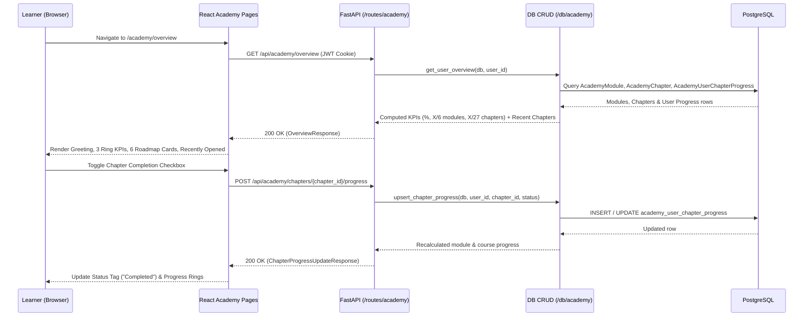
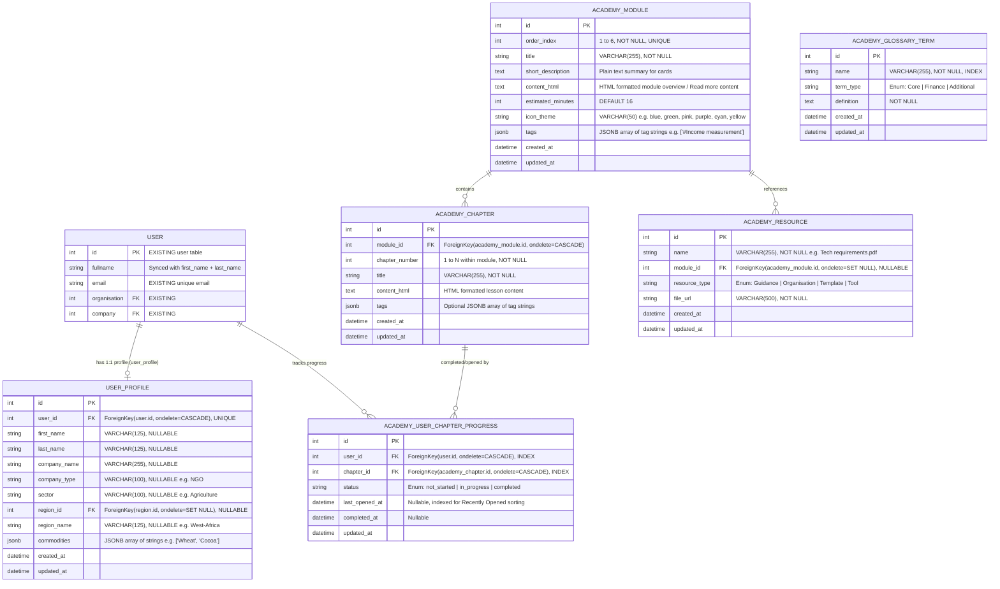

# Living Income Academy - Implementation Plan

> **Template Adaptation & Path Standard**:
> - **Project-Root-Relative Paths (#6)**: Always use paths relative to workspace root (e.g., `/backend/models/academy/...`, `/backend/routes/academy/...`).
> - **Repo Structure Alignment**: Mirrors the modular separation used by `procurement_library_v2` across `/backend/models/academy/`, `/backend/db/academy/`, `/backend/routes/academy/`, and `/backend/seeder/academy.py`.

## Overview
The **Living Income Academy** is an interactive, self-paced learning and resource hub integrated into the IDH Income Driver Calculator (IDC) platform. It guides corporate sustainability leads, procurement managers, sector leads, and NGO practitioners through the **6 process modules of the IDH Living Income Roadmap**, tracks chapter-level completion and reading history, centralizes downloadable technical resources and standardized glossary terms, and allows learners to manage their organizational and commodity profile.

### 5W1H Requirements Analysis
- **Who (Personas)**:
  - **Authenticated Learner (`User`)**: Practitioners taking the IDH Living Income Roadmap course, tracking progress, browsing resources/glossary, and managing their learner profile.
  - **Note on Content Management**: Academy course modules, HTML chapter content, technical resources, and glossary terms are seeded strictly via master seed files (`/backend/seeder/academy.py` and `/backend/source/master/`). No admin CRUD endpoints or admin UI are required in this phase.
- **What (Core Scope)**:
  1. **Shared Academy Shell**: Left navigation sidebar (`Quick Search`, `My overview`, `Course Overview`, `Academy resources`, `Need help?` card, `Account`, `Settings`), top header with `"Academy"` nav link and user avatar (`initials`), floating `Chatbot` facilitator launcher, and footer with partner logos and the Living Income Academy disclaimer.
  2. **User Overview Page (`/academy/overview`)**: Personalized greeting (`"Good morning, [First Name]"`), `"Continue learning"` CTA button, 3 KPI progress cards with circular progress rings (`Academy progress %`, `Modules completed X/6`, `Chapters completed X of Y`), `"Your roadmap progress"` 6-card module grid with tags and progress bars, `"Recently opened"` chapters list with `"View history"` action and inline completion toggles, and bottom `"Learn more about the living income roadmap"` CTA banner.
  3. **User Account / Profile Page (`/academy/account`)**: Hero banner with large avatar initials (`KJ`), full name, email, `"Edit profile"` / `"Continue learning"` buttons, **Personal info** card (`First name`, `Last name`, `Email`), and **Additional info** card (`Company name`, `Company type`, `Sector`, `Region`, and interactive `Commodities` multi-tag selector with `"Add more +"`).
  4. **Course Overview Page (`/academy/courses`)**: `"Course Overview"` header with `"Continue learning"` CTA, search bar (`"Search modules, chapters and tags..."`), `"Browse by tag"` filter chips (`All`, `#Income measurement`, `#Income gap`, `#Benchmark`, `#Due diligence`, `#Gender`, `#Procurement`), course summary with `"Read more"` (rendering HTML module/course content), and a collapsible 6-module accordion listing each module's completion %, status pill (`Completed`, `In progress`, `Not started`), estimated time (`16 minutes to complete`), and expandable chapter rows with status tags and completion check toggles.
  5. **Academy Resources — Resources Tab (`/academy/resources?tab=resources`)**: `"Technical Resources & Glossary"` header, segmented toggle (`Resources` | `Glossary`), table action icons (`Sort`, `Filter`, `Search`), and a table with columns: `Name` (with document icon), `Module`, `Type` tag (`Guidance`, `Organisation`, `Template`, `Tool`), and `Actions` (download/external link).
  6. **Academy Resources — Glossary Tab (`/academy/resources?tab=glossary`)**: Segmented toggle active on `Glossary`, table action icons (`Sort`, `Filter`, `Search`), and a table with columns: `Name` (bold term), `Type` (`Core`, `Finance`, `Additional`), and `Definition`.
- **Where (System Location)**:
  - **Backend (Dedicated `academy` namespace mirroring `procurement_library_v2`)**:
    - `/backend/models/user_profile.py` (1-to-1 `user_profile` extension linked to the existing `user` table in `/backend/models/user.py`)
    - `/backend/models/academy/` (`__init__.py`, `academy_models.py`, `academy_schemas.py`)
    - `/backend/db/academy/` (`__init__.py`, `crud_course.py`, `crud_resource.py`, `crud_profile.py`)
    - `/backend/routes/academy/` (`__init__.py`, `course.py`, `resource.py`, `profile.py`)
    - `/backend/seeder/academy.py` + master CSV/HTML seed files in `/backend/source/master/`
    - `/backend/alembic/versions/` (Alembic schema migration)
  - **Frontend**:
    - `/frontend/src/pages/academy/` (Pages, shared layout, components, hooks, and SCSS modules)
    - `/frontend/src/App.js` and `/frontend/src/components/route/paths.js`
- **When**: Accessed when an authenticated user navigates to `"Academy"` from the global top navbar or footer.
- **Why**: Practitioners need structured, self-paced guidance on closing the living income gap with progress tracking across the 6 IDH Living Income Roadmap modules and centralized access to technical resources and terminology.
- **How**: FastAPI routers under `/api/academy` backed by PostgreSQL tables (seeded with HTML content for modules/chapters, resources, and glossary terms), consumed by a React + Ant Design frontend.

---

## User Stories

### Epic 1: Shared Academy Layout & Navigation
- **US-01 (Academy Shell & Navigation)**: As a Learner, I want a dedicated Academy sidebar (`My overview`, `Course Overview`, `Academy resources`, `Account`, `Settings`), a `Quick Search` input, a `Need help?` support card, and a floating Facilitator Chatbot button so that I can seamlessly switch between learning views and get support at any time.

### Epic 2: Learner Dashboard (`My overview`)
- **US-02 (Progress KPIs & Continue Learning)**: As a Learner, I want to see a personalized time-of-day greeting, a `"Continue learning"` button that resumes my last active chapter, and 3 summary metric cards (`Academy progress %`, `Modules completed`, `Chapters completed`) so that I immediately understand my overall completion status.
- **US-03 (Roadmap Progress Grid)**: As a Learner, I want to view the 6 modules of the IDH Living Income Roadmap as cards showing module number, status pill (`Completed`, `In progress`, `Not started`), title, description, topic tags, and a progress bar, with a `"Full course overview"` button and per-card navigation arrows.
- **US-04 (Recently Opened Chapters & Quick Completion)**: As a Learner, I want to see my 3 most recently opened chapters on my overview dashboard, toggle their completion checkbox directly, or click `"View history"` to see my broader reading history.

### Epic 3: Course Overview & Curriculum Discovery (`Course Overview`)
- **US-05 (Module & Chapter Search and Tag Filtering)**: As a Learner, I want to search modules and chapters by keyword and filter them using topic tag chips (`All`, `#Income measurement`, `#Income gap`, `#Benchmark`, `#Due diligence`, `#Gender`, `#Procurement`) so that I can quickly find guidance relevant to my supply chain challenges.
- **US-06 (Interactive Module Accordions, HTML Content & Chapter Tracking)**: As a Learner, I want to expand or collapse each of the 6 course modules to view its estimated completion time, module progress bar, HTML-formatted content/summary, and ordered list of chapters, and click a chapter to open it or toggle its completion radio/check status.

### Epic 4: Technical Resources & Glossary (`Academy resources`)
- **US-07 (Technical Resources Directory)**: As a Learner, I want to view all downloadable files and tools referenced across the modules in a structured `Resources` table (`Name`, `Module`, `Type` badge: `Guidance`, `Organisation`, `Template`, `Tool`, and `Actions`), and search, filter, or sort the list.
- **US-08 (Living Income Glossary)**: As a Learner, I want to switch to the `Glossary` view using the segmented control to browse, search, filter by type (`Core`, `Finance`, `Additional`), and sort standardized living income definitions (`Name`, `Type`, `Definition`).

### Epic 5: Learner Account & Profile (`Account`)
- **US-09 (Personal & Additional Profile Management)**: As a Learner, I want to view and edit my personal details (`First name`, `Last name`, `Email`) and organizational context (`Company name`, `Company type`, `Sector`, `Region`, and associated `Commodities` tags with `"Add more +"`) so that my Academy profile reflects my role and commodity focus.

---

## Architecture Overview

1. **Database Seeding (`seed_master.sh` → `python -m seeder.academy`)** → Reads master CSV/JSON/HTML seed files from `/backend/source/master/` (`academy_modules.csv`, `academy_chapters.csv`, `academy_resources.csv`, `academy_glossary.csv`) and idempotently populates the Academy tables, storing rich module/chapter content in HTML format (`content_html`).
2. **Client Request** → Authenticated user requests Academy views via Axios service functions in `/frontend/src/pages/academy/`.
3. **FastAPI Router (`/backend/routes/academy/*`)** → Validates JWT token (`decode_token`) and query/body parameters via Pydantic schemas (`/backend/models/academy/academy_schemas.py`).
4. **CRUD Layer (`/backend/db/academy/*`)** → Queries PostgreSQL via SQLAlchemy ORM, merges static module/chapter records with user-specific `academy_user_chapter_progress` rows, and computes module/course completion percentages.
5. **Frontend Rendering (`/frontend/src/pages/academy/*`)** → Hydrates React state, renders sanitized HTML content (`dompurify` where applicable), and updates progress optimistically or on API confirmation.



---

## 1. Backend Implementation

### 1.1 Dedicated Backend Directory Structure
Following the exact pattern of `procurement_library_v2`, while reusing the existing `user` table (`/backend/models/user.py`) and extending it with `/backend/models/user_profile.py` (`user_profile` table):
```text
backend/
├── models/
│   ├── user.py                    # [EXISTING] Reused for authentication, email, fullname, role, company, organisation
│   ├── user_profile.py            # [NEW] 1-to-1 user_profile table linked to user.id
│   └── academy/
│       ├── __init__.py
│       ├── academy_models.py      # SQLAlchemy ORM entities for Academy (modules, chapters, progress, resources, glossary)
│       └── academy_schemas.py     # Pydantic v2 request/response schemas
├── db/
│   └── academy/
│       ├── __init__.py
│       ├── crud_course.py         # Overview, modules, chapters, progress & history queries
│       ├── crud_resource.py       # Resources & glossary filtering, sorting, search
│       └── crud_profile.py        # Learner profile get & update (user + user_profile)
├── routes/
│   └── academy/
│       ├── __init__.py
│       ├── course.py              # APIRouter(prefix="/academy", tags=["Academy - Course"])
│       ├── resource.py            # APIRouter(prefix="/academy", tags=["Academy - Resources & Glossary"])
│       └── profile.py             # APIRouter(prefix="/academy", tags=["Academy - Profile"])
├── seeder/
│   └── academy.py                 # Seeder script invoked by seed_master.sh
└── source/
    └── master/
        ├── academy_modules.csv    # 6 Roadmap modules + HTML descriptions/content
        ├── academy_chapters.csv   # 27 chapters + HTML content
        ├── academy_resources.csv  # Technical resources metadata
        └── academy_glossary.csv   # Glossary terms & definitions
```

### 1.2 Database Models
**Files**: `/backend/models/user.py` (existing), `/backend/models/user_profile.py`, and `/backend/models/academy/academy_models.py`

> **User & Profile Design**:
> - **Reuse Existing `user` Table**: No new user table is created. Authentication, `email`, `fullname`, `organisation`, and `company` continue to live in the existing `user` table (`/backend/models/user.py`).
> - **`user_profile` Table (`UserProfile`)**: Extending user attributes (`first_name`, `last_name`, `company_name`, `company_type`, `sector`, `region_id`, `region_name`, `commodities`) are stored in a general-purpose `user_profile` table with a 1-to-1 `user_id` foreign key to `user.id`.



### 1.3 Database Migration & Seeding
**File**: `/backend/alembic/versions/[revision]_create_academy_and_user_profile_tables.py`
- Reuses the existing `user` table and creates `user_profile` (1-to-1 with `user.id`), `academy_module`, `academy_chapter`, `academy_user_chapter_progress` (with `UniqueConstraint('user_id', 'chapter_id', name='uq_academy_user_chapter')`), `academy_resource`, and `academy_glossary_term`.
- **File**: `/backend/seeder/academy.py` (added to `/backend/seed_master.sh`):
  - Truncates and seeds `academy_module`, `academy_chapter`, `academy_resource`, and `academy_glossary_term` from `/backend/source/master/academy_*.csv`.
  - Module and chapter rich content is stored in `content_html` (HTML format).

### 1.4 API Routers
**Files**: `/backend/routes/academy/course.py`, `/backend/routes/academy/resource.py`, `/backend/routes/academy/profile.py`

#### `GET /academy/overview`
- Fetches personalized learner dashboard metrics, 6 module progress cards, and top 3 recently opened chapters.
- **Response Payload**:
  ```json
  {
    "greeting_name": "Kole",
    "continue_chapter_id": 2,
    "metrics": {
      "academy_progress_pct": 35,
      "modules_completed": 2,
      "total_modules": 6,
      "modules_completed_pct": 22,
      "chapters_completed": 6,
      "total_chapters": 27,
      "chapters_completed_pct": 22
    },
    "modules": [
      {
        "id": 1,
        "order_index": 1,
        "title": "The concept of living income",
        "short_description": "Establish a solid foundation to act on living income...",
        "icon_theme": "blue",
        "tags": ["#Income measurement", "#Income gap"],
        "progress_pct": 100,
        "status": "Completed"
      }
    ],
    "recently_opened": [
      {
        "chapter_id": 1,
        "module_id": 1,
        "chapter_number": 1,
        "title": "Why living income matters to farmers and companies",
        "status": "In progress",
        "last_opened_at": "2026-11-04T10:00:00"
      }
    ]
  }
  ```

#### `GET /academy/modules`
- Lists all 6 modules with their HTML content (`content_html`), nested chapters, and user-specific progress. Supports `?search=` (matches module title, description, chapter title, or tags) and `?tag=` (e.g., `#Income measurement`).
- **Response Payload**:
  ```json
  {
    "total_modules": 6,
    "course_summary_html": "<p>Lorem ipsum dolor sit amet...</p>",
    "available_tags": ["All", "#Income measurement", "#Income gap", "#Benchmark", "#Due diligence", "#Gender", "#Procurement"],
    "modules": [
      {
        "id": 2,
        "order_index": 2,
        "title": "Measuring & Analysis",
        "short_description": "Use recognised standards to identify credible living income benchmarks...",
        "content_html": "<p>Detailed module HTML overview...</p>",
        "estimated_minutes": 16,
        "progress_pct": 20,
        "status": "In progress",
        "tags": ["#Income measurement", "#Income gap"],
        "chapters": [
          {
            "id": 6,
            "chapter_number": 1,
            "title": "Why living income matters to farmers and companies",
            "content_html": "<div><h2>Chapter 1</h2><p>HTML lesson content...</p></div>",
            "status": "Completed"
          }
        ]
      }
    ]
  }
  ```

#### `POST /academy/chapters/{chapter_id}/progress`
- Updates a learner's chapter progress status (`not_started`, `in_progress`, `completed`) and optionally records `last_opened_at`.
- **Request Payload**:
  ```json
  {
    "status": "completed",
    "mark_opened": true
  }
  ```

#### `GET /academy/history`
- Returns paginated list of chapters opened by the user (`last_opened_at IS NOT NULL`) ordered by `last_opened_at DESC` for the `"View history"` action.

#### `GET /academy/resources`
- Returns technical resources with filtering and sorting (`?search=&resource_type=&module_id=&sort_by=name&sort_order=asc`).
- **Response Payload**:
  ```json
  {
    "total": 8,
    "data": [
      {
        "id": 1,
        "name": "Tech requirements.pdf",
        "module_id": 1,
        "module_label": "Module 1",
        "resource_type": "Guidance",
        "file_url": "/assets/academy/tech_requirements.pdf"
      }
    ]
  }
  ```

#### `GET /academy/glossary`
- Returns glossary terms with filtering and sorting (`?search=&term_type=&sort_by=name&sort_order=asc`).
- **Response Payload**:
  ```json
  {
    "total": 8,
    "data": [
      {
        "id": 1,
        "name": "Actual income",
        "term_type": "Core",
        "definition": "Total household income from all sources over a year, including crop sales, other farm income, off-farm work and transfers."
      }
    ]
  }
  ```

#### `GET /user/me` (Enhanced Core User Endpoint)
- **File**: `/backend/routes/user.py` & `/backend/models/user.py`
- Delivers the learner's extended `user_profile` dictionary alongside existing core user details (`email`, `fullname`, `role`, etc.) so the frontend can immediately hydrate user state upon login:
  ```json
  {
    "id": 1,
    "email": "kole@untitledui.com",
    "fullname": "Kole Jain",
    "role": "user",
    "user_profile": {
      "first_name": "Kole",
      "last_name": "Jain",
      "company_name": "Unicef",
      "company_type": "NGO",
      "sector": "Agriculture",
      "region_id": 4,
      "region_name": "West-Africa",
      "commodities": ["Wheat", "Corn", "Grain", "Cocoa", "Sugar", "Cane", "Cotton", "Rice"]
    }
  }
  ```

#### `GET /academy/profile` & `PUT /academy/profile`
- Retrieves or updates the authenticated user's Personal Info (`first_name`, `last_name`, `email`) and Additional Info (`company_name`, `company_type`, `sector`, `region_id`, `region_name`, `commodities`). Updating `first_name` / `last_name` synchronizes `user.fullname`.

---

## 2. Frontend Implementation

### 2.1 State Management & Service Layer
**Files**:
- `/frontend/src/pages/academy/services/academyService.js`: Wraps Axios calls (`api.get`, `api.post`, `api.put`) for all `/academy/*` endpoints.
- `/frontend/src/pages/academy/store/academyStore.js` (or Pullstate `AcademyState`): Manages shared Academy progress state, active filters, and user profile cache.

### 2.2 Components & UI Structure
**Directory**: `/frontend/src/pages/academy/`
```text
frontend/src/pages/academy/
├── index.js
├── AcademyLayout.js               # Shared sidebar, Quick Search, Need help card, Chatbot button, Footer
├── AcademyOverviewPage.js         # Page 1: User Overview (12320:15548)
├── AcademyAccountPage.js          # Page 2: User Account / Profile (12029:57236)
├── AcademyCourseOverviewPage.js   # Page 3: Course Overview (12338:25909)
├── AcademyResourcesPage.js        # Pages 4 & 5: Technical Resources & Glossary (12327:22288 & 12327:24333)
├── components/
│   ├── AcademySidebar.js
│   ├── ProgressMetricCard.js      # KPI card with circular SVG progress ring
│   ├── RoadmapModuleCard.js       # 6-module grid card with status pill, tags, progress bar
│   ├── ChapterRowCard.js          # Chapter card with number badge, status pill, completion checkbox
│   ├── ModuleAccordion.js         # Collapsible module panel for Course Overview
│   ├── ResourcesTable.js          # Resources table with type badges & actions
│   ├── GlossaryTable.js           # Glossary table with term, type & definition
│   └── CommodityTagSelector.js    # Removable commodity tags + "Add more +" dropdown
└── styles/
    └── academy.scss               # Scoped styling matching Figma tokens
```

#### Wireframe Layout
```text
+-----------------------------------------------------------------------------------+
| [IDH Logo | Toolkit Towards Better Incomes]   IDC | PL | CII | Academy | [Avatar] |
+--------------------+--------------------------------------------------------------+
| [Quick Search   ]  |  Good morning, Kole                      [Continue learning] |
|                    |  +------------------+ +------------------+ +---------------+ |
| - My overview      |  | Academy progress | | Modules compl.   | | Chapters comp.| |
| - Course Overview  |  | 35%        (35%) | | 2/6        (22%) | | 6 of 27 (22%) | |
| - Academy resources|  +------------------+ +------------------+ +---------------+ |
|                    |                                                              |
| +----------------+ |  Your roadmap progress                [Full course overview] |
| | Need help?     | |  [Module 1: Completed] [Module 2: In prog] [Module 3: Not..] |
| | [  Get help  ] | |  [Module 4: Not start] [Module 5: Not st.] [Module 6: Not..] |
| +----------------+ |                                                              |
| - Account          |  Recently opened                              [View history] |
| - Settings         |  [01 Why living income matters...          [In progress] ( )] |
+--------------------+--------------------------------------------------------------+
| [Partner Logos: IDH | Sustainable Food Lab | Living Income CoP | RVO]             |
| [Dark Blue Footer (#002744): Links & Living Income Academy Disclaimer]            |
+-----------------------------------------------------------------------------------+
```

---

## 3. Acceptance Criteria (UAC & TAC)

### 3.1 User Acceptance Criteria (UAC)
- [ ] **UAC-1 (Shared Layout & Navigation)**: Left sidebar renders `Quick Search`, `My overview`, `Course Overview`, `Academy resources`, `Need help?` card (`Get help`), `Account`, and `Settings`. Top navbar highlights `Academy` and shows user avatar initials. Footer shows partner logos and the Living Income Academy disclaimer.
- [ ] **UAC-2 (User Overview — `12320:15548`)**: Displays dynamic greeting, `"Continue learning"` button, 3 KPI cards with circular progress rings, 6-module `"Your roadmap progress"` grid with status pills and `#tags`, `"Recently opened"` chapters (up to 3) with completion checkboxes and `"View history"`, and bottom `"Learn more about the living income roadmap"` CTA banner.
- [ ] **UAC-3 (User Account / Profile — `12029:57236`)**: Displays hero banner with `160px` avatar initials, full name, email, `"Edit profile"`, and `"Continue learning"`. Allows viewing and saving **Personal info** (`First name`, `Last name`, `Email`) and **Additional info** (`Company name`, `Company type`, `Sector`, `Region`, and removable `Commodities` tags with `"Add more +"`).
- [ ] **UAC-4 (Course Overview — `12338:25909`)**: Displays search bar (`"Search modules, chapters and tags..."`), `"Browse by tag"` filter chips (`All`, `#Income measurement`, `#Income gap`, `#Benchmark`, `#Due diligence`, `#Gender`, `#Procurement`), expandable HTML course summary (`"Read more"`), and 6 collapsible module accordions with chapter lists, status tags, and completion checkboxes.
- [ ] **UAC-5 (Resources & Glossary — `12327:22288` & `12327:24333`)**: Segmented control switches cleanly between `Resources` (`Name`, `Module`, `Type` tag, `Actions`) and `Glossary` (`Name`, `Type`, `Definition`), with working `Sort`, `Filter`, and `Search` toolbar controls.

### 3.2 Technical Acceptance Criteria (TAC)
- [ ] **TAC-1 (Dedicated Backend Folder Structure)**: All Academy backend code is isolated in `/backend/models/academy/`, `/backend/db/academy/`, `/backend/routes/academy/`, and `/backend/seeder/academy.py`, matching the `procurement_library_v2` architecture.
- [ ] **TAC-2 (HTML Content & Master Seeding)**: Course/module/chapter content is stored as HTML (`content_html`) and seeded via `./dc.sh exec backend python -m seeder.academy` (and hooked into `seed_master.sh`). Frontend sanitizes rendered HTML via `dompurify` (`[SEC]`).
- [ ] **TAC-3 (Database & Migration Integrity)**: Reuses the existing `user` table and creates `user_profile` (with `UNIQUE(user_id)` foreign key to `user.id`) plus the 5 Academy tables (`academy_module`, `academy_chapter`, `academy_user_chapter_progress`, `academy_resource`, `academy_glossary_term`) with foreign key cascades and `UniqueConstraint('user_id', 'chapter_id')`.
- [ ] **TAC-4 (Authentication & Scope Security)**: All `/academy/*` endpoints verify JWT authentication (`decode_token`) and strictly scope progress/profile reads and writes to the authenticated user's `id`.
- [ ] **TAC-5 (Quality & Coverage Gates)**:
  - `./dc.sh exec backend flake8` passes with 0 errors.
  - `./dc.sh exec backend pytest -v` passes with **≥80% test coverage** on new Academy modules.
  - `./dc.sh exec frontend yarn lint` and `./dc.sh exec frontend yarn test:ci` pass with 0 errors.

---

## 4. Verification & Testing

### 4.1 Automated Tests
- **Backend Linter & Unit/Integration Tests**:
  ```bash
  ./dc.sh exec backend flake8
  ./dc.sh exec backend pytest backend/tests/test_academy.py -v
  ```
- **Frontend Linter & Unit Tests**:
  ```bash
  ./dc.sh exec frontend yarn lint
  ./dc.sh exec frontend yarn test:ci
  ```

### 4.2 Manual Verification Steps
1. Run `./dc.sh exec backend alembic upgrade head` and `./dc.sh exec backend python -m seeder.academy` to seed the 6 modules, 27 chapters, resources, and glossary terms.
2. Log in to the frontend (`http://localhost:3000`) and click **Academy** in the top navigation bar.
3. Verify **My overview** displays the 3 KPI ring cards, 6 roadmap module cards, and recently opened chapters; toggle a chapter's completion check and verify the KPI rings and module progress bar update.
4. Navigate to **Course Overview**, test keyword search and `#tag` chip filtering, expand Module 2 accordion, and verify chapter rows and HTML summary rendering.
5. Navigate to **Academy resources**, toggle between `Resources` and `Glossary`, and test `Sort`, `Filter`, and `Search`.
6. Navigate to **Account**, click `Edit profile`, update personal/additional info and commodity tags (`Add more +` / `×`), save, and reload to verify persistence.

---

## 5. Task Breakdown & Estimation (1 Developer @ 7 Effective Hours/Day) ⏱️

- **Estimation Basis**: Standard 1-developer velocity with **7 effective coding hours per day**.
- **Task Sizing Rule**: Every task is scoped to a **maximum of 6.0 hours** (including a **1.0-hour buffer** per task).
- **Dependencies**: Existing `user`, `region`, and `commodity` master tables.

### 5.1 Backend Development Tasks (`BE-01` – `BE-05`)

| Task ID | Backend Component & Description | Dev | Testing | QA & Review | Buffer | Total Est. | Days (7h/d) | Priority |
| :--- | :--- | :---: | :---: | :---: | :---: | :---: | :---: | :--- |
| **BE-01** | **DB Models, Schemas & Alembic Migration**: Create `/backend/models/user_profile.py` (`user_profile` linked 1:1 to existing `user` table), `/backend/models/academy/` (`academy_models.py`, `academy_schemas.py`), and Alembic migration for all 6 tables. | 2.5h | 1.0h | 0.5h | 1.0h | **5.0h** | 0.71d | Must Have |
| **BE-02** | **Master CSVs (HTML Content) & Academy Seeder**: Create `/backend/source/master/academy_*.csv` (6 modules, 27 HTML chapters, resources, glossary terms), implement idempotent `/backend/seeder/academy.py`, and hook into `seed_master.sh`. | 2.5h | 1.0h | 0.5h | 1.0h | **5.0h** | 0.71d | Must Have |
| **BE-03** | **Course Overview, Progress & History API**: Implement `/backend/db/academy/crud_course.py` and `/backend/routes/academy/course.py` (`GET /academy/overview`, `GET /academy/modules` with search/tag filter, `POST /academy/chapters/{id}/progress`, `GET /academy/history`). | 3.0h | 1.5h | 0.5h | 1.0h | **6.0h** | 0.86d | Must Have |
| **BE-04** | **Technical Resources & Glossary API**: Implement `/backend/db/academy/crud_resource.py` and `/backend/routes/academy/resource.py` (`GET /academy/resources` and `GET /academy/glossary` with search, filter, and sort). | 2.0h | 1.0h | 0.5h | 1.0h | **4.5h** | 0.64d | Must Have |
| **BE-05** | **User Profile Delivery & Management API (`user` + `user_profile`)**: Update `GET /user/me` in `/backend/routes/user.py` to deliver `user_profile`; implement `/backend/routes/academy/profile.py` (`GET/PUT /academy/profile` syncing `user.fullname`, `user.company`, and `commodities` JSONB tags); update `/frontend/src/store/user.js`. | 2.5h | 1.0h | 0.5h | 1.0h | **5.0h** | 0.71d | Must Have |
| **BE Subtotal** | **Backend Group (5 Tasks)** | **12.5h** | **5.5h** | **2.5h** | **5.0h** | **25.5h** | **3.64d** | — |

#### Task Details: Backend Workstream

##### `BE-01`: DB Models, Schemas & Alembic Migration
- **UAC**:
  - [ ] The database securely supports persistent storage of user profiles, Academy course curriculum, progress tracking, technical resources, and glossary entries.
- **TAC**:
  - [ ] `backend/models/user_profile.py` defines `UserProfile` with a 1:1 relation to `user.id` (`ForeignKey("user.id", ondelete="CASCADE")`, `unique=True`), columns `first_name`, `last_name`, `company_name`, `company_type`, `sector`, `region_id`, `region_name`, and `commodities` (`JSONB`).
  - [ ] `backend/models/academy/academy_models.py` defines `AcademyModule`, `AcademyChapter`, `AcademyUserChapterProgress`, `AcademyResource`, and `AcademyGlossaryTerm` with cascades and `UniqueConstraint('user_id', 'chapter_id')`.
  - [ ] `backend/models/academy/academy_schemas.py` defines Pydantic v2 schemas for all payloads with field validations.
  - [ ] Alembic migration applies cleanly (`alembic upgrade head`) and rolls back without error (`alembic downgrade -1`).
  - [ ] Linter pass: `./dc.sh exec backend flake8` returns 0 errors.

##### `BE-02`: Master CSVs (HTML Content) & Academy Seeder
- **UAC**:
  - [ ] The platform is pre-loaded with official IDH Living Income Roadmap content (6 modules, 27 chapters with rich HTML content, technical resources, and glossary terms).
- **TAC**:
  - [ ] Master seed CSVs created under `backend/source/master/`: `academy_modules.csv`, `academy_chapters.csv`, `academy_resources.csv`, and `academy_glossary.csv`.
  - [ ] Chapters and modules contain sanitized, valid HTML in `content_html`.
  - [ ] `backend/seeder/academy.py` runs idempotently without duplicating rows or disrupting existing progress records.
  - [ ] `backend/seed_master.sh` includes `python -m seeder.academy`.
  - [ ] Unit test verifies database row counts match expected master CSV counts after seeding.

##### `BE-03`: Course Overview, Progress & History API
- **UAC**:
  - [ ] Learner can fetch dashboard metrics (`continue_chapter_id`, KPI ring percentages, module progress cards, and 3 recently opened chapters).
  - [ ] Learner can retrieve all 6 modules and chapters with keyword search and tag filtering.
  - [ ] Learner can update chapter progress (`not_started`, `in_progress`, `completed`), updating `last_opened_at` and recalculating progress dynamically.
  - [ ] Learner can fetch their historical sequence of visited chapters.
- **TAC**:
  - [ ] Endpoints implemented in `backend/routes/academy/course.py` and `backend/db/academy/crud_course.py`:
    - `GET /academy/overview`
    - `GET /academy/modules` (supports `?search=` and `?tag=`)
    - `POST /academy/chapters/{chapter_id}/progress` (upserts progress, updates `last_opened_at` / `completed_at`)
    - `GET /academy/history` (paginated, ordered by `last_opened_at DESC`)
  - [ ] Endpoints require JWT authentication (`Depends(get_current_user_required)`) and scope data strictly to `current_user.id`.
  - [ ] Test suite in `backend/tests/test_academy_course.py` reaches ≥80% test coverage.

##### `BE-04`: Technical Resources & Glossary API
- **UAC**:
  - [ ] Learner can list and search downloadable technical resources filtered by resource type (`Guidance`, `Organisation`, `Template`, `Tool`) or module.
  - [ ] Learner can list and search glossary terms filtered by term type (`Core`, `Finance`, `Additional`).
  - [ ] Learner can sort resources and glossary entries by name or date.
- **TAC**:
  - [ ] Endpoints implemented in `backend/routes/academy/resource.py` and `backend/db/academy/crud_resource.py`:
    - `GET /academy/resources` (supports `?search=`, `?resource_type=`, `?module_id=`, `?sort_by=`, `?sort_order=`)
    - `GET /academy/glossary` (supports `?search=`, `?term_type=`, `?sort_by=`, `?sort_order=`)
  - [ ] Search query executes case-insensitive matching (`ilike`) on name, definition, and module title.
  - [ ] Enforces enum validation for `resource_type` and `term_type`.
  - [ ] Unit tests in `backend/tests/test_academy_resource.py` reach ≥80% test coverage.

##### `BE-05`: User Profile Delivery & Management API (`user` + `user_profile`)
- **UAC**:
  - [ ] Learner's profile details (`first_name`, `last_name`, company details, sector, region, and commodities) are automatically delivered upon login with account information (`GET /user/me`) and populated in global user state.
  - [ ] Learner can view personal information and additional organization/sector/region/commodities profile details via Academy endpoints.
  - [ ] Learner can update profile info, with first and last name updates automatically updating the account display name (`user.fullname`) and company name (`user.company`).
- **TAC**:
  - [ ] `UserInfo` TypedDict in `backend/models/user.py` and `to_user_info` method updated to include `user_profile: Optional[UserProfileDict]` (delivering `first_name`, `last_name`, `company_name`, `company_type`, `sector`, `region_id`, `region_name`, and `commodities`).
  - [ ] `GET /user/me` in `backend/routes/user.py` verified to return the extended `user_profile`.
  - [ ] Endpoints implemented in `backend/routes/academy/profile.py` and `backend/db/academy/crud_profile.py`:
    - `GET /academy/profile` (fetches joint `user` and `user_profile` record; creates default `user_profile` if none exists)
    - `PUT /academy/profile` (validates schema via Pydantic; updates `user_profile` and syncs `user.fullname` and `user.company`)
  - [ ] `frontend/src/store/user.js` default state updated with `profile` object, and `frontend/src/App.js` updated to hydrate `UserState.profile` on login.
  - [ ] Commodities payload validated as JSONB array of strings.
  - [ ] Strictly scoped to authenticated `current_user.id` (users cannot view or edit profiles belonging to other users).
  - [ ] Unit tests in `backend/tests/test_academy_profile.py` and `backend/tests/test_user.py` reach ≥80% test coverage.

### 5.2 Frontend Development Tasks (`FE-01` – `FE-07`)

| Task ID | Frontend Component & Description | Dev | Testing | QA & Review | Buffer | Total Est. | Days (7h/d) | Priority |
| :--- | :--- | :---: | :---: | :---: | :---: | :---: | :---: | :--- |
| **FE-01** | **Academy Layout Shell, Sidebar, Footer & Routing**: Build `AcademyLayout.js`, `AcademySidebar.js` (`Quick Search`, nav items, `Need help?` card), disclaimer footer, `ChatbotFloatButton.js`, API service (`/services/academy.js`), and routes in `paths.js` & `App.js`. | 3.0h | 1.0h | 0.5h | 1.0h | **5.5h** | 0.79d | Must Have |
| **FE-02** | **User Overview Page — Greeting, KPI Rings & Roadmap Grid**: Build `AcademyOverviewPage.js` greeting bar (`"Continue learning"`), 3 `ProgressMetricCard.js` circular ring cards, and the 6-card `RoadmapModuleCard.js` grid with status pills, `#tags`, and progress bars. | 3.0h | 1.0h | 0.5h | 1.0h | **5.5h** | 0.79d | Must Have |
| **FE-03** | **User Overview Page — Recently Opened, History Modal & CTA Banner**: Build `RecentlyOpenedChapterCard.js` (top 3 chapters with inline completion check toggle), `"View history"` modal, and bottom `"Learn more about the living income roadmap"` CTA banner. | 2.5h | 1.0h | 0.5h | 1.0h | **5.0h** | 0.71d | Must Have |
| **FE-04** | **Course Overview Page — Search, Tag Chips & HTML Summary**: Build `CourseOverviewPage.js` header, keyword search bar, `"Browse by tag"` chip bar (`All`, `#Income measurement`, etc.), and expandable `"Read more"` HTML course summary (sanitized via `dompurify`). | 2.5h | 1.0h | 0.5h | 1.0h | **5.0h** | 0.71d | Must Have |
| **FE-05** | **Course Overview Page — Module Accordions & Chapter Viewer**: Build collapsible `ModuleAccordion.js` (6 modules with progress bar, status tag, `"Go →"`) and expandable chapter rows (`01`..`05`) with completion toggles and HTML chapter content viewer. | 3.0h | 1.5h | 0.5h | 1.0h | **6.0h** | 0.86d | Must Have |
| **FE-06** | **Academy Resources & Glossary Page (`Resources` & `Glossary` Tabs)**: Build `AcademyResourcesPage.js` segmented toggle (`Resources` \| `Glossary`), `Sort`/`Filter`/`Search` toolbar controls, `ResourcesTable.js`, and `GlossaryTable.js`. | 3.0h | 1.5h | 0.5h | 1.0h | **6.0h** | 0.86d | Must Have |
| **FE-07** | **User Account / Profile Page (`Account`)**: Build `AcademyAccountPage.js` hero header (`160px` avatar initials, `Edit profile`), `Personal info` form card, and `Additional info` form card with interactive `CommodityTagSelector.js` (`×` remove & `"Add more +"`). | 3.0h | 1.5h | 0.5h | 1.0h | **6.0h** | 0.86d | Must Have |
| **FE Subtotal** | **Frontend Group (7 Tasks)** | **20.0h** | **8.5h** | **3.5h** | **7.0h** | **39.0h** | **5.57d** | — |

#### Task Details: Frontend Workstream

##### `FE-01`: Academy Layout Shell, Sidebar, Footer & Routing
- **UAC**:
  - [ ] Learner navigates via a dedicated Academy sidebar (`Quick Search`, `My overview`, `Course Overview`, `Academy resources`, `Need help?` card, `Account`, `Settings`).
  - [ ] Top navbar highlights `Academy` and shows user initials avatar.
  - [ ] Footer displays IDH partner logos and the Living Income Academy disclaimer.
  - [ ] Floating chatbot facilitator button (`48x48px`) is visible in the bottom-right corner.
- **TAC**:
  - [ ] Components implemented under `frontend/src/pages/academy/components/`: `AcademyLayout.js`, `AcademySidebar.js`, `AcademyFooter.js`, `ChatbotFloatButton.js`.
  - [ ] Academy routes registered in `frontend/src/components/route/paths.js` and `frontend/src/App.js` with authentication protection.
  - [ ] API service client `frontend/src/services/academy.js` configured with Axios interceptors and global error handling.
  - [ ] Layout renders responsively down to 1024px without overlapping or horizontal scrolling.
  - [ ] Unit tests for sidebar navigation and active path highlighting pass with 0 errors.

##### `FE-02`: User Overview Page — Greeting, KPI Rings & Roadmap Grid
- **UAC**:
  - [ ] Learner sees a personalized time-aware greeting ("Good morning, [Name]") and a `"Continue learning"` button.
  - [ ] Displays 3 KPI progress cards with circular progress rings: `Academy progress`, `Modules completed` (`X/6`), `Chapters completed` (`X of 27`).
  - [ ] Displays the 3x2 grid of 6 Living Income Roadmap module cards with status pills, descriptions, `#tags`, progress bars, and `"Go →"` caret button.
- **TAC**:
  - [ ] Components: `AcademyOverviewPage.js`, `ProgressMetricCard.js`, `RoadmapModuleCard.js`.
  - [ ] Circular progress rings rendered using Ant Design `Progress type="circle"` or custom SVG adhering to brand color tokens.
  - [ ] Module grid styled with CSS Grid (`grid-template-columns: repeat(3, 1fr)`) with responsive wrapping for tablet/mobile viewports.
  - [ ] Graceful loading skeleton states and zero-progress edge case handling.
  - [ ] Unit tests verify KPI percentage calculations, greeting format, and tag badge rendering.

##### `FE-03`: User Overview Page — Recently Opened, History Modal & CTA Banner
- **UAC**:
  - [ ] Overview page displays up to 3 recently opened chapters with chapter badges, status pills, and clickable circular completion checkboxes.
  - [ ] Toggling completion updates the checkbox state immediately, recalculates KPI ring values, and persists progress to the backend.
  - [ ] Clicking `"View history"` opens a modal displaying the learner's complete reading history.
  - [ ] Bottom banner displays `"Learn more about the living income roadmap"` with `"Learn more"` action.
- **TAC**:
  - [ ] Components: `RecentlyOpenedChapterCard.js`, `ChapterHistoryModal.js`, `RoadmapCtaBanner.js`.
  - [ ] Optimistic state update on completion checkbox toggle with automatic rollback if API call fails.
  - [ ] History modal supports scrollable or paginated list of historically visited chapters.
  - [ ] Unit tests cover checkbox toggle interactions and modal open/close transitions.

##### `FE-04`: Course Overview Page — Search, Tag Chips & HTML Summary
- **UAC**:
  - [ ] Learner can search modules, chapters, and tags using the search input bar.
  - [ ] Learner can filter curriculum using topic chips (`All`, `#Income measurement`, `#Income gap`, `#Benchmark`, etc.).
  - [ ] Course summary displays introductory overview text with an expandable `"Read more"` trigger displaying full HTML content.
- **TAC**:
  - [ ] Components: `CourseOverviewPage.js`, `CourseTagFilter.js`, `CourseSummaryBlock.js`.
  - [ ] Search input implements 300ms debouncing before triggering filtering.
  - [ ] HTML content rendered securely using `DOMPurify.sanitize()` to protect against XSS (`[SEC]`).
  - [ ] Active filter state synchronizes bidirectionally with URL query parameters (`?tag=...&search=...`).
  - [ ] Unit tests verify debounced input, tag filtering logic, and HTML sanitization.

##### `FE-05`: Course Overview Page — Module Accordions & Chapter Viewer
- **UAC**:
  - [ ] Learner can expand and collapse 6 module accordions showing title, completion time ("16 minutes to complete"), progress bar, status tag, and `"Go →"` link.
  - [ ] Expanded module displays ordered chapters (`01`, `02`, ...) with title, status pill, and completion radio/check button.
  - [ ] Clicking a chapter opens lesson content in an HTML reader view.
- **TAC**:
  - [ ] Components: `ModuleAccordion.js`, `ChapterRow.js`, `ChapterContentViewer.js`.
  - [ ] Module accordion built using customized Ant Design `Collapse` matching Figma header padding and caret icons.
  - [ ] Status badge dynamically derived from chapter progress counts (`0` = `Not started`, all = `Completed`, else = `In progress`).
  - [ ] Lesson viewer renders responsive HTML with styling for callouts, tables, and lists.
  - [ ] Unit tests verify accordion expansion, chapter selection, and status badge derivation.

##### `FE-06`: Academy Resources & Glossary Page (`Resources` & `Glossary` Tabs)
- **UAC**:
  - [ ] Learner can switch between `Resources` and `Glossary` views via segmented control.
  - [ ] In `Resources` tab: table displays `Name` (with document icon), `Module`, `Type` tag (`Guidance`, `Organisation`, `Template`, `Tool`), and `Actions` (Download / external link).
  - [ ] In `Glossary` tab: table displays `Name` (term), `Type` (`Core`, `Finance`, `Additional`), and `Definition`.
  - [ ] Learner can search, filter by type/module, and sort columns in both tables.
- **TAC**:
  - [ ] Components: `AcademyResourcesPage.js`, `ResourcesTable.js`, `GlossaryTable.js`, `ResourceToolbar.js`.
  - [ ] Segmented toggle synchronized with URL query param `?tab=resources|glossary`.
  - [ ] Table sorting and filtering handled via API parameters or client-side caching.
  - [ ] Download action triggers secure direct download or file blob streaming.
  - [ ] Unit tests verify tab toggling, toolbar filtering, and table sort behavior.

##### `FE-07`: User Account / Profile Page (`Account`)
- **UAC**:
  - [ ] Hero header displays user avatar initials (`160px`), full name, email, and `"Edit profile"` / `"Continue learning"` buttons.
  - [ ] Personal info card displays `First name`, `Last name`, and `Email`.
  - [ ] Additional info card displays `Company name`, `Company type` (dropdown), `Sector` (dropdown), `Region` (dropdown), and `Commodities` tags.
  - [ ] Commodities tags can be removed with `×` and added via `"Add more +"` tag input.
  - [ ] Saving updates displays a success notification and immediately reflects updated name/avatar across the app.
- **TAC**:
  - [ ] Components: `AcademyAccountPage.js`, `AccountHeroBanner.js`, `PersonalInfoForm.js`, `AdditionalInfoForm.js`, `CommodityTagSelector.js`.
  - [ ] Form built with Ant Design `Form` with client-side validation rules.
  - [ ] `CommodityTagSelector` supports keyboard addition (Enter/Comma), deduplication, and dropdown selection from known commodities.
  - [ ] Submits payload via `PUT /academy/profile` and refreshes user context in React state if `fullname` changed.
  - [ ] Unit tests verify validation errors, tag addition/deletion, and successful submission handling.

### 5.3 Summary Rollup (1 Developer @ 7h/Day)

| Workstream | Tasks | Dev Hours | Testing Hours | QA & Review | Buffer (1h/task) | Total Hours | Working Days (7h/day) |
| :--- | :---: | :---: | :---: | :---: | :---: | :---: | :---: |
| **Backend (`BE-01` – `BE-05`)** | 5 | 12.5h | 5.5h | 2.5h | 5.0h | **25.5h** | **3.64 days** |
| **Frontend (`FE-01` – `FE-07`)** | 7 | 20.0h | 8.5h | 3.5h | 7.0h | **39.0h** | **5.57 days** |
| **GRAND TOTAL** | **12** | **32.5h** | **14.0h** | **6.0h** | **12.0h** | **64.5h** | **~9.21 days** |
