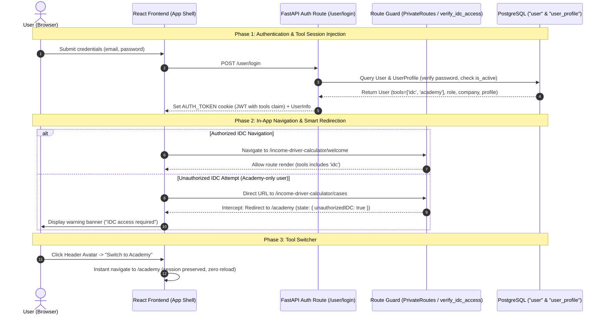

# Toolkit Login (Shared Access for IDC & Academy) - Implementation Plan

> **Template Adaptation & Path Standard**:
> - **Project-Root-Relative Paths**: All paths are relative to workspace root (`backend/...`, `frontend/...`, `docs/...`).
> - **Upstream Alignment with Spec 001**: Directly aligns with and builds upon `docs/features/001_living_income_academy_spec.md`, reusing the existing `user_profile` table (migration `413e4c18b8eb`), downstream Academy tables, and setting the migration `down_revision` to `a6b4d5e6f7a8`.

---

## Overview

The **Toolkit Login (Shared Access for Income Driver Calculator and Living Income Academy)** establishes a unified identity and access management layer across the IDH Better Income Toolkit. It allows users to authenticate once and access their authorized tools—the **Income Driver Calculator (IDC)** and the **Living Income Academy**—using a single set of credentials and a shared session cookie (`AUTH_TOKEN`).

### 5W1H Requirements Analysis

- **Who (Personas)**:
  - **Existing IDC User**: Has full access to IDC and Academy (`tools = ['idc', 'academy']`). Linked to an official IDC Company entity (`user.company` FK).
  - **Academy Self-Registered User**: Public practitioner who signs up directly for the Academy (`tools = ['academy']`). Reports their company name as free text, stored directly in `user_profile.company_name` (from Spec 001). Has no access to IDC until upgraded.
  - **IDH Admin / Super Admin**: Manages users, filters by tool access, grants IDC access to Academy users by linking an official IDC Company (`company.id`), and invites new users with automatic deduplication.
- **What (Core Scope)**:
  1. **PostgreSQL Native Array Tool Tagging**: Single array column `tools = Column(ARRAY(String), nullable=False, server_default='{}')` on `user` table. Existing users migrate to `['idc', 'academy']`. Company name for Academy accounts is stored in the already existing `user_profile.company_name` table (avoiding redundant column creation on `user`).
  2. **Unified Toolkit Login & Smart Redirection**: Branded "Better Income Toolkit Login" with public Academy registration link, query param redirection (`?redirect=...`), and fallback to `/academy` for Academy-only accounts attempting to access IDC.
  3. **Academy Public Self-Registration**: Public sign-up flow provisioning `User` and `UserProfile` records with real-time password criteria validation, company auto-suggestions, and token-based email verification.
  4. **Header Avatar Menu & Tool Switcher**: Top navigation header avatar with user initials, profile dropdown, tool switcher to navigate between IDC and Academy (`/academy`), and an informational modal for Academy users lacking IDC access.
  5. **Tool-Level Route Guarding**: Backend FastAPI dependency (`verify_idc_access`) and frontend `PrivateRoutes.js` gatekeeping to protect private IDC routes and company data from Academy-only users.
  6. **Shared User Profile Page (`/profile`)**: Centralized profile settings with password management and a dismissible reminder banner for incomplete profiles, reusing `crud_profile` and `crud_settings` from Spec 001.
  7. **Admin Access Management & Company Linkage**: Tool tags and filter in `Users.js`, "Grant IDC Access" switch in `UserForm.js` with mandatory company linkage, and automated notification emails.
  8. **Admin User Invitation Deduplication**: Detection of existing Academy accounts during invite flow returning HTTP 409 Conflict, triggering an in-app confirmation modal to link IDC access without duplicate records.
  9. **Unified Email Templates**: Aligned notification copy across invitation, registration, access grant, and password reset workflows.
- **Where (System Location)**:
  - **Backend**:
    - `backend/models/user.py` (SQLAlchemy `User` model, Pydantic DTOs: `UserInfo`, `UserDetailDict`, `UserPageDict`)
    - `backend/models/user_profile.py` (Reused 1:1 `UserProfile` entity from Spec 001)
    - `backend/alembic/versions/2026_11_10_0800-b7c8d9e0f1a2_add_user_tools_array_column.py` (Alembic migration branching from `a6b4d5e6f7a8`)
    - `backend/routes/user.py` (Auth, registration, profile, grant-idc, and invitation endpoints)
    - `backend/routes/academy/settings.py` & `backend/routes/academy/profile.py` (Reused settings and profile logic from Spec 001)
    - `backend/middleware.py` (`verify_idc_access` dependency)
    - `backend/utils/mailer.py` (`EmailBody` enum and templates)
  - **Frontend**:
    - `frontend/src/pages/login/` (`Login.js`, `Register.js`, `ResetPassword.js`, `login.scss`)
    - `frontend/src/components/layout/` (`PageLayout.js`, `layout.scss`)
    - `frontend/src/components/route/` (`PrivateRoutes.js`, `paths.js`)
    - `frontend/src/pages/profile/` (`Profile.js`, `profile.scss`)
    - `frontend/src/pages/admin/users/` (`Users.js`, `UserForm.js`, `user.scss`)
- **When**: Accessed whenever users log in, navigate between tools, register for Academy, or when administrators manage user permissions.
- **Why**: IDH is expanding from a single calculator into the "Toolkit Towards Better Incomes" featuring both IDC and the Living Income Academy. Users require a unified sign-in experience without maintaining separate accounts, while IDH requires secure boundaries so that confidential IDC supply chain data remains restricted to authorized enterprise partners.
- **How**: Shared domain session cookie (`AUTH_TOKEN`), PostgreSQL array column `tools`, role/tool authorization checks on routes/endpoints, and Ant Design v5 UI components.

---

## Alignment with Spec 001 (Living Income Academy)

In `docs/features/001_living_income_academy_spec.md`, the platform established an Alembic migration sequence and core backend services. Spec 002 directly integrates with these completed foundations:

### 1. Alembic Migration Hierarchy
Spec 001 executed 8 migrations following the **1 migration file per model** standard:
```text
3g4h5i6j7k8l (Base User Type)
└── 413e4c18b8eb (create_user_profile_table)
    └── 17ecb7685606 (create_academy_tag_table)
        └── cb28c82405a6 (create_academy_resource_table)
            └── cb29ec330c92 (create_academy_glossary_term_table)
                └── d3e1a2b3c4d5 (create_academy_module_table)
                    └── e4f2b3c4d5e6 (create_academy_chapter_table)
                        └── f5a3c4d5e6f7 (create_academy_tag_relation_table)
                            └── a6b4d5e6f7a8 (create_academy_user_chapter_progress_table) [HEAD]
                                └── [NEW: Spec 002] add_user_tools_array_column (down_revision = 'a6b4d5e6f7a8')
```

### 2. Elimination of Duplicate Columns (`user_profile.company_name`)
- Spec 001 created the `user_profile` table (`models/user_profile.py`), which includes `company_name VARCHAR(255)`, `company_type`, `sector`, `region_id`, `commodities`, `first_name`, and `last_name`.
- Spec 002 leverages `user_profile.company_name` directly for Academy learner company information. This eliminates the need to add a redundant `academy_company_text` column to the `user` table.
- **Clear Architectural Distinction**:
  - `user.company` (Foreign Key $\rightarrow$ `company.id`): Represents an official, vetted enterprise entity in the IDC database, granting access to confidential supply chain cases.
  - `user_profile.company_name` (String): Represents the self-reported organization of a public Academy learner.

### 3. Backend Service & CRUD Reuse
- `backend/db/academy/crud_profile.py`: `get_or_create_user_profile()` and `update_user_profile()` are reused when public users register and when learners update their profile details.
- `backend/routes/academy/settings.py`: Password change logic (`crud_settings.change_user_password`) is reused across the unified `/profile` workflow.
- `GET /user/me` (`backend/routes/user.py`): Already delivers `user_profile` alongside core `user` attributes.

---

## User Stories & Acceptance Criteria

### Epic 1: Database Foundation & Tool Permissions
- **US-01 (Database Tool Access Array)**: As a System Architect, I want user tool permissions stored as a native PostgreSQL array on the `user` table so that adding future tools requires zero schema migrations.
  - **UAC-01.1**: Existing users retain uninterrupted access to IDC and Academy (`tools = ['idc', 'academy']`).
  - **UAC-01.2**: New Academy users store `tools = ['academy']` and their organization name is saved to `user_profile.company_name`.
  - **TAC-01.1**: Alembic migration adds `tools = Column(ARRAY(String), nullable=False, server_default='{}')` to `user` table with `down_revision = 'a6b4d5e6f7a8'`.
  - **TAC-01.2**: Data migration initializes all existing users to `tools = '{"idc", "academy"}'`.

### Epic 2: Unified Authentication & Public Self-Registration
- **US-02 (Unified Toolkit Login)**: As a Toolkit User, I want to log in through a single branded gateway and be automatically routed to my authorized tool.
  - **UAC-02.1**: Login screen displays "Better Income Toolkit Login" with clear links to register for Academy or request IDC access.
  - **UAC-02.2**: IDC users are redirected to the IDC dashboard; Academy-only users are redirected to `/academy`.
  - **TAC-02.1**: `POST /user/login` returns JWT claims and user DTO containing `tools: List[str]`.
  - **TAC-02.2**: Frontend `Login.js` parses `tools` and handles deep link `?redirect=` safely.
- **US-03 (Academy Public Self-Registration)**: As a Public Practitioner, I want to sign up for the Living Income Academy online and verify my email so that I can begin learning immediately without manual admin approval.
  - **UAC-03.1**: Visitor registers with Fullname, Email, Password, and Company name with real-time password criteria validation.
  - **UAC-03.2**: Clicking email verification link immediately activates account (`is_active=1`, `tools=['academy']`).
  - **TAC-03.1**: `POST /user/register-academy` creates inactive user with `invitation_id` verification token and provisions `UserProfile` with `company_name`.
  - **TAC-03.2**: `GET /user/verify-academy?token=...` activates account and redirects to login.

### Epic 3: Navigation Shell, Tool Switcher & Gatekeeping
- **US-04 (Header Avatar Menu & Tool Switcher)**: As an Authenticated User, I want a header avatar menu and in-app tool switcher so that I can move between IDC and Academy without logging in again.
  - **UAC-04.1**: Header displays user initials in an avatar dropdown showing user details, profile link, tool switcher, and logout.
  - **UAC-04.2**: Switcher allows instant jumping between IDC and Academy (`/academy`).
  - **UAC-04.3**: For Academy-only users, IDC shows as disabled with a modal explaining how to request access.
  - **TAC-04.1**: `PageLayout.js` renders Ant Design `<Avatar>` and `<Dropdown menu={{ items }}>`.
- **US-05 (IDC Route Guarding)**: As an IDH Program Manager, I want Academy-only users prevented from viewing confidential IDC case data so that enterprise data stays protected.
  - **UAC-05.1**: Direct access to IDC URLs by an Academy-only user redirects to `/academy` with a prominent warning banner.
  - **TAC-05.1**: Backend FastAPI dependency `verify_idc_access` enforces `'idc' in user.tools` (returning HTTP 403).
  - **TAC-05.2**: Frontend `PrivateRoutes.js` blocks unprivileged navigation and routes to `/academy`.

### Epic 4: Profile Management & Administration
- **US-06 (Shared User Profile)**: As a User, I want a centralized profile page to review my account details and change my password.
  - **UAC-06.1**: `/profile` displays user details, assigned company, active tool badges, and password change form.
  - **UAC-06.2**: Users with incomplete profiles see a dismissible reminder banner.
  - **TAC-06.1**: `GET /user/me` and `PUT /user/profile` (or `PUT /academy/profile`) handle retrieval and updates securely.
- **US-07 (Admin Tool Access Management)**: As an IDH Admin, I want to filter users by tool and upgrade Academy users to IDC access by linking their company.
  - **UAC-07.1**: Admin users table shows "Tool Access" badges (`IDC`, `Academy`) and a tool filter.
  - **UAC-07.2**: Editing an Academy user provides a "Grant IDC Access" toggle with mandatory IDC Company selection.
  - **TAC-07.1**: `POST /user/{id}/grant-idc` appends `'idc'` to `tools` and sets `user.company = company_id`.
- **US-08 (Admin Invitation Deduplication)**: As an IDH Admin, I want the system to alert me if an invited person already has an Academy account so that I can grant them IDC access without creating duplicates.
  - **UAC-08.1**: Inviting an existing Academy email presents an interactive confirmation modal to grant IDC access.
  - **TAC-08.1**: `POST /user/invite` returns HTTP 409 Conflict with structured metadata from `user` and `user_profile`.
- **US-09 (Unified Notifications)**: As a Toolkit User, I want all system emails to reflect the Better Income Toolkit branding.
  - **UAC-09.1**: Invitations, password resets, and access grant notifications clearly explain multi-tool access.
  - **TAC-09.1**: `mailer.py` templates updated to reflect the unified Toolkit identity.

---

## Architecture Overview



```mermaid
classDiagram
    class User {
        +Integer id
        +String email
        +String fullname
        +String password
        +Enum role
        +Enum user_type
        +SmallInteger is_active
        +String[] tools
        +Integer company (FK)
        +DateTime created_at
        +DateTime updated_at
        +to_user_info() UserInfo
        +to_user_detail() UserDetailDict
    }

    class UserProfile {
        +Integer id
        +Integer user_id (FK, 1:1)
        +String first_name
        +String last_name
        +String company_name
        +String company_type
        +String sector
        +Integer region_id (FK)
        +String region_name
        +JSONB commodities
    }

    class Company {
        +Integer id
        +String name
    }

    User "1" --> "0..1" UserProfile : has 1:1 profile
    User "0..*" --> "0..1" Company : linked for IDC access (FK)
```

---

## 1. Backend Implementation

### 1.1 Database Model
**File**: `backend/models/user.py`

Modify SQLAlchemy `User` model:
- `tools`: `Column(ARRAY(String), nullable=False, server_default='{}')` — Holds tool identifiers (`['idc', 'academy']` or `['academy']`).
- Reuses existing relationship to `UserProfile`:
  ```python
  # backend/models/user.py
  from sqlalchemy import Column, Integer, String, ARRAY, ...
  
  class User(Base):
      __tablename__ = "user"
  
      id = Column(Integer, primary_key=True)
      tools = Column(ARRAY(String), nullable=False, server_default='{}')
      company = Column(Integer, ForeignKey("company.id"), nullable=True)
      # ... existing fields
  ```

Update Pydantic DTOs:
- `UserInfo`: Add `tools: List[str]`. Note that `user_profile: Optional[UserProfileDict]` is already included.
- `UserDetailDict`: Add `tools: List[str]`.
- `UserPageDict`: Add `tools: List[str]`.

### 1.2 Database Migration
**File**: `backend/alembic/versions/2026_11_10_0800-b7c8d9e0f1a2_add_user_tools_array_column.py`

```python
"""add user tools array column

Revision ID: b7c8d9e0f1a2
Revises: a6b4d5e6f7a8
Create Date: 2026-11-10 08:00:00.000000
"""
from typing import Sequence, Union
from alembic import op
import sqlalchemy as sa
from sqlalchemy.dialects import postgresql

revision: str = 'b7c8d9e0f1a2'
down_revision: Union[str, None] = 'a6b4d5e6f7a8'
branch_labels: Union[str, Sequence[str], None] = None
depends_on: Union[str, Sequence[str], None] = None

def upgrade() -> None:
    op.add_column(
        'user',
        sa.Column('tools', postgresql.ARRAY(sa.String()), nullable=False, server_default='{}')
    )
    # Data migration: Existing users receive IDC and Academy access
    op.execute("UPDATE \"user\" SET tools = '{\"idc\", \"academy\"}' WHERE tools = '{}'")

def downgrade() -> None:
    op.drop_column('user', 'tools')
```

### 1.3 API Routers & Middleware
**Files**: `backend/routes/user.py`, `backend/middleware.py`, `backend/utils/mailer.py`

#### 1.3.1 `POST /user/login` (Updated)
- Inject `tools` claim into JWT token payload: `create_access_token(data={"email": user.email, "role": user.role.value, "tools": user.tools})`.
- Response returns `UserInfo` with `tools: List[str]`.

#### 1.3.2 `POST /user/register-academy` (New)
- **Request Payload**:
  ```json
  {
    "fullname": "Jane Doe",
    "email": "jane@example.com",
    "password": "Password123!",
    "company_name": "Sustainable Agriculture Initiative"
  }
  ```
- **Response**: `201 Created`
  ```json
  {
    "message": "Registration successful. Please check your email to verify your account."
  }
  ```
- **Logic**:
  1. Validate email is unique (raise `HTTP 400 Bad Request` if exists).
  2. Enforce password complexity (min 8 chars, 1 uppercase, 1 lowercase, 1 number, 1 special char).
  3. Create `User` record with `tools=['academy']`, `company=None`, `is_active=0`, `invitation_id=secrets.token_hex(32)`.
  4. Attach `UserProfile` using `crud_profile.get_or_create_user_profile()`, setting `profile.company_name = company_name`.
  5. Dispatch verification email via `mailer.py`.

#### 1.3.3 `GET /user/verify-academy` (New)
- **Query Parameter**: `token: str`
- **Response**: `302 Found` Redirect to `/login?verified=true` (or `200 OK` JSON).
- **Logic**: Find user by `invitation_id == token`, set `is_active = 1`, `invitation_id = None`, commit DB session.

#### 1.3.4 `verify_idc_access` Dependency (New)
**File**: `backend/middleware.py`
```python
def verify_idc_access(req: Request, user: User = Depends(verify_user)) -> User:
    if not user.tools or "idc" not in user.tools:
        raise HTTPException(
            status_code=status.HTTP_403_FORBIDDEN,
            detail="Tool access required: idc"
        )
    return user
```
Apply `Depends(verify_idc_access)` to secured IDC routes in `backend/routes/case.py` and `case_import.py`.

#### 1.3.5 `POST /user/{id}/grant-idc` (New)
- **Dependencies**: `Depends(verify_admin)`
- **Request Payload**:
  ```json
  {
    "company_id": 42,
    "user_type": "external_regular"
  }
  ```
- **Response**: `200 OK` (returns updated `UserDetailDict`).
- **Logic**:
  1. Verify `company_id` exists in `company` table.
  2. Append `'idc'` to `user.tools` if not already present.
  3. Set `user.company = company_id` and update `user_type`.
  4. Dispatch `EmailBody.IDC_ACCESS_GRANTED` to user email.

#### 1.3.6 `POST /user/invite` (Updated Deduplication)
- When admin invites an email:
  - If user exists and `'idc' in user.tools`: Return `HTTP 400 Bad Request` ("User already has IDC access").
  - If user exists and `user.tools == ['academy']`: Return `HTTP 409 Conflict` with payload:
    ```json
    {
      "detail": {
        "message": "User already has an Academy account",
        "is_academy_user": true,
        "user_id": 12,
        "fullname": "Jane Doe",
        "academy_company": user.profile.company_name if user.profile else None
      }
    }
    ```

#### 1.3.7 `GET /user/me` & `PUT /user/profile` (Shared Profile)
- `GET /user/me`: Reused directly as it already hydrates identity, permissions, role, tools, and `user_profile`.
- `PUT /user/profile`: Updates `fullname`, updates `user_profile.company_name` via `crud_profile.update_user_profile()`, and handles password changes via `crud_settings.change_user_password()`.

#### 1.3.8 `backend/utils/mailer.py` Template Updates
- Update `EmailBody.INVITATION` text: "You have been invited to the Better Income Toolkit (with access to the Income Driver Calculator and Living Income Academy)."
- Update `EmailBody.FORGOT_PASSWORD`: Subject "Better Income Toolkit: Reset Your Password".
- Add `EmailBody.ACADEMY_REGISTRATION_VERIFY`: Includes verification link `{webdomain}/verify-academy?token={token}`.
- Add `EmailBody.IDC_ACCESS_GRANTED`: "An administrator has granted you access to the Income Driver Calculator under {company_name}."

---

## 2. Frontend Implementation

### 2.1 State Management & Routing
**Files**: `frontend/src/store/user.js`, `frontend/src/components/route/paths.js`, `frontend/src/components/route/PrivateRoutes.js`

- **User Store**: Extend `UserState` to store `tools: []` and keep `user_profile: null`.
- **Paths**: Keep `routePath.academy.landing = "/academy"` and `routePath.idc.*` paths.
- **PrivateRoutes Guard**:
  ```javascript
  // frontend/src/components/route/PrivateRoutes.js
  const userTools = UserState.useState((s) => s.tools) || [];
  const isIdcRoute = location.pathname.startsWith(routePrefix.idc) || location.pathname.startsWith('/cases');

  if (isIdcRoute && !userTools.includes('idc')) {
    return <Navigate to={routePath.academy.landing} replace state={{ unauthorizedIDC: true }} />;
  }
  ```

### 2.2 Components & UI Updates

#### 2.2.1 `Login.js` & `login.scss`
- Change title to "Better Income Toolkit Login".
- Add link: "New to the Living Income Academy? Create an account (`/register`)".
- Add info note: "Access to the Income Driver Calculator is invite-only. Contact your IDH representative to request access."
- Handle `?redirect=...`: Directs user to requested destination or falls back to `/academy` with alert state if user lacks IDC access.

#### 2.2.2 `Register.js`
- Adapt existing layout to public Academy registration:
  - Form fields: Fullname, Email, Password (with live `PasswordCriteria` validator), Company name (with `Select` auto-suggestion from existing companies or free-text entry).
  - Submit calls `api.post("user/register-academy", payload)`.
  - Shows success notification with instructions to verify email.

#### 2.2.3 `PageLayout.js` (Header Avatar & Tool Switcher)
- In `PageHeader`:
  - When logged in, render an Ant Design `<Avatar>` with calculated initials (`KJ`) and a `<Dropdown menu={{ items }}>`.
  - Menu Items:
    - User Info header (Fullname, Email)
    - "My Profile" (`/profile`)
    - Divider
    - Submenu / Section: "Switch Tool"
      - **Income Driver Calculator** (Disabled with `(no access)` if `!userTools.includes('idc')`. Clicking disabled item triggers `Modal.info`).
      - **Living Income Academy** (Navigates to `/academy`).
    - Divider
    - "Admin Panel" (`/admin/users`, visible only if role is `admin` or `super_admin`)
    - "Log out" (Clears cookie, resets store, redirects to `/login`).

#### 2.2.4 Shared Profile Page (`/profile`)
- **File**: `frontend/src/pages/profile/Profile.js`
- Renders:
  - **Account Overview Card**: Avatar initials, Fullname, Email, Role badge.
  - **Tool Permissions Card**: Tag badges (`IDC`, `Academy`).
  - **Organization / Company Card**: If IDC user: displays assigned Company (read-only with note "Assigned by IDH Admin"). If Academy-only user: editable input for company name (syncs to `user_profile.company_name`).
  - **Change Password Card**: Current password, new password, confirm new password with `PasswordCriteria`.
  - **Profile Incomplete Alert**: Dismissible `<Alert type="info" showIcon closable />` if name or company is missing; dismissal cached in `localStorage`.

#### 2.2.5 Admin User Management (`Users.js` & `UserForm.js`)
- **`Users.js` Table**:
  - Add column: "Tool Access" rendering `<Tag color="green">IDC</Tag>` and `<Tag color="blue">Academy</Tag>`.
  - Add filter dropdown: Tool Access (`All`, `IDC`, `Academy`).
- **`UserForm.js`**:
  - For Academy-only accounts: Show "Grant IDC Access" switch.
  - Toggling "Grant IDC Access" reveals mandatory "Company" select dropdown.
  - Submitting calls `POST /user/{id}/grant-idc`.
  - Intercepts HTTP 409 Conflict on user invitation, prompting the admin via `Modal.confirm` to grant IDC access directly.

---

### 2.3 ASCII Wireframes & UI Mockups

#### Header Avatar & Tool Switcher Menu
```text
+-----------------------------------------------------------------------------------------+
| [IDH Logo] Toolkit Towards Better Incomes        [Nav Links]               (KJ) Avatar v|
+-----------------------------------------------------------------------------------------+
                                                                             | Jane Doe   |
                                                                             | j@acme.com |
                                                                             +------------+
                                                                             | My Profile |
                                                                             +------------+
                                                                             | SWITCH TOOL|
                                                                             | • IDC [x]  |
                                                                             | • Academy  |
                                                                             +------------+
                                                                             | Admin Panel|
                                                                             | Log out    |
                                                                             +------------+
```

#### Admin Invitation Deduplication Modal
```text
+-----------------------------------------------------------------+
| Account Already Exists on Academy                               |
+-----------------------------------------------------------------+
| A user with email "jane@acme.com" (Jane Doe) is currently       |
| registered on the Living Income Academy under "Acme Corp".      |
|                                                                 |
| Would you like to grant them access to the Income Driver        |
| Calculator and link them to an official IDC Company?            |
|                                                                 |
| [ Select IDC Company: Acme Global B.V.                      v ] |
|                                                                 |
|               [ Cancel ]    [ Yes, Grant IDC Access ]           |
+-----------------------------------------------------------------+
```

#### Shared Profile Page (`/profile`)
```text
+-----------------------------------------------------------------------------------------+
| [IDH Logo] Toolkit Towards Better Incomes                                  (KJ) Avatar  |
+-----------------------------------------------------------------------------------------+
| (i) Reminder: Please verify your company details for accurate reporting.            [X] |
|                                                                                         |
|  Account Information                       Tool Access Permissions                      |
|  +-------------------------------------+   +------------------------------------------+ |
|  | Fullname: Jane Doe                  |   | Active Tools:                            | |
|  | Email:    jane@acme.com             |   | [ IDC ]  [ Academy ]                     | |
|  | Role:     User (External)           |   |                                          | |
|  | Company:  Acme Global B.V. (Linked) |   |                                          | |
|  +-------------------------------------+   +------------------------------------------+ |
|                                                                                         |
|  Change Password                                                                        |
|  +------------------------------------------------------------------------------------+ |
|  | Current Password: [ **************** ]                                             | |
|  | New Password:     [ **************** ]                                             | |
|  | Confirm Password: [ **************** ]                                             | |
|  | [ Update Password ]                                                                | |
|  +------------------------------------------------------------------------------------+ |
+-----------------------------------------------------------------------------------------+
```

---

## 3. Verification & Testing

### 3.1 Automated Tests

#### Backend Test Suite
```bash
# Execute within Docker container via ./dc.sh exec
./dc.sh exec backend pytest tests/test_001_auth.py -v
./dc.sh exec backend pytest tests/test_900_utils_mailer.py -v
./dc.sh exec backend pytest tests/test_1007_user_tools.py -v
./dc.sh exec backend pytest tests/test_1008_academy_registration.py -v
./dc.sh exec backend pytest tests/test_1009_route_guarding.py -v
./dc.sh exec backend pytest tests/test_1010_user_profile.py -v
./dc.sh exec backend pytest tests/test_1011_admin_tool_access.py -v
./dc.sh exec backend pytest tests/test_1012_invitation_dedup.py -v
./dc.sh exec backend flake8
```

#### Frontend Test Suite
```bash
# Execute within Docker container via ./dc.sh exec
./dc.sh exec frontend yarn test:ci
./dc.sh exec frontend yarn lint
./dc.sh exec frontend yarn prettier-write
```

### 3.2 Manual Verification Steps

1. **Database Migration Verification**:
   - Run `./dc.sh exec backend alembic upgrade head`.
   - Verify in pgAdmin / psql: `SELECT id, email, tools FROM "user" LIMIT 5;`.
   - Confirm all existing users have `tools = '{"idc", "academy"}'`.
2. **Public Self-Registration & Email Activation**:
   - Navigate to `http://localhost:3000/register`.
   - Register a new account (`test_academy@example.com`).
   - Copy the verification link dispatched to the mail logs / mailhog.
   - Click the link, verify redirection to `/login?verified=true`, and log in.
   - Confirm user is redirected to `/academy` and cannot access `/income-driver-calculator/welcome`.
3. **In-App Tool Switcher & Gatekeeping**:
   - While logged in as `test_academy@example.com`, click Avatar $\rightarrow$ Switch Tool $\rightarrow$ "Income Driver Calculator".
   - Confirm the IDH informational modal appears detailing access instructions.
   - Enter `http://localhost:3000/income-driver-calculator/cases` directly into the address bar.
   - Confirm interception and redirect back to `/academy` with warning alert.
4. **Admin Upgrade & Company Linkage**:
   - Log in as an IDH Administrator (`admin@idhtrade.org`).
   - Open `/admin/users`, filter by "Academy" tool.
   - Edit `test_academy@example.com`, toggle "Grant IDC Access", select a test company, and click Save.
   - Log out, log back in as `test_academy@example.com`.
   - Confirm user can now access both IDC and Academy.
5. **Invitation Deduplication Modal**:
   - As Admin in `/admin/users`, click "Invite User" and enter an existing Academy user's email.
   - Confirm the confirmation modal appears: *"This person already has an Academy account..."*.
   - Confirm clicking "Yes, Grant IDC Access" links the company without database error or duplicate record.

---

## 4. Epic & Vibe Coding Estimation ⏱️

- **Confidence Level**: High (reuses existing authentication infrastructure, forms, layout shell, and database models).
- **Dependencies**: None. Purely internal to IDH-IDC repository.
- **Granularity Rule**: Every atomic subtask is scoped to $\le 4\text{ hours}$.

| Task ID | Component & Description | Vibe Coding (Dev) | Automated Testing | QA & Review | Total Est. Time | Priority |
| :--- | :--- | :---: | :---: | :---: | :---: | :--- |
| **T-01A** | Alembic Migration & User Table Array Column (revises `a6b4d5e6f7a8`) | 2h 00m | 45m | 30m | **3h 15m (3.25h)** | Must Have |
| **T-01B** | SQLAlchemy Model, DTOs & Serialization Update (`User.tools`) | 1h 30m | 45m | 30m | **2h 45m (2.75h)** | Must Have |
| **T-02A** | Backend Login Claims & Tool Array Payload | 2h 00m | 45m | 30m | **3h 15m (3.25h)** | Must Have |
| **T-02B** | Frontend Login UI Branding & Smart Redirection | 2h 30m | 45m | 30m | **3h 45m (3.75h)** | Must Have |
| **T-03A** | Backend Academy Self-Registration & UserProfile Provisioning | 2h 30m | 45m | 30m | **3h 45m (3.75h)** | Must Have |
| **T-03B** | Frontend Public Registration Form & Validation | 2h 30m | 45m | 30m | **3h 45m (3.75h)** | Must Have |
| **T-03C** | Email Token Verification Landing & Auto-Activation | 2h 00m | 30m | 15m | **2h 45m (2.75h)** | Must Have |
| **T-04A** | Header Avatar & Dropdown Menu Component | 2h 30m | 45m | 30m | **3h 45m (3.75h)** | Must Have |
| **T-04B** | In-App Tool Switcher & Access Restriction Modal | 2h 30m | 45m | 30m | **3h 45m (3.75h)** | Must Have |
| **T-04C** | Universal Logout & Session Cleanup Handler | 1h 00m | 30m | 15m | **1h 45m (1.75h)** | Must Have |
| **T-05A** | Backend IDC Dependency (`verify_idc_access`) | 2h 00m | 45m | 30m | **3h 15m (3.25h)** | Must Have |
| **T-05B** | Frontend `PrivateRoutes.js` Tool Guarding & Banners | 1h 30m | 45m | 30m | **2h 45m (2.75h)** | Must Have |
| **T-06A** | Backend Profile Retrieval & Password Update API (reusing `crud_profile`/`crud_settings`) | 2h 30m | 45m | 30m | **3h 45m (3.75h)** | Must Have |
| **T-06B** | Frontend `/profile` Page Layout & Form Integration | 2h 30m | 45m | 30m | **3h 45m (3.75h)** | Must Have |
| **T-06C** | Incomplete Profile Reminder Banner & Persistence | 1h 30m | 30m | 30m | **2h 30m (2.50h)** | Should Have |
| **T-07A** | Backend Tool Filter & Grant IDC Endpoint | 2h 30m | 45m | 30m | **3h 45m (3.75h)** | Must Have |
| **T-07B** | Frontend Admin Users Table Tool Tags & Filters | 2h 00m | 30m | 30m | **3h 00m (3.00h)** | Must Have |
| **T-07C** | UserForm Grant IDC Switch & Mandatory Company Linkage | 2h 00m | 45m | 30m | **3h 15m (3.25h)** | Must Have |
| **T-08A** | Backend Invitation Collision Detection (409 Conflict) | 2h 00m | 45m | 30m | **3h 15m (3.25h)** | Must Have |
| **T-08B** | Frontend Deduplication Confirmation Modal Flow | 2h 30m | 45m | 30m | **3h 45m (3.75h)** | Must Have |
| **T-09A** | Outgoing Email Templates & Copy Realignment | 2h 00m | 45m | 30m | **3h 15m (3.25h)** | Must Have |
| **T-09B** | Password Reset Flow Verification & Alignment | 1h 30m | 45m | 30m | **2h 45m (2.75h)** | Must Have |
| **TOTAL** | **22 Atomic Subtasks (≤4h each)** | **46h 30m** | **14h 45m** | **9h 45m** | **71h 00m (~9 Days)** | |

---

## 5. Detailed Task Specifications (Asana-Ready with UAC & TAC)

The 22 atomic tasks map into 9 feature-level tickets formatted for direct copy-paste into Asana or Jira:

---

### [TASK-01] Database Schema & Migration for Tool Access Array (`T-01A`, `T-01B`)
* **Asana Title**: `[#T-01] DB Schema: User Tools Array Column & Backward Compatible Migration`
* **Effort**: **6 hours** *(Base Dev: 3.5h | Automated Testing: 1.5h | QA & Review: 1h)*
* **Scope Touchpoints**:
  * `[MIGRATION]` `backend/alembic/versions/2026_11_10_0800-b7c8d9e0f1a2_add_user_tools_array_column.py` (down_revision: `a6b4d5e6f7a8`)
  * `[BACKEND]` `backend/models/user.py` (`User` SQLAlchemy model, `UserInfo`, `UserDetailDict`, `UserPageDict`)
  * `[BACKEND]` `backend/db/crud_user.py`
  * `[TESTS]` `backend/tests/test_1007_user_tools.py`
* **User Acceptance Criteria (UAC)**:
  - [ ] **UAC-01.1**: Existing active IDC users maintain uninterrupted access and their profile reflects access to both IDC and Academy (`tools = ['idc', 'academy']`).
  - [ ] **UAC-01.2**: Newly registered Academy users receive `tools = ['academy']` and their organization name is safely saved to `user_profile.company_name` without requiring an IDC company link.
* **Technical Acceptance Criteria (TAC)**:
  - [ ] **TAC-01.1**: Alembic migration adds `tools = Column(ARRAY(String), nullable=False, server_default='{}')` to `user` table with `down_revision = 'a6b4d5e6f7a8'`.
  - [ ] **TAC-01.2**: Data migration script executes `UPDATE "user" SET tools = '{"idc", "academy"}' WHERE tools = '{}'` to guarantee backward compatibility.
  - [ ] **TAC-01.3**: Alembic rollback drops the `tools` column cleanly.
  - [ ] **TAC-01.4**: SQLAlchemy `User` model exposes `tools: List[str]` and DTOs serialize `tools` as a list of strings.
  - [ ] **TAC-01.5**: Verification: `./dc.sh exec backend alembic upgrade head` and `./dc.sh exec backend pytest tests/test_1007_user_tools.py -v` pass with 0 errors.

---

### [TASK-02] Unified Toolkit Login & Smart Redirection (`T-02A`, `T-02B`)
* **Asana Title**: `[#T-02] Auth: Unified Toolkit Login Gateway & Tool Redirection Engine`
* **Effort**: **7 hours** *(Base Dev: 4.5h | Automated Testing: 1.5h | QA & Review: 1h)*
* **Scope Touchpoints**:
  * `[BACKEND]` `backend/routes/user.py` (`POST /user/login`, `create_access_token`)
  * `[FRONTEND]` `frontend/src/pages/login/Login.js`, `frontend/src/pages/login/login.scss`
  * `[FRONTEND]` `frontend/src/store/user.js`, `frontend/src/components/route/paths.js`
  * `[TESTS]` `backend/tests/test_001_auth.py`, `frontend/src/pages/login/__tests__/Login.test.js`
* **User Acceptance Criteria (UAC)**:
  - [ ] **UAC-02.1**: Login screen displays "Better Income Toolkit Login" with clear links to "Register for Academy" (`/register`) and an info tip for IDC invitation requests.
  - [ ] **UAC-02.2**: IDC users are redirected to the IDC dashboard (`/income-driver-calculator/welcome` or their requested deep link).
  - [ ] **UAC-02.3**: Academy-only users are redirected to `/academy` (if attempting to access IDC, redirected to `/academy` with an informational notice explaining that their account only has Academy access).
  - [ ] **UAC-02.4**: Incorrect credentials or unverified accounts show clear feedback (`401 Unauthorized`).
* **Technical Acceptance Criteria (TAC)**:
  - [ ] **TAC-02.1**: `POST /user/login` returns JWT `access_token` and `user` payload containing `tools: List[str]`.
  - [ ] **TAC-02.2**: Encoded JWT claims include `email`, `role`, and `tools`.
  - [ ] **TAC-02.3**: `Login.js` stores `access_token` in `AUTH_TOKEN` cookie and updates `UserState.tools`.
  - [ ] **TAC-02.4**: Deep link query parameter `?redirect=` safely routes to target if authorized, or falls back to `/academy` with state `{ unauthorizedIDC: true }`.
  - [ ] **TAC-02.5**: Verification: `./dc.sh exec backend pytest tests/test_001_auth.py -v` and `./dc.sh exec frontend yarn test:ci -t Login` pass with 0 errors.

---

### [TASK-03] Academy Public Self-Registration & Email Verification (`T-03A`, `T-03B`, `T-03C`)
* **Asana Title**: `[#T-03] Registration: Academy Public Sign-Up & Token Verification Flow`
* **Effort**: **10 hours** *(Base Dev: 7.0h | Automated Testing: 2.0h | QA & Review: 1.0h)*
* **Scope Touchpoints**:
  * `[BACKEND]` `backend/routes/user.py` (`POST /user/register-academy`, `GET /user/verify-academy`), `backend/db/academy/crud_profile.py`, `backend/utils/mailer.py`
  * `[FRONTEND]` `frontend/src/pages/login/Register.js`, `frontend/src/pages/login/VerifyAcademy.js`, `frontend/src/App.js`
  * `[TESTS]` `backend/tests/test_1008_academy_registration.py`, `frontend/src/pages/login/__tests__/Register.test.js`
* **User Acceptance Criteria (UAC)**:
  - [ ] **UAC-03.1**: Visitor enters Fullname, Email, Password, and Company name on `/register`; password criteria checkmarks validate live; form submission prompts to verify email.
  - [ ] **UAC-03.2**: Clicking email verification link immediately activates account (`is_active=1`, `tools=['academy']`) and redirects to login with confirmation alert.
  - [ ] **UAC-03.3**: Submitting an already registered email displays an inline error: "An account with this email already exists."
* **Technical Acceptance Criteria (TAC)**:
  - [ ] **TAC-03.1**: `POST /user/register-academy` validates payload, creates inactive `User` with `tools=['academy']` and `invitation_id = token_hex(32)`.
  - [ ] **TAC-03.2**: Provisions `UserProfile` with `company_name = company_name` via `crud_profile.get_or_create_user_profile()`.
  - [ ] **TAC-03.3**: Dispatches verification email via `mailer.py` (`EmailBody.ACADEMY_REGISTRATION_VERIFY`).
  - [ ] **TAC-03.4**: `GET /user/verify-academy?token=...` sets `is_active = 1`, `invitation_id = None`, commits, and redirects to `/login?verified=true`.
  - [ ] **TAC-03.5**: Verification: `./dc.sh exec backend pytest tests/test_1008_academy_registration.py -v` passes with 0 errors.

---

### [TASK-04] Header Avatar Menu & In-App Tool Switcher (`T-04A`, `T-04B`, `T-04C`)
* **Asana Title**: `[#T-04] Shell: Header Avatar Dropdown Menu & In-App Tool Switcher`
* **Effort**: **9 hours** *(Base Dev: 6.0h | Automated Testing: 2.0h | QA & Review: 1.0h)*
* **Scope Touchpoints**:
  * `[FRONTEND]` `frontend/src/components/layout/PageLayout.js`, `frontend/src/components/layout/layout.scss`
  * `[FRONTEND]` `frontend/src/store/user.js`, `frontend/src/components/route/paths.js`
  * `[TESTS]` `frontend/src/components/layout/__tests__/PageLayout.test.js`
* **User Acceptance Criteria (UAC)**:
  - [ ] **UAC-04.1**: Header displays "Toolkit Towards Better Incomes" logo on left and circular Avatar with user initials on right.
  - [ ] **UAC-04.2**: Clicking Avatar opens dropdown with Name, Email, "My Profile", "Switch Tool" sub-group, "Admin Panel" (if admin/super_admin), and "Log out".
  - [ ] **UAC-04.3**: User with access to both tools can switch instantaneously between IDC and Academy (`/academy`) without re-authenticating.
  - [ ] **UAC-04.4**: For Academy-only users, IDC displays as disabled / `(no access)`. Clicking it opens an IDH-branded informational dialog (`Modal.info`) explaining access request instructions.
  - [ ] **UAC-04.5**: Clicking "Log out" clears `AUTH_TOKEN` cookie and redirects to `/login`.
* **Technical Acceptance Criteria (TAC)**:
  - [ ] **TAC-04.1**: `PageHeader` in `PageLayout.js` renders Ant Design `<Avatar>` and `<Dropdown menu={{ items }}>`.
  - [ ] **TAC-04.2**: Switcher item for IDC evaluates `disabled: !userTools.includes('idc')`.
  - [ ] **TAC-04.3**: Tool switching executes client-side routing via React Router `navigate()`.
  - [ ] **TAC-04.4**: Verification: `./dc.sh exec frontend yarn test:ci -t PageLayout` passes with 0 errors.

---

### [TASK-05] Tool-Level Route Guarding & IDC Gatekeeping (`T-05A`, `T-05B`)
* **Asana Title**: `[#T-05] Security: Tool-Level Route Guarding & Confidential Data Gatekeeping`
* **Effort**: **6 hours** *(Base Dev: 3.5h | Automated Testing: 1.5h | QA & Review: 1.0h)*
* **Scope Touchpoints**:
  * `[BACKEND]` `backend/middleware.py` (`verify_idc_access`), `backend/routes/case.py`, `backend/routes/case_import.py`
  * `[FRONTEND]` `frontend/src/components/route/PrivateRoutes.js`, `frontend/src/components/route/paths.js`
  * `[TESTS]` `backend/tests/test_1009_route_guarding.py`, `frontend/src/components/route/__tests__/PrivateRoutes.test.js`
* **User Acceptance Criteria (UAC)**:
  - [ ] **UAC-05.1**: Direct access to IDC URLs (e.g. `/income-driver-calculator/cases`) by an Academy-only user is denied and redirected to `/academy` with a prominent warning banner.
  - [ ] **UAC-05.2**: Authorized IDC users access IDC pages without interruption.
  - [ ] **UAC-05.3**: Unauthenticated users trying to access private routes are redirected to `/login`.
* **Technical Acceptance Criteria (TAC)**:
  - [ ] **TAC-05.1**: FastAPI dependency `verify_idc_access` verifies `'idc' in user.tools` and raises `HTTP 403 Forbidden` if missing.
  - [ ] **TAC-05.2**: Secured IDC endpoints apply `Depends(verify_idc_access)`.
  - [ ] **TAC-05.3**: Frontend `PrivateRoutes.js` inspects `location.pathname` and redirects unprivileged users to `routePath.academy.landing` with `state: { unauthorizedIDC: true }`.
  - [ ] **TAC-05.4**: Verification: `./dc.sh exec backend pytest tests/test_1009_route_guarding.py -v` passes with 0 errors.

---

### [TASK-06] Shared User Profile Page & Incomplete Reminder (`T-06A`, `T-06B`, `T-06C`)
* **Asana Title**: `[#T-06] Profile: Shared Toolkit Profile Page & Incomplete Data Alert`
* **Effort**: **10 hours** *(Base Dev: 6.5h | Automated Testing: 2.0h | QA & Review: 1.5h)*
* **Scope Touchpoints**:
  * `[BACKEND]` `backend/routes/user.py` (`GET /user/me`, `PUT /user/profile`), `backend/db/academy/crud_profile.py`, `backend/db/academy/crud_settings.py`
  * `[FRONTEND]` `frontend/src/pages/profile/Profile.js`, `frontend/src/pages/profile/profile.scss`, `frontend/src/App.js`
  * `[TESTS]` `backend/tests/test_1010_user_profile.py`, `frontend/src/pages/profile/__tests__/Profile.test.js`
* **User Acceptance Criteria (UAC)**:
  - [ ] **UAC-06.1**: `/profile` displays Fullname, Email, Company (read-only for IDC users, editable for Academy users), Active Tool Tags, and Change Password card.
  - [ ] **UAC-06.2**: Users with incomplete profiles see a dismissible reminder banner on dashboard/profile.
  - [ ] **UAC-06.3**: Updating name or password persists immediately and confirms with a success alert.
* **Technical Acceptance Criteria (TAC)**:
  - [ ] **TAC-06.1**: `GET /user/me` delivers user identity, tools, and `user_profile`.
  - [ ] **TAC-06.2**: `PUT /user/profile` updates `user_profile.company_name` via `crud_profile.update_user_profile()` and updates password via `crud_settings.change_user_password()`.
  - [ ] **TAC-06.3**: UI built using `ContentLayout`, Ant Design `<Card>`, `<Form>`, `<Tag>`, and `<Alert>`.
  - [ ] **TAC-06.4**: Verification: `./dc.sh exec backend pytest tests/test_1010_user_profile.py -v` passes with 0 errors.

---

### [TASK-07] Admin Tool Access Management & Company Linkage (`T-07A`, `T-07B`, `T-07C`)
* **Asana Title**: `[#T-07] Admin: Tool Access Filtering & IDC Company Linkage Workflow`
* **Effort**: **10 hours** *(Base Dev: 6.5h | Automated Testing: 2.0h | QA & Review: 1.5h)*
* **Scope Touchpoints**:
  * `[BACKEND]` `backend/routes/user.py` (`GET /user`, `POST /user/{id}/grant-idc`), `backend/utils/mailer.py`
  * `[FRONTEND]` `frontend/src/pages/admin/users/Users.js`, `frontend/src/pages/admin/users/UserForm.js`
  * `[TESTS]` `backend/tests/test_1011_admin_tool_access.py`, `frontend/src/pages/admin/users/__tests__/Users.test.js`
* **User Acceptance Criteria (UAC)**:
  - [ ] **UAC-07.1**: Admin users table shows "Tool Access" column with tags (`IDC`, `Academy`) and a tool filter dropdown.
  - [ ] **UAC-07.2**: Editing an Academy user displays a "Grant IDC Access" toggle.
  - [ ] **UAC-07.3**: Enabling "Grant IDC Access" makes the official IDC "Company" dropdown mandatory.
  - [ ] **UAC-07.4**: Saving updates adds `'idc'` to `user.tools`, links `user.company`, and sends an email notification.
* **Technical Acceptance Criteria (TAC)**:
  - [ ] **TAC-07.1**: `GET /user` supports `?tool=` filter query matching `User.tools.contains([tool])`.
  - [ ] **TAC-07.2**: `POST /user/{id}/grant-idc` validates `company_id`, updates `tools` and `company`, and dispatches `EmailBody.IDC_ACCESS_GRANTED`.
  - [ ] **TAC-07.3**: `Users.js` table adds Tool Access column and filter select; `UserForm.js` adds toggle and mandatory company validation.
  - [ ] **TAC-07.4**: Verification: `./dc.sh exec backend pytest tests/test_1011_admin_tool_access.py -v` passes with 0 errors.

---

### [TASK-08] Admin User Invitation Deduplication Modal (`T-08A`, `T-08B`)
* **Asana Title**: `[#T-08] Admin: User Invitation Deduplication & Conflict Modal`
* **Effort**: **7 hours** *(Base Dev: 4.5h | Automated Testing: 1.5h | QA & Review: 1.0h)*
* **Scope Touchpoints**:
  * `[BACKEND]` `backend/routes/user.py` (`POST /user/invite`), `backend/db/crud_user.py`
  * `[FRONTEND]` `frontend/src/pages/admin/users/UserForm.js`
  * `[TESTS]` `backend/tests/test_1012_invitation_dedup.py`, `frontend/src/pages/admin/users/__tests__/UserForm.test.js`
* **User Acceptance Criteria (UAC)**:
  - [ ] **UAC-08.1**: Inviting an email that already has an Academy account displays an Ant Design modal: *"This person already has an Academy account ({email}). Would you like to grant them IDC access instead?"*.
  - [ ] **UAC-08.2**: Clicking "Yes, Grant IDC Access" transitions to company linkage and grants IDC access without creating a duplicate record.
  - [ ] **UAC-08.3**: Clicking "Cancel" closes the dialog without modifying the database.
* **Technical Acceptance Criteria (TAC)**:
  - [ ] **TAC-08.1**: `POST /user/invite` returns `HTTP 409 Conflict` with structured metadata (`is_academy_user: true`, `academy_company: user.profile.company_name`) when inviting an Academy user.
  - [ ] **TAC-08.2**: `UserForm.js` catches 409 status and opens `Modal.confirm` triggering `POST /user/{id}/grant-idc`.
  - [ ] **TAC-08.3**: Verification: `./dc.sh exec backend pytest tests/test_1012_invitation_dedup.py -v` passes with 0 errors.

---

### [TASK-09] Unified Password Reset & Notification Templates (`T-09A`, `T-09B`)
* **Asana Title**: `[#T-09] Notifications: Better Income Toolkit Notification & Password Reset Alignment`
* **Effort**: **6 hours** *(Base Dev: 3.5h | Automated Testing: 1.5h | QA & Review: 1.0h)*
* **Scope Touchpoints**:
  * `[BACKEND]` `backend/utils/mailer.py`, `backend/templates/email.html`
  * `[BACKEND]` `backend/routes/user.py` (`POST /user/forgot-password`, `POST /user/reset-password`)
  * `[FRONTEND]` `frontend/src/pages/login/ResetPassword.js`
  * `[TESTS]` `backend/tests/test_900_utils_mailer.py`, `frontend/src/pages/login/__tests__/ResetPassword.test.js`
* **User Acceptance Criteria (UAC)**:
  - [ ] **UAC-09.1**: Forgot password on login screen sends a branded "Toolkit Towards Better Incomes" reset email.
  - [ ] **UAC-09.2**: Submitting new compliant password allows immediate login across all permitted tools.
  - [ ] **UAC-09.3**: Invitation and access grant emails explain access to both IDC and Academy.
* **Technical Acceptance Criteria (TAC)**:
  - [ ] **TAC-09.1**: `backend/utils/mailer.py` updates `INVITATION`, `FORGOT_PASSWORD`, adds `ACADEMY_REGISTRATION_VERIFY` and `IDC_ACCESS_GRANTED`.
  - [ ] **TAC-09.2**: `ResetPassword.js` confirmed functional for single unified credentials.
  - [ ] **TAC-09.3**: Verification: `./dc.sh exec backend pytest tests/test_900_utils_mailer.py -v` passes with 0 errors.
