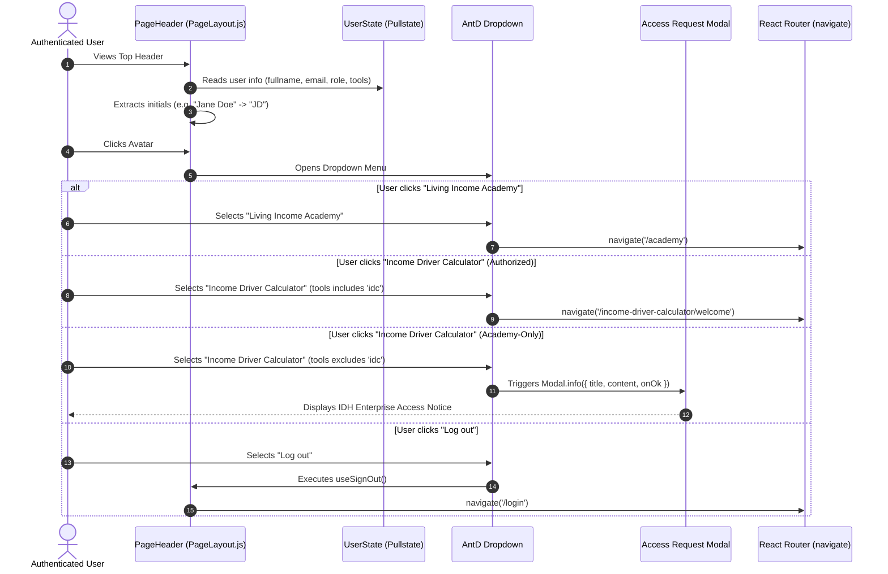

# Feature Spec 004: Shell Header Avatar Dropdown Menu & In-App Tool Switcher

> **Task Reference**: [TLSA-004] / GitHub Issue [#865](https://github.com/akvo/IDH-IDC/issues/865)  
> **Touchpoints**: `frontend/src/components/layout/PageLayout.js`, `frontend/src/App.scss`, `frontend/src/store/user.js`, `frontend/src/components/route/paths.js`, `frontend/src/components/layout/__tests__/PageLayout.test.js`  
> **Component Stack**: Ant Design v5 (`Avatar`, `Dropdown`, `Menu`, `Modal`, `Tag`, `Drawer`, `Button`, `Space`, `Divider`)

---

## 1. Overview & 5W1H Discovery

The **Better Income Toolkit** expands the IDH platform from a standalone calculator into a multi-tool suite incorporating both the **Income Driver Calculator (IDC)** and the **Living Income Academy**. The header shell serves as the unified navigation anchor across all tools.

### 5W1H Requirements Analysis
- **Who (Personas)**:
  - **IDC & Academy Dual User**: Has access to both tools (`tools: ['idc', 'academy']`). Can switch seamlessly between IDC and Academy without re-authenticating.
  - **Academy-Only User**: Public learner registered with `tools: ['academy']`. Can navigate to Academy, view profile, and switch tools; IDC displays as gated with `(no access)`. Clicking IDC opens the IDH-branded Access Request Modal.
  - **Administrator / Super Admin**: Users with `role: 'admin' | 'super_admin'`. Sees additional "Admin Panel" link pointing to `/admin/users`.
  - **Unauthenticated Visitor**: Sees public navigation links and a clear "Sign In" button linking to `/login`.
- **What (Core Scope)**:
  1. **Circular Initials Avatar**: 36px circular avatar in header with uppercase user initials (e.g. `JD`), high-contrast dark teal background (`#154b42`), and white text.
  2. **Avatar Dropdown Menu**:
     - User Identity card (Fullname, Email).
     - "My Profile" (`/profile`).
     - "Switch Tool" section:
       - **Income Driver Calculator**: Active indicator (soft mint wash `#f0fcf5` background and bold `#01625f` text) if currently on IDC. If user lacks `'idc'` tool permission, renders with muted styling and a subtle `(no access)` tag. Clicking opens the Access Request Modal.
       - **Living Income Academy**: Active indicator (soft mint wash `#f0fcf5` background and bold `#01625f` text) if currently on Academy. Clicking routes to `/academy`.
     - "Admin Panel" (if `role` is `admin` or `super_admin`).
     - "Log out" (triggers `useSignOut()`, clears `AUTH_TOKEN` cookie, resets `UserState`, and redirects to `/login`; styled with `#cf1322` high-contrast crimson on soft `#fff1f0` wash when hovered).
  3. **Access Request Modal**: Editorial, IDH-branded informational dialog triggered when an Academy user clicks the gated IDC item, explaining access criteria and support contact (`livingincome@idhtrade.org`).
  4. **Mobile Drawer Integration**: Clean responsive adaptation where user profile, tool switcher, and navigation actions are housed within the mobile slide-out drawer.
- **Where**:
  - `frontend/src/components/layout/PageLayout.js`
  - `frontend/src/App.scss`
  - `frontend/src/components/layout/__tests__/PageLayout.test.js`
- **When**: Rendered on all authenticated application pages (except standalone auth landing pages like `/login` and `/register`).
- **Why**: Eliminates siloed navigation, provides a persistent identity anchor, enables fast cross-tool workflows, and clearly communicates enterprise access boundaries for the Income Driver Calculator.
- **How**: Ant Design v5 `<Avatar>` and `<Dropdown menu={{ items }}>` connected to reactive `UserState`, custom SCSS tokens, and React Router navigation.

---

## 2. Architecture & Component Structure



---

## 3. Detailed UI & Interaction Specifications

### 3.1 Initials Extraction Algorithm
To ensure robust, crash-free initials rendering:
```javascript
export const getInitials = (fullname, email) => {
  if (fullname && typeof fullname === "string" && fullname.trim()) {
    const parts = fullname.trim().split(/\s+/);
    if (parts.length === 1) {
      return parts[0].substring(0, 2).toUpperCase();
    }
    return (parts[0][0] + parts[parts.length - 1][0]).toUpperCase();
  }
  if (email && typeof email === "string" && email.trim()) {
    return email.trim().substring(0, 2).toUpperCase();
  }
  return "U";
};
```

### 3.2 Dropdown Menu Items Specification
To prevent Ant Design from suppressing click events on disabled items, the IDC tool item uses **soft-gating**:
```javascript
const hasIdcAccess = (tools || []).includes("idc");
const hasAcademyAccess = (tools || []).includes("academy");
const isCurrentIdc = location.pathname.startsWith("/income-driver-calculator") || location.pathname.startsWith("/cases") || location.pathname.startsWith("/case");
const isCurrentAcademy = location.pathname.startsWith("/academy");

const menuItems = [
  {
    key: "user-info",
    type: "group",
    label: (
      <div className="header-avatar-user-card" data-testid="user-info-card">
        <div className="user-card-name">{fullname || "Toolkit User"}</div>
        <div className="user-card-email">{email || ""}</div>
      </div>
    ),
  },
  { type: "divider" },
  {
    key: "profile",
    label: "My Profile",
    icon: <UserOutlined />,
    onClick: () => navigate("/profile"),
  },
  { type: "divider" },
  {
    key: "tool-switcher-group",
    type: "group",
    label: <span className="menu-group-heading">SWITCH TOOL</span>,
    children: [
      {
        key: "tool-idc",
        label: (
          <div className="tool-switcher-item">
            <span className="tool-name">Income Driver Calculator</span>
            {isCurrentIdc && <Tag color="#47d985" className="tool-tag-active">Current</Tag>}
            {!hasIdcAccess && <Tag className="tool-tag-no-access">No access</Tag>}
          </div>
        ),
        onClick: () => {
          if (!hasIdcAccess) {
            showAccessRequestModal();
            return;
          }
          navigate(routePath.idc.dashboard);
        },
      },
      {
        key: "tool-academy",
        label: (
          <div className="tool-switcher-item">
            <span className="tool-name">Living Income Academy</span>
            {isCurrentAcademy && <Tag color="#47d985" className="tool-tag-active">Current</Tag>}
          </div>
        ),
        onClick: () => navigate("/academy"),
      },
    ],
  },
  ...(isAdmin
    ? [
        { type: "divider" },
        {
          key: "admin",
          label: "Admin Panel",
          icon: <SettingOutlined />,
          onClick: () => navigate("/admin/users"),
        },
      ]
    : []),
  { type: "divider" },
  {
    key: "logout",
    label: "Log out",
    icon: <LogoutOutlined />,
    danger: true,
    onClick: handleLogout,
  },
];
```

### 3.3 Access Request Modal
Triggered when an Academy-only user attempts to switch to IDC:
- **Title**: "Income Driver Calculator Access"
- **Icon**: `<InfoCircleOutlined style={{ color: '#01625f' }} />`
- **Body Content**:
  > The Income Driver Calculator is designed for supply chain partners and program participants.
  > 
  > Access is currently restricted to registered organization members. If your company participates in an IDH program, please contact your organization administrator or reach out to our team at **livingincome@idhtrade.org**.
- **Button**: Single clean primary button ("Got it") styled with IDH Dark Teal (`#01625f`).

---

## 4. Anti-AI-Slop Styling & Design Tokens

| Token | Value | Purpose |
| :--- | :--- | :--- |
| `$primary-color` | `#01625f` | Avatar circle background, modal primary button, brand headings, active tool label |
| `$hover-mint` | `#f0fcf5` | Active tool switcher background and dropdown item hover wash |
| `$danger-crimson` | `#cf1322` | Log out item active/hover text and icon color |
| `$yellow-color` | `#ffc505` | Accent highlights |
| `nav-signin-size` | `36px` height / `20px` radius | Proportional, compact horizontal pill for unauthenticated sign-in |
| `avatar-size` | `36px` desktop / `32px` mobile | Ergonomic, touch-friendly proportions |
| `border-radius-avatar` | `50%` | Perfectly circular avatar |
| `card-border` | `1px solid rgba(0, 0, 0, 0.08)` | Subdued hairline divider |

---

## 5. Verification Plan

### Automated Test Suite (`PageLayout.test.js`)
1. **Logged-out state**: Renders public navigation links and "Sign In" button; does not render avatar dropdown.
2. **Logged-in dual-access user (`['idc', 'academy']`)**:
   - Renders avatar with extracted initials (`JD`).
   - Clicking avatar opens dropdown displaying Name, Email, "My Profile", both tools enabled, and "Log out".
   - Clicking IDC routes to `/income-driver-calculator/welcome`.
   - Clicking Academy routes to `/academy`.
3. **Academy-only user (`['academy']`)**:
   - Shows "No access" badge on IDC item.
   - Clicking IDC triggers `Modal.info` access request modal instead of navigation.
4. **Admin user (`role: 'admin'`)**:
   - Displays "Admin Panel" menu item linking to `/admin/users`.
5. **Regular user (`role: 'user'`)**:
   - Omits "Admin Panel" menu item.
6. **Logout**:
   - Clicking "Log out" calls `useSignOut()`, removes cookie, and redirects to `/login`.

---

## 6. Vibe Coding Estimation Standard ⏱️

| Task ID | Component & Description | 💻 Vibe Coding (Dev) | 🧪 Automated Testing | 🔍 QA & Review | Total Est. Time | Priority |
| :--- | :--- | :---: | :---: | :---: | :---: | :--- |
| **T-04A** | **Avatar Component & Initials Logic**: Extracted initials helper, Avatar element, contrast styling, and responsive sizing | 60m (1.00h) | 30m (0.50h) | 15m (0.25h) | **105m (1.75h)** | Must Have |
| **T-04B** | **Dropdown Menu & Tool Switcher**: Dropdown items, tool status tags, route navigation, and admin role filtering | 90m (1.50h) | 45m (0.75h) | 30m (0.50h) | **165m (2.75h)** | Must Have |
| **T-04C** | **Access Request Modal & Logout**: `Modal.info` dialog implementation, support contact, and sign-out integration | 45m (0.75h) | 30m (0.50h) | 15m (0.25h) | **90m (1.50h)** | Must Have |
| **T-04D** | **Mobile Drawer Synchronization**: Replicating user identity, switcher, and actions inside mobile slide-out menu | 45m (0.75h) | 30m (0.50h) | 15m (0.25h) | **90m (1.50h)** | Must Have |
| **TOTAL** | **Complete TASK-04 Delivery** | **240m (4.00h)** | **135m (2.25h)** | **75m (1.25h)** | **450m (7.50h)** | **Must Have** |
