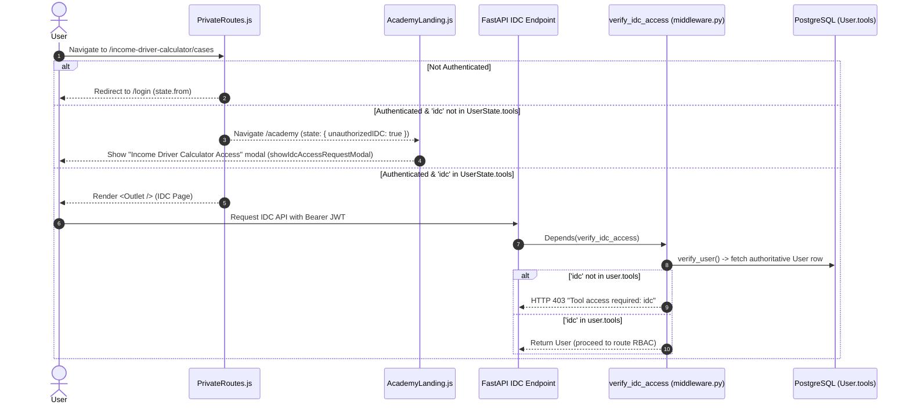

# [TLSA-005] Tool-Level Route Guarding & IDC Gatekeeping - Implementation Plan

**GitHub Issue**: `#868` — `[TLSA-005] Security: Tool-Level Route Guarding & Confidential Data Gatekeeping`  
**Parent Spec**: `docs/features/002_toolkit_login_shared_access_spec.md` (`TASK-05`)  
**Branch**: `feature/868-tool-level-route-guarding-idc-gatekeeping` (from `feature/857-db-schema-migration-tool-access-array`)

---

## Overview

Ensure that **Living Income Academy** users (`user.tools = ['academy']`) are prevented from accessing confidential **Income Driver Calculator (IDC)** supply-chain routes and API endpoints, whether by manipulating browser URLs directly or calling FastAPI endpoints with a valid JWT. Simultaneously preserve uninterrupted access for authorized IDC / dual-tool users (`'idc' in user.tools`) and keep shared endpoints (login, `/user/me`, `/academy/*`, public template/world map assets) working normally.

### 5W1H Summary
- **Who**: Academy-only users (denied IDC access), authorized IDC / dual-tool users (allowed), unauthenticated visitors (redirected to `/login` or rejected with HTTP `401`/`403`).
- **What**: Server-side FastAPI dependency `verify_idc_access` enforcing `'idc' in user.tools` (`HTTP 403 Forbidden`, `"Tool access required: idc"`) across confidential IDC routes, paired with frontend `PrivateRoutes.js` path guarding, `App.js` `UserState.tools` hydration, and the unified `showIdcAccessRequestModal()` prompt on `/academy`.
- **Where**:
  - Backend: `backend/middleware.py`, `backend/routes/case.py`, `backend/routes/case_import.py`, `backend/routes/segment.py`, `backend/routes/segment_answer.py`, `backend/routes/visualization.py`, `backend/routes/optimization.py`, `backend/routes/map.py`
  - Frontend: `frontend/src/components/route/PrivateRoutes.js`, `frontend/src/components/layout/PageLayout.js`, `frontend/src/components/utils/idcAccessModal.js`, `frontend/src/components/utils/index.js`, `frontend/src/App.js`, `frontend/src/pages/income-driver-calculator/Landing.js`, `frontend/src/pages/academy/AcademyLanding.js`
- **When**: Executed immediately upon protected API calls and protected client-side route navigation.
- **Why**: Client-side UI hiding is insufficient when Academy accounts share unified authentication (`AUTH_TOKEN`); server-side and router-level gates prevent unauthorized exposure of supply-chain case data.
- **How**: Layered zero-trust enforcement: FastAPI evaluates `verify_idc_access` at the dependency layer before route execution (reading authoritative DB `user.tools`, not trusting JWT claims alone), while React Router inspects `UserState.tools` in `PrivateRoutes.js` and redirects unauthorized attempts to `/academy` with `state: { unauthorizedIDC: true }`.

---

## Architecture Overview

1. **Unauthenticated Request** → Backend `HTTPBearer()` rejects missing header (`403`) or invalid/expired JWT rejects (`401`); Frontend `PrivateRoutes` redirects to `/login` (`paths.login`) preserving `state.from`.
2. **Unauthorized Tool Request (`'idc' not in user.tools`)** → Backend `verify_idc_access` raises `HTTP 403 Forbidden` (`"Tool access required: idc"`); Frontend `PrivateRoutes` detects `isIdcRestrictedPath` (`routePrefix.idc`, `/cases`, `/case`, `/old-welcome`, `/old-cases`, `/admin`) and redirects to `/academy` (`routePath.academy.landing`) with `state: { unauthorizedIDC: true }`, triggering `showIdcAccessRequestModal()` once.
3. **Authorized Tool Request (`'idc' in user.tools`)** → `verify_idc_access` returns the DB `User` and existing RBAC/case-level checks (`verify_case_viewer`, `verify_case_editor`, etc.) proceed normally; Frontend renders `<Outlet />` cleanly, including after browser reload via `App.js` `GET user/me` hydration of `UserState.tools`.



---

## 1. Backend Implementation

### 1.1 Middleware Dependency (`backend/middleware.py`)
- Add `verify_idc_access`:
  ```python
  def verify_idc_access(
      req: Request,
      session: Session = Depends(get_session),
      credentials: HTTPAuthorizationCredentials = Depends(idc_security),
  ) -> User:
  ```
- **Resolution & Fail-Closed Design**:
  - Uses `idc_security = HTTPBearer()` so missing `Authorization` headers preserve the existing HTTP `403` contract tested in `backend/tests/test_1005_case_import.py`.
  - Resolves `authenticated = getattr(req.state, "authenticated", None)` (falling back to `decode_token(credentials.credentials)` if `route_middleware` was bypassed in direct calls).
  - Calls `verify_user(session=session, authenticated=authenticated)` to fetch the live PostgreSQL `User` record (preventing stale or tampered JWT `tools` claims from granting access).
  - Checks `if not user.tools or ToolType.idc.value not in user.tools:` and raises `HTTPException(status_code=status.HTTP_403_FORBIDDEN, detail="Tool access required: idc")`.

### 1.2 Secured IDC Route Inventory

| File | Guarded Endpoints (`dependencies=[Depends(verify_idc_access)]`) | Preserved Public / Shared Exceptions |
| :--- | :--- | :--- |
| `backend/routes/case.py` | All 12 `/case*` routes (create, list, dropdown, update, detail, delete, case-access share/edit/delete, benchmark update, update-status) | None |
| `backend/routes/case_import.py` | 5 confidential import routes (`POST /case-import`, `POST /case-import/segmentation-preview`, `POST /case-import/generate-segment-values`, `POST /case-import/recalculate-segmentation`, `DELETE /case-import/{import_id}`) | **Public**: `GET /case-import/download-template` |
| `backend/routes/segment.py` | All 4 `/segment*` routes (`POST`, `PUT`, `DELETE`, `GET /segment/case/{case_id}`) | None |
| `backend/routes/segment_answer.py` | Both `/segment-answer/{segment_id}` routes (`POST`, `PUT`) | None |
| `backend/routes/visualization.py` | Both `/visualization` (`POST`) & `/visualization/case/{case_id}` (`GET`) routes | None |
| `backend/routes/optimization.py` | `POST /optimize/run-model/{case_id}/{segment_id}` | None |
| `backend/routes/map.py` | `GET /map/case-by-country` & `GET /map/case-by-country-and-company` | **Public**: `GET /map/static/world_map.js` |
| `backend/routes/user.py` | No changes (shared auth/profile/registration endpoints) | `/user/login`, `/user/me`, `/user/register-academy`, `/user/verify-academy`, etc. |

---

## 2. Frontend Implementation

### 2.1 `UserState.tools` Hydration Fix (`frontend/src/App.js`)
- Update `GET user/me` hydration in `App.js` (`useEffect`) to set:
  ```javascript
  s.tools = Array.isArray(data.tools) ? data.tools : [];
  ```
- Without this fix, full-page reloads on IDC routes would leave `UserState.tools = []` and mistakenly lock out authorized IDC users.

### 2.2 Route Guarding (`frontend/src/components/route/PrivateRoutes.js`)
- Extract pure helper or predicate `isIdcRestrictedPath(pathname)` matching IDC and Admin paths (mirroring `Login.js` checks):
  - `routePrefix.idc` (`/income-driver-calculator`), `/cases`, `/case`, `/old-welcome`, `/old-cases`, `/admin`
- Preserve Academy child routes (`/academy/*`) and shared routes inside `<PrivateRoutes />` for authenticated Academy-only users.
- Redirect logic:
  1. `!isAuthenticated` → `<Navigate to={paths.login} state={{ from: location }} replace />` (`UAC-05.3`).
  2. `isIdcRestrictedPath(location.pathname) && !userTools.includes("idc")` → `<Navigate to={routePath.academy.landing} replace state={{ unauthorizedIDC: true }} />` (`UAC-05.1`).
  3. Otherwise → `<Outlet />` (`UAC-05.2`).

- Also guard `/income-driver-calculator` (`frontend/src/pages/income-driver-calculator/Landing.js`): public visitors remain allowed to view the landing page, while authenticated users lacking `"idc"` (`!userTools.includes("idc")`) — including navigation from Home or Tools & Resources — are redirected to `/academy` with `state: { unauthorizedIDC: true }`.

### 2.3 Unified Access Request Modal (`frontend/src/components/utils/idcAccessModal.js` & `AcademyLanding.js`)
- Extracted `showIdcAccessRequestModal` into `frontend/src/components/utils/idcAccessModal.js` so `PageLayout.js` (navbar / avatar switcher) and `AcademyLanding.js` share the same IDH-branded `Modal.info` dialog (`title: "Income Driver Calculator Access"`, `livingincome@idhtrade.org`).
- Read `useLocation().state?.unauthorizedIDC` in `AcademyLanding.js` (target destination for `PrivateRoutes.js`, `Landing.js`, and `Login.js` unauthorized IDC redirects), trigger `showIdcAccessRequestModal()` once, and clear navigation state via `navigate(location.pathname, { replace: true, state: {} })`.

---

## 3. Technical Audit (Phase 1 Findings)

1. **`verify_user` DI Signature**: `backend/middleware.py:112` defines `verify_user(session: Session, authenticated)` without `Depends()` defaults, and `route_middleware` (`backend/core/config.py:189`) skips setting `req.state.authenticated` when `Authorization` is omitted. Therefore `verify_idc_access` cannot use `Depends(verify_user)` directly; it resolves `req.state.authenticated` / `HTTPBearer()` token and invokes `verify_user(session, authenticated)` internally.
2. **Test File Naming Collision**: `backend/tests/test_1009_company_deletion.py` already uses prefix `1009`. New route-guarding backend tests are created at `backend/tests/test_1032_route_guarding.py` (following `test_1031_academy_registration.py`) while keeping command verification compatible (`pytest tests/test_1032_route_guarding.py -v`).
3. **`PrivateRoutes.test.js` Login Redirect Contract**: Existing `PrivateRoutes.test.js` checked `routePath.idc.login`; aligning `PrivateRoutes.js` to `paths.login` (`/login`) fulfills `UAC-05.3` consistently with `App.js` (`<Route exact path="/login" ... />`).

---

## 4. Verification & Testing

### 4.1 Automated Tests
- **Backend Guarding**: `./dc.sh exec backend pytest tests/test_1032_route_guarding.py -v`
  - Includes valid-payload `POST /case` rejection with zero DB mutation across `user` and `admin` roles, authorized `tools=["idc"]` positive control, `super_admin` + `internal` bypass prevention, 20-route `POST`/`PUT`/`DELETE`/protected `GET` IDC write/destructive matrix, revoked `Case.created_by` + `UserCaseAccess` lockout, live mid-session DB revocation with cached JWT, and case-sensitive/malformed tool strings (`["IDC"]`, `["academy", "idc_admin"]`).
- **Backend Regression + Coverage**: `./dc.sh exec backend pytest tests/test_1032_route_guarding.py tests/test_1005_case_import.py tests/test_051_optimization.py tests/test_1000_permission_overiding.py tests/test_1007_user_tools.py -v` and `./dc.sh exec backend flake8`
- **Frontend Route Guard & Banner Tests**: `./dc.sh exec frontend yarn test:ci` and `./dc.sh exec frontend yarn lint` (including `/old-cases/1`, `/income-driver-calculator/explore-studies`, and malformed/case-mismatched tool claims in `PrivateRoutes.test.js`)

### 4.2 Manual Verification Steps
1. Log in as an Academy-only user (`tools=['academy']`) and navigate manually to `/income-driver-calculator/cases` or `/income-driver-calculator` → confirm immediate redirect to `/academy` with the "Income Driver Calculator Access" modal displayed once.
2. Attempt `GET /api/case` with that user's Bearer JWT → confirm `HTTP 403 Forbidden` (`{"detail": "Tool access required: idc"}`).
3. Log in as a dual-access or IDC-only user, visit `/income-driver-calculator/welcome` and refresh the browser → confirm `UserState.tools` hydrates via `/user/me` and the page remains accessible without redirect.

---

## 5. Epic & Vibe Coding Estimation ⏱️

- **Confidence Level**: High
- **Dependencies**: `#857` (`User.tools` array column & JWT claims)

| Task ID | Component & Description | Vibe Coding (Dev) | Automated Testing | QA & Review | Total Est. Time | Priority |
| :--- | :--- | :---: | :---: | :---: | :---: | :--- |
| **T-05A** | Backend `verify_idc_access` dependency & confidential IDC route decorators | 1h 30m | 45m | 30m | **2h 45m (2.75h)** | Must Have |
| **T-05B** | Frontend `PrivateRoutes.js` tool guard, `App.js` hydration fix & `AcademyLanding.js` banner | 1h 45m | 45m | 30m | **3h 00m (3.00h)** | Must Have |
| **TOTAL** | **Complete TASK-05 Delivery** | **3h 15m** | **1h 30m** | **1h 00m** | **5h 45m (5.75h)** | |
