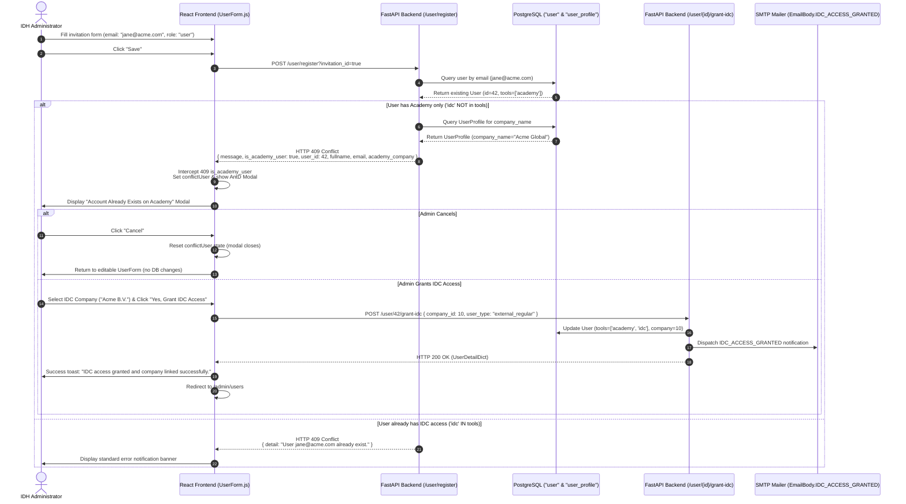

# [TLSA-008] Admin: User Invitation Deduplication & Conflict Modal

**GitHub Issue**: `#875` — `[TLSA-008] Admin: User Invitation Deduplication & Conflict Modal`  
**Parent Spec**: [`docs/features/002_toolkit_login_shared_access_spec.md`](file:///Users/galihpratama/Sites/IDH-IDC/docs/features/002_toolkit_login_shared_access_spec.md) (`TASK-08`)  
**Branch**: `feature/875-admin-user-invitation-dedup-conflict-modal` (from `feature/873-admin-tool-access-filtering-company-linkage`)

---

## 1. 5W1H Framework

| Dimension | Specification |
| :--- | :--- |
| **Who** | IDH System Administrators and Super Administrators managing practitioner access across the Better Income Toolkit. |
| **What** | Automated collision detection during user invitation that intercepts duplicate accounts when an invitee already possesses an active Living Income Academy account, rendering an interactive conflict resolution modal in the Admin UI. |
| **When** | Triggered whenever an administrator submits the user invitation form (`POST /user/register?invitation_id=true`) using an email address that matches an existing record in the PostgreSQL `user` table whose `tools` array does not include `'idc'`. |
| **Where** | Frontend Admin UI ([`frontend/src/pages/admin/users/UserForm.js`](file:///Users/galihpratama/Sites/IDH-IDC/frontend/src/pages/admin/users/UserForm.js)) and Backend User Router ([`backend/routes/user.py`](file:///Users/galihpratama/Sites/IDH-IDC/backend/routes/user.py)). |
| **Why** | Prevents duplicate user account proliferation, avoids password/credential divergence, preserves existing Academy learning progress, and provides a seamless 1-click bridge to upgrade the user to Income Driver Calculator access linked to an official IDC Company. |
| **How** | Backend inspects existing user `tools` on collision and returns `HTTP 409 Conflict` with structured Academy user metadata. The frontend catches this specific payload, displays an informative confirmation `<Modal>`, captures the target IDC Company, and executes `POST /user/{id}/grant-idc`. |

---

## 2. Architecture & Sequence Diagram



---

## 3. Interface Contracts & Data Payloads

### 3.1 Backend: `POST /user/register?invitation_id=true`
- **Location**: [`backend/routes/user.py`](file:///Users/galihpratama/Sites/IDH-IDC/backend/routes/user.py) (`register` endpoint).
- **Authentication**: `verify_admin` (`401 Unauthorized` if unauthenticated, `403 Forbidden` if non-admin).
- **Collision Detection Logic**:
  1. Look up existing user via `crud_user.get_user_by_email(session=session, email=payload.email)`.
  2. If user exists:
     - Check whether `ToolType.idc.value` is present in `check_user_exist.tools or []`.
     - **Case A: Academy-Only User (`'idc'` NOT in `tools`)**:
       Retrieve `check_user_exist.profile.company_name` if profile exists, and raise `HTTP 409 Conflict` with structured dictionary detail:
       ```json
       {
         "detail": {
           "message": "User already has an Academy account",
           "is_academy_user": true,
           "user_id": 42,
           "fullname": "Jane Doe",
           "email": "jane@acme.com",
           "academy_company": "Acme Global"
         }
       }
       ```
     - **Case B: Full / Existing IDC User (`'idc'` in `tools`)**:
       Raise standard `HTTP 409 Conflict` with string detail:
       ```json
       {
         "detail": "User jane@acme.com already exist."
       }
       ```

### 3.2 Downstream Upgrade: `POST /user/{user_id}/grant-idc`
- **Location**: Registered in [`backend/routes/user.py`](file:///Users/galihpratama/Sites/IDH-IDC/backend/routes/user.py) (from `[TLSA-007]`).
- **Request Payload**:
  ```json
  {
    "company_id": 10,
    "user_type": "external_regular"
  }
  ```
- **Response**: `HTTP 200 OK` with full `UserDetailDict`.
- **Side Effect**: Appends `"idc"` to `user.tools`, sets `user.company`, and dispatches `MailTypeEnum.IDC_ACCESS_GRANTED`.

---

## 4. Frontend Specifications: `UserForm.js`

- **Location**: [`frontend/src/pages/admin/users/UserForm.js`](file:///Users/galihpratama/Sites/IDH-IDC/frontend/src/pages/admin/users/UserForm.js)

### 4.1 Form Submission Error Interceptor
When submitting an invitation (`api.post("/user/register?invitation_id=true", payload)`):
```javascript
.catch((e) => {
  const { data, status } = e?.response || {};
  if (status === 409 && data?.detail?.is_academy_user === true) {
    const detail = data.detail;
    const conflictUserType =
      resolvedUserType === "internal"
        ? "external_regular"
        : resolvedUserType || "external_regular";
    setConflictUser({
      user_id: detail.user_id || detail.id,
      fullname: detail.fullname,
      email: detail.email,
      academy_company: detail.academy_company,
      user_type: conflictUserType,
    });
    setConflictCompanyId(company || null);
    return;
  }
  // Standard error handling fallback for string or other error details
})
```

### 4.2 Deduplication Modal Component Structure
An Ant Design `<Modal>` conditionally rendered when `Boolean(conflictUser)` is truthy:
- **Title**: `"Account Already Exists on Academy"`
- **Body Content**:
  - Explanatory copy:
    > "A user with email `\"{conflictUser.email}\"` (`{conflictUser.fullname}`) is currently registered on the Living Income Academy under `\"{conflictUser.academy_company}\"`."
    *(If `academy_company` is null or empty, omits the `under "{company}"` clause gracefully).*
  - Action prompt:
    > "Would you like to grant them access to the Income Driver Calculator and link them to an official IDC Company?"
  - Mandatory IDC Company `<Select>` dropdown populated with `companyList` and `data-testid="conflict-company-select"`.
- **Footer Buttons**:
  - **Cancel** (`data-testid="conflict-cancel-btn"`): Clears `conflictUser` and `conflictCompanyId`, closing modal with zero side effects.
  - **Yes, Grant IDC Access** (`data-testid="conflict-grant-btn"`):
    - Validates `conflictCompanyId` is selected (shows error toast if missing).
    - Sets `loading={grantingConflict}`.
    - Calls `api.post("user/" + conflictUser.user_id + "/grant-idc", { company_id: conflictCompanyId, user_type: conflictUser.user_type })`.
    - On success: shows success toast, resets form, navigates to `/admin/users`.
    - On error: displays error toast, leaves modal open for retry.

---

## 5. Edge Cases & Safety Matrix

| Scenario | Condition | System Behavior |
| :--- | :--- | :--- |
| **Existing IDC User** | Inviting email that already has `'idc'` in `tools`. | Returns `409 Conflict` with string `"User {email} already exist."`. Frontend shows standard error banner; no modal is triggered. |
| **Academy User (No Company)** | Inviting Academy self-registered user who omitted company name. | Backend returns `academy_company: null`. Modal gracefully renders `"A user with email ... is currently registered on the Living Income Academy."`. |
| **Admin Submits Without Company** | Admin clicks "Yes, Grant IDC Access" without choosing an IDC company. | Frontend blocks request and displays error toast `"Please select an IDC Company."`. |
| **Cancelled Invitation** | Admin clicks "Cancel" on the conflict modal. | Modal closes, `conflictUser` cleared, form fields preserved, zero database mutations committed. |
| **Role Permissions** | Non-admin attempts to trigger invitation or grant. | Rejected with `401 Unauthorized` or `403 Forbidden` (`verify_admin`). |
| **SMTP Notification Failure** | Access grant succeeds but mail relay is unavailable. | Grant commits cleanly to DB; mailer logs warning without rolling back the transaction. |

---

## 6. Verification & Automated Testing

### 6.1 Backend Test Cases ([`backend/tests/test_1035_invitation_dedup.py`](file:///Users/galihpratama/Sites/IDH-IDC/backend/tests/test_1035_invitation_dedup.py))
- `test_invite_new_user_success`: Inviting an unregistered email creates inactive user and sends invitation URL.
- `test_invite_existing_academy_user_returns_409_structured_payload`: Inviting an existing Academy user returns `409` with `is_academy_user: true`, `user_id`, `email`, and `academy_company`.
- `test_invite_existing_academy_user_without_profile_returns_null_company`: Inviting Academy user without profile returns `academy_company: None`.
- `test_invite_existing_idc_user_returns_409_plain_string`: Inviting existing IDC user returns standard duplicate string error.
- `test_grant_idc_after_conflict_detection`: Executing `POST /user/{id}/grant-idc` completes the upgrade flow.

### 6.2 Frontend Test Cases ([`frontend/src/pages/admin/users/__tests__/UserForm.test.js`](file:///Users/galihpratama/Sites/IDH-IDC/frontend/src/pages/admin/users/__tests__/UserForm.test.js))
- Confirms conflict modal opens with user details when register returns 409 Academy conflict.
- Confirms clicking "Cancel" closes modal without invoking `grant-idc`.
- Confirms clicking "Yes, Grant IDC Access" without selecting company warns user.
- Confirms selecting company and clicking "Yes, Grant IDC Access" calls `POST user/{id}/grant-idc` and navigates to `/admin/users`.
- Confirms plain string 409 responses do not open the modal and display standard error banners.

### 6.3 Deterministic Verification Commands
```bash
# Backend unit & integration tests
./dc.sh exec backend pytest tests/test_1035_invitation_dedup.py -v
./dc.sh exec backend flake8

# Frontend unit tests & linting
./dc.sh exec frontend yarn test:ci --testPathPattern="UserForm" --runInBand
./dc.sh exec frontend yarn lint
```

---

## 7. Vibe Coding Estimation ⏱️

- **Confidence Level**: High (reuses existing `POST /user/register`, `POST /user/{id}/grant-idc`, and Ant Design Modal primitives).
- **Dependencies**: Depends on `[TLSA-007]` (`POST /user/{id}/grant-idc`).

| Task ID | Component & Description | Vibe Coding (Dev) | Automated Testing | QA & Review | Total Est. Time | Priority |
| :--- | :--- | :---: | :---: | :---: | :---: | :--- |
| **T-08A** | Backend Invitation Collision Detection & 409 Payload (`backend/routes/user.py`) | 2h 00m | 45m | 30m | **3h 15m (3.25h)** | Must Have |
| **T-08B** | Frontend Deduplication Confirmation Modal Flow (`UserForm.js`) | 2h 30m | 45m | 30m | **3h 45m (3.75h)** | Must Have |
| **TOTAL** | **[TLSA-008] Admin Invitation Deduplication & Conflict Modal** | **4h 30m** | **1h 30m** | **1h 00m** | **7h 00m (~1 Day)** | |
