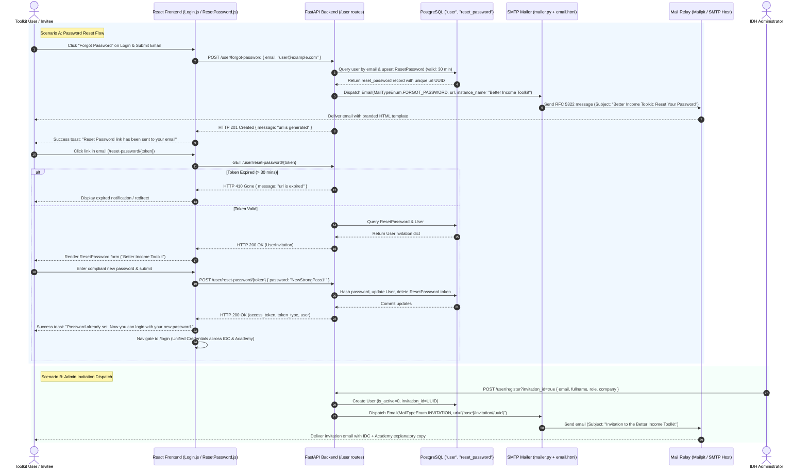

# [TLSA-009] Notifications: Better Income Toolkit Notification & Password Reset Alignment

**GitHub Issue**: `#879` — `[TLSA-009] Notifications: Better Income Toolkit Notification & Password Reset Alignment`  
**Parent Spec**: [`docs/features/002_toolkit_login_shared_access_spec.md`](file:///Users/galihpratama/Sites/IDH-IDC/docs/features/002_toolkit_login_shared_access_spec.md) (`TASK-09`)  
**Branch**: `feature/879-notifications-toolkit-password-reset` (from `feature/875-admin-user-invitation-dedup-conflict-modal`)

---

## 1. 5W1H Framework

| Dimension | Specification |
| :--- | :--- |
| **Who** | Practitioners, company partners, and administrators using or invited to the **Better Income Toolkit** ecosystem (Income Driver Calculator, Living Income Academy, or both). |
| **What** | Complete rebranding and functional alignment of transactional emails (`backend/utils/mailer.py`, `backend/templates/email.html`) and password reset flows (`backend/routes/user.py`, `frontend/src/pages/login/ResetPassword.js`) from legacy standalone "Income Driver Calculator" to the unified **"Better Income Toolkit"** branding. |
| **When** | Triggered when: (1) A user requests a password reset via `POST /user/forgot-password`; (2) An admin invites a user via `POST /user/register?invitation_id=true`; (3) A user self-registers on Academy (`POST /user/register-academy`); (4) An admin grants IDC access (`POST /user/{id}/grant-idc`); or (5) A user completes setting/resetting their password on `/invitation/:tokenId` or `/reset-password/:tokenId`. |
| **Where** | Backend mailer utility ([`backend/utils/mailer.py`](file:///Users/galihpratama/Sites/IDH-IDC/backend/utils/mailer.py)), Jinja2 HTML email template ([`backend/templates/email.html`](file:///Users/galihpratama/Sites/IDH-IDC/backend/templates/email.html)), FastAPI User Router ([`backend/routes/user.py`](file:///Users/galihpratama/Sites/IDH-IDC/backend/routes/user.py)), and Frontend Reset Password page ([`frontend/src/pages/login/ResetPassword.js`](file:///Users/galihpratama/Sites/IDH-IDC/frontend/src/pages/login/ResetPassword.js)). |
| **Why** | Following the convergence of IDH tools into the shared Better Income Toolkit platform, transactional emails and password reset screens retained obsolete single-tool branding (and a legacy typo `<h1>Income Drive Calculator</h1>` in `email.html`). Academy-only practitioners receiving password reset or invitation emails experienced confusion regarding unrecognized IDC references. A unified branding and single-credential reset process ensures seamless access across all authorized tools. |
| **How** | (1) Modernize `EmailBody` enum templates in `mailer.py` with multi-tool copy; (2) Replace hardcoded email header in `email.html` with dynamic `{{ instance_name }}` defaulting to `"Better Income Toolkit"`; (3) Update reset link generation in `/user/forgot-password` to respect `req.headers.get("origin")` for local/staging environment parity; (4) Refresh `ResetPassword.js` with Better Income Toolkit typography and redirect to `/login`; (5) Deliver 100% unit test coverage for mailer and reset password components. |

---

## 2. Architecture & Sequence Diagram



---

## 3. Interface Contracts & Specification Details

### 3.1 Backend: `backend/utils/mailer.py`

#### 3.1.1 `EmailBody` Enum Copy Updates
Update the template strings to explicitly communicate the unified platform and its sub-tools:

| Enum Key | Title | Subject | Body | Message Link Copy |
| :--- | :--- | :--- | :--- | :--- |
| `INVITATION` | `Invitation` | `Invitation to the Better Income Toolkit` | `You have been invited to the Better Income Toolkit (with access to the Income Driver Calculator and Living Income Academy).` | `Please click <a href="#url#" target="_blank" rel="noreferrer">here</a> or the link below to set your password.` |
| `FORGOT_PASSWORD` | `Reset Password` | `Better Income Toolkit: Reset Your Password` | `You have requested to reset your password for your Better Income Toolkit account.` | `Please click <a href="#url#" target="_blank" rel="noreferrer">here</a> or the link below to reset your password.` |
| `ACADEMY_REGISTRATION_VERIFY` | `Verify Your Academy Account` | `Verify Your Living Income Academy Account` | `Thank you for registering for the Living Income Academy.` | `Please click <a href="#url#" target="_blank" rel="noreferrer">here</a> or the link below to verify your account and activate your access.` |
| `IDC_ACCESS_GRANTED` | `IDC Access Granted` | `Income Driver Calculator Access Granted` | `An administrator has granted you access to the Income Driver Calculator under {company_name}.` | *(No URL button; informational)* |
| `USER_PASSWORD_CREATED` | `Access Changed` | `Better Income Toolkit: Access Changed` | `Your access credentials have been updated.` | *(Informational)* |

#### 3.1.2 Unified Platform Branding Parameter
In `backend/utils/mailer.py`, update `Email.data`:
```python
html = html_template.render(
    logo=f"{webdomain}/logo.png",
    instance_name="Better Income Toolkit",  # Updated from "Income Driver Calculator"
    webdomain=webdomain,
    title=email["title"],
    body=body,
    image=email["image"],
    message=message,
    context=self.context,
)
```

#### 3.1.3 Default Sender Display Name
Ensure fallback sender name in `Email.data` reflects the toolkit identity:
```python
from_email = EMAIL_FROM or EMAIL_HOST_USER
if not from_email:
    from_email = "noreply@incomedrivercalculator.idhtrade.org"
    TESTING = os.environ.get("TESTING")
    CLIENT_ID = os.environ.get("CLIENT_ID")
    if TESTING or CLIENT_ID == "test":
        from_email = "noreply@akvo.org"
```

---

### 3.2 Backend: `backend/templates/email.html`

- **Header Typo & Hardcoded Brand Fix (Lines 440–443)**:
  Replace legacy hardcoded `<h1>Income Drive Calculator</h1>` with dynamic:
  ```html
  <h1
    style="
      vertical-align: middle;
      margin: 0px;
      padding: 10px;
      font-size: 20px;
      font-weight: 600;
    "
  >
    {{ instance_name }}
  </h1>
  ```
- **Footer Link Label (Line 557)**:
  Maintains `{{ instance_name }}` linking to `{{ webdomain }}`.
- **Client Compatibility**: Preserve existing inline tables, MSO conditional comments, and CSS reset styles for Outlook/Gmail rendering.

---

### 3.3 Backend: User Routes (`backend/routes/user.py`)

#### 3.3.1 `POST /user/forgot-password` (Line 913)
- **Origin-Aware Base URL**:
  Align URL generation with `register-academy` (`req.headers.get("origin") or webdomain`) so emails dispatched in local development, preview deployments, or staging environments point to the proper origin:
  ```python
  base_url = req.headers.get("origin") or webdomain
  url = f"{base_url}/reset-password/{reset_password['url']}"
  ```
- **Execution Safety**: Continue returning `HTTP 201 Created` with `{"message": "url is generated"}` on success, and `HTTP 404 Not Found` if the requested email is not registered in PostgreSQL.

#### 3.3.2 `GET /user/reset-password/{url:path}` & `POST /user/reset-password/{url:path}`
- `GET`: Validates token existence (`404` if invalid) and expiration (`410 Gone` if expired). Returns `UserInvitation` serializer.
- `POST`: Validates token existence, enforces password hashing (`get_password_hash`), commits new password to `User`, cleans up used token via `crud_reset_pwd.delete_reset_password`, and returns user token.

---

### 3.4 Frontend: `frontend/src/pages/login/ResetPassword.js`

#### 3.4.1 Page Header Typography & Visual Identity
Replace legacy standalone IDC header with the shared Better Income Toolkit styling matching [`Login.js`](file:///Users/galihpratama/Sites/IDH-IDC/frontend/src/pages/login/Login.js):

```jsx
<div className="page-title-container">
  <Typography.Title>
    Better Income <br />
    <span style={{ color: "#47d985", fontSize: "2.5rem" }}>
      Toolkit
    </span>
  </Typography.Title>
</div>
<h2>{isInvitation ? "Set Password" : "Reset Password"}</h2>
```

#### 3.4.2 Navigation Alignment
Upon successful password save:
- Standardize redirect target to `paths.login` (`/login`):
  ```javascript
  setTimeout(() => {
    navigate("/login");
  }, 300);
  ```
- Supports single unified credentials: user logs in once at `/login` and is directed to their landing surface (`/income-driver-calculator/welcome` if IDC-enabled, or `/academy` if Academy-only).

#### 3.4.3 Data Security Provision
- Retain mandatory `DataSecurityProvisionModal` acceptance checkbox for invited users (`isInvitation === true`), disabled for standard password resets where terms were agreed upon at initial registration.

---

## 4. Edge Cases & Safety Matrix

| Scenario | Condition | System Behavior |
| :--- | :--- | :--- |
| **Expired Reset Link** | User clicks password reset email after 30 minutes. | Backend returns `HTTP 410 Gone`. Frontend navigates to `/not-found` or displays expired alert with prompt to request a new link. |
| **Tampered / Non-Existent Token** | User modifies URL token string. | Backend returns `HTTP 404 Not Found`. Frontend redirects to `/not-found`. |
| **Password Rule Non-Compliance** | User enters password lacking uppercase, lowercase, number, or special char. | `PasswordCriteria` validator marks failing items; submit button is blocked or form validation rejects with `"Please follow password criteria rule"`. |
| **Academy-Only User Reset** | User registered on Academy resets password. | Receives email branded "Better Income Toolkit". Sets new password and logs in at `/login`; successfully redirected to `/academy`. |
| **Dual-Access User Reset** | User with both `idc` and `academy` resets password. | Reset updates single shared password. User can access both IDC cases and Academy modules with one set of credentials. |
| **SMTP Delivery Failure** | Mail server unreachable when submitting forgot password. | `Email.send` returns `False`; route catches or logs error without crashing the server. |
| **Token Replay Attack** | User attempts to reuse the reset link after successfully changing password. | `delete_reset_password` removed the URL from DB; second attempt immediately yields `HTTP 404 Not Found`. |

---

## 5. Verification & Automated Testing Plan

### 5.1 Backend Automated Tests

#### 5.1.1 Mailer Unit Tests ([`backend/tests/test_900_utils_mailer.py`](file:///Users/galihpratama/Sites/IDH-IDC/backend/tests/test_900_utils_mailer.py))
- `test_email_invitation_toolkit_branding`: Asserts that `MailTypeEnum.INVITATION` renders subject `"Invitation to the Better Income Toolkit"` and contains text `"Better Income Toolkit"`.
- `test_email_forgot_password_toolkit_branding`: Asserts that `MailTypeEnum.FORGOT_PASSWORD` renders subject `"Better Income Toolkit: Reset Your Password"`, title `"Reset Password"`, and contains `"Better Income Toolkit account"`.
- `test_email_html_instance_name_rendering`: Renders template and verifies that `<h1>Better Income Toolkit</h1>` is present in HTML output and the typo `"Income Drive Calculator"` is eliminated.
- `test_email_academy_verify_and_idc_granted`: Validates that `ACADEMY_VERIFY` and `IDC_ACCESS_GRANTED` produce compliant RFC 5322 payloads.

#### 5.1.2 Password Reset Integration Tests ([`backend/tests/test_002_user.py`](file:///Users/galihpratama/Sites/IDH-IDC/backend/tests/test_002_user.py) / `test_1036_notifications_password_reset.py`)
- `test_forgot_password_dispatches_branded_email`: Submits email to `POST /user/forgot-password`, verifies token created in DB, and verifies mail mock received correct template parameters.
- `test_reset_password_with_valid_token`: Sets compliant password via `POST /user/reset-password/{url}`, confirms DB password updated, and verifies token deleted.
- `test_reset_password_expired_token_returns_410`: Simulates 31-minute elapsed token and verifies `410 Gone`.

### 5.2 Frontend Automated Tests ([`frontend/src/pages/login/__tests__/ResetPassword.test.js`](file:///Users/galihpratama/Sites/IDH-IDC/frontend/src/pages/login/__tests__/ResetPassword.test.js))
- **`FE-RST-01: Branding Rendering`**: Verifies `"Better Income"`, `"Toolkit"`, and `"Reset Password"` / `"Set Password"` headings are rendered with logo.
- **`FE-RST-02: Invitation Mode & Data Security Provision`**: Verifies checkbox is rendered when path contains `"invitation"`, blocking submit until checked.
- **`FE-RST-03: Password Criteria Interactive Checklist`**: Verifies dynamic checkbox evaluation as user types into password field.
- **`FE-RST-04: Successful Password Reset Flow`**: Mocks API post, verifies form reset, success toast display, and `navigate("/login")` execution.
- **`FE-RST-05: Expired / Missing Token Handling`**: Mocks API get rejection and verifies navigation to `/not-found`.

### 5.3 Deterministic Verification Commands
```bash
# Backend unit & integration tests
./dc.sh exec backend pytest tests/test_900_utils_mailer.py -v
./dc.sh exec backend pytest tests/test_002_user.py -k "forgot_password" -v
./dc.sh exec backend flake8

# Frontend unit tests & code quality
./dc.sh exec frontend yarn test:ci --testPathPattern="ResetPassword" --runInBand
./dc.sh exec frontend yarn lint
./dc.sh exec frontend yarn prettier-write
```

---

## 6. Vibe Coding Estimation ⏱️

- **Confidence Level**: High (reuses established Jinja2 template patterns, existing `crud_reset_password` service, and Ant Design form conventions).
- **Dependencies**: Follows `[TLSA-008]` (`feature/875-admin-user-invitation-dedup-conflict-modal`).

| Task ID | Component & Description | Vibe Coding (Dev) | Automated Testing | QA & Review | Total Est. Time | Priority |
| :--- | :--- | :---: | :---: | :---: | :---: | :--- |
| **T-09A** | Backend: Unified Email Templates & Password Reset Mailer Alignment (`mailer.py`, `email.html`, `routes/user.py`, `test_900_utils_mailer.py`) | 1h 45m | 45m | 30m | **3h 00m (3.0h)** | Must Have |
| **T-09B** | Frontend: ResetPassword Component Toolkit Rebranding & Unified Login Alignment (`ResetPassword.js`, `ResetPassword.test.js`) | 1h 45m | 45m | 30m | **3h 00m (3.0h)** | Must Have |
| **TOTAL** | **[TLSA-009] Notifications: Better Income Toolkit Notification & Password Reset Alignment** | **3h 30m** | **1h 30m** | **1h 00m** | **6h 00m (~0.75 Day)** | |
