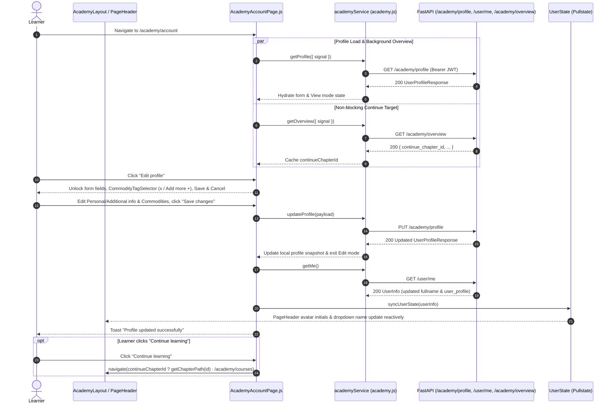

# [LIACD-012] Screen 5: "User Account & Profile" — Feature Specification

**GitHub Issue**: `#885` — `[LIACD-012] Screen 5: "User Account & Profile"`  
**Parent Spec**: `docs/features/001_living_income_academy_spec.md` (`FE-07`, `BE-05`, Figma Node `12029:57236`)  
**Related Specs**: `docs/features/004_shell_header_avatar_tool_switcher_spec.md`, `docs/features/005_tool_level_route_guarding_spec.md`, `docs/features/006_shared_toolkit_profile_spec.md`  
**Branch**: `feature/885-screen-5-user-account-profile` (from `epic/843-li-academy`)  
**Status**: Approved Specification — Ready for `/2-implement`

---

## 1. Overview & 5W1H Requirements Analysis

Screen 5 delivers the **User Account & Profile** experience (`/academy/account`) inside the Living Income Academy shell (`AcademyLayout`). It replaces the current `<AcademyPagePlaceholder title="Account" />` in `frontend/src/App.js` with a complete profile viewing and editing workflow backed by the already-implemented `GET /academy/profile`, `PUT /academy/profile`, `GET /user/me`, and `GET /academy/overview` APIs.

| Dimension | Specification |
| :--- | :--- |
| **Who** | **Authenticated Living Income Academy Learners** (`tools` includes `"academy"`), including both **Academy-only** learners (`["academy"]`) and **Dual-tool** IDC + Academy practitioners (`["idc", "academy"]`), as well as Admins navigating inside the Academy shell. Unauthenticated visitors are blocked by `PrivateRoutes` and redirected to `/login`. |
| **What** | 1. **Account Hero Banner (`AccountHeroBanner.js`)**: Large `160px` circular initials avatar (e.g., `KJ`), full name heading, email subtitle, `"Edit profile"` mode-toggle button (switches between View and Edit modes, or shows `"Cancel"` / `"Save changes"` while editing), and `"Continue learning"` primary CTA button.<br>2. **Personal Info Card (`PersonalInfoCard.js`)**: `First name` (`maxLength=125`, required in edit mode), `Last name` (`maxLength=125`, optional), and read-only `Email` (sourced from `UserState` / `GET /user/me`, never editable).<br>3. **Additional Info Card (`AdditionalInfoCard.js`)**: `Company name` (`maxLength=255`), `Company type` (`Select`, `maxLength=100`), `Sector` (`Select`, `maxLength=100`), `Region` (`Select`, `maxLength=125`), and `Commodities` multi-tag editor.<br>4. **Interactive Commodity Tag Selector (`CommodityTagSelector.js`)**: Renders removable commodity `<Tag>` pills (`×` in edit mode) and an `"Add more +"` trigger opening an inline searchable dropdown/input supporting known master commodities and custom entries with whitespace trimming and deduplication.<br>5. **Global State Synchronization**: Persisting via `PUT /academy/profile` immediately refreshes `UserState` via `GET /user/me` so the top shell header avatar initials (`PageLayout.js`) and dropdown identity card reflect updated names without a browser reload. |
| **Where** | **Frontend Route**: `/academy/account` (`routePath.academy.account`) inside `<AcademyLayout />` (`frontend/src/App.js`).<br>**Frontend Modules**: `frontend/src/pages/academy/AcademyAccountPage.js`, `AcademyAccountPage.scss`, `frontend/src/pages/academy/components/{AccountHeroBanner,PersonalInfoCard,AdditionalInfoCard,CommodityTagSelector}.js`, `frontend/src/pages/academy/services/academy.js`, `frontend/src/pages/academy/index.js`, `frontend/src/store/user.js`.<br>**Backend Modules (Verified Pre-Existing)**: `backend/routes/academy/profile.py`, `backend/db/academy/crud_profile.py`, `backend/models/user_profile.py`, `backend/routes/user.py` (`/user/me`), `backend/routes/academy/course.py` (`/academy/overview`). |
| **When** | Accessed whenever an authenticated learner clicks `"Account"` in the Academy left sidebar (`AcademySidebar.js`) or navigates directly to `/academy/account`. Profile loading executes on mount; `"Continue learning"` navigation uses the learner's next recommended chapter (`continue_chapter_id` from `/academy/overview`, defaulting to `/academy/courses`). |
| **Why** | While `/profile` (`Profile.js`) manages shared toolkit identity (`fullname`, Academy `company_name`, password change), Academy learners lack a dedicated in-shell profile screen for curriculum-relevant demographics (`company_type`, `sector`, `region_name`, `commodities`) and seamless `"Continue learning"` re-entry. Currently `/academy/account` renders a stub `"Account is coming soon"` empty state. |
| **How** | `AcademyAccountPage` orchestrates an Ant Design `<Form>` spanning `PersonalInfoCard` and `AdditionalInfoCard`, initialized from `GET /academy/profile` and `UserState`. In View mode, inputs render read-only/static; clicking `"Edit profile"` unlocks editing. Submitting dispatches `PUT /academy/profile`, calls `academyService.getMe()` to hydrate `UserState` (`syncUserState`), clears any satisfied `IncompleteProfileAlert` dismissal cache, and exits edit mode with a confirmation toast. |

---

## 2. Architecture & Sequence Diagram

1. **Mount & Hydration**: `PrivateRoutes` verifies JWT / `UserState`; `AcademyLayout` renders the sidebar with `"Account"` highlighted via `getActiveMenuKey("/academy/account")`. `AcademyAccountPage` fires `academyService.getProfile({ signal })` (auto-provisioning `user_profile` on the server if missing) and runs a non-blocking background `academyService.getOverview({ signal })` to pre-resolve `continue_chapter_id` for `"Continue learning"`. If `UserState.email` is not yet hydrated, `academyService.getMe()` fills identity fields.
2. **View vs. Edit Mode**: Initial render shows the hero banner (`160px` avatar initials, name, email, `"Edit profile"`, `"Continue learning"`) and the two cards in read-only View mode. Clicking `"Edit profile"` enables form fields, reveals `"Save changes"` and `"Cancel"`, and activates `CommodityTagSelector` (`×` remove & `"Add more +"`). Clicking `"Cancel"` resets form values to the last server snapshot (`form.setFieldsValue(...)`) and restores View mode.
3. **Save & Global State Sync**: Submitting validates fields client-side, trims string inputs, sends `PUT /academy/profile`, updates local profile state with the server response, fetches `GET /user/me` (`academyService.getMe()`), updates `UserState` (`syncUserState`), clears the `IncompleteProfileAlert` dismissal key in `localStorage` if complete, and displays a success message.



---

## 3. Backend Contract Verification (Pre-Existing)

All required backend models, migrations, CRUD helpers, endpoints, and tests already exist in `epic/843-li-academy`. **Zero backend code or Alembic migration changes are required for Screen 5.**

### 3.1 Database Schema (`user_profile` Table)
- **Model**: `backend/models/user_profile.py` (`UserProfile`)
- **Migration**: `backend/alembic/versions/2026_11_05_0429-413e4c18b8eb_create_user_profile_table.py`
- **Columns & Constraints**:
  - `id`: `Integer`, PK, autoincrement
  - `user_id`: `Integer`, `ForeignKey("user.id", ondelete="CASCADE")`, `unique=True`, `index=True`, `nullable=False`
  - `first_name`: `String(125)`, nullable
  - `last_name`: `String(125)`, nullable
  - `company_name`: `String(255)`, nullable
  - `company_type`: `String(100)`, nullable
  - `sector`: `String(100)`, nullable
  - `region_id`: `Integer`, `ForeignKey("region.id", ondelete="SET NULL")`, nullable
  - `region_name`: `String(125)`, nullable
  - `commodities`: `JSONB`, `nullable=False`, default `list` (`[]`)
  - `created_at` / `updated_at`: `DateTime`, server defaults

### 3.2 Verified API Endpoints

#### `GET /academy/profile`
- **Router**: `backend/routes/academy/profile.py` (`academy:get_profile`)
- **Auth**: `HTTPBearer` (`verify_user`) — accessible to any active authenticated user regardless of `"idc"` tool flag.
- **Behavior**: Calls `crud_profile.get_or_create_user_profile(session, user)`. If no `user_profile` row exists, auto-provisions one by splitting `user.fullname` (`split(" ", 1)`) into `first_name` / `last_name` and `commodities=[]`.
- **Response (`200 OK`, `UserProfileResponse`)**:
  ```json
  {
    "id": 1,
    "user_id": 42,
    "first_name": "Kole",
    "last_name": "Johnson",
    "company_name": "IDH Partner Org",
    "company_type": "NGO",
    "sector": "Agriculture",
    "region_id": null,
    "region_name": "West Africa",
    "commodities": ["Cocoa", "Coffee"],
    "created_at": "2026-11-05T04:29:09",
    "updated_at": "2026-11-16T05:00:00"
  }
  ```

#### `PUT /academy/profile`
- **Router**: `backend/routes/academy/profile.py` (`academy:update_profile`)
- **Request (`UserProfileUpdatePayload`, partial updates supported via `exclude_unset=True`)**:
  ```json
  {
    "first_name": "Kole",
    "last_name": "Johnson",
    "company_name": "IDH Partner Org",
    "company_type": "NGO",
    "sector": "Agriculture",
    "region_id": null,
    "region_name": "West Africa",
    "commodities": ["Cocoa", "Coffee"]
  }
  ```
- **Verified Server Rules (`backend/db/academy/crud_profile.py`)**:
  1. **Display Name Sync**: Computes `full_name = f"{profile.first_name or ''} {profile.last_name or ''}".strip()`. When non-empty, updates `user.fullname = full_name` while leaving `user.company` FK unmodified.
  2. **Commodities Sanitization**: Strips whitespace, removes empty items, and deduplicates while preserving order. Sending `null` resets `commodities` to `[]`. Non-list / non-string-list payloads fail with `422 Unprocessable Entity`.
  3. **Region Resolution**: If a non-null `region_id` is passed, validates against the `region` table (`404 Not Found` if missing) and auto-hydrates `region_name` if `region_name` is omitted/blank. When the frontend selects a macro-region string (e.g. `"West Africa"`) or clears `Region`, it MUST explicitly pass `region_id: null` alongside `region_name` so stale `region_id` values are cleared cleanly.
  4. **Length Limits**: `first_name` (125), `last_name` (125), `company_name` (255), `company_type` (100), `sector` (100), `region_name` (125); exceeding returns `422`.

#### `GET /user/me` & `GET /academy/overview`
- `GET /user/me` (`backend/routes/user.py`): Returns `UserInfo` including `email`, `fullname`, `company`, `company_name`, `tools`, and nested `user_profile`.
  - *Dual-Tool Company Note*: In `User.to_user_info` (`backend/models/user.py`), `UserInfo.company_name` resolves from `user.user_company.name` when `"idc" in user.tools` and from `user.profile.company_name` otherwise, whereas `user_profile.company_name` always stores the Academy profile's `company_name` without altering `user.company` FK.
- `GET /academy/overview` (`backend/routes/academy/course.py`): Returns `{ continue_chapter_id, ... }` for routing `"Continue learning"` directly to the next chapter (`getChapterPath(continue_chapter_id)`), falling back to `routePath.academy.courses` if `null` or unavailable.

---

## 4. Frontend Component & Service Specification

### 4.1 Touchpoint File Inventory

| Action | File Path | Responsibility |
| :--- | :--- | :--- |
| `[MODIFY]` | `frontend/src/pages/academy/services/academy.js` | Add `getProfile({ signal })` and `updateProfile(payload)` on `academyService`. |
| `[MODIFY]` | `frontend/src/store/user.js` | Add `syncUserState(userInfo)` helper to update `UserState` consistently after `getMe()` (preserving `defaultUserState` and default export). |
| `[CREATE]` | `frontend/src/pages/academy/AcademyAccountPage.js` | Page container orchestrating data fetch, loading/error states, View/Edit mode state, AntD `<Form>`, save/cancel handlers, `UserState` sync, and `"Continue learning"`. |
| `[CREATE]` | `frontend/src/pages/academy/AcademyAccountPage.scss` | Scoped `#root .academy-account` styles matching Academy design tokens (`_tokens.scss`, `_mixins.scss`) and compact breakpoint (`1366px`). |
| `[CREATE]` | `frontend/src/pages/academy/components/AccountHeroBanner.js` | `160px` circular initials avatar, learner name, email, `"Edit profile"` / `"Cancel"` & `"Save changes"` actions, and `"Continue learning"` button. |
| `[CREATE]` | `frontend/src/pages/academy/components/PersonalInfoCard.js` | Personal info card (`First name`, `Last name`, disabled `Email`). |
| `[CREATE]` | `frontend/src/pages/academy/components/AdditionalInfoCard.js` | Additional info card (`Company name`, `Company type`, `Sector`, `Region`, `Commodities`). |
| `[CREATE]` | `frontend/src/pages/academy/components/CommodityTagSelector.js` | Controlled AntD `<Form.Item>` component rendering removable `<Tag>` items and `"Add more +"` searchable selector / custom entry input. |
| `[MODIFY]` | `frontend/src/pages/academy/index.js` | Export `AcademyAccountPage`. |
| `[MODIFY]` | `frontend/src/App.js` | Mount `<Route exact path={routePath.academy.account} element={<AcademyAccountPage />} />` inside `<AcademyLayout />` and remove `routePath.academy.account` from `academyChildRoutes` placeholder array. |
| `[MODIFY]` | `frontend/src/components/layout/PageLayout.js` | Context-aware `"My Profile"` navigation in desktop avatar dropdown & mobile drawer: route to `routePath.academy.account` when `isCurrentAcademy || !hasIdcAccess`, else `routePath.profile`. |
| `[TEST]` | `frontend/src/pages/academy/services/__tests__/academy.test.js` | Unit tests for `getProfile` (incl. `AbortSignal`) and `updateProfile`. |
| `[TEST]` | `frontend/src/store/__tests__/user.test.js` | Unit tests for `syncUserState` helper and `user_profile` hydration. |
| `[TEST]` | `frontend/src/components/layout/__tests__/PageLayout.test.js` | Unit tests verifying `"My Profile"` routes to `/academy/account` inside `/academy*` or for Academy-only users, and `/profile` for IDC users in IDC. |
| `[TEST]` | `frontend/src/pages/academy/__tests__/AcademyAccountPage.test.js` | Comprehensive RTL unit tests covering loading/error states, View/Edit toggle, validation, `CommodityTagSelector` add/remove/dedup, save + `UserState` sync, cancel rollback, and `"Continue learning"`. |

### 4.2 Service Layer (`frontend/src/pages/academy/services/academy.js`)
Add the following two methods to `academyService`:
```javascript
getProfile: ({ signal } = {}) =>
  academyClient.get("academy/profile", { signal }).then((res) => res.data),
updateProfile: (payload) =>
  academyClient.put("academy/profile", payload).then((res) => res.data),
```
Both automatically inherit `Authorization: Bearer ${api.token}`, `401` token clearing, `5xx` deduplicated toast handling, and `4xx` rejection propagation via `normaliseError`.

### 4.3 State Management (`frontend/src/store/user.js` & Page State)
- **`UserState` (`frontend/src/store/user.js`)**: Export a `syncUserState(data)` helper that safely updates `UserState` from a `GET /user/me` (or login) response:
  - Updates `fullname`, `email`, `role`, `active`, `company`, `company_name`, `user_profile`, `tools`, `internal_user`, `organisation_detail`, `business_unit_detail`, `tags_count`, `cases_count`, `case_access`, `user_type`, `isExternalRegular`, `isCaseCreator`.
  - Keeping this helper in `user.js` ensures `AcademyAccountPage` refreshes `UserState` cleanly without duplicating field-mapping boilerplate.
- **Local State in `AcademyAccountPage.js`**:
  - `profile`: Server snapshot (`UserProfileResponse | null`)
  - `loading` / `error`: Initial load state (`Skeleton` / `Result`)
  - `isEditing`: `boolean` (defaults to `false`, i.e. View mode)
  - `saving`: `boolean` (`PUT /academy/profile` in-flight state)
  - `saveError`: `string | null` (inline `<Alert type="error" />` for `4xx` API errors without wiping form edits)
  - `continueChapterId`: `number | null` (resolved silently in background via `academyService.getOverview({ signal })`)

### 4.4 Component & UI Architecture

#### Wireframe (`Figma 12029:57236`)
```text
+------------------------------------------------------------------------------------+
| [IDH Logo | Toolkit Towards Better Incomes]   IDC | PL | CII | Academy | [KJ v]    |
+--------------------+---------------------------------------------------------------+
| [Quick Search   ]  | +-----------------------------------------------------------+ |
|                    | |  ( KJ )   Kole Johnson           [Edit profile] [Continue | |
| - My overview      | |  160px    kole@example.org                      learning] | |
| - Course Overview  | +-----------------------------------------------------------+ |
| - Academy resources|                                                               |
|                    | +-----------------------------------------------------------+ |
| +----------------+ | | Personal info                                             | |
| | Need help?     | | | +-------------------------+ +---------------------------+ | |
| | [Get help]     | | | | First name              | | Last name                 | | |
| +----------------+ | | | Kole                    | | Johnson                   | | |
| ------------------ | | | +-------------------------+ +---------------------------+ | |
| - Account (Active) | | | Email                                                   | | |
| - Settings         | | | kole@example.org (read-only)                            | | |
|                    | | +---------------------------------------------------------+ | |
|                    | +-----------------------------------------------------------+ |
|                    |                                                               |
|                    | +-----------------------------------------------------------+ |
|                    | | Additional info                                           | |
|                    | | +-------------------------+ +---------------------------+ | |
|                    | | | Company name            | | Company type              | | |
|                    | | +-------------------------+ +---------------------------+ | |
|                    | | +-------------------------+ +---------------------------+ | |
|                    | | | Sector                  | | Region                    | | |
|                    | | +-------------------------+ +---------------------------+ | |
|                    | | Commodities                                               | |
|                    | | [Cocoa x] [Coffee x] [Tea x]               [Add more +]   | |
|                    | +-----------------------------------------------------------+ |
|                    |                      (When editing:) [Cancel] [Save changes]  |
+--------------------+---------------------------------------------------------------+
```

#### Component Specifications (Verified against Figma `12029:57236`)
1. **`AccountHeroBanner.js` (`node 12029:57741`)**:
   - Top decorative header graphic wrap (`200px` height, `overflow: hidden`, `border-top-left-radius: 24px`) with layered abstract landscape/wave background (`#d5ebfd` sky blue + `#cdcfb8` warm sage).
   - Profile row (`px: 32px`, `gap: 24px`, `pb: 24px`):
     - Displays `160px × 160px` circular initials avatar (`border-radius: 200px`, `background: #e6eff6`, `border: 4px solid #ffffff`, `box-shadow: 0px 12px 16px -4px rgba(16,24,40,0.08), 0px 4px 6px -2px rgba(16,24,40,0.03)`), overlapping the bottom of the `200px` graphic wrap, with `#005ea3` initials (`60px` / `72px`, `font-weight: 500`, `letter-spacing: -1.2px`, computed via `getUserInitials({ fullname, user_profile })` with email fallback).
     - Identity & actions row (`pt: 64px` relative to avatar top, `gap: 16px`): displays full name (`32px`/`42px`, `letter-spacing: -0.32px`, `#000000`) and email (`18px`, `#777777`).
   - Action controls (`gap: 8px`, `padding: 10px 16px`, `border-radius: 8px`, `font-size: 14px`):
     - When `!isEditing`: `"Edit profile"` (`Button`, outlined `#005ea3` border/text on `#ffffff`, calls `onEdit()`) + `"Continue learning"` (`Button type="primary"`, `#005ea3` fill, calls `onContinue()`).
     - When `isEditing`: `"Cancel"` (`Button`, resets form & exits edit mode, disabled while `saving`) + `"Save changes"` (`Button type="primary" htmlType="submit"`, `loading={saving}`) + `"Continue learning"`.
2. **`PersonalInfoCard.js` (`node 12029:57285`)**:
   - Outer card: `#ffffff` surface, `border: 1px solid #e0e0e0`, `border-radius: 24px`, `padding: 24px`, `gap: 24px`.
   - Card header (`gap: 8px`): Title `"Personal info"` (`20px`, `#000000`) and subtitle `"Update your photo and personal details."` (`16px`/`24px`, `#777777`).
   - Two-column grid (`24px` gap, collapsing to 1 column `<= 768px`, labels `14px` `#444444`, inputs `border: 1px solid #cbcbcb`, `border-radius: 8px`):
     - `first_name` (`Input`, label `"First name"`, `maxLength={125}`, disabled when `!isEditing`, rules: `required` + `whitespace` + `max: 125`).
     - `last_name` (`Input`, label `"Last name"`, `maxLength={125}`, disabled when `!isEditing`, rules: `max: 125`).
   - Full-width read-only field:
     - `email` (`Input`, label `"Email"`, always `disabled`, helper note `"Email address cannot be changed."`).
3. **`AdditionalInfoCard.js` (`node 12050:71890`)**:
   - Outer card: `#ffffff` surface, `border: 1px solid #e0e0e0`, `border-radius: 24px`, `padding: 24px`, `gap: 24px`.
   - Card header (`gap: 8px`): Title `"Additional info"` (`20px`, `#000000`) and subtitle `"Update your photo and personal details."` (`16px`/`24px`, `#777777`).
   - Two-column responsive rows (`gap: 24px` vertical, `gap: 16px` horizontal):
     - `company_name` (`Input`, label `"Company name"`, `maxLength={255}`, disabled when `!isEditing`). Pre-populates from `profile.company_name`, or for IDC users with null `profile.company_name` displays `userState.company_name` only as placeholder so explicit saves don't silently overwrite unless edited.
     - `company_type` (`Select`, label `"Company type"`, `allowClear`, `showSearch`, disabled when `!isEditing`). Options: `["Private Sector", "NGO", "Government / Public Sector", "Cooperative / Farmer Organization", "Research / Academia", "Financial Institution", "Multilateral / Donor", "Consultancy", "Other"]` (dynamically preserving any existing DB value outside the preset list).
     - `sector` (`Select`, label `"Sector"`, `allowClear`, `showSearch`, disabled when `!isEditing`). Options: `["Agriculture", "Food & Beverage", "Apparel & Textiles", "Retail & Consumer Goods", "Financial Services", "Development & Philanthropy", "Technology & Data", "Other"]` (preserving any existing DB value).
     - `region_name` (`Select`, label `"Region"`, `allowClear`, `showSearch`, disabled when `!isEditing`). Options: `["Global", "West Africa", "East Africa", "Southern Africa", "Latin America & Caribbean", "Southeast Asia", "South Asia", "East Asia", "Europe", "North America", "Middle East & North Africa"]` (dynamically preserving any existing DB `region_name` such as sub-national `Region.name` or `"West-Africa"`).
   - Full-width `<Form.Item name="commodities" label="Commodities">` (label `16px`/`24px`, `#000000`): renders `<CommodityTagSelector disabled={!isEditing} />`.
4. **`CommodityTagSelector.js` (`nodes 12050:72094`, `12145:8175`)**:
   - Props: `value = []`, `onChange`, `disabled = false`, `suggestions` (defaults to deduplicated merge of `commodities.map(c => c.name)` from `frontend/src/store/static.js` plus curated defaults `["Wheat", "Corn", "Grain", "Cocoa", "Sugar", "Cane", "Cotton", "Rice", "Coffee", "Tea", "Rice / Paddy", "Maize", "Oil palm (FFB)", "Rubber", "Vanilla", "Cashew"]`).
   - Behavior:
     - Renders wrapped tag row (`gap: 4px`): each item styled per Figma (`background: #ffffff`, `border: 1px solid #d0d5dd`, `border-radius: 6px`, `padding: 3px 4px 3px 8px`, `gap: 3px`, `12px`/`18px` `#344054` text, `closable={!disabled}` `10px` `×` close button).
     - In View mode (`disabled === true`) with empty array, renders muted empty text (`"No commodities selected"`).
     - In Edit mode (`disabled === false`), renders `"Add more +"` pill trigger (`border: 1px solid #d0d5dd`, `border-radius: 6px`, `padding: 3px 4px 3px 8px`, `gap: 3px`, text `"Add more"` + `14px` `+` icon, `aria-label="Add commodity"`).
     - Clicking `"Add more +"` shows an inline `<AutoComplete>` / `<Input>` combo (`autoFocus`, filtered options excluding already-selected values case-insensitively).
     - Commits entry on `Enter`, comma (`,`), option selection, or explicit add/blur (if non-empty): trims whitespace, splits on comma if pasted, ignores blanks, deduplicates case-insensitively while preserving existing casing, calls `onChange`, and closes/clears the input (`Escape` cancels without adding).

### 4.5 Styling & Accessibility
- Scoped under `#root .academy-account` in `frontend/src/pages/academy/AcademyAccountPage.scss` to outrank global `#root` `TabletGothic` / `RocGrotesk` / `.ant-card` rules in `frontend/src/App.scss`.
- Uses `$academy-primary` (`#005ea3`), `$academy-primary-tint` (`#e6eff6`), `$academy-card-stroke` (`#e0e0e0`), `$academy-panel-radius` (`24px`), `$academy-compact-breakpoint` (`1366px`), and `@include academy-button` / `@include academy-button-outline`.
- `AccountHeroBanner` avatar (`160px x 160px` desktop, stepping down to `112px` below `$academy-compact-breakpoint` and `88px` on mobile `<= 640px`) uses `#e6eff6` (`$academy-primary-tint`) background with `#005ea3` (`$academy-primary`) initials (`>= 4.5:1` WCAG AA contrast), `4px` `#ffffff` ring border, and Elevation MD/LG shadow.
- All controls use native `<button>` / Ant Design `<Form>` labels and `aria-label` attributes (`Remove <commodity>`, `Add more +`) for keyboard and screen-reader accessibility.

> **Relationship to `"My Profile"` (`/profile`) & Context-Aware Header Routing**: [Profile.js](file:///Users/galihpratama/Sites/IDH-IDC/frontend/src/pages/profile/Profile.js) remains untouched as the shared toolkit account/password page (`routePath.profile = "/profile"`), while **Screen 5 (`/academy/account`)** replaces `<AcademyPagePlaceholder title="Account" />`. In [PageLayout.js](file:///Users/galihpratama/Sites/IDH-IDC/frontend/src/components/layout/PageLayout.js), clicking `"My Profile"` in the top-right avatar dropdown or mobile drawer uses context-aware routing (`profileTargetRoute = isCurrentAcademy || !hasIdcAccess ? routePath.academy.account : routePath.profile`): Academy-only users and any user currently inside `/academy*` go to `/academy/account`, whereas IDC users outside `/academy*` go to `/profile`.

---

## 5. Technical Research Audit

| Area | Audited Finding & Architectural Constraint |
| :--- | :--- |
| **Stack & Library Versions** | Verified in `frontend/package.json`: React `18.2.0`, Ant Design `5.9.3`, React Router `6.15.0`, Axios `0.25.0`, Pullstate `1.23.0`, `node-sass` `7.0.1`, Jest / `@testing-library/react` `14.0.0`. AntD v5 `<Select options={...} />`, `<Tag closable />`, `<AutoComplete options={...} />`, and `<Form.useForm()>` are supported natively. |
| **Region Endpoint Gap** | `backend/routes/region.py` only exposes `GET /region/options?country_id={id}` (sub-national benchmark regions for a country, returning `404` if none). There is no global macro-region list endpoint. Therefore `AdditionalInfoCard` MUST use curated `region_name` options (preserving any pre-existing `region_name`), and send `region_id: null` whenever `region_name` is changed or cleared via the dropdown so `crud_profile.py` does not retain a mismatched `region_id`. |
| **Global `App.scss` Specificity** | `frontend/src/App.scss` defines `#root .ant-card { font-family: "TabletGothic" !important }`, `#root .ant-card .ant-card-body { font-family: "RocGrotesk" !important }`, `#root h1 { font-weight: 900 !important }`, and `#root .ant-btn { font-size: 13px }`. `AcademyAccountPage.scss` MUST scope overrides under `#root .academy-account` (matching `AcademyOverviewPage.scss` and `AcademyResourcesPage.scss`). |
| **Header Avatar Sync Trap** | `PageLayout.js` computes header avatar initials via `getUserInitials({ user_profile: userProfile }) || getInitials(fullname, email)` and dropdown name via `UserState.fullname`. Updating `UserState` via `academyService.getMe()` -> `syncUserState(me)` right after `PUT /academy/profile` ensures both `fullname` and `user_profile.{first_name,last_name}` update atomically. |
| **Dual-Tool `company_name` Semantics** | In `User.to_user_info` (`backend/models/user.py`), `UserInfo.company_name` mirrors `user.user_company.name` when `"idc" in tools` and `user.profile.company_name` otherwise. `PUT /academy/profile` updates `user_profile.company_name` without corrupting `user.company` FK. `AcademyAccountPage` reads/writes `user_profile.company_name` cleanly via `/academy/profile`. |
| **Empty `window.master` in Jest** | `frontend/src/store/static.js` derives `commodities` from `window.master?.commodity_categories || []`, which is `[]` in Jest and unseeded contexts. `CommodityTagSelector` MUST merge `commodities` with a built-in fallback list so suggestions always work in unit tests and offline shells. |
| **Security & Validation (`[SEC]`)** | Route is inside `<PrivateRoutes />` (auth-enforced, open to both `academy` and `idc` tools). Client validates max lengths (`125`/`255`/`100`) matching Pydantic `UserProfileUpdatePayload`; server enforces authoritative JWT scoping (`verify_user`) and input sanitization (`crud_profile.py`). No raw HTML rendering (`dangerouslySetInnerHTML`) is used. |

---

## 6. Verification Plan & Vibe Coding Estimation

### 6.1 Automated Tests & Linting (Docker Mandatory)
- **Backend Regression (already implemented)**:
  ```bash
  ./dc.sh exec backend pytest tests/test_academy_profile_api.py tests/test_user_profile_model.py -v
  ```
- **Frontend Unit Tests (target `>= 80%` coverage on all new/modified Academy Account files)**:
  ```bash
  ./dc.sh exec frontend yarn test:ci --watchAll=false src/pages/academy/__tests__/AcademyAccountPage.test.js src/pages/academy/services/__tests__/academy.test.js src/store/__tests__/user.test.js
  ```
- **Frontend Full Suite, Linting & Formatting**:
  ```bash
  ./dc.sh exec frontend yarn test:ci
  ./dc.sh exec frontend yarn lint
  ./dc.sh exec frontend yarn prettier-write
  ```

### 6.2 Manual Verification Steps
1. Sign in as an Academy learner, verify `/academy/account` loads via sidebar `"Account"` without `"coming soon"` placeholder, displaying `160px` avatar initials, full name, email, and read-only View mode.
2. Click `"Edit profile"`, modify `First name`, `Last name`, `Company name`, `Company type`, `Sector`, `Region`, add/remove commodity tags (via `"Add more +"` dropdown, Enter/comma custom entry, and `×`), and click `"Cancel"` — confirm edits revert cleanly.
3. Re-enter Edit mode, apply valid updates, click `"Save changes"` — confirm toast notification, View mode restoration, immediate header avatar initials update, and persistence after hard browser refresh (`F5`).
4. Click `"Continue learning"` — confirm navigation routes to `/academy/courses?chapter=<id>` (or `/academy/courses` when `continue_chapter_id` is `null`).
5. Verify responsive layout down to `1024px` laptop width and `375px` mobile width with zero horizontal overflow.

### 6.3 Vibe Coding Estimation Breakdown

- **Confidence Level**: High (backend APIs 100% complete & verified; Academy layout/theme/test patterns already established in screens 1–4)
- **Dependencies**: None (`epic/843-li-academy` backend profile endpoints and `AcademyLayout` shell are already merged)

| Task ID | Component & Description | Vibe Coding (Dev) | Automated Testing | QA & Review | Total Est. Time | Priority |
| :--- | :--- | :---: | :---: | :---: | :---: | :--- |
| **T-01** | **Service & Store Alignment**: Add `getProfile` & `updateProfile` in `academy.js`; add `syncUserState` helper in `store/user.js`. | 20m | 25m | 10m | **55m (0.9h)** | Must Have |
| **T-02** | **Hero Banner & Personal Info Card**: Create `AccountHeroBanner.js` (`160px` avatar, Edit/Save/Cancel, `"Continue learning"`) and `PersonalInfoCard.js`. | 40m | 25m | 15m | **80m (1.3h)** | Must Have |
| **T-03** | **Commodity Tag Selector & Additional Info Card**: Create `CommodityTagSelector.js` (`×` remove, `"Add more +"`, suggestions, Enter/comma, dedup) and `AdditionalInfoCard.js`. | 55m | 35m | 20m | **110m (1.8h)** | Must Have |
| **T-04** | **Page Assembly, Styling & Route Mounting**: Create `AcademyAccountPage.js` & `AcademyAccountPage.scss`, export in `pages/academy/index.js`, mount `/academy/account` in `App.js`. | 50m | 35m | 20m | **105m (1.8h)** | Must Have |
| **T-05** | **Integration Tests, Lint & Responsive QA**: Write full `AcademyAccountPage.test.js`, run `yarn test:ci` (`>=80%` cov), `yarn lint`, `prettier-write`, and manual browser check. | 15m | 40m | 25m | **80m (1.3h)** | Must Have |
| **TOTAL** | **Complete Screen 5 Delivery (`FE-07`)** | **180m (3.0h)** | **160m (2.7h)** | **90m (1.5h)** | **430m (7.2h)** | **Must Have** |
