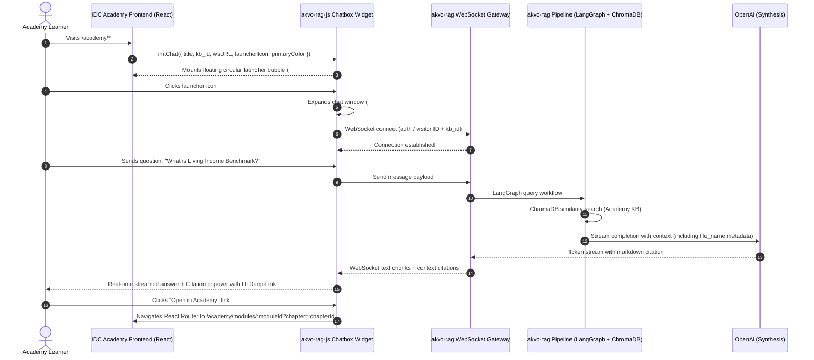

# [#013] Feature Spec: IDC Academy AI Chatbot Integration (MVP)

> **Status**: DRAFT / PROPOSED  
> **Target Release**: IDC Academy MVP  
> **Approach**: `akvo-rag` (main branch as-is) + `akvo-rag-js` (customized launcher icon UI)  
> **Total Effort**: ~10.0 hours (3 Major Work Packages)

---

## 1. Requirements Discovery (5W1H)

* **Who (Target Personas)**: 
  * IDC Academy Learners & Practitioners browsing Living Income Academy modules who need immediate answers on definitions, formulas, living income benchmarks, and course guidance.
* **What (Core Deliverable)**: 
  * An embedded, branded AI chatbot widget mounted across IDC Academy pages.
  * Powered by `akvo-rag` (WebSocket streaming) and bundled via `akvo-rag-js`.
  * Customized with IDC brand palette (`#007A78`), custom bot launcher icon/avatar, and start-minimized state.
* **Where (System Locations)**:
  1. `akvo-rag-js` (`~/Sites/akvo-rag-js`): UI enhancement for customizable floating launcher button, custom icon/avatar rendering, and dynamic brand coloring.
  2. `akvo-rag` (`~/Sites/akvo-rag`): Tenant registration for IDC, dedicated Knowledge Base creation (`idc-academy-kb`), and curriculum document ingestion.
  3. `IDH-IDC` (`frontend/src/pages/academy`): React integration wrapper mounting the widget inside `AcademyLayout.js`.
* **When (Timeline)**: MVP rollout for Living Income Academy.
* **Why (User Value)**: 
  * Learners can ask natural language questions while taking courses without navigating away or filing support tickets.
  * MVP uses existing infrastructure without risking backend delays.
* **How (Technical Flow)**:
  1. `akvo-rag-js` is patched with customizable launcher icon and theme support, built, and released.
  2. IDC is registered as an app in `akvo-rag`, and Academy curriculum is uploaded to a dedicated KB.
  3. IDC frontend initializes `initChat(...)` on `/academy/*` routes with IDC-specific bot icons and WebSocket URL.
  4. Learner clicks floating icon $\rightarrow$ widget expands $\rightarrow$ user chats via WebSocket to `akvo-rag`.

---

## 2. Architecture & Data Flow



---

## 3. Citation & UI Deep-Linking Strategy 🔗

### 3.1 Overview & Package Dependency
**Does `akvo-rag-js` need another update for deep-linking?**  
**No.** `akvo-rag-js@1.3.0` already parses assistant responses through `marked.js` and sanitizes with `DOMPurify`. Any relative markdown link generated by the LLM (e.g., `[Module 1, Chapter 2](/academy/modules/1?chapter=2)`) is rendered as a standard clickable HTML anchor tag (`<a href="...">`).

### 3.2 In-Message Link Strategy (Level 1 — Primary)
1. **Prompt Grounding**: The system prompt in `akvo-rag` instructs the model:
   > *"When your answer is derived from curriculum documents, always append a referral link at the end formatted as:*  
   > `📖 You can find this in [Module {X}, Chapter {Y}: {Title}](/academy/modules/{X}?chapter={Y})`"
2. **Curriculum Filenames**: Documents are ingested with structured filenames (`module-1-chapter-2-income-gap.pdf`). Chunks carry the chapter and module numbers directly in their source titles, giving the LLM the exact context needed to output the correct URL.

### 3.3 SPA Navigation Interception (IDC Frontend)
Because IDC is a Single Page Application (Create React App), clicking `<a href="/academy/modules/...">` inside the chatbot would trigger a full browser refresh if unhandled.  
In `frontend/src/pages/academy/components/AcademyChatbot.js`, an event listener intercepts internal navigation clicks and delegates to React Router:
```javascript
// Delegate internal academy links to React Router without full browser reload
useEffect(() => {
  const container = document.getElementById("akvo-rag");
  if (!container) return;

  const handleLinkClick = (e) => {
    const anchor = e.target.closest("a");
    if (!anchor) return;

    const href = anchor.getAttribute("href");
    if (href && href.startsWith("/academy/")) {
      e.preventDefault();
      history.push(href);
    }
  };

  container.addEventListener("click", handleLinkClick);
  return () => container.removeEventListener("click", handleLinkClick);
}, [history]);
```

### 3.4 Citation Popover Link (Level 2 — Optional Backlog)
Hovering over citation tags (`<sup>[1]</sup>`) displays source file metadata (`Source: module-1-chapter-2.pdf, Page 3`). Extending the popover with an explicit clickable button can be handled in a future patch via an optional `citationLinkResolver(metadata)` prop.

---

## 4. Work Package Breakdown (Asana Tasks)

Instead of micro-tasks, the implementation is organized into **3 high-level, cohesive work packages**:

```
┌─────────────────────────────────────────────────────────────────────────────┐
│                       IDC Academy Chatbot MVP (Epic)                        │
└──────────────────────────────────────┬──────────────────────────────────────┘
                                       │
        ┌──────────────────────────────┼──────────────────────────────┐
        ▼                              ▼                              ▼
┌─────────────────────────┐  ┌─────────────────────────┐  ┌─────────────────────────┐
│       PACKAGE 1         │  │       PACKAGE 2         │  │       PACKAGE 3         │
│ akvo-rag-js Enhancement │  │ akvo-rag KB Ingestion & │  │ IDC Frontend Integration│
│ (Launcher & Custom UI)  │  │ App Tenant Connection   │  │ & E2E Verification      │
│  [Est: 3.5 hrs]         │  │  [Est: 3.0 hrs]         │  │  [Est: 3.5 hrs]         │
└─────────────────────────┘  └─────────────────────────┘  └─────────────────────────┘
```

---

### CHAT-001: `akvo-rag-js` Package Enhancement (Launcher & Custom UI) - [COMPLETED]
* **Goal**: Modernize the widget with a floating circular launcher button (FAB), dynamic theme colors, and custom icon support.
* **Status**: **COMPLETED & MERGED** (Merged in PR [#17](https://github.com/akvo/akvo-rag-js/pull/17), Tag `v1.3.0`, 49/49 unit tests passing).
* **Scope**:
  * **Floating Launcher (FAB)**: Added `#akvo-rag-launcher` circular bubble (`56x56px`) at bottom-right. Added `startMinimized: true` default so the widget mounts as a discrete button rather than an intrusive 360x500 box.
  * **Customizable Icons**: Added `launcherIcon` and `headerIcon` options supporting SVG strings, image URLs, or FontAwesome classes with DOMPurify sanitization.
  * **Brand Theming**: Exposed `--akvo-primary` CSS custom property and `options.primaryColor` to dynamically inherit IDC's primary teal (`#007A78`).
  * **Quality & Release**: Added 20+ unit tests in `tests/unit/launcher.test.mjs`, verified webpack production bundle (`dist/`), and released version `1.3.0`.
* **Deliverable**: Published NPM package `akvo-rag-js@1.3.0` ready for IDC consumption.
* **User Acceptance Criteria (UAC)**:
  - [x] **UAC-1.1 (Floating Launcher Button)**: By default (or when `startMinimized: true`), a floating circular launcher icon (`56x56px`) renders in the bottom-right corner of the host page (`bottom: 24px; right: 24px; z-index: 99998`), without obstructing the main content with an open chatbox.
  - [x] **UAC-1.2 (Toggle & Expand)**: Clicking the floating launcher smoothly reveals the chatbox container (`#akvo-rag`) and hides the floating button.
  - [x] **UAC-1.3 (Minimize / Close)**: Clicking the close/minimize button in the chat header hides the chatbox container and restores the floating launcher button.
  - [x] **UAC-1.4 (Custom Icon Support)**: When `launcherIcon` is passed, the launcher displays the custom SVG icon, image URL, or font icon; if omitted, it defaults to a clean comment bubble icon.
  - [x] **UAC-1.5 (Header Avatar / Icon)**: When `headerIcon` is passed, an icon or avatar is rendered in the chat header adjacent to the title text.
  - [x] **UAC-1.6 (Theme Color Harmonization)**: The launcher button and chat header background adapt to the provided primary color without hardcoded blue defaults.
* **Technical Acceptance Criteria (TAC)**:
  - [x] **TAC-1.1 (Backward Compatibility)**: Existing `akvo-rag-js` consumers with standard options (`title`, `kb_id`, `wsURL`) continue functioning without breaking changes.
  - [x] **TAC-1.2 (Icon Prop Sanitization)**: `_renderIcon` safely renders SVG markup, image URLs (`.svg`, `.png`, `http...`), or CSS classes (`fa ...`), sanitizing any inline HTML via DOMPurify to prevent XSS (`[SEC]`).
  - [x] **TAC-1.3 (CSS Custom Variables)**: Uses `--akvo-primary` variable in SCSS for launcher, header, send button, and citation highlights; sets inline style on container when `options.primaryColor` is specified.
  - [x] **TAC-1.4 (Automated Unit Tests)**: Unit tests in `akvo-rag-js/tests/` verify DOM creation of `#akvo-rag-launcher`, visibility toggling when launcher and close button are clicked, `startMinimized: true` behavior, and SVG/image/font-icon rendering branches (49/49 passed).
  - [x] **TAC-1.5 (Build & Release Gate)**: `npm test` passes 100%; `npm run build` generates valid `dist/akvo-rag.js` and `dist/akvo-rag.css`; published version `1.3.0` to GitHub / NPM.

---

### CHAT-002: Module 1 PDF Ingestion, A/B Benchmark & Academy KB Setup
* **Goal**: Ingest Module 1 curriculum PDFs into `akvo-rag`, run an A/B benchmark between Single PDF vs. Per-Chapter PDFs, and establish the production KB with citation deep-linking metadata.
* **Scope**:
  * **A/B Ingestion Setup**:
    * Create **KB A** (`IDC-Mod1-Single`): Upload the complete Module 1 combined PDF.
    * Create **KB B** (`IDC-Mod1-Chapters`): Upload individual chapter PDFs structured with standard naming convention (`module-1-chapter-{id}-{slug}.pdf`).
  * **Comparative Benchmark**:
    * Execute 4 evaluation queries (core definition, specific calculation, chapter takeaways, and overall summary).
    * Compare semantic retrieval accuracy, cosine similarity, and citation readability.
  * **Knowledge Base Finalization**:
    * Finalize the optimal KB structure and capture the active `KB_ID` for frontend environment wiring.
* **Deliverable**: Active, benchmarked Knowledge Base ID in `akvo-rag` with validated chapter citations.
* **User Acceptance Criteria (UAC)**:
  - [ ] **UAC-2.1 (Domain-Accurate Answers)**: Chatbot accurately answers questions regarding Module 1 concepts, Living Income definitions, Benchmarks, and core methodologies.
  - [ ] **UAC-2.2 (Clear Citation Source)**: Citation popovers and reference badges clearly display the source document title and chapter (e.g. `module-1-chapter-2.pdf`, Page X).
  - [ ] **UAC-2.3 (Out-of-Scope Fallback)**: For questions not covered by the curriculum, the assistant responds politely without fabricating living income figures.
  - [ ] **UAC-2.4 (Fast Streaming Feedback)**: User receives instant token-by-token streaming responses without timeout errors or dropped connections.
* **Technical Acceptance Criteria (TAC)**:
  - [ ] **TAC-2.1 (Hermetic Ingestion Pipeline)**: All uploaded PDFs are successfully processed through MinIO S3 and `mcp-vector-kb-ingestion`, verifying chunk records in `vkb_document_chunks` and embeddings in ChromaDB collection `kb_<id>`.
  - [ ] **TAC-2.2 (Deterministic Filename Mapping)**: Per-chapter PDFs follow the strict naming regex `^module-\d+-chapter-\d+.*\.pdf$` to ensure predictable downstream citation link parsing.
  - [ ] **TAC-2.3 (A/B Evaluation Scorecard)**: Comparative analysis between Single PDF and Per-Chapter PDFs is documented with retrieval latency, top-k chunk relevance, and citation granularity.
  - [ ] **TAC-2.4 (Query Retrieval Benchmark)**: Verify that querying *"What is Living Income Benchmark?"* returns top-3 relevant chunks with cosine similarity score $\ge 0.70$.

---

### CHAT-003: IDC Frontend Integration, Citation Deep-Linking & E2E Verification
* **Goal**: Mount `akvo-rag-js` across IDC Academy, wire environment configurations, enable seamless React Router deep-linking for citations, and verify user experience.
* **Scope**:
  * **Package Setup & Config**: Install `akvo-rag-js@^1.3.0` in `frontend/package.json`. Add `.env.example` configurations (`REACT_APP_AKVO_RAG_WS_URL`, `REACT_APP_AKVO_RAG_KB_ID`).
  * **React Wrapper Component**: Create `frontend/src/pages/academy/components/AcademyChatbot.js`. Integrate into `AcademyLayout.js` with clean mounting and unmount cleanup (`chat.destroy()`).
  * **Citation & In-Text Deep-Linking**: Attach click handler to intercept `/academy/modules/...` links in the chat widget and route via React Router (`history.push`), allowing learners to click a citation and jump straight to that lesson without page reloads.
  * **Asset & Style Harmonization**: Add IDC branded SVG/PNG bot icon asset. Set primary color to `#007A78`. Ensure z-index layering avoids conflicts with headers and notifications.
  * **Regression & Verification Pass**: Run `./dc.sh exec frontend yarn lint` and `yarn test:ci`. Perform full browser walkthrough across desktop and mobile viewports.
* **Deliverable**: Live, production-ready AI chatbot in IDC Academy with clickable lesson deep-links.
* **User Acceptance Criteria (UAC)**:
  - [ ] **UAC-3.1 (Global Academy Presence)**: The floating bot icon appears across all `/academy/*` routes (`/academy`, `/academy/modules/:id`, `/academy/resources`, `/academy/account`, `/academy/settings`).
  - [ ] **UAC-3.2 (Clickable Lesson Links)**: When the chatbot references a module or chapter (e.g. *"You can find this in Module 1, Chapter 2"* or citation link), clicking the link navigates directly to `/academy/modules/1?chapter=2` inside the Academy UI.
  - [ ] **UAC-3.3 (IDC Branding Alignment)**: The launcher icon displays the official IDC robot/chat icon in IDH brand teal (`#007A78`), perfectly matching the Academy layout tokens.
  - [ ] **UAC-3.4 (Non-Intrusive Layout)**: Chat window and floating button do not overlap key Academy controls (like "Continue learning" buttons or mobile sidebar toggles) and maintain comfortable margin on mobile viewports ($\le 768px$).
  - [ ] **UAC-3.5 (Session & Error Handling)**: If WebSocket connection disconnects or network fails, an inline reconnecting status is shown gracefully without crashing the React tree.
* **Technical Acceptance Criteria (TAC)**:
  - [ ] **TAC-3.1 (Hermetic Component Lifecycle)**: `AcademyChatbot.js` wraps `initChat` in `useEffect`. On unmount or route transition away from Academy (e.g. navigation to `/cases` or `/tool`), invokes `chat.destroy()`, closes WebSocket, and cleans up DOM nodes to eliminate memory leaks.
  - [ ] **TAC-3.2 (SPA Link Interception)**: Chat container intercepts clicks on anchor tags matching `^/academy/.*` and delegates to React Router `history.push(...)` instead of triggering a full browser refresh.
  - [ ] **TAC-3.3 (Environment Configuration)**: Exposes `REACT_APP_AKVO_RAG_WS_URL` and `REACT_APP_AKVO_RAG_KB_ID` in `.env.example`. Throws a descriptive console warning (and fails closed safely) if env vars are missing.
  - [ ] **TAC-3.4 (Z-Index & CSS Scoping)**: Styles are encapsulated inside `#akvo-rag` and `#akvo-rag-launcher`; z-index set to `9999` (under full-screen modal overlays, but above Academy sticky header).
  - [ ] **TAC-3.5 (Automated Quality Gates)**: Frontend unit test (`AcademyChatbot.test.js`) verifies component mounting, props forwarding, and destroy cleanup call on unmount; `./dc.sh exec frontend yarn lint` passes with 0 ESLint errors/warnings; `./dc.sh exec frontend yarn test:ci` passes 100% across all suites.

---

## 5. Estimation Table for Asana ⏱️

> Tasks follow the 3-part Vibe Coding breakdown: **Vibe Coding (Dev)** + **Automated Testing** + **QA & Review** = **Total Est. Time**.

| Task ID | Task Title (Asana Task) | Vibe Coding (Dev) | Automated Testing | QA & Review | Total Est. Time | Status / Priority |
| :--- | :--- | :---: | :---: | :---: | :---: | :--- |
| **CHAT-001** | **`akvo-rag-js` Launcher & Custom UI Enhancement**<br>Add floating circular bubble, `startMinimized`, custom icon/avatar support, CSS `--akvo-primary`, unit tests & patch release. | 1.8h | 1.0h | 0.7h | **3.5h** | **✅ DONE** (v1.3.0) |
| **CHAT-002** | **Module 1 PDF Ingestion, A/B Benchmark & KB Setup**<br>Ingest Single PDF vs. Per-Chapter PDFs in `akvo-rag`, benchmark retrieval quality, verify citation filenames & establish KB ID. | 1.5h | 0.8h | 0.7h | **3.0h** | P0 (Must) |
| **CHAT-003** | **IDC Frontend Integration & Citation Deep-Linking**<br>Mount `AcademyChatbot.js`, wire env vars, add SPA citation link routing to `/academy/modules/:id?chapter=:id`, lint & test pass. | 1.7h | 1.0h | 0.8h | **3.5h** | P0 (Must) |
| **TOTAL** | **Full MVP AI Chatbot Integration** | **5.0h** | **2.8h** | **2.2h** | **10.0h (~1.25 days)** | *(3.5h Completed)* |

---

## 6. Post-MVP Backlog (Phase 2 - ToC RAG & Dynamic Tree Traversal)
* `[BACKLOG-01]` Generic Markdown header chunker in `vector-kb-mcp`.
* `[BACKLOG-02]` `source_url` metadata passthrough in `query_answering_workflow.py`.
* `[BACKLOG-03]` Clickable module/chapter link rendering in `akvo-rag-js` markdown parser (`/academy/modules/:id?chapter=:id`).
