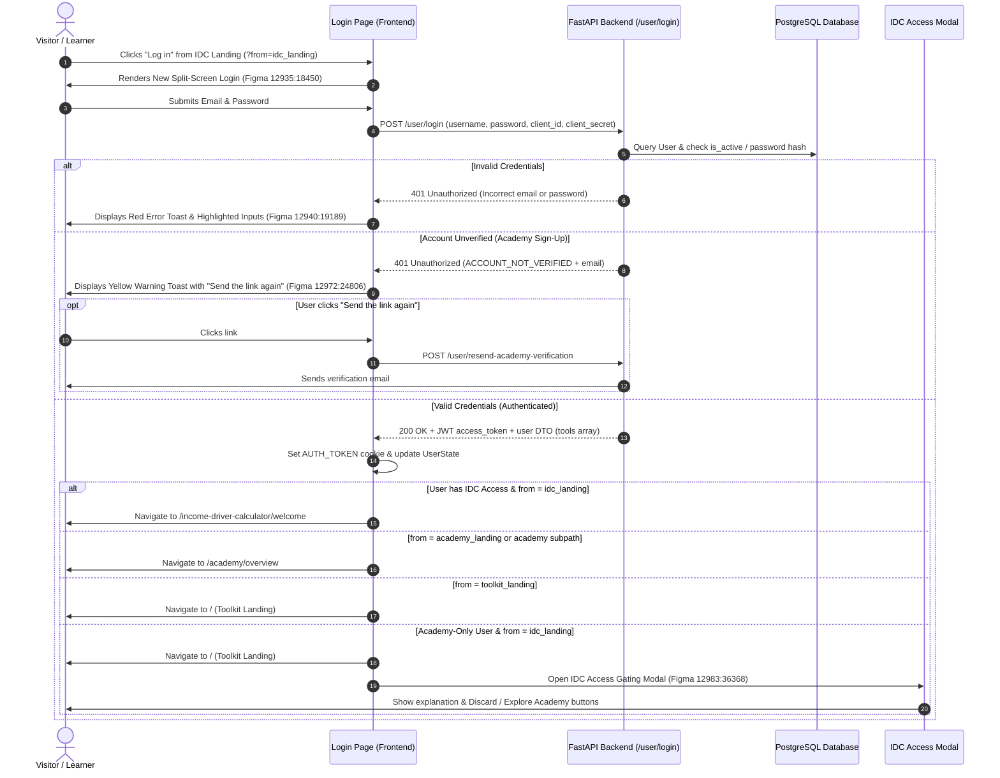

# Feature Specification: New Toolkit Login & Smart Redirection Flow

> **Document ID**: `docs/features/015_new_toolkit_login_page_spec.md`  
> **Status**: Implemented (#896) — Origin return & mobile modal refined in `docs/features/023_after_logged_in_avatar_menu_spec.md` (`[TLSA-016]` / #917)  
> **Target Release**: Living Income Academy & IDC Shared Toolkit  
> **Figma Source**: [Living Income Academy 2026 - Node 10612-21056](https://www.figma.com/design/ga4EMPcp00Bh0d883khSs6/Living-income-academy?node-id=10612-21056&t=u2lPXhpCtpFNt2uj-1)  
> **Related Specs**:  
> - `docs/features/001_living_income_academy_spec.md` (Base Academy schema & profile)  
> - `docs/features/002_toolkit_login_shared_access_spec.md` (Tool array permissions & shared cookie)  
> - `docs/features/003_academy_public_registration_spec.md` (Public sign-up & email verification)  
> - `docs/features/005_tool_level_route_guarding_spec.md` (Access control & route guards)  

---

## Overview

The **New Toolkit Login Page** replaces the legacy Income Driver Calculator (IDC) login screen with a unified, modern sign-in gateway for the entire **Toolkit Towards Better Incomes**. Users authenticate once with their unified credentials (`AUTH_TOKEN` session cookie) to access both the **Living Income Academy** and the **Income Driver Calculator**.

The new login experience introduces:
1. **Figma-Accurate Visual Identity**: 50/50 split-screen layout with an onboarding panel on the left (IDH branding, clean typography, pill buttons) and curved collaborative hero imagery on the right (`rounded-bl-[80px] rounded-tl-[80px]`).
2. **Context-Aware Smart Redirection**: Remembers where the visitor originated (Top Navigation, Toolkit Landing, IDC Landing, or Academy Landing) and deterministically navigates them to the appropriate tool after successful authentication.
3. **Graceful Access Gating & Note Modal**: If an Academy-only user attempts to log in from the IDC landing page or access restricted IDC tools, they are guided back to the Toolkit landing page accompanied by an informative modal explaining how to request IDC access.
4. **Comprehensive Status & Error Handling**: Bespoke in-form toast alerts for incorrect credentials, unverified email accounts (with instant "resend link" capability), and account verified confirmation state.

---

### 5W1H Requirements Analysis

| Dimension | Specification |
| :--- | :--- |
| **Who (Personas)** | - **IDC Enterprise User (`tools: ['idc', 'academy']`)**: Full access to IDC calculation models and Academy courses.<br>- **Academy Public Learner (`tools: ['academy']`)**: Full access to Academy; restricted from private IDC supply chain cases.<br>- **Unverified Registrant (`is_active: 0`, pending verification)**: Must confirm email before gaining entry. |
| **What (Core Scope)** | - Rebuild `/login` following Figma node `10612-21056` (Frames `12935:18450`, `12940:19189`, `12972:24806`, `12983:36368`, `12943:7471`).<br>- Implement origin-tracking redirection matrix based on entry point and user tool permissions.<br>- Add backend support for unverified account detection and verification email resend.<br>- Add IDC Access Note Modal with "Don't show again" local persistence. |
| **Where (System Location)** | - **Frontend**: `frontend/src/pages/login/Login.js`, `login.scss`, `frontend/src/components/layout/PageLayout.js`, `frontend/src/components/utils/idcAccessModal.js` (upgraded from existing modal), `frontend/src/pages/home/Home.js`.<br>- **Backend**: `backend/routes/user.py` (`/user/login`, `/user/resend-academy-verification`), `backend/middleware.py` (30-day JWT TTL). |
| **When (Triggers)** | - Triggered when a visitor clicks "Log in" / "Sign In" in the header navigation or on any landing page (Toolkit, IDC, Academy), or attempts to enter a protected route without authentication. |
| **Why (Business Value)** | - Positions the platform as a cohesive multi-tool suite rather than a standalone calculator.<br>- Prevents confusion for public Academy learners while securing enterprise supply chain data. |
| **How (Technical Approach)** | - Shared JWT cookie (`AUTH_TOKEN`), React Router query param / state propagation (`?from=...` or `location.state.from`), Ant Design v5 Form components wrapped in bespoke SCSS matching Figma tokens. |

---

## Architecture & Smart Redirection Matrix

### Post-Login Routing Matrix

When a user logs in, the platform evaluates **User Permissions (`user.tools`)** against **Origin (`from` parameter or referrer)**:

| User Type | Came From (Origin) | Target Destination | Post-Login UX / Notes |
| :--- | :--- | :--- | :--- |
| **IDC User** (`['idc', 'academy']`) | **IDC Landing Page** (`/income-driver-calculator`) | **IDC Dashboard** (`/income-driver-calculator/welcome`) | Direct entry to calculator workspace. |
| **Any User** (IDC or Academy) | **Academy Landing / Page** (`/academy` or subpath) | **Academy My Overview** (`/academy/overview`) | Direct entry to learning overview. |
| **Any User** (IDC or Academy) | **Toolkit Landing Page** (`/`) | **Toolkit Landing Page** (`/`) | Stays on Toolkit home, now authenticated (avatar visible). |
| **Academy-Only User** (`['academy']`) | **IDC Landing Page** (`/income-driver-calculator`) | **Toolkit Landing Page** (`/`) | **Note Modal Appears**: *"You don’t have access to the Income Driver Calculator yet."* Explains email invitation request process. |
| **Any User** | **Public Toolkit Pages** (`/procurement-library`, `/cocoa-income-inventory`, `/tools-and-resources`, `/income-driver-calculator/faq` via `?from=<pathname+search>`) | Exact Originating Page (`pathname + search`) | Preserves full query parameters (`#917`). |
| **Admin (`admin` / `super_admin`)** | **Admin Routes** (`/admin/*` via `?from=` or `?redirect=`) | Target `/admin/*` Route | Allowed regardless of `"idc"` in `user.tools` (`#917`). |
| **Any User** | **Specific Deep Link** (e.g., `/income-driver-calculator/cases/10`) | Target Deep Link (if authorized) OR `/academy/overview` (if unauthorized) | Preserves deep linking for authorized workflows. |

---

### Sequence Diagram: Authentication & Smart Redirection



---

## 1. Backend Implementation

### 1.1 Database Schema
No schema changes are required for this phase. The `user.tools` PostgreSQL array column (`tools = Column(ARRAY(String), nullable=False, server_default='{}')`) and `user.is_active` / `user.invitation_id` attributes are already established in migrations `b7c8d9e0f1a2` and `a6b4d5e6f7a8`.

---

### 1.2 API Router Updates
**File**: `backend/routes/user.py`

#### 1.2.1 Enhanced `POST /user/login` Error Handling
- **Current Behavior**: If `not user or not user.is_active`, returns generic `"Incorrect email or password."` or `"You can't login until your account is approved."`.
- **New Behavior**: Distinguish between bad credentials vs. an unverified Academy self-registration:
  - If user exists, password is valid, but `user.is_active == 0` and `user.invitation_id` is present (pending verification token):
    - Return HTTP 401 with JSON detail:
      ```json
      {
        "detail": "Please confirm your email address first.",
        "error_code": "ACCOUNT_NOT_VERIFIED",
        "email": "user@example.com"
      }
      ```
  - Allows the frontend to instantly trigger the yellow warning banner matching Figma frame `12972:24806`.

#### 1.2.2 New Endpoint: `POST /user/resend-academy-verification`
- **Purpose**: Resends the verification email when a user clicks "send the link again" on the login warning banner.
- **Request Payload**:
  ```json
  {
    "email": "user@example.com"
  }
  ```
- **Response Payload**:
  ```json
  {
    "message": "Verification link has been resent to your email address."
  }
  ```
- **Logic**:
  1. Validate email format.
  2. Query user by email.
  3. If user exists, `is_active == 0`, and `tools` contains `'academy'`:
     - If `invitation_id` is missing/expired, generate a new `secrets.token_hex(32)`.
     - Dispatch `ACADEMY_VERIFY` email using standard `mailer.py`.
  4. Always return 200 OK (even if email not found, to prevent email enumeration attacks).

---

## 2. Frontend Implementation

### 2.1 Figma Visual Breakdown & Screens

The login flow comprises 5 distinct states defined in Figma:

```text
+----------------------------------------------------------------------------------------------------+
|                      Desktop Split Screen (Primary: 1280 x 720 | Figma Ref: 1440 x 960)            |
+----------------------------------------------------+-----------------------------------------------+
|  Left: Onboarding Form Container (50% Fluid)       |  Right: Hero Image Section (50% Fluid)        |
|                                                    |                                               |
|  [IDH Logo] | Toolkit Towards Better Incomes       |  +-----------------------------------------+  |
|                                                    |  |                                         |  |
|                  Log in                            |  |  Curved Hero Photography                |  |
|                                                    |  |  (Two businesswomen collaborating)      |  |
|  [ Email Field                                  ]  |  |                                         |  |
|  [ Password Field                               ]  |  |  Top-Left Radius: clamp(48px,5.5vw,80px)|  |
|                                                    |  |  Bottom-Left Radius: clamp(48px,..,80px)|  |
|  [x] Remember for 30 days       Forgot password?   |  |                                         |  |
|                                                    |  |                                         |  |
|  (================== Log in ====================)  |  |                                         |  |
|                                                    |  |                                         |  |
|  New to the Toolkit?  Register for free            |  |                                         |  |
|                                                    |  +-----------------------------------------+  |
|  [!] Context Alert Banner (Error / Warning / Info) |                                               |
|                                                    |                                               |
|  © IDH 2026                 livingincome@idhtrade.org                                              |
+----------------------------------------------------+-----------------------------------------------+
```

#### Responsive & 1280 x 720 Primary Viewport Rules
- **Fluid 50/50 Split (No Fixed `720px`/`960px` Lock)**: Use `min-height: 100vh` and `flex: 1 1 50%` panes instead of hardcoded `720px` widths or `960px` heights; the right hero image spans `min-height: 100vh` (`object-fit: cover`) with a proportional inner curve (`clamp(48px, 5.5vw, 80px)` — `56px` at `<= 1366px`, `80px` at `>= 1440px`).
- **Compact `1280 x 720` Vertical Rhythm (`@media (max-width: 1366px), (max-height: 800px)`)**:
  - Header height `96px` $\rightarrow$ `64px` (`padding: 16px 24px`); Footer height `96px` $\rightarrow$ `52px` (`padding: 12px 24px`).
  - Form vertical gaps tightened (`32px` $\rightarrow$ `16px–20px`, field gaps `20px` $\rightarrow$ `12px–14px`, button vertical padding `12px` $\rightarrow$ `10px`) so the entire form, CTA button, helper links, inline error/warning toast, and footer fit cleanly **above the fold on `1280 x 720`** (accounting for ~`600–650px` usable browser viewport height) with zero vertical clipping or horizontal overflow.
- **Modal Fit (`idcAccessModal.js`)**: Constrain modal width to `min(654px, 90vw)` and `max-height: 90vh` with compact padding at `<= 800px` height so `"Don't show again"`, `"Discard"`, and `"Explore academy"` remain visible without scrolling.
- **Mobile (`< 768px`)**: Single-column stacked layout (form container full width, hero image hidden or compact header banner) with no `<Blocker>`.

##### Responsive Typography & Font-Size Scale (Aligned with `variables.scss` & `AcademyAccountPage.scss`)
> **Global CSS Guard**: `frontend/src/index.scss` sets `font-size: 14px !important` and `frontend/src/App.scss` globally styles `h1` (`48px`), `h2` (`36px`), and `h3` (`20px`), so `login.scss` MUST scope explicit `px` font sizes and project `@font-face` names (`RocGroteskBold`, `TabletGothic`, `TabletGothicBold` from `frontend/src/variables.scss`) inside the auth container.

| UI Element | Font Family (`variables.scss`) | Large Desktop (`>= 1440px`) | Primary Laptop (`1280 x 720` / `<= 1366px`) | Mobile (`< 768px`) |
| :--- | :--- | :---: | :---: | :---: |
| **Page Title** (`Log in`, `Your account is verified`) | `RocGroteskBold` | `32px / 42px` | **`26px / 34px`** | `24px / 32px` |
| **Form Labels** (`Email`, `Password`) | `TabletGothic` | `14px / 20px` | **`13px / 18px`** | `14px / 20px` |
| **Inputs & Placeholders** | `TabletGothic` | `14px / 20px` | **`13px / 18px`** | `16px / 22px` *(prevents iOS Safari zoom)* |
| **Primary / Secondary Pill Buttons** | `TabletGothicBold` | `16px / 24px` | **`14px / 20px`** | `15px / 22px` |
| **Checkboxes & Inline Links** (`Remember for 30 days`, `Forgot password?`, `Register for free`) | `TabletGothic` | `14px / 20px` | **`13px / 18px`** | `14px / 20px` |
| **Inline Alert / Toast Copy** | `TabletGothic` | `14px / 20px` | **`13px / 18px`** *(floor `>= 12px` for WCAG AA legibility)* | `13px / 18px` |
| **Header Brand Subtitle & Footer** | `TabletGothic` | `14px / 18px` | **`12px–13px / 16px`** | `12px / 16px` |
| **Modal Title / Body (`idcAccessModal.js`)** | `RocGroteskBold` / `TabletGothic` | `16px / 24px` & `14px / 21px` | **`15px / 22px` & `13px / 19px`** | `15px / 22px` & `13px / 19px` |

#### Screen State Matrix

1. **Default State (`12935:18450`)**:
   - Clean email and password inputs with neutral borders (`#cbcbcb`).
   - "Remember for 30 days" checkbox.
   - Primary pill button: `background: #01625f`, `color: #ffffff`, `border-radius: 999px`.
   - Links: "Forgot password?" navigating to `/reset-password` (or toggling reset state) and "Register for free" navigating to `/register`.
   - Footer with copyright and `livingincome@idhtrade.org`.

2. **Error State - Invalid Credentials (`12940:19189`)**:
   - Highlighted input borders (`#ff9ca1`) and labels (`#ff010e`).
   - Bottom Toast Alert:
     - Background: `#ffeaeb`, Left accent border: 4px `#ff353f`, Corner radius: 16px.
     - Text: *"The email address or password is not correct. Please check them and try again. Forgot your password?"*

3. **Warning State - Account Not Verified (`12972:24806`)**:
   - Bottom Toast Alert:
     - Background: `#fffaeb`, Left accent border: 4px `#fed13a`, Corner radius: 16px.
     - Icon: Warning triangle.
     - Text: *"Please confirm your email address first. We sent a link to **{email}** when you signed up. Can’t find it? Check your spam folder or **send the link again**"*.
     - Action: Clicking "send the link again" calls `POST /user/resend-academy-verification` and shows confirmation.

4. **Success State - Email Verified (`12943:7471`)**:
   - Triggered when visiting `/login?verified=true`.
   - Replaces input fields with a verified badge:
     - Icon: Teal verified shield icon in circular badge.
     - Heading: *"Your account is verified"*.
     - Primary action button: *"Log in"* (switches back to active form).

5. **Access Warning Modal (`12983:36368`)**:
   - Displayed when an Academy-only user lands on Toolkit home from the IDC landing page.
   - Modal with backdrop blur (`backdrop-blur-[8px] bg-[rgba(6,27,26,0.4)]`):
     - Icon: Warning triangle inside teal circle (`#01625f`).
     - Title: *"You don’t have access to the Income Driver Calculator yet."*
     - Body: *"Your account gives you the Living Income Academy, which you can use right away. The calculator is available by invitation: send an email to **livingincome@idhtrade.org** with your name, your organisation and what you would like to use the calculator for. IDH will get back to you personally to provide access to the IDC. You then log in with the same email address and password."*
     - Checkbox: *"Don't show again"* (stored in `localStorage.setItem("idh_dismiss_idc_access_warning", "true")`).
     - Buttons:
       - *"Discard"*: Secondary pill button, closes modal.
       - *"Explore academy"*: Primary brand pill button (`#01625f`), navigates to `/academy/overview`.
     - **Mobile Layout (`<= 600px`, Figma `12983:36367`, added in `#917`)**: Centered icon badge, title, and body copy; hides `"Don't show again"` checkbox on mobile; stacks full-width pill buttons vertically with `"Explore the Academy"` above `"Discard"`.

---

### 2.2 Component Hierarchy & Structure

```text
frontend/src/
├── components/utils/
│   └── idcAccessModal.js          # Upgraded existing access restriction modal for Academy-only users (Figma 12983:36368)
└── pages/login/
    ├── Login.js                   # Primary split-screen login page & redirection engine
    ├── login.scss                 # Figma-token SCSS (colors, layout, pill buttons, responsive)
    └── components/
        ├── LoginAlertToast.js     # Contextual error/warning/success notification cards
        └── VerifiedSuccessCard.js # "Your account is verified" intermediate view
```

### 2.3 Upstream Links & Origin Propagation
To ensure the login page accurately detects where the user originated:
1. **Top Navigation (`PageLayout.js`)**:
   ```javascript
   <Link 
     to={`${paths.login}?from=${encodeURIComponent(`${location.pathname}${location.search}`)}`}
     className="nav-sign-in"
   >
     Log in
   </Link>
   ```
2. **IDC Landing Page (`GetStarted.js` / `Jumbotron.js`)**:
   ```javascript
   <Link 
     to={`${paths.login}?from=idc_landing`}
     className="button button-green-fill"
   >
     Log in to the calculator
   </Link>
   ```
3. **Toolkit Landing Page (`Home.js`)**:
   Links to `${paths.login}?from=toolkit_landing`.
4. **Academy Landing / Pages (`AcademyLanding.js`)**:
   Links to `${paths.login}?from=academy_landing`.

---

## 3. Verification & Testing

### 3.1 Automated Tests

#### Backend Test Suite (`pytest`)
- **File**: `backend/tests/test_1032_login_redirection_and_resend.py`
  - `test_login_successful_idc_user`: Verifies `POST /user/login` returns token and `tools: ['idc', 'academy']`.
  - `test_login_successful_academy_user`: Verifies `POST /user/login` returns token and `tools: ['academy']`.
  - `test_login_unverified_academy_user`: Verifies 401 response with `ACCOUNT_NOT_VERIFIED` code and email payload.
  - `test_login_invalid_password`: Verifies standard 401 error.
  - `test_resend_verification_email`: Verifies `POST /user/resend-academy-verification` generates new token and dispatches email.
  - `test_resend_verification_nonexistent_email`: Verifies 200 OK safe fallback.

Deterministic test command:
```bash
./dc.sh exec backend pytest backend/tests/test_1032_login_redirection_and_resend.py -v
./dc.sh exec backend flake8 backend/routes/user.py
```

#### Frontend Test Suite (`jest`)
- **File**: `frontend/src/pages/login/__tests__/Login.test.js`
  - `FE-LOG-01`: Renders Figma split-screen layout, logo, header, and hero image.
  - `FE-LOG-02`: Shows error toast and highlights inputs on invalid credentials.
  - `FE-LOG-03`: Shows yellow warning toast with "send the link again" when account is unverified.
  - `FE-LOG-04`: Shows verified badge when `?verified=true` is present.
  - `FE-LOG-05`: **Redirection Matrix - IDC User from IDC Landing**: navigates to `/income-driver-calculator/welcome`.
  - `FE-LOG-06`: **Redirection Matrix - Any User from Academy**: navigates to `/academy/overview`.
  - `FE-LOG-07`: **Redirection Matrix - Any User from Toolkit Landing**: navigates to `/`.
  - `FE-LOG-08`: **Redirection Matrix - Academy-Only User from IDC Landing**: navigates to `/` and triggers IDC Access Modal.
  - `FE-LOG-09`: **IDC Access Modal**: "Don't show again" persists preference to localStorage; "Explore academy" routes to `/academy/overview`.

Deterministic test command:
```bash
./dc.sh exec frontend yarn test frontend/src/pages/login/__tests__/Login.test.js --watchAll=false
./dc.sh exec frontend yarn lint
```

---

### 3.2 Manual Verification Checklist
1. **Visual Fidelity & `1280 x 720` Primary Viewport Check**:
   - Inspect **`1280 x 720` (primary user laptop viewport)** first: verify header, form, inline error/warning toast, footer, and `IdcAccessModal` all fit cleanly above the fold with zero vertical clipping or horizontal overflow, and confirm scaled typography legibility (`26px` heading, `13px` labels/inputs/toasts, `14px` pill buttons, zero wrapping distortion).
   - Inspect **`1440 x 960` desktop view**: verify fluid 50/50 split with proportional `80px` left border curves on the hero image.
   - Inspect **mobile view (`375px` / `<768px`)**: verify single-column stacked layout works cleanly without `<Blocker>`.
2. **Matrix Walkthrough**:
   - Navigate to `/income-driver-calculator` $\rightarrow$ click "Log in to the calculator" $\rightarrow$ log in with `user_idc@example.com` $\rightarrow$ verify landing on IDC dashboard.
   - Navigate to `/academy` $\rightarrow$ click "Sign In" $\rightarrow$ log in with `user_academy@example.com` $\rightarrow$ verify landing on `/academy/overview`.
   - Navigate to `/` $\rightarrow$ click "Sign In" $\rightarrow$ log in with any account $\rightarrow$ verify remaining on `/` with avatar shown.
   - Navigate to `/income-driver-calculator` $\rightarrow$ click "Log in" $\rightarrow$ log in with `user_academy@example.com` $\rightarrow$ verify redirection to `/` with IDC Access Modal displayed.
3. **Modal Dismissal**:
   - Check "Don't show again" on the modal $\rightarrow$ click Discard $\rightarrow$ log out $\rightarrow$ repeat flow $\rightarrow$ verify modal no longer blocks navigation.

---

## 4. Epic & Vibe Coding Estimation ⏱️

> Estimates use the standardized 3-part Vibe Coding breakdown: **Vibe Coding (Dev)** + **Automated Testing** + **QA & Review** = **Total Est. Time**. All tasks are atomic ($\le$ 4.0h each).
>
> **Existing Foundations Leveraged**: `Login.js` already implements `AUTH_TOKEN` cookie handling, `UserState` updates, `isSafeRedirect`, `?redirect=` / `location.state.from`, `?verified=true`, and `user.tools` checks (with an existing `Login.test.js` suite); `frontend/src/components/utils/idcAccessModal.js` (`showIdcAccessRequestModal`) and `unauthorizedIDC` routing already exist; `backend/middleware.py` already issues JWTs with `tools` claims; and `backend/routes/user.py` already handles `MailTypeEnum.ACADEMY_VERIFY` email dispatch.
>
> **Scope Note (Privacy Checkbox)**: Figma frame `12935:18450` includes a placeholder (`[Privacy text – pending, action 7]`). Until final legal copy is supplied, omit or keep behind a non-blocking placeholder so the delivery remains within the 6–8h window.

- **Confidence Level**: High (core auth plumbing, modal scaffold, mailer, and test harnesses already exist).
- **Dependencies**: Mailpit local mailer for resend testing (`axllent/mailpit:latest`).

| Task ID | Component & Grouped Scope | Vibe Coding (Dev) | Automated Testing | QA & Review | Total Est. Time | Priority |
| :--- | :--- | :---: | :---: | :---: | :---: | :--- |
| **LOG-01** | **Backend: Auth Status Codes, 30-Day TTL & Resend API**<br>• Enhance `POST /user/login` in `user.py` to detect unverified Academy accounts (`ACCOUNT_NOT_VERIFIED` + email) and support 30-day `remember_me` TTL in `middleware.py`<br>• Add `POST /user/resend-academy-verification` endpoint reusing `MailTypeEnum.ACADEMY_VERIFY` with non-enumerating 200 OK fallback<br>• Backend tests (`test_1032_login_redirection_and_resend.py`), `pytest` regression & `flake8` | 40m | 30m | 20m | **1.5h (90m)** | P0 |
| **LOG-02** | **Frontend: New Split-Screen Login UI & Interactive States**<br>• Rebuild `Login.js` & `login.scss` per Figma `10612-21056` (fluid 50/50 split layout targeting `1280 x 720` primary laptop & `1440 x 960` ref, proportional curved hero image, responsive mobile view, header/footer, "Remember for 30 days")<br>• Build `LoginAlertToast.js` (invalid credentials error state & unverified warning with resend action) and `VerifiedSuccessCard.js` (`?verified=true`)<br>• Extend `Login.test.js` (`FE-LOG-01`–`FE-LOG-04`) & `1280 x 720` / `1440 x 960` / mobile visual QA | 1h 30m | 55m | 35m | **3.0h (180m)** | P0 |
| **LOG-03** | **Routing & Access Gating: Origin Tracking, Redirection Matrix & IDC Access Modal**<br>• Update post-login redirection matrix in `Login.js` (IDC landing, Academy landing/pages, Toolkit landing, deep links)<br>• Upgrade `frontend/src/components/utils/idcAccessModal.js` (Figma `12983:36368`, backdrop blur, `1280 x 720` viewport fit, "Don't show again" `localStorage` persistence, "Discard" & "Explore academy" CTAs) and trigger on `Home.js`<br>• Wire `?from=` origin links in `PageLayout.js`, `GetStarted.js`, `Jumbotron.js`, `Home.js`, and Academy landing<br>• Update existing test suites (`Login.test.js` `FE-LOG-05`–`FE-LOG-09`, `PageLayout.test.js`, `Landing.test.js`), run `yarn test:ci` / `yarn lint` & `1280 x 720` end-to-end walkthrough | 1h 25m | 55m | 40m | **3.0h (180m)** | P0 |
| **TOTAL** | **Full Feature Delivery (3 Grouped Tasks)** | **3h 35m** | **2h 20m** | **1h 35m** | **7.5h (450m)** | - |
