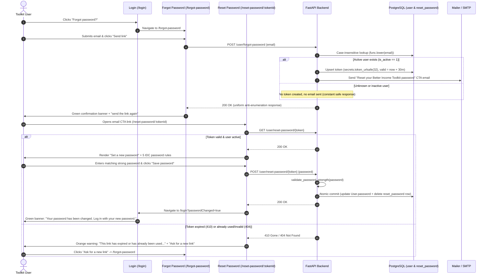

# Feature Specification: Toolkit Forgot Password & Reset Password Flow

> **Document ID**: `docs/features/016_forgot_and_reset_password_spec.md`  
> **Status**: Ready for Review / Phase 0 Planning & Estimation  
> **Target Release**: Living Income Academy & IDC Shared Toolkit  
> **Figma Source**: [Living Income Academy 2026 - Node 10612-21056](https://www.figma.com/design/ga4EMPcp00Bh0d883khSs6/Living-income-academy?node-id=10612-21056&t=u2lPXhpCtpFNt2uj-1) (Frames `11915:54871`, `11915:54982`, `12942:19837`, `12942:20025`, `12948:7854`, `12948:8158`, `12942:20133`; Email Template `12958:22575`–`12958:22611`)  
> **Related Specs**:  
> - `docs/features/002_toolkit_login_shared_access_spec.md` (Shared Toolkit access & `user.tools`)  
> - `docs/features/009_notifications_password_reset_spec.md` (Baseline Toolkit rebrand of reset emails & `ResetPassword.js`)  
> - `docs/features/015_new_toolkit_login_page_spec.md` (New split-screen Login shell & Figma design tokens)  

---

## Overview

The **Toolkit Forgot Password & Reset Password Flow** delivers a unified, restyled, and security-hardened password recovery journey for the shared **Better Income Toolkit** account. Reached from the `"Forgot password?"` link on the unified `/login` screen, a single password reset updates credentials across both the **Living Income Academy** and the **Income Driver Calculator (IDC)**.

This specification upgrades and replaces the legacy inline reset toggle and `/not-found` fallback with:
1. **Figma-Aligned Split-Screen Experience**: Dedicated `/forgot-password` and `/reset-password/:tokenId` routes sharing the Spec 015 split-screen shell (`1440 x 960` desktop layout with curved hero imagery and responsive mobile support).
2. **Anti-Enumeration & Token Security Hardening**: Eliminates account existence leaks (`200 OK` uniform response on forgot-password), resolves case-sensitive email lookup and 30m/20m TTL mismatch bugs, upgrades token entropy to `secrets.token_urlsafe(32)`, enforces server-side password strength validation, and ensures atomic single-use token invalidation.
3. **Restyled Email & Recoverable Error UX**: Updates the reset email with a branded `"Set a new password"` CTA button and validity/disclaimer footer, surfaces exact inline validation messages, replaces blunt `/not-found` redirects with an inline orange expired/used warning + `"Ask for a new link"` CTA, and redirects back to `/login?passwordChanged=true` with a green confirmation banner.

---

### 5W1H Requirements Analysis

| Dimension | Specification |
| :--- | :--- |
| **Who (Personas)** | - **Any Toolkit User (`tools` includes `'idc'` and/or `'academy'`)**: Users who forgot their shared Better Income Toolkit password.<br>- **Invited IDC Users (`/invitation/:tokenId`)**: First-time invited users setting an initial password (preserved cleanly without regression). |
| **What (Core Scope)** | - Standalone `/forgot-password` screen (`11915:54871`) with green anti-enumeration confirmation & `"send the link again"` action (`11915:54982`).<br>- Restyled reset email (`12958:22575`–`12958:22611`) with `"Set a new password"` CTA button and expiry/ignore footer.<br>- Restyled `/reset-password/:tokenId` screen (`12942:19837`) enforcing the 5 IDC password rules, showing inline mismatch (`12942:20025`) and rules-not-met (`12948:7854`) errors, showing an inline orange expired/used warning (`12948:8158`) instead of redirecting to `/not-found`, and redirecting post-save to `/login?passwordChanged=true` with a green confirmation banner (`12942:20133`). |
| **Where (System Location)** | - **Backend**: `backend/models/reset_password.py`, `backend/db/crud_reset_password.py`, `backend/routes/user.py`, `backend/utils/mailer.py`, `backend/templates/email.html`, `backend/models/user.py` (reusing `validate_password_strength`).<br>- **Frontend**: `frontend/src/pages/login/ForgotPassword.js` (new), `frontend/src/pages/login/ResetPassword.js`, `frontend/src/pages/login/Login.js`, `frontend/src/pages/login/login.scss`, `frontend/src/App.js`, `frontend/src/components/route/paths.js`, `frontend/src/components/layout/PageLayout.js`, `frontend/src/components/utils/PasswordCriteria.js`. |
| **When (Triggers)** | - Clicking `"Forgot password?"` on `/login`, opening the reset link from email (`/reset-password/:tokenId`), or clicking `"Ask for a new link"` from an expired/used link warning. |
| **Why (Business Value)** | - Aligns password recovery visually and functionally with the unified Toolkit login (`015`).<br>- Remediates security and UX flaws identified in the codebase audit (email enumeration, mixed-case lookup failure, inconsistent 20m/30m expiry, missing server-side complexity check, dead-end `/not-found` error screen, and mobile blocking). |
| **How (Technical Approach)** | - Reuses the existing `reset_password` table (zero DB migrations), centralizes `RESET_PASSWORD_EXPIRE_MINUTES = 30`, uses CSPRNG `secrets.token_urlsafe(32)` and an atomic SQLAlchemy commit, and renders Ant Design forms inside the Spec 015 split-screen Onboarding layout. |

---

### Existing Codebase Audit & Gaps Addressed

| Area & File | Current Behavior (Audit Findings) | Target Behavior (Spec 016 Fix) |
| :--- | :--- | :--- |
| **Email Enumeration**<br>`backend/routes/user.py:953-990`<br>`frontend/src/pages/login/Login.js:194-198` | `POST /user/forgot-password` returns `404` (`"User Not found"`), `400` (`"User account is inactive or unverified"`), or `201`; `Login.js` displays `"Email not found"` on failure. | Uniform `200 OK` response regardless of account existence or status; frontend always displays identical green anti-enumeration confirmation. |
| **Case-Sensitive Lookup**<br>`backend/db/crud_reset_password.py:9` | Queries `User.email == email` case-sensitively (unlike `crud_user.get_user_by_email` `func.lower`), causing mixed-case emails to falsely `404`. | Query via `func.lower(User.email) == email.strip().lower()` (or pass resolved `user` directly). |
| **Token TTL Mismatch**<br>`backend/models/reset_password.py:34`<br>`backend/db/crud_reset_password.py:22` | Initial insert sets **30 min** expiry, but repeat upsert overwrites expiry to **20 min**. | Single centralized constant `RESET_PASSWORD_EXPIRE_MINUTES = 30` applied uniformly on both insert and upsert. |
| **Token Entropy & Atomicity**<br>`backend/models/reset_password.py:33`<br>`backend/routes/user.py:1028-1031` | Uses `str(uuid4())` and commits `update_password` and `delete_reset_password` in two separate transactions. | Uses CSPRNG `secrets.token_urlsafe(32)` and executes password update + reset-row deletion in a single atomic commit. |
| **Server-Side Strength Check**<br>`backend/routes/user.py:1027`<br>`backend/models/user.py:534-551` | `POST /user/reset-password/{url:path}` hashes any non-empty string without calling `validate_password_strength`. | Validates via `validate_password_strength`; rejects weak passwords with HTTP `400` (`PASSWORD_RULES_NOT_MET`). |
| **`GET` User Guard & PII**<br>`backend/routes/user.py:525-547` | Does not verify `user` exists and `user.is_active == 1`; returns full `UserInvitation` PII. | Guards `not user or user.is_active != 1` (returns `404`/`410`); returns minimal non-sensitive verification status while preserving `/invitation/:tokenId` compatibility. |
| **Reset Email Template**<br>`backend/utils/mailer.py:81-97`<br>`backend/templates/email.html` | Plain inline `<a>here</a>` + raw URL, generic body copy, no styled button, no expiry/ignore disclaimer. | Subject `"Reset your Better Income Toolkit password"`, styled `#01625f` `"Set a new password"` CTA button, and expiry + ignore footer copy. |
| **Frontend Routing & Expired UX**<br>`frontend/src/pages/login/Login.js:38`<br>`frontend/src/pages/login/ResetPassword.js:68` | Inline toggle on `Login.js` (blocked on mobile via `<Blocker>`); `ResetPassword.js` redirects blindly to `/not-found` on both `404` and `410`. | Dedicated `/forgot-password` route (mobile-friendly) and inline orange expired/used warning on `/reset-password/:tokenId` with `"Ask for a new link"`. |

---

## Architecture Overview

1. **Request Reset (`/forgot-password`)**: User enters email and clicks `"Send link"`. Backend performs a case-insensitive lookup; only if an active user exists (`is_active == 1`) does it upsert a `secrets.token_urlsafe(32)` token with a 30-minute UTC expiry and dispatch the restyled reset email. Regardless of outcome, `POST /user/forgot-password` returns `200 OK` and the UI displays the green confirmation card with `"send the link again"`.
2. **Validate & Set Password (`/reset-password/:tokenId`)**: Opening the email link calls `GET /user/reset-password/{token}`. Valid tokens render the `"Set a new password"` form with the 5 IDC password rules; expired (`410`) or invalid/used (`404`) tokens render the inline orange warning card with `"Ask for a new link"` linking back to `/forgot-password`.
3. **Save & Redirect (`/login?passwordChanged=true`)**: Client validates rules and password match; `POST /user/reset-password/{token}` re-validates password strength server-side, hashes with bcrypt, updates `User.password` and deletes the `reset_password` row in one atomic commit, and frontend navigates to `/login?passwordChanged=true` displaying the green confirmation banner.



---

## 1. Backend Implementation

### 1.1 Database Model
**File**: `backend/models/reset_password.py`

No database schema changes or Alembic migrations are required; the existing `reset_password` table (`id`, `user`, `url`, `valid`) is reused.
- Define a single shared expiry constant: `RESET_PASSWORD_EXPIRE_MINUTES = 30`.
- Replace `str(uuid4())` token generation with CSPRNG `secrets.token_urlsafe(32)`.
- Use `datetime.utcnow() + timedelta(minutes=RESET_PASSWORD_EXPIRE_MINUTES)` consistently for `valid`.

### 1.2 CRUD & Atomicity Fixes
**File**: `backend/db/crud_reset_password.py`
- Fix `new_reset_password` email lookup to use case-insensitive matching (`func.lower(User.email) == email.strip().lower()`) or accept the already-resolved `user` object.
- Update upsert branch (`L21-22`) to generate `secrets.token_urlsafe(32)` and apply `timedelta(minutes=RESET_PASSWORD_EXPIRE_MINUTES)` (eliminating the 20-minute discrepancy).
- Support `commit: bool = True` on `crud_user.update_password` (`backend/db/crud_user.py`) and `crud_reset_pwd.delete_reset_password` so the reset endpoint performs password update and token deletion in a single atomic transaction.

### 1.3 API Router
**File**: `backend/routes/user.py`

#### `POST /user/forgot-password`
- **Purpose**: Initiate a password reset without revealing whether an email address is registered or active.
- **Request Payload**: Form field `email: str = Form(...)` (normalized via `.strip().lower()`).
- **Response Payload (`200 OK`)**:
  ```json
  {
    "message": "If there is an account with this email, we have sent a link to reset your password.",
    "expires_in_minutes": 30
  }
  ```
- **Logic**:
  1. Resolve user case-insensitively via `crud_user.get_user_by_email`.
  2. Only if `user` exists and `user.is_active == 1`:
     - Upsert reset token (`RESET_PASSWORD_EXPIRE_MINUTES = 30`).
     - Build origin-safe reset URL `{get_safe_base_url(req)}/reset-password/{token}`.
     - Dispatch `MailTypeEnum.FORGOT_PASSWORD` email.
  3. Always return `200 OK` with the uniform message (never `404` or `400` for unknown/inactive accounts).

#### `GET /user/reset-password/{url:path}`
- **Purpose**: Validate whether a password reset token exists, is unexpired, and belongs to an active user.
- **Responses**:
  - `200 OK`: Token valid (`{"valid": True, ...}` — preserving `UserInvitation` shape where needed by shared tests/invitations, without exposing unnecessary sensitive fields).
  - `404 Not Found`: Token not found (already used or invalid) or user missing/inactive.
  - `410 Gone`: Token exists but `valid < datetime.utcnow()` (`{"message": "This link has expired."}`).

#### `POST /user/reset-password/{url:path}`
- **Purpose**: Validate password rules, update the shared account password, and invalidate the token in one atomic commit.
- **Request Payload**: Form field `password: SecretStr = Form(...)`.
- **Responses**:
  - `200 OK`: Returns `{"message": "Password changed successfully."}` (or `Token` payload for backward compatibility without auto-logging in before redirect).
  - `400 Bad Request`: Password fails `validate_password_strength` (`{"detail": "The password doesn't meet the rules", "error_code": "PASSWORD_RULES_NOT_MET"}`) or user is inactive.
  - `404 Not Found`: Token invalid or already consumed.
  - `410 Gone`: Token expired.
- **Logic**:
  1. Verify token exists (`404`), is unexpired (`410`), and user exists with `is_active == 1` (`400`/`404`).
  2. Validate `password.get_secret_value()` using `validate_password_strength` (`backend/models/user.py:534-551`).
  3. Hash password (`get_password_hash`), update `User.password`, and delete the `reset_password` row in a single `session.commit()`.

### 1.4 Reset Password Email Template
**Files**: `backend/utils/mailer.py`, `backend/templates/email.html`

Update `EmailBody.FORGOT_PASSWORD` and email button/footer rendering to match the brief and Figma design (`12958:22575`–`12958:22611`):
- **Subject**: `"Reset your Better Income Toolkit password"`
- **Heading / Body**: `"We received a request to reset the password of your Better Income Toolkit account. Click the button to set a new password."`
- **Primary CTA Button**: Brand teal (`#01625f`) pill/rounded HTML button labeled `"Set a new password"` pointing to `#url#` (`{base_url}/reset-password/{token}`), plus a plain-text fallback URL in the text part.
- **Footer Disclaimer**: `"The link is valid for 30 minutes. Didn’t ask for this? You can ignore this email; your password stays the same."`

---

## 2. Frontend Implementation

### 2.1 Routes, Shell & Shared Styling
**Files**: `frontend/src/App.js`, `frontend/src/components/route/paths.js`, `frontend/src/components/layout/PageLayout.js`, `frontend/src/pages/login/login.scss`

- **Routes**:
  - Add `forgotPassword: "/forgot-password"` to `paths` (and `routePath.public`) in `paths.js`.
  - Mount `<Route exact path="/forgot-password" element={<ForgotPassword />} />` in `App.js` alongside `/login` and `/reset-password/:tokenId`.
  - Update `Login.js` `"Forgot password?"` link to navigate directly to `/forgot-password` (removing the legacy inline `isResetPassword` boolean toggle).
- **Shell & Responsive Layout**:
  - Add `/forgot-password` to `pagesWithNoSider` and `pagesWithNoHeader` in `PageLayout.js` (and ensure `/reset-password/` consistently hides header and sider).
  - Remove `<Blocker>` mobile gating from `Login.js`, `ForgotPassword.js`, and `ResetPassword.js` so password recovery works seamlessly on mobile and desktop viewports.
  - Reuse the Spec 015 split-screen shell (fluid 50/50 split targeting **`1280 x 720` primary desktop** and `1440 x 960` Figma reference: left Onboarding panel with IDH logo + `"Toolkit Towards Better Incomes"` header and `© IDH 2026` / `livingincome@idhtrade.org` footer; right curved hero image).

#### Responsive & `1280 x 720` Primary Viewport Rules
- **Fluid 50/50 Split (No Fixed `720px`/`960px` Lock)**: Use `min-height: 100vh` and `flex: 1 1 50%` panes with proportional hero curve (`clamp(48px, 5.5vw, 80px)` — `56px` at `<= 1366px`, `80px` at `>= 1440px`).
- **Compact `1280 x 720` Vertical Rhythm (`@media (max-width: 1366px), (max-height: 800px)`)**:
  - Compact header (`64px`) and footer (`52px`), tightened form vertical gaps (`12px–16px`), and compact button/input sizing so `/forgot-password` (including the green confirmation banner) and the orange expired-link warning fit cleanly **above the fold on `1280 x 720`** (~`600–650px` usable browser height) with zero clipping or horizontal overflow.
  - **Reset Password Rules Layout (`/reset-password/:tokenId`)**: Keep the 5-rule `PasswordCriteria` checklist compact at `<= 800px` viewport height (tight 2-column grid or reduced line spacing) so `"Set a new password"`, `"New password"`, `"Confirm new password"`, all 5 rules, `"Save password"` pill button, and any inline error toast (`"The passwords don’t match"` / `"The password doesn’t meet the rules"`) remain visible above the fold on `1280 x 720`.

##### Responsive Typography & Font-Size Scale (Shared Spec 015 / `AcademyAccountPage.scss` Rhythm)
> **Global CSS Guard**: `frontend/src/index.scss` sets `font-size: 14px !important` and `frontend/src/App.scss` globally styles `h1` (`48px`), `h2` (`36px`), and `h3` (`20px`), so `login.scss` MUST scope explicit `px` font sizes and project `@font-face` names (`RocGroteskBold`, `TabletGothic`, `TabletGothicBold` from `frontend/src/variables.scss`) inside the auth container.

| UI Element | Font Family (`variables.scss`) | Large Desktop (`>= 1440px`) | Primary Laptop (`1280 x 720` / `<= 1366px`) | Mobile (`< 768px`) |
| :--- | :--- | :---: | :---: | :---: |
| **Page Title** (`Forgot your password?`, `Set a new password`) | `RocGroteskBold` | `32px / 42px` | **`26px / 34px`** | `24px / 32px` |
| **Supporting Intro Copy** | `TabletGothic` | `14px / 21px` | **`13px / 19px`** | `14px / 20px` |
| **Form Labels & Inputs** | `TabletGothic` | `14px / 20px` | **`13px / 18px`** | `14px` label / `16px` input *(prevents iOS zoom)* |
| **Primary Pill Buttons** (`Send link`, `Save password`) | `TabletGothicBold` | `16px / 24px` | **`14px / 20px`** | `15px / 22px` |
| **Inline Links** (`Back to log in`, `send the link again`, `Ask for a new link`) | `TabletGothic` | `14px / 20px` | **`13px / 18px`** | `14px / 20px` |
| **Password Rules (`PasswordCriteria`) & Inline Banners** | `TabletGothic` | `14px / 20px` | **`12px–13px / 18px`** *(floor `>= 12px` for WCAG AA legibility)* | `13px / 18px` |
| **Header Subtitle & Footer** | `TabletGothic` | `14px / 18px` | **`12px–13px / 16px`** | `12px / 16px` |

### 2.2 Components & Screen States
**Files**: `frontend/src/pages/login/ForgotPassword.js`, `frontend/src/pages/login/ResetPassword.js`, `frontend/src/pages/login/Login.js`, `frontend/src/components/utils/index.js`

#### Wireframes: Forgot Password & Reset Password Screens

```text
+----------------------------------------------------------------------------------------------------+
|                                  /forgot-password (Figma 11915:54871 / 54982)                      |
+----------------------------------------------------+-----------------------------------------------+
|  [IDH Logo] | Toolkit Towards Better Incomes       |  +-----------------------------------------+  |
|                                                    |  |                                         |  |
|  Forgot your password?                             |  |  Curved Hero Photography                |  |
|  Enter the email address of your Toolkit account.  |  |  (rounded-bl-[80px] rounded-tl-[80px])  |  |
|  We'll send you a link to set a new password.      |  |                                         |  |
|                                                    |  |                                         |  |
|  Email                                             |  |                                         |  |
|  [ jane@coop.org                                ]  |  |                                         |  |
|                                                    |  |                                         |  |
|  (================= Send link ==================)  |  |                                         |  |
|                   Back to log in                   |  |                                         |  |
|                                                    |  |                                         |  |
|  [✓] (On submit - Green Banner):                   |  |                                         |  |
|  If there is an account with jane@coop.org, we've  |  |                                         |  |
|  sent a link to reset your password. The link is   |  |                                         |  |
|  valid for 30 minutes. Can't find the email? Check |  |                                         |  |
|  your spam folder or [send the link again].        |  |                                         |  |
|                                                    |  |                                         |  |
|  © IDH 2026                 livingincome@idhtrade.org                                              |
+----------------------------------------------------+-----------------------------------------------+

+----------------------------------------------------------------------------------------------------+
|                             /reset-password/:tokenId (Figma 12942:19837 / 8158)                    |
+----------------------------------------------------+-----------------------------------------------+
|  [IDH Logo] | Toolkit Towards Better Incomes       |  +-----------------------------------------+  |
|                                                    |  |                                         |  |
|  Set a new password                                |  |  Curved Hero Photography                |  |
|                                                    |  |                                         |  |
|  New password                                      |  |                                         |  |
|  [ ••••••••••••                                 ]  |  |                                         |  |
|  Confirm new password                              |  |                                         |  |
|  [ ••••••••••••                                 ]  |  |                                         |  |
|                                                    |  |                                         |  |
|  Password rules (5 IDC rules via PasswordCriteria):|  |                                         |  |
|  [✓] Min 8 chars  [✓] Uppercase  [✓] Lowercase     |  |                                         |  |
|  [✓] Number       [✓] Special character            |  |                                         |  |
|                                                    |  |                                         |  |
|  (=============== Save password ================)  |  |                                         |  |
|                                                    |  |                                         |  |
|  [!] (Errors): "The passwords don't match" OR      |  |                                         |  |
|                "The password doesn't meet the rules"| |                                         |  |
|  [!] (Expired/Used - Orange Banner replaces form): |  |                                         |  |
|  This link has expired or has already been used.   |  |                                         |  |
|  For your security, reset links are valid for      |  |                                         |  |
|  30 minutes. [Ask for a new link]                  |  |                                         |  |
|                                                    |  |                                         |  |
|  © IDH 2026                 livingincome@idhtrade.org                                              |
+----------------------------------------------------+-----------------------------------------------+
```

#### Screen State Breakdown (7 States)
1. **Forgot your password? (`11915:54871`)**:
   - Title: `"Forgot your password?"`
   - Copy: `"Enter the email address of your Toolkit account. We’ll send you a link to set a new password."`
   - Email field + `"Send link"` primary `#01625f` pill button + `"Back to log in"` link to `/login`.
2. **Password reset sent confirmation (`11915:54982`)**:
   - Rendered inline on `/forgot-password` in a green success toast/banner (`#eafaf1` / `#49d985` or IDC success token):
     - *"If there is an account with **{email}**, we’ve sent a link to reset your password. The link is valid for **30 minutes**. Can’t find the email? Check your spam folder or **send the link again**."*
   - Clicking `"send the link again"` triggers `POST /user/forgot-password` for the same email (with loading/cooldown guard to prevent double clicks).
3. **Set a new password (`12942:19837`)**:
   - Title: `"Set a new password"`
   - `"New password"` and `"Confirm new password"` password inputs (`Input.Password`).
   - 5 IDC password rules checklist rendered below inputs via `PasswordCriteria` (min 8 chars, uppercase, lowercase, number, special character — aligning the min-length check in `checkPasswordCriteria` to `val.length >= 8` to match backend `validate_password_strength`).
   - Primary pill button: `"Save password"`.
4. **Passwords don't match error (`12942:20025`)**:
   - Red error toast / inline highlight displaying: `"The passwords don’t match"`.
5. **Rules not met error (`12948:7854`)**:
   - Red error toast / inline highlight displaying: `"The password doesn’t meet the rules"` (enforced on submit both client-side and when `POST` returns `PASSWORD_RULES_NOT_MET`).
6. **Reset link expired or already used (`12948:8158`)**:
   - Replaces the `/not-found` redirect on `GET` `404` or `410` (and `POST` `404`/`410`) for `/reset-password/:tokenId` with an inline orange warning banner (`#fff7e6` / `#ff9800` or warning palette):
     - *"This link has expired or has already been used. For your security, reset links are valid for **30 minutes**."*
   - Primary/link CTA `"Ask for a new link"` navigating to `/forgot-password`.
7. **Password changed confirmation (`12942:20133`)**:
   - After `POST /user/reset-password/{token}` succeeds, navigate to `/login?passwordChanged=true` (and `state={{ passwordChanged: true }}`) so `Login.js` displays a green success banner:
     - *"Your password has been changed. Log in with your new password."*

### 2.3 Invitation Flow Compatibility (`/invitation/:tokenId`)
- `ResetPassword.js` continues supporting `/invitation/:tokenId` (`isInvitation = pathname.includes("invitation")`), preserving the invitation heading, Data Security Provision modal/checkbox, and existing `FE-RST-01B` / `FE-RST-07` coverage without regression.

---

## 3. Verification & Testing

### 3.1 Automated Tests

#### Backend Test Suite (`pytest`)
- **Files**: `backend/tests/test_002_user.py`, `backend/tests/test_900_utils_mailer.py`
  - Uniform `200 OK` response on `POST /user/forgot-password` for unknown, inactive/unverified, and active emails (no enumeration leak).
  - Case-insensitive email lookup (`Mixed.Case@Example.com`) generates token successfully.
  - Consistent 30-minute expiry on both initial request and repeat upsert, using non-empty URL-safe token (`secrets.token_urlsafe(32)`).
  - `GET /user/reset-password/{token}` returns `404` for invalid/used/inactive-user tokens and `410` for expired tokens.
  - `POST /user/reset-password/{token}` rejects weak passwords (`400 PASSWORD_RULES_NOT_MET`), accepts strong passwords, commits password update + token deletion atomically, and rejects replay (`404`).
  - `EmailBody.FORGOT_PASSWORD` renders subject `"Reset your Better Income Toolkit password"`, `"Set a new password"` CTA button, and expiry/ignore footer text.

```bash
./dc.sh exec backend pytest backend/tests/test_002_user.py backend/tests/test_900_utils_mailer.py -v
./dc.sh exec backend flake8 backend/routes/user.py backend/db/crud_reset_password.py backend/models/reset_password.py backend/utils/mailer.py
```

#### Frontend Test Suite (`jest`)
- **Files**: `frontend/src/pages/login/__tests__/ForgotPassword.test.js` (new), `frontend/src/pages/login/__tests__/ResetPassword.test.js`, `frontend/src/pages/login/__tests__/Login.test.js`
  - `/forgot-password`: Renders title, copy, email input, `"Send link"`, `"Back to log in"`; displays green anti-enumeration confirmation banner with entered email, period, and `"send the link again"` resend action.
  - `/login`: `"Forgot password?"` navigates to `/forgot-password`; `?passwordChanged=true` renders `"Your password has been changed. Log in with your new password."`.
  - `/reset-password/:tokenId`: Enforces 5 IDC password rules; shows `"The passwords don’t match"` and `"The password doesn’t meet the rules"` errors; renders inline orange warning + `"Ask for a new link"` on `404`/`410` (instead of `/not-found`); saves valid password and navigates to `/login?passwordChanged=true`.
  - `/invitation/:tokenId`: Existing invitation heading and Data Security checkbox tests continue to pass.

```bash
./dc.sh exec frontend yarn test:ci --testPathPattern="ForgotPassword|ResetPassword|Login"
./dc.sh exec frontend yarn lint
```

### 3.2 Manual Verification Steps
1. **Anti-Enumeration & Mailpit Check** (`http://localhost:8025`):
   - Submit an unregistered email on `/forgot-password` $\rightarrow$ confirm green banner appears and **no** email arrives in Mailpit.
   - Submit an active Toolkit email (including mixed-case letters) $\rightarrow$ confirm identical green banner appears and email arrives in Mailpit; click `"send the link again"` $\rightarrow$ confirm second email arrives.
2. **Reset Email Visual Check**:
   - Inspect email in Mailpit: subject `"Reset your Better Income Toolkit password"`, body copy, teal `"Set a new password"` CTA button, and `"The link is valid for 30 minutes. Didn’t ask for this?..."` footer.
3. **Reset Password Error & Success Flows**:
   - Open CTA link $\rightarrow$ test weak password (`"The password doesn’t meet the rules"`) and mismatched confirm password (`"The passwords don’t match"`).
   - Submit valid matching strong password $\rightarrow$ verify redirect to `/login?passwordChanged=true` with `"Your password has been changed. Log in with your new password."`.
   - Log in with the new password and confirm access works for both IDC (for IDC users) and Living Income Academy.
4. **Expired / Already Used Link Recovery**:
   - Re-open the already-used reset link (and test an expired link) $\rightarrow$ confirm inline orange warning appears with `"Ask for a new link"` CTA routing to `/forgot-password`.
5. **Responsive (`1280 x 720` Primary) & Invitation Regression**:
   - Inspect **`1280 x 720` (primary user laptop viewport)** across every state (`/forgot-password` default & green sent banner, `/reset-password/:tokenId` with 5 rules + error toast, expired orange warning, `/login?passwordChanged=true`) to verify everything fits cleanly above the fold with zero clipping or horizontal overflow, and verify scaled typography legibility (`26px` title, `13px` labels/inputs/intro copy, `12px–13px` password rules/banners, `14px` pill buttons, zero wrapping distortion).
   - Verify `1440 x 960` desktop and `375px` mobile viewports work without `<Blocker>`, and run a smoke check on `/invitation/:tokenId`.

---

## 4. Epic & Vibe Coding Estimation ⏱️

> Estimates use the standardized 3-part Vibe Coding breakdown: **Vibe Coding (Dev)** + **Automated Testing** + **QA & Review** = **Total Est. Time**. All tasks are grouped cleanly and capped $\le$ 4.0h each.
>
> **Dependencies & Spec 015 Reuse**: Assumes Spec 015 (`docs/features/015_new_toolkit_login_page_spec.md`) establishes or shares the split-screen Onboarding shell and SCSS tokens (`login.scss`). If implemented immediately after Spec 015, total effort drops by ~30–45m (to **~6.25–6.5h**). Uses Mailpit (`axllent/mailpit:latest`) for local email testing; zero DB migrations required.

- **Confidence Level**: High (database table, `validate_password_strength`, `PasswordCriteria`, and `ResetPassword.js` baseline already exist).

| Task ID | Component & Grouped Scope | Vibe Coding (Dev) | Automated Testing | QA & Review | Total Est. Time | Priority |
| :--- | :--- | :---: | :---: | :---: | :---: | :--- |
| **PWD-01** | **Backend: Anti-Enumeration, Token Hardening, Password Rules & Reset Email**<br>• Uniform `200 OK` on `POST /user/forgot-password` + case-insensitive lookup fix in `crud_reset_password.py`<br>• Standardize `RESET_PASSWORD_EXPIRE_MINUTES = 30`, CSPRNG `secrets.token_urlsafe(32)`, atomic password-update + token-delete, and `validate_password_strength` on `POST /user/reset-password/{url}`<br>• Update `EmailBody.FORGOT_PASSWORD` & `templates/email.html` (subject, copy, styled `"Set a new password"` CTA button, expiry/ignore footer)<br>• Update & expand `test_002_user.py` & `test_900_utils_mailer.py`, run `pytest` & `flake8` | 50m | 40m | 30m | **2.0h (120m)** | P0 |
| **PWD-02** | **Frontend: Forgot Password Screen (`/forgot-password`) & Confirmation Flow**<br>• Create `ForgotPassword.js` with fluid split-screen Figma layout (`11915:54871`, `11915:54982`) tuned for `1280 x 720` primary viewport & `1440 x 960` ref, mount `/forgot-password` in `App.js`, `paths.js`, `PageLayout.js` (mobile-friendly, no header/sider)<br>• Replace inline toggle on `Login.js` with link to `/forgot-password`<br>• Implement green anti-enumeration confirmation banner with email, expiry period, and `"send the link again"` action + double-submit guard<br>• Add `ForgotPassword.test.js`, update `Login.test.js`, `1280 x 720` / `1440 x 960` / mobile visual QA | 1h 00m | 45m | 30m | **2.25h (135m)** | P0 |
| **PWD-03** | **Frontend: Restyled Reset Password Screen, Error/Expired States & Login Confirmation**<br>• Restyle `ResetPassword.js` per Figma (`12942:19837`) with compact 5-rule `PasswordCriteria` fitting above the fold on `1280 x 720` while preserving `/invitation/:tokenId` compatibility<br>• Implement exact error states (`"The passwords don’t match"`, `"The password doesn’t meet the rules"`) and replace `/not-found` redirect on `404`/`410` with inline orange expired/used warning (`12948:8158`) + `"Ask for a new link"` CTA<br>• Redirect on save to `/login?passwordChanged=true` and render green confirmation banner (`12942:20133`) on `Login.js`<br>• Update `ResetPassword.test.js` & `Login.test.js`, run `yarn test:ci`, `yarn lint`, `1280 x 720` visual check, and Mailpit E2E walkthrough | 1h 20m | 55m | 30m | **2.75h (165m)** | P0 |
| **TOTAL** | **Full Feature Delivery (3 Grouped Tasks)** | **3h 10m** | **2h 20m** | **1h 30m** | **7.0h (420m)** | - |

---

## 5. Open Confirmations Before Implementation

1. **`[period]` Validity Duration**: Currently planned as **`30 minutes`** (`RESET_PASSWORD_EXPIRE_MINUTES = 30`, aligning with `backend/models/reset_password.py` and fixing the 20-minute upsert bug). Confirm whether Product prefers `30 minutes`, `1 hour`, or `24 hours` for the UI and email copy.
2. **Copy Normalization**: The brief contained a minor typo (`"Log in with your new§ password."`); normalized to `"Log in with your new password."` in this specification.
3. **Figma Visual Detail Check**: Frame IDs, `1440 x 960` `Onboarding` + `Image section` layout, email template nodes, and design tokens were verified from the Figma file (`ga4EMPcp00Bh0d883khSs6`); live per-frame Figma MCP inspection hit the Collab seat rate limit during planning, so verify any bespoke icon/illustration assets during implementation if needed.
