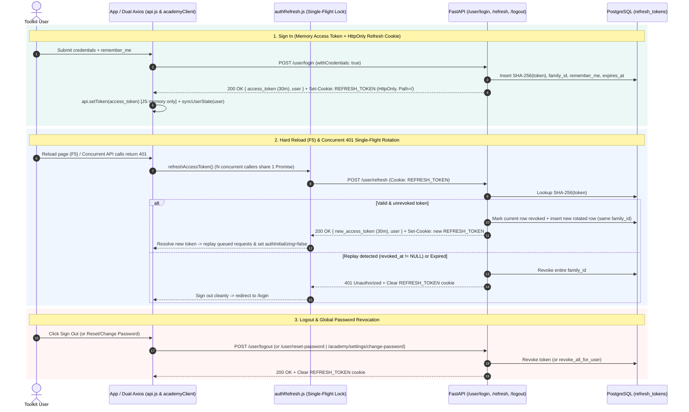

# Feature Specification: Auth Token Hardening (Short-Lived Access Token & Rotating `HttpOnly` Refresh Token)

> **Document ID**: `docs/features/017_auth_refresh_token_hardening_spec.md`  
> **Status**: Ready for Review / Phase 0 Planning & Estimation (Path A Prerequisite for Issue `#896` / Spec `015`)  
> **Target Release**: Living Income Academy & IDC Shared Toolkit  
> **Related Specs**:  
> - `docs/features/002_toolkit_login_shared_access_spec.md` (Shared Toolkit access & `user.tools`)  
> - `docs/features/015_new_toolkit_login_page_spec.md` (New Toolkit Login & "Remember for 30 days" UI)  
> - `docs/features/016_forgot_and_reset_password_spec.md` (Forgot/Reset password hardening)  

---

## Overview

The **Auth Token Hardening** specification replaces the long-lived, JavaScript-readable `AUTH_TOKEN` cookie with a **short-lived in-memory JWT access token (`30 minutes`)** paired with a **rotating, database-backed `HttpOnly; SameSite=Lax` refresh token cookie** (`1 day` session cookie by default, `30 days` persistent cookie when `remember_me=true`).

By moving persistent session credentials into an `HttpOnly` cookie and keeping bearer access tokens strictly in JavaScript memory, the platform:
1. **Eliminates 30-Day XSS Token Exfiltration**: Third-party scripts or XSS vectors can no longer read a 30-day session token from `document.cookie`.
2. **Enables True Server-Side Revocation**: Supports immediate session invalidation on explicit logout (`POST /user/logout`) and global multi-device revocation on password reset (`POST /user/reset-password`) or password change (`POST /academy/settings/change-password`).
3. **Detects Refresh Token Replay**: Tracks token families (`family_id`) with rotation on every refresh; replaying an already-rotated token immediately revokes the entire family.
4. **Preserves Zero Regressions**: Keeps the existing `Authorization: Bearer <token>` middleware, `verify_idc_access`, Swagger UI, AI Chatbot, and all IDC/Academy/Admin/Procurement APIs intact while unifying dual Axios clients (`api.js` and `academyClient`) behind one single-flight refresh lock.

---

### 5W1H Requirements Analysis

| Dimension | Specification |
| :--- | :--- |
| **Who (Personas)** | - **All Authenticated Toolkit Users** (`idc`, `academy`, `admin`): Seamless 30-day persistence when `"Remember for 30 days"` is checked, or session-scoped persistence otherwise.<br>- **Security / Compliance Reviewers**: Guaranteed `HttpOnly` cookie isolation, token rotation, replay protection, and server-side revocation. |
| **What (Core Scope)** | - New `refresh_tokens` PostgreSQL table (`backend/models/refresh_token.py`) + Alembic migration (`down_revision = "b7c8d9e0f1a2"`).<br>- Short-lived 30m JWT access tokens + `POST /user/refresh`, `POST /user/logout`, `remember_me` on `POST /user/login`, and global revocation hooks on password change/reset & account deletion.<br>- Shared frontend single-flight `refreshAccessToken()` utility wired into both `api.js` and `academyClient`, plus `authInitializing` boot hydration replacing direct `cookies?.AUTH_TOKEN` checks. |
| **Where (System Location)** | - **Backend**: `backend/models/refresh_token.py`, `backend/alembic/versions/<ts>_create_refresh_tokens_table.py`, `backend/db/crud_refresh_token.py`, `backend/middleware.py`, `backend/routes/user.py`, `backend/routes/academy/settings.py`.<br>- **Frontend**: `frontend/src/lib/authRefresh.js`, `frontend/src/lib/api.js`, `frontend/src/pages/academy/services/academy.js`, `frontend/src/store/user.js`, `frontend/src/App.js`, `frontend/src/components/route/PrivateRoutes.js`, `frontend/src/components/layout/PageLayout.js`, `frontend/src/pages/income-driver-calculator/Landing.js`, `frontend/src/pages/login/Login.js`, `frontend/src/hooks/useSignOut.js`. |
| **When (Triggers)** | - Executed at login (`POST /user/login`), hard browser reload `F5` (silent boot `POST /user/refresh`), any `401` expired access token response on `api.js` or `academyClient`, explicit sign-out (`POST /user/logout`), password reset/change, or account deletion. |
| **Why (Business Value)** | - Prevents storing a 30-day bearer token in JS-accessible cookies (`document.cookie`) ahead of rolling out `"Remember for 30 days"` in Issue `#896` (Spec `015`).<br>- Decouples auth transport hardening from Login UI changes for clean, low-risk PR review and zero regression. |
| **How (Technical Approach)** | - Same-origin `/api/` proxy (`setupProxy.js`) allows `HttpOnly; SameSite=Lax; Path=/` cookies without cross-site CORS issues; SHA-256 hashed tokens in Postgres (`refresh_tokens`); single-flight in-memory Promise lock across dual Axios clients (`api.js` and `academyClient`). |

---

## Architecture Overview

1. **Login**: `POST /user/login` validates credentials and `remember_me`. It returns `{ access_token (30m), token_type, user }` in JSON and sets an `HttpOnly` `REFRESH_TOKEN` cookie (`Path=/`, `SameSite=Lax`, dynamic `Secure`). The frontend stores `access_token` solely in memory (`api.setToken`) and never writes `AUTH_TOKEN` to `document.cookie`.
2. **Hard Reload (`F5`) & Dual-Client Single-Flight Refresh**: On mount, `App.js` sets `authInitializing: true` and invokes `refreshAccessToken()` (`POST /user/refresh` with `withCredentials: true`). Both `api.js` and `academyClient` (`academy.js`) attach 401 retry-once interceptors backed by the same single-flight Promise lock so concurrent `401` failures trigger **exactly one** token rotation and replay safely.
3. **Replay Detection & Revocation**: Every refresh rotates the token row inside the same `family_id`. Replaying a previously rotated token immediately marks the whole `family_id` revoked and returns `401`. Explicit logout (`POST /user/logout`) revokes the current token and clears the cookie; password reset/change revokes all active tokens for that user.



---

## 1. Backend Implementation

### 1.1 Database Model
**File**: `backend/models/refresh_token.py`

Create SQLAlchemy model `RefreshToken` (`__tablename__ = "refresh_tokens"`):

| Column | Type & Constraints | Purpose |
| :--- | :--- | :--- |
| `id` | `Integer`, Primary Key, `index=True` | Surrogate primary key |
| `user_id` | `Integer`, `ForeignKey("user.id", ondelete="CASCADE")`, `nullable=False`, `index=True` | Owning user (`CASCADE` cleans up on account delete) |
| `token_hash` | `String(64)`, `unique=True`, `nullable=False`, `index=True` | Hex SHA-256 digest of raw CSPRNG token (plaintext never stored) |
| `family_id` | `String(64)`, `nullable=False`, `index=True` | Rotation chain identifier for replay/reuse revocation |
| `remember_me` | `Boolean`, `nullable=False`, `server_default="false"` | Preserves `30d` persistent vs session cookie behavior across rotations |
| `expires_at` | `DateTime`, `nullable=False` | UTC expiration timestamp (`now + 1d` or `now + 30d`) |
| `revoked_at` | `DateTime`, `nullable=True` | UTC timestamp when rotated, logged out, or invalidated |
| `created_at` | `DateTime`, `nullable=False`, `server_default=func.now()` | Audit creation timestamp |

---

### 1.2 Database Migration
**File**: `backend/alembic/versions/<timestamp>_create_refresh_tokens_table.py`
- Set `down_revision = "b7c8d9e0f1a2"` (current Alembic HEAD from `add_user_tools_array_column`).
- `upgrade()`: Create `refresh_tokens` table with FK constraint to `user.id` (`ondelete="CASCADE"`), unique index on `token_hash`, and indexes on `user_id` and `family_id`.
- `downgrade()`: Drop indexes and `refresh_tokens` table cleanly.

---

### 1.3 Refresh Token CRUD & Rotation Service
**File**: `backend/db/crud_refresh_token.py`

- **`hash_refresh_token(raw_token: str) -> str`**: Returns `hashlib.sha256(raw_token.encode("utf-8")).hexdigest()`.
- **`issue_refresh_token(session, user_id: int, remember_me: bool) -> Tuple[str, RefreshToken]`**:
  - Generates `raw_token = secrets.token_urlsafe(48)` and `family_id = secrets.token_hex(16)`.
  - Sets `ttl_days = 30 if remember_me else 1`.
  - Persists hashed `RefreshToken` row and returns `(raw_token, record)`.
- **`rotate_refresh_token(session, raw_token: str) -> Optional[Tuple[str, RefreshToken, User]]`**:
  - Looks up `RefreshToken` by `hash_refresh_token(raw_token)`.
  - If missing or `expires_at < datetime.utcnow()`, returns `None`.
  - **Replay Detection**: If `revoked_at is not None`, immediately revokes **all** unrevoked rows sharing `family_id` (`revoked_at = datetime.utcnow()`), commits, and returns `None`.
  - Otherwise, validates owning `User` exists and `user.is_active == 1`, marks current row `revoked_at = datetime.utcnow()`, inserts a replacement `RefreshToken` preserving `family_id` and `remember_me` (with fresh `expires_at` based on `remember_me`), commits atomically, and returns `(new_raw_token, new_record, user)`.
- **`revoke_token(session, raw_token: str) -> None`**: Marks matching active token `revoked_at = datetime.utcnow()`.
- **`revoke_all_for_user(session, user_id: int, commit: bool = True) -> None`**: Revokes all unrevoked refresh tokens for `user_id` (used on password reset/change).

---

### 1.4 Middleware & Cookie Security Helpers
**File**: `backend/middleware.py`

- Set `ACCESS_TOKEN_EXPIRE_MINUTES = 30` and update `create_access_token(data: dict, expires_delta: Optional[timedelta] = None)` to default to `timedelta(minutes=ACCESS_TOKEN_EXPIRE_MINUTES)`.
- Preserve `verify_user` (`is_active == 1` check), `verify_idc_access` (`ToolType.idc.value in user.tools`), and `backend/core/config.py` `Authorization: Bearer <token>` decoding unchanged.
- Add cookie helpers:
  - `REFRESH_COOKIE_NAME = "REFRESH_TOKEN"`
  - `is_secure_request(req: Request) -> bool`: Returns `req.url.scheme == "https" or req.headers.get("x-forwarded-proto") == "https"` (enforces `Secure=True` in staging/production HTTPS while allowing `http://localhost` Docker dev and FastAPI `TestClient`).
  - `set_refresh_cookie(response: Response, req: Request, raw_token: str, remember_me: bool)`: Sets `httponly=True`, `samesite="lax"`, `path="/"` *(avoids `setupProxy.js` `/api/` rewrite cookie drop)*, `secure=is_secure_request(req)`, and `max_age=30 * 24 * 3600` when `remember_me=True` else `max_age=None` (browser session cookie).
  - `clear_refresh_cookie(response: Response, req: Request)`: Deletes `REFRESH_TOKEN` at `path="/"`, matching `httponly`, `samesite="lax"`, and `secure`.

---

### 1.5 API Router Updates & Global Revocation Hooks
**Files**: `backend/routes/user.py`, `backend/routes/academy/settings.py`

1. **`POST /user/login`** (`backend/routes/user.py`):
   - Accept optional `remember_me: Optional[bool] = Form(False)` alongside `OAuth2PasswordRequestForm = Depends()`.
   - Issue 30-minute `access_token` + DB `RefreshToken` row, attach `REFRESH_TOKEN` `HttpOnly` cookie on `Response`, and return existing `{ "access_token": ..., "token_type": "bearer", "user": user.to_user_info }` payload.
2. **`POST /user/refresh`** (`backend/routes/user.py`):
   - Read `REFRESH_TOKEN` from `req.cookies`.
   - Call `rotate_refresh_token(session, raw_token)`.
   - On failure (missing, expired, inactive user, or replay detected): clear `REFRESH_TOKEN` cookie and raise HTTP `401 Unauthorized`.
   - On success: issue fresh 30-minute `access_token`, set rotated `REFRESH_TOKEN` cookie, and return `{ "access_token": ..., "token_type": "bearer", "user": user.to_user_info }`.
3. **`POST /user/logout`** (`backend/routes/user.py`):
   - Idempotent (`200 OK`): revokes DB row matching `REFRESH_TOKEN` cookie if present and calls `clear_refresh_cookie`.
4. **Revocation Hooks**:
   - `POST /user/reset-password/{url:path}` (`backend/routes/user.py`): Call `revoke_all_for_user(session, user.id, commit=False)` in the password update transaction.
   - `POST /academy/settings/change-password` (`backend/routes/academy/settings.py`): Call `revoke_all_for_user(session, user.id)` after password change.
   - `DELETE /academy/account` (`backend/routes/academy/settings.py`): Call `clear_refresh_cookie(response, req)` (DB `ON DELETE CASCADE` automatically removes `refresh_tokens` rows).

---

## 2. Frontend Implementation (Zero-Regression Plan)

### 2.1 Shared Single-Flight Refresh Utility
**File**: `frontend/src/lib/authRefresh.js` (new)

- Maintains a module-level `let refreshPromise = null;` lock.
- **`refreshAccessToken()`**:
  - If `refreshPromise` is non-null, returns the existing Promise so concurrent `401` failures or boot hydration trigger **at most 1** `POST /api/user/refresh` call (`withCredentials: true`).
  - Uses a raw `axios.post("/api/user/refresh", null, { withCredentials: true })` call (bypassing intercepted clients to prevent recursion).
  - On success: sets `api.setToken(access_token)`, calls `syncUserState(user)`, and resolves `access_token`.
  - On failure: clears `api.setToken(null)`, resets `UserState` with `authInitializing: false`, and rejects.
  - Clears `refreshPromise = null` in `finally`.

### 2.2 Dual Axios Client 401 Interceptors
**Files**: `frontend/src/lib/api.js`, `frontend/src/pages/academy/services/academy.js`

- **`frontend/src/lib/api.js`**:
  - Create a configured Axios instance (`apiClient`) used by `get`, `post`, `put`, `delete`, `sendCompressedData`, and `download`, with `withCredentials: true` enabled for auth endpoints.
  - Attach a response interceptor that, on `401` (excluding `/user/login`, `/user/refresh`, `/user/logout`, and requests already marked `_retry`), awaits `refreshAccessToken()`, updates `Authorization: Bearer <new_token>`, and retries the original request once.
- **`frontend/src/pages/academy/services/academy.js`**:
  - Update `academyClient.interceptors.response` (`L49-68`) so a `401` error (not yet retried) awaits `refreshAccessToken()`, updates `Authorization`, and retries `academyClient(originalRequest)`; only clear `api.setToken(null)` if refresh itself fails.

### 2.3 Unified `UserState`, Boot Hydration & Auth Consumers
- **`frontend/src/store/user.js`**:
  - Add `authInitializing: true` and `isAuthenticated: false` to `defaultUserState`.
  - `syncUserState(data)` sets `s.isAuthenticated = true` and `s.authInitializing = false`.
- **`frontend/src/App.js`**:
  - Remove `useCookies(["AUTH_TOKEN"])` and `api.setToken(cookies?.AUTH_TOKEN)`.
  - On mount (`useEffect`), call `refreshAccessToken()` once to hydrate in-memory access token and `UserState`; on failure (including legacy users who only have an old `AUTH_TOKEN` cookie), call `removeCookie("AUTH_TOKEN", { path: "/" })` and ensure `authInitializing: false`.
- **`frontend/src/components/route/PrivateRoutes.js`, `frontend/src/components/layout/PageLayout.js`, `frontend/src/pages/income-driver-calculator/Landing.js`**:
  - Replace all `cookies?.AUTH_TOKEN` checks with `UserState`:
    - `const isAuthenticated = UserState.useState((s) => s.isAuthenticated || Boolean(s.id && s.active));`
    - `const authInitializing = UserState.useState((s) => s.authInitializing);`
  - While `authInitializing` is `true` inside `PrivateRoutes` and `Landing.js`, render a clean `<Spin />` / loading placeholder so `F5` hard reloads never flash-redirect authenticated users to `/login`.
- **`frontend/src/pages/login/Login.js`**:
  - Remove `setCookie("AUTH_TOKEN", ...)`; call `api.setToken(token)` (in-memory only), update `UserState` with `isAuthenticated: true, authInitializing: false`, and send `remember_me` in `FormData`.
- **`frontend/src/hooks/useSignOut.js`**:
  - Fire `api.post("user/logout", null, { withCredentials: true }).catch(() => {})` so server-side refresh token revocation runs cleanly.
  - Call `removeCookie("AUTH_TOKEN", { path: "/" })` (cleaning up any legacy cookie), `api.setToken(null)`, and `UserState.replace({ ...defaultUserState, authInitializing: false })`.

### 2.4 Explicit Zero-Regression Matrix
- **Untouched & Safe**:
  - `frontend/src/pages/academy/components/AcademyChatbot.js` (reads no auth cookie; hardened against widget XSS).
  - IDC Cases / Step 5 Modelling / Admin / Procurement / Swagger UI (all consume `Authorization: Bearer` unchanged).
  - Legacy session transition: Old `AUTH_TOKEN` cookies are ignored and cleared cleanly on boot/logout without crashing.

---

## 3. Verification & Testing

### 3.1 Automated Tests

#### Backend Test Suite (`pytest`)
- **File**: `backend/tests/test_1033_refresh_token_auth.py` (new)
  - `POST /user/login` returns `30m` JWT and sets `REFRESH_TOKEN` cookie (`HttpOnly`, `SameSite=Lax`, `Path=/`; `Max-Age` set only when `remember_me=true`).
  - `POST /user/refresh` issues a new `access_token` + rotated `REFRESH_TOKEN` cookie and revokes the previous row.
  - Replay/reuse of a rotated refresh token returns `401`, revokes the entire `family_id`, and rejects subsequent refreshes on newer tokens in that family.
  - Expired or inactive-user refresh token returns `401` and clears cookie.
  - `POST /user/logout` revokes the token in DB and clears the cookie.
  - Password reset (`POST /user/reset-password`) and password change (`POST /academy/settings/change-password`) revoke all active refresh tokens for the user.

```bash
./dc.sh exec backend pytest backend/tests/test_1033_refresh_token_auth.py -v
./dc.sh exec backend pytest -v
./dc.sh exec backend flake8
```

#### Frontend Test Suite (`jest`)
- **Files**:
  - `frontend/src/lib/__tests__/authRefresh.test.js` (new): Single-flight concurrent `401` lock triggers exactly **1** `POST /api/user/refresh` across both `api.js` and `academyClient`, replays queued requests, and signs out cleanly when refresh fails.
  - Update existing tests replacing `cookies.set("AUTH_TOKEN", ...)` with `UserState` + `authInitializing` assertions:
    - `frontend/src/components/route/__tests__/PrivateRoutes.test.js` (plus `authInitializing: true` reload test)
    - `frontend/src/components/layout/__tests__/PageLayout.test.js`
    - `frontend/src/pages/income-driver-calculator/__tests__/Landing.test.js`
    - `frontend/src/hooks/__tests__/useSignOut.test.js`
    - `frontend/src/pages/academy/services/__tests__/academy.test.js` & `frontend/src/pages/login/__tests__/Login.test.js`

```bash
./dc.sh exec frontend yarn test:ci --testPathPattern="authRefresh|api|academy|PrivateRoutes|PageLayout|Landing|useSignOut|Login"
./dc.sh exec frontend yarn test:ci
./dc.sh exec frontend yarn lint
```

### 3.2 Manual Verification Steps
1. **Cookie Isolation Check**: Sign in $\rightarrow$ run `document.cookie` in Browser Console $\rightarrow$ confirm neither `AUTH_TOKEN` nor `REFRESH_TOKEN` appears in `document.cookie`; verify `REFRESH_TOKEN` appears in DevTools Application $\rightarrow$ Cookies with `HttpOnly` and `SameSite=Lax` at `Path=/`.
2. **Hard Reload (`F5`) Continuity**: Refresh browser directly on `/income-driver-calculator/cases` and `/academy/overview` $\rightarrow$ confirm single `POST /api/user/refresh` call succeeds and user stays on the protected route without flashing `/login`.
3. **Remember Me Cookie Persistence**: Sign in with `remember_me=false` (session cookie) vs `remember_me=true` (`Expires` / `Max-Age` ~30 days).
4. **Logout & Password Change Revocation**: Click Sign Out $\rightarrow$ confirm `POST /api/user/logout` clears `REFRESH_TOKEN` and subsequent reload prompts login.

---

## 4. Epic & Vibe Coding Estimation ⏱️

> Estimates use the standardized 3-part Vibe Coding breakdown: **Vibe Coding (Dev)** + **Automated Testing** + **QA & Review** = **Total Est. Time**. All tasks are grouped cleanly and capped $\le$ 4.0h each.

- **Confidence Level**: High (all auth consumers audited; single-origin `/api/` proxy already handles cookie forwarding cleanly).
- **Dependencies**: Alembic migration (`down_revision = "b7c8d9e0f1a2"`). Must land on `staging` before implementing Issue `#896` (`Spec 015`) under Path A.

| Task ID | Component & Grouped Scope | Vibe Coding (Dev) | Automated Testing | QA & Review | Total Est. Time | Priority |
| :--- | :--- | :---: | :---: | :---: | :---: | :--- |
| **AUTH-01** | **Backend Schema, Migration & Refresh Token CRUD**<br>• Create `backend/models/refresh_token.py` (`refresh_tokens` table) + Alembic migration (`down_revision = "b7c8d9e0f1a2"`)<br>• Create `backend/db/crud_refresh_token.py` (SHA-256 hashing, CSPRNG token issue, atomic rotation with `family_id` replay revocation, user-wide revocation)<br>• Verify migration `upgrade`/`downgrade` & write CRUD unit tests | 45m | 30m | 15m | **1.5h (90m)** | P0 |
| **AUTH-02** | **Backend Auth Endpoints, Cookie Helpers & Revocation Hooks**<br>• Update `backend/middleware.py` (`30m` access JWT default + `REFRESH_TOKEN` `HttpOnly; SameSite=Lax; Path=/` cookie helpers)<br>• Update `POST /user/login` (`remember_me`) and add `POST /user/refresh` & `POST /user/logout` in `backend/routes/user.py`<br>• Wire `revoke_all_for_user` in `POST /user/reset-password`, `POST /academy/settings/change-password`, and cookie clear on `DELETE /academy/account`<br>• Add `test_1033_refresh_token_auth.py`, run full `pytest` & `flake8` | 55m | 40m | 25m | **2.0h (120m)** | P0 |
| **AUTH-03** | **Frontend In-Memory Token, Dual-Client Refresh & Boot Hydration**<br>• Create `frontend/src/lib/authRefresh.js` single-flight Promise lock; wire 401 retry-once interceptors in both `api.js` and `academyClient` (`academy.js`)<br>• Add `authInitializing`/`isAuthenticated` in `store/user.js`; wire boot hydration in `App.js` and migrate `PrivateRoutes.js`, `PageLayout.js`, `Landing.js`, `Login.js`, and `useSignOut.js` off `cookies?.AUTH_TOKEN`<br>• Add `authRefresh.test.js`, update affected unit suites (`PrivateRoutes`, `PageLayout`, `Landing`, `useSignOut`, `academy`, `Login`), run full `yarn test:ci`, `yarn lint` & browser QA | 55m | 40m | 25m | **2.0h (120m)** | P0 |
| **TOTAL** | **Full Feature Delivery (3 Grouped Tasks)** | **2h 35m** | **1h 50m** | **1h 05m** | **5.5h (330m)** | - |
