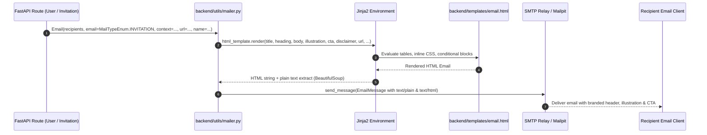

# Feature Specification: [TLSA-012] Better Income Toolkit Email Templates

> **Document ID**: `docs/features/018_update_email_templates_spec.md`  
> **Status**: Completed / Ready for Review  
> **Target Release**: Better Income Toolkit & Living Income Academy  
> **Figma Source**: [Living Income Academy 2026 - Node 12958:22481](https://www.figma.com/design/ga4EMPcp00Bh0d883khSs6/Living-income-academy?node-id=12958-22481&t=u2lPXhpCtpFNt2uj-1)  
> - **Login e-mail / IDC Invitation**: Frame `12958:22668`  
> - **Forgot Password**: Frame `12958:22484`  
> - **IDC Invite (Existing User)**: Frame `13044:24441`  
> - **Email Confirmation (Academy Registration)**: Frame `13044:25309`  
> **Related Specs**:  
> - `docs/features/003_academy_public_registration_spec.md` (Academy verification email dispatch)  
> - `docs/features/008_invitation_dedup_spec.md` (Invitation & access granting flows)  
> - `docs/features/016_forgot_and_reset_password_spec.md` (Password reset email dispatch)  

---

## 1. Executive Summary & 5W1H

| Dimension | Specification |
| :--- | :--- |
| **Who (Actors)** | - **New IDC Invitee**: First-time user invited to IDC who must set a password.<br>- **Registered User (Reset)**: User requesting password recovery for the shared Toolkit account.<br>- **Academy Public Registrant**: New learner signing up for Living Income Academy who must confirm email.<br>- **Existing User Granted IDC Access**: Academy user who receives IDC workspace access from an admin without needing a new password. |
| **What (Scope)** | - Rebuild master HTML email template (`backend/templates/email.html`) and mailer utility (`backend/utils/mailer.py`) to align with Figma Node `12958:22481`.<br>- Deliver 4 branded templates with official IDH + Toolkit header, hero illustrations, high-contrast typography, styled CTA buttons, security/expiry disclaimers, and social footer.<br>- Support dynamic variables: recipient name (`{name}`), organization/company (`{company_name}`), validity period (`{period}`), and action link (`{url}`).<br>- Provide public asset hosting for email illustrations and social icons under `frontend/public/email-icons/`. |
| **Where (System)** | - **Backend**: `backend/templates/email.html`, `backend/utils/mailer.py`, `backend/routes/user.py`, `backend/routes/invitation.py`.<br>- **Frontend / Assets**: `frontend/public/email-icons/` (SVGs/PNGs for email client rendering).<br>- **Tests**: `backend/tests/test_900_utils_mailer.py`, `backend/tests/test_1037_email_templates.py`. |
| **When (Triggers)** | - Triggered whenever the system sends transactional emails (invitation, reset password, email verification, or tool access grant). |
| **Why (Value)** | - Replaces legacy Akvo/IDC 2020 blue template (`#0288d1`) with official Better Income Toolkit visual identity.<br>- Ensures cross-client rendering consistency (Gmail, Outlook, Apple Mail, mobile).<br>- Delivers clear security disclaimers (e.g. 30m / 24h validity, ignore if unrequested). |
| **How (Approach)** | - Responsive single-column HTML email architecture (600px container, inline CSS, tables for Outlook MSO support).<br>- Modular Jinja2 template with conditional blocks for hero illustration, greeting, body copy, CTA button, disclaimer, and footer.<br>- Unit tests verifying HTML structure, subject lines, variable interpolation, and plain-text fallback. |

---

## 2. Template Catalog & Design Alignment

### Template 1: IDC Invitation (New User Account)
- **Figma Frame**: `12958:22668` (Node `12958:22760`)
- **Trigger**: Administrator invites a new user to the platform with IDC access.
- **Subject**: `Invitation`
- **Header**: IDH Logo + vertical divider + "Toolkit Towards Better Incomes"
- **Illustration**: Open blue envelope with avatar circle and blue checkmark badge (`email-invitation-screen.png`)
- **Title / Heading**: `Invitation`
- **Subheading**: `You have been invited to the Income Driver Calculator`
- **Body Copy**: `Please click here or the link below to set your password`
- **Plain Link**: Displays `#url#` directly in `#3F98F7`.
- **CTA Button**: `Income Drive Calculator` (or `Log in to the Income Driver Calculator`)
- **Button Styling**: Background `#3F98F7`, border-radius `10px`, white text, 16px font, centered.

### Template 2: Password Reset
- **Figma Frame**: `12958:22484` (Node `12958:22576`)
- **Trigger**: User requests password recovery at `/forgot-password`.
- **Subject**: `Reset your Better Income Toolkit password`
- **Header**: IDH Logo + vertical divider + "Toolkit Towards Better Incomes"
- **Illustration**: Green key over gear cog with `***` password bubble graphic (`email-password-reset.png`)
- **Title / Heading**: `Password reset`
- **Subheading**: `We received a request to reset the password of your Better Income Toolkit account. Click the button to set a new password.`
- **Disclaimer**: `The link is valid for {period}. Didn’t ask for this? You can ignore this email; your password stays the same.`
- **CTA Button**: `Set a new password`
- **Button Styling**: Background `#61CF86`, border-radius `10px`, white text, 16px font, centered.

### Template 3: IDC Access Granted (Existing Academy User)
- **Figma Frame**: `13044:24441` (Node `13044:24534`)
- **Trigger**: An existing user (e.g. Academy learner) is granted access to an IDC company workspace.
- **Subject**: `Income Driver Calculator Access Granted`
- **Header**: IDH Logo + vertical divider + "Toolkit Towards Better Incomes"
- **Illustration**: Open blue envelope with avatar circle and blue checkmark badge (`email-invitation-screen.png`)
- **Title / Heading**: `Invitation`
- **Subheading**: `Hi {name}, IDH gave you access to the Income Driver Calculator for {company_name}`
- **Body Copy**: `You don’t need a new account: log in with your current email address and password.`
- **CTA Button**: `Explore the Income Driver Calculator`
- **Button Styling**: Background `#3F98F7`, border-radius `10px`, white text, 16px font, centered.

### Template 4: Email Confirmation (Academy Public Registration)
- **Figma Frame**: `13044:25309` (Node `13044:25402`)
- **Trigger**: Public user registers for Living Income Academy via `/register`.
- **Subject**: `Confirm your email for the Living Income Academy`
- **Header**: IDH Logo + vertical divider + "Toolkit Towards Better Incomes"
- **Illustration**: Blue profile ID card with green shield checkmark badge (`email-verified-shield.png`)
- **Title / Heading**: `Confirm your email`
- **Subheading**: `Hi {name}, welcome to the Living Income Academy. Please confirm your email address to activate your account.`
- **Disclaimer**: `Didn’t sign up? You can ignore this email.` (Aligned with #861 single-use replay protection without an un-enforced expiration claim)
- **CTA Button**: `Confirm email`
- **Button Styling**: Background `#3F98F7`, border-radius `10px`, white text, 16px font, centered.

### Template 5: Admin Notification - New Account Registration
- **Trigger**: New user submits registration without prior invitation.
- **Recipient**: Super Admin or Business Unit Admin.
- **Subject**: `Action Required: New User Registration Pending Approval`
- **Header**: IDH Logo + vertical divider + "Toolkit Towards Better Incomes"
- **Illustration**: Open envelope with avatar circular badge (`email-invitation-screen.png`)
- **Title / Heading**: `New Account Registration`
- **Subheading**: `A new user account is awaiting your approval.`
- **Body Copy**: `A new user has submitted a registration request for the Better Income Toolkit. Please sign in to the administration portal to review their details and grant access.`
- **CTA Button**: `Review in Admin Portal` (links to `/admin/users`)
- **Button Styling**: Background `#3F98F7`, border-radius `10px`, white text, 16px font, centered.
- **Disclaimer**: `You are receiving this notification because you have administrative privileges for the Better Income Toolkit.`

### Template 6: User Notification - Registration Approved
- **Trigger**: Administrator approves a pending user account.
- **Recipient**: Newly approved user.
- **Subject**: `Your Better Income Toolkit Account Has Been Approved`
- **Header**: IDH Logo + vertical divider + "Toolkit Towards Better Incomes"
- **Illustration**: Blue ID profile card with green shield checkmark badge (`email-verified-shield.png`)
- **Title / Heading**: `Account Approved`
- **Subheading**: `Welcome! Your account has been reviewed and activated.`
- **Body Copy**: `You now have full access to the Better Income Toolkit. Click below to sign in and start exploring.`
- **CTA Button**: `Log in to Better Income Toolkit` (links to `/login`)
- **Button Styling**: Background `#3F98F7`, border-radius `10px`, white text, 16px font, centered.

---

## 3. Architecture & Data Flow



---

## 4. Technical Specifications & File Touchpoints

### 4.1 Master Template Architecture (`backend/templates/email.html`)
The new template will replace legacy blue styles (`#0288d1`, `#0d0cb5`) with standard email-safe HTML:
- **Max Width**: 600px centered table container on light gray background (`#f8f9fa` or `#f1f1f1`).
- **Card Background**: Clean white (`#ffffff`) with subtle 1px border or card elevation.
- **Header**:
  - Left-aligned IDH brand logo (`idhtrade.org` asset) + vertical line divider + text `"Toolkit Towards Better Incomes"` in Roboto/sans-serif.
  - Border-bottom divider separating header from email body.
- **Hero Illustration**:
  - Centered image block (width 244px, height ~150px) referencing public URL `${webdomain}/email-icons/{illustration_name}.png`.
  - Alt tags included; fallback spacing maintained if images are blocked by email client.
- **Content Block**:
  - Main Heading: 32px–36px bold, color `#000000`.
  - Subheading / Intro paragraph: 16px, color `#676767`, line-height 1.5.
  - Explanatory / Expiry copy: 14px, color `#676767`.
  - Centered CTA Button:
    ```html
    <table border="0" cellpadding="0" cellspacing="0" style="margin: 24px auto;">
      <tr>
        <td align="center" style="border-radius: 10px; background-color: {{ button_color | default('#01625f') }};">
          <a href="{{ url }}" target="_blank" style="display: inline-block; padding: 12px 32px; font-family: sans-serif; font-size: 16px; font-weight: bold; color: #ffffff; text-decoration: none; border-radius: 10px;">
            {{ button_text }}
          </a>
        </td>
      </tr>
    </table>
    ```
- **Footer**:
  - Divider line (`#e0e0e0`).
  - Copyright: `Copyright © IDH 2026. All rights reserved.`
  - Social Media Links: Facebook, LinkedIn, Instagram, X (Twitter) with 24px–32px icons hosted at `/email-icons/social-*.png`.
  - Powered-by / Disclaimer notice.

### 4.2 Mailer Logic (`backend/utils/mailer.py`)
- Update `EmailBody` enum configurations with exact copy, subjects, button texts, button colors, and illustrations:
  - `INVITATION`
  - `FORGOT_PASSWORD`
  - `ACADEMY_REGISTRATION_VERIFY`
  - `IDC_ACCESS_GRANTED`
- Update `Email` class constructor to accept optional structured kwargs:
  - `name: Optional[str] = None`
  - `company_name: Optional[str] = None`
  - `period: Optional[str] = None`
  - `button_text: Optional[str] = None`
  - `button_url: Optional[str] = None`
- Maintain full backward compatibility for legacy call sites (fallback to existing behavior if `name` or `button_text` is omitted).

### 4.3 Static Assets (`frontend/public/email-icons/`)
Export or optimize the 4 key illustrations and social icons:
1. `email-invitation-screen.png` (IDC invite / login laptop)
2. `email-password-reset.png` (Key & lock security)
3. `email-verified-shield.png` (Profile card with verified shield)
4. `email-logo.png` (IDH + Toolkit header lockup)
5. `social-facebook.png`, `social-linkedin.png`, `social-instagram.png`, `social-x.png`

---

## 5. Verification & Quality Gates

### 5.1 Automated Testing
1. **Unit Tests (`backend/tests/test_1037_email_templates.py` & `test_900_utils_mailer.py`)**:
   - Verify each of the 4 templates renders with valid HTML and correct title/subject.
   - Verify interpolation of dynamic fields: `{name}`, `{company_name}`, `{period}`, `{url}`.
   - Verify that plain text fallback (`html_to_text`) extracts intelligible text including the action link.
   - Verify button URLs and fallback defaults.
2. **Linter & Code Quality**:
   - `flake8 backend` must pass with 0 errors.

### 5.2 Manual Smoke Testing via Mailpit
1. Trigger `/user/forgot-password` $\rightarrow$ inspect rendered email in Mailpit WebUI (`http://localhost:8025`).
2. Trigger `/user/register-academy` $\rightarrow$ inspect confirmation email in Mailpit WebUI.
3. Trigger `/invitation` $\rightarrow$ inspect invitation email in Mailpit WebUI.
4. Verify responsiveness in mobile preview view in Mailpit.

---

## 6. Vibe Coding Task Breakdown & Estimation

| Task ID | Story Description | Vibe Coding (Dev) | Automated Testing | QA & Review | Total Est. Time | Priority |
| :--- | :--- | :---: | :---: | :---: | :---: | :--- |
| **EML-01** | **Asset Preparation & Header/Footer Shell**<br>Extract/export illustrations from Figma into `frontend/public/email-icons/`. Implement new 600px responsive table shell in `backend/templates/email.html` with IDH header, social footer, and copyright. | 45m | 30m | 20m | **1.5h (95m)** | P0 |
| **EML-02** | **Template Copy & Dynamic Variable Refactoring**<br>Update `EmailBody` enum in `backend/utils/mailer.py` with the 4 templates (Invitation, Password Reset, Academy Verify, IDC Access Granted). Implement `{name}`, `{company_name}`, `{period}` variable handling. | 45m | 35m | 25m | **1.75h (105m)** | P0 |
| **EML-03** | **Hermetic Test Suite & Mailpit End-to-End Verification**<br>Add `test_1037_email_templates.py` testing all 4 email renders, variable replacements, plain-text generation, and flake8 compliance. Verify visual rendering in Mailpit WebUI. | 30m | 40m | 20m | **1.5h (90m)** | P0 |
| **TOTAL** | **Full Feature Delivery** | **2h 00m** | **1h 45m** | **1h 05m** | **4.75h (290m)** | |

---

## 7. Next Steps & Handoff

This Feature Specification is complete and ready for review. Per BMAD Phase 0 protocol, no application code has been written.

Once approved:
1. Transition to `/1-research` or `/2-implement`.
2. Create tracking branch: `feature/912-update-email-templates` (or appropriate issue number).
3. Begin implementation with `bmad-dev` (Amelia) following TDD.
