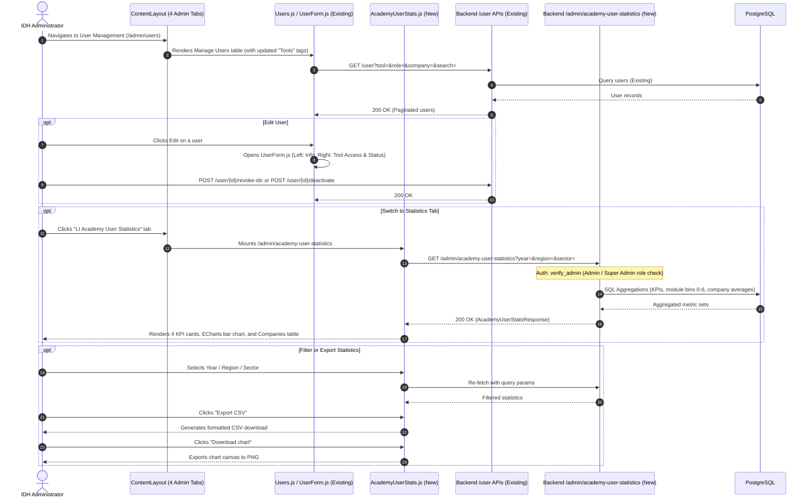

# [TLSA-013] Joint Admin Page & Living Income Academy User Statistics — Feature Specification

> **GitHub Issue**: [#905](https://github.com/akvo/IDH-IDC/issues/905) — `[TLSA-013] Backend: Living Income Academy User Statistics Aggregation API`  
> **Branch**: `feature/905-backend-academy-user-statistics`  
> **Status**: Backend Complete (100% Green) — Ready for Frontend Development  
> **Backend Implementation Status**:
> - **User Management & Edit User**: **Complete (Zero Backend Tasks Required)** — `GET /user`, `GET /user/{id}`, `PUT /user/{id}`, `POST /user`, `POST /user/{id}/activate`, `POST /user/{id}/deactivate`, and `POST /user/{id}/revoke-idc` are already implemented and tested.
> - **LI Academy User Statistics API**: **COMPLETED (#905)** — Aggregation endpoint `GET /admin/academy-user-statistics` implemented in `backend/routes/admin_academy_stats.py`, SQL engine in `backend/db/crud_admin_academy_stats.py`, Pydantic DTOs in `backend/models/admin_academy_stats.py`, hermetic test suite in `backend/tests/test_1037_admin_academy_user_stats.py` (8/8 passed).
> - **Faker Seeder**: **COMPLETED** — `backend/seeder/fake_seeder/fake_academy_stats.py` populates realistic user profiles, enterprise companies, and chapter/module progress for local development.
> 
> **Figma Source**:
> - [Joint Admin Page / User Management (`node-id=13010-13007`)](https://www.figma.com/design/ga4EMPcp00Bh0d883khSs6/Living-income-academy?node-id=13010-13007&t=5fAO9ofzgvOY1k3s-0)
> - [Edit User (`node-id=13033-15051`)](https://www.figma.com/design/ga4EMPcp00Bh0d883khSs6/Living-income-academy?node-id=13033-15051&t=5fAO9ofzgvOY1k3s-0)
> - [LI Academy User Statistics (`node-id=13036-20503`)](https://www.figma.com/design/ga4EMPcp00Bh0d883khSs6/Living-income-academy?node-id=13036-20503&t=5fAO9ofzgvOY1k3s-0)
> - [Tool Filter Options (`node-id=13028-9607`)](https://www.figma.com/design/ga4EMPcp00Bh0d883khSs6/Living-income-academy?node-id=13028-9607&t=5fAO9ofzgvOY1k3s-0)

---

## 1. Executive Summary & Context

The IDH "Toolkit Towards Better Incomes" combines the **Income Driver Calculator (IDC)** and the **Living Income Academy (LIA)** under a single administrative umbrella.

Most of this initiative is an **update of the existing IDC admin page**, with only the **Academy user statistics page being net-new**:
1. **Existing User Management Page (`Users.js`)**: Polish table styling, update the column header from "Tool Access" to **"Tools"**, and align tag badge colors (`LI Academy` in Polar Green, `IDC` in Geek Blue) with Figma design tokens.
2. **Existing Edit User Page (`UserForm.js`)**: Already implements the 2-column layout from TLSA-007 (User Information on left, Tool Access with "Remove IDC Access" and "Account Status" on right); polish action button borders and typography.
3. **Admin Shell Navigation (`ContentLayout.js`)**: Expand the top admin navigation tabs from 3 tabs (`Manage Users`, `Manage Companies`, `Manage Tags`) to **4 tabs** by mounting **`LI Academy User Statistics`**.
4. **New LI Academy User Statistics Dashboard (`AcademyUserStats.js`)**:
   - Header filters (`Year`, `Region`, `Sector`) with one-click formatted CSV export.
   - 4 high-level KPI figure cards (`Registered Academy users`, `Active users (last 30 days)`, `Companies taking part`, `Average modules completed`).
   - Interactive module completion distribution bar chart (`0` to `6` modules completed) with unit toggle (`%` vs `Number`), `Show label` switch, and PNG chart download.
   - Sortable enterprise participation table ("Companies taking part") with IDH green header toolbar (`#01625f`), detailing company learner counts, average course progress %, and full-completion counts.

---

## 2. Requirements Discovery (5W1H)

| Dimension | Description |
| :--- | :--- |
| **Who** | IDH Platform Administrators, Super Admins, and Program Directors (Procurement & Living Income). |
| **What** | 1. 4-tab admin navigation including `LI Academy User Statistics`.<br>2. Minor visual polish on `Users.js` ("Tools" column with Figma tags) and `UserForm.js` action buttons.<br>3. Dedicated Academy statistics dashboard with KPI cards, ECharts bar chart (0–6 modules), and company progress table.<br>4. Backend analytics aggregation endpoint `GET /admin/academy-user-statistics`. |
| **Where** | **Frontend**: `frontend/src/components/layout/ContentLayout.js`, `frontend/src/pages/admin/users/Users.js`, `frontend/src/pages/admin/users/UserForm.js`, and `frontend/src/pages/admin/academy-stats/AcademyUserStats.js`.<br>**Backend**: `backend/routes/admin_academy_stats.py`, `backend/db/crud_admin_academy_stats.py`, `backend/models/admin_academy_stats.py`. |
| **When** | Feature `[TLSA-013]`, triggered when administrators view user management or click the "LI Academy User Statistics" tab. |
| **Why** | Program leadership requires aggregate data-driven insights into how companies and learners progress through Living Income Academy modules, while platform admins need consistent cross-tool user management. |
| **How** | Consume optimized SQL aggregation queries secured by `verify_admin` via FastAPI, rendered using Ant Design v5 + ECharts within the existing `ContentLayout`. |

---

## 3. Architecture & Data Flow



---

## 4. Existing Component Inventory & Zero-Duplication Matrix 🧩

| UI / Backend Element | Existing Asset | Action Required | Anti-Duplication Guardrail (**What NOT to Do**) |
| :--- | :--- | :--- | :--- |
| **Admin Tabs Container** | `frontend/src/components/layout/ContentLayout.js` | **Adapt (Minor)**:<br>Add 4th tab `{ key: "/admin/academy-user-statistics", label: "LI Academy User Statistics", value: "academy-user-statistics" }`. | **DO NOT** create a separate layout for the stats page; render it inside `ContentLayout`. |
| **Manage Users Table** | `frontend/src/pages/admin/users/Users.js` | **Adapt (Minor)**:<br>Rename column "Tool Access" to **"Tools"**; update tag styling to Polar Green (`LI Academy`) and Geek Blue (`IDC`). | **DO NOT** rewrite the user table or pagination logic. Existing table already supports filters, search, and actions. |
| **Edit User Page** | `frontend/src/pages/admin/users/UserForm.js` | **Adapt (Minor)**:<br>Verify button styling ("Save User" rounded outline, "Remove IDC Access" red button, "Account Status"). | **DO NOT** rewrite user edit forms; 2-column layout and `revoke-idc` integration already exist. |
| **User Management Backend** | `backend/routes/user.py`, `backend/db/crud_user.py` | **Reuse Directly (100%)**:<br>User CRUD, filtering, deactivation, and `revoke-idc` endpoints already exist and tested. | **DO NOT** touch user management backend routes or models. |
| **Database Migrations** | PostgreSQL Schema | **Zero Migrations (100%)**:<br>Tables `user`, `user_profile`, `academy_chapter_progress`, `company` already exist. | **DO NOT** create new database tables or alembic migrations. |
| **Academy Stats Backend** | `backend/routes/admin_academy_stats.py`<br>`backend/db/crud_admin_academy_stats.py`<br>`backend/models/admin_academy_stats.py` | **Net-New Backend Task**:<br>Implement aggregated analytics endpoint `GET /admin/academy-user-statistics`. | **DO NOT** compute stats on frontend by downloading all raw progress records. Aggregate server-side in SQL. |
| **Academy Stats Dashboard** | `frontend/src/pages/admin/academy-stats/AcademyUserStats.js` | **Net-New Frontend Page**:<br>Build dashboard with filter bar, 4 KPI cards, ECharts distribution chart, and company table. | **DO NOT** install new charting libraries; reuse existing project ECharts / Ant Design components. |

---

## 5. Detailed Component Specifications (Figma Alignment)

### 5.1 Joint Admin Page: Manage Users (`node-id=13010:13007`)
- **Breadcrumb & Header**:
  - Breadcrumb: `Home > Users > User Management`
  - Title: `User Management`
  - Navigation Tabs:
    1. `Manage Users` (active on `/admin/users`)
    2. `Manage Companies` (`/admin/companies`)
    3. `Manage Tags` (`/admin/tags`)
    4. `LI Academy User Statistics` (`/admin/academy-user-statistics`)
- **Filter Toolbar**:
  - Search Input: `Find User`
  - Role Filter: `User Role` dropdown (All, Super Admin, Admin, Internal User, External Regular, External Advanced)
  - Company Filter: `Company` dropdown
  - Tool Filter: `All tools` dropdown (`All tools`, `IDC`, `Academy`) matching Figma `node-id=13028:9607`
  - Status Filter: `All Users` / `Show Approved User`
  - Action Button: `Add User` primary button (right-aligned)
- **Table Columns**:
  - `Fullname` (sortable)
  - `Email` (sortable)
  - `User Role` (sortable, formatted)
  - `Company` (sortable)
  - **`Tools`**: Tag column:
    - **`LI Academy`**: Polar Green tag (background `#f6ffed`, border `#b7eb8f`, text `#52c41a`, font size 12px).
    - **`IDC`**: Geek Blue tag (background `#f0f5ff`, border `#adc6ff`, text `#2f54eb`, font size 12px).
  - `Action`: Edit (`<EditOutlined />`), Deactivate/Activate, Delete

---

### 5.2 Edit User Page (`node-id=13033:15051`)
- **Header**:
  - Breadcrumb: `Home > Users > User Management > Edit User`
  - Title: `Edit User`
- **2-Column Card Layout**:
  - **Left Card (`User Information`)**:
    - Mandatory fields with asterisks: `Fullname`, `Email`, `Role`, `User Type`, `Company`.
  - **Right Card (`Tool Access`)**:
    - Section header: `Tool Access`
    - Subheader: `Current Access:` followed by active tool tags (`Academy`, `IDC`).
    - Helper description: *"This user already has access to the Income Driver Calculator (IDC)."*
    - Divider.
    - **Remove IDC Access Row**:
      - Label: `Remove IDC Access`
      - Action: Red danger button `Remove IDC Access` invoking `POST /user/{id}/revoke-idc` with confirmation popconfirm.
    - Divider.
    - **Account Status Row**:
      - Label: `Account Status`
      - Action: Red danger button `Deactivate Account` (or `Reactivate Account`) with confirmation popconfirm.
- **Form Actions**:
  - Bottom action: Green outline button **`Save User`** (`border: 2px solid #00625f`, `border-radius: 20px`, `color: #00625f`).

---

### 5.3 LI Academy User Statistics Dashboard (`node-id=13036:20503`)
- **Header Toolbar**:
  - Filter Selectors:
    - `All years` dropdown: Year filter (populated from registration years in DB).
    - `All regions` dropdown: Region filter (populated from `user_profile.region_name`).
    - `All sectors` dropdown: Sector filter (populated from `user_profile.sector`).
  - Action: **`Export CSV`** button (right-aligned, secondary outline button).
- **Key Figures (4 KPI Cards)**:
  1. **Registered Academy users**: Total users having `'academy'` in `tools`. (e.g. `1,248`)
  2. **Active users (last 30 days)**: Users with activity in `academy_user_chapter_progress` in the last 30 days. (e.g. `412`)
  3. **Companies taking part**: Distinct count of companies represented in the cohort. (e.g. `37`)
  4. **Average modules completed**: Average number of completed modules out of 6. Displayed as `{avg} / 6`. (e.g. `3.4 / 6`)
- **Visualizations Area (2 Columns)**:
  - **Left Column: Module Completion Distribution Bar Chart**:
    - Title: `"How many modules have users completed?"`
    - Action: `"Download chart"` outline button (PNG export).
    - Controls:
      - Unit Toggle: Radio group with options **`%`** and **`Number`**.
      - Label Toggle: Switch **`Show label`** toggling data values above bars.
    - ECharts Bar Chart:
      - Categories (X-Axis): `0`, `1`, `2`, `3`, `4`, `5`, `6`.
      - Bar color: Brand teal/green `#01625f`, rounded top corners (`border-radius: [4, 4, 0, 0]`).
      - Tooltip: Displays both user count and percentage.
  - **Right Column: Enterprise Participation Table ("Companies taking part")**:
    - Header Toolbar: Deep IDH green background (`#01625f`), white title `"Companies taking part"`.
    - Table Columns:
      - **`Company`**: Company name (string sortable).
      - **`Users`**: Number of registered Academy learners (numeric sortable).
      - **`Average progress`**: Average module/chapter progress percentage (numeric sortable, formatted with `%`).
      - **`Completed all 6`**: Number of users who completed all 6 modules (numeric sortable).
    - Pagination: 10 rows per page.

---

## 6. Backend Specification: Analytics Aggregation Engine

### 6.1 Endpoint Contract
- **Method**: `GET`
- **Path**: `/admin/academy-user-statistics`
- **Security**: `verify_admin` (Admin or Super Admin role required)
- **Query Parameters**:
  - `year`: Optional integer (filter by user registration year)
  - `region`: Optional string (case-insensitive filter by `user_profile.region_name`)
  - `sector`: Optional string (case-insensitive filter by `user_profile.sector`)

### 6.2 Response DTO (`backend/models/admin_academy_stats.py`)
```python
from typing import List, Optional
from pydantic import BaseModel, Field


class AcademyKpiStats(BaseModel):
    registered_users: int = Field(..., description="Total verified users with academy in tools")
    active_users_30d: int = Field(..., description="Academy users active in the last 30 days")
    companies_count: int = Field(..., description="Distinct companies taking part")
    avg_modules_completed: float = Field(..., description="Average number of completed modules (out of 6)")
    total_modules: int = Field(6, description="Total number of modules in curriculum")


class AcademyModuleDistributionBin(BaseModel):
    modules_completed: int = Field(..., ge=0, le=6, description="Number of modules completed (0 to 6)")
    count: int = Field(..., ge=0, description="Number of users in this bin")
    percentage: float = Field(..., ge=0.0, le=100.0, description="Percentage of total filtered cohort")


class AcademyCompanyStatItem(BaseModel):
    company: str = Field(..., description="Company name")
    users_count: int = Field(..., ge=1, description="Number of registered academy users")
    average_progress_pct: float = Field(..., ge=0.0, le=100.0, description="Average course progress %")
    completed_all_modules_count: int = Field(..., ge=0, description="Users who completed all 6 modules")


class AcademyStatsFilterOptions(BaseModel):
    years: List[int] = Field(..., description="Available registration years")
    regions: List[str] = Field(..., description="Available region names")
    sectors: List[str] = Field(..., description="Available sector names")


class AcademyUserStatsResponse(BaseModel):
    kpis: AcademyKpiStats
    module_distribution: List[AcademyModuleDistributionBin]
    companies: List[AcademyCompanyStatItem]
    filter_options: AcademyStatsFilterOptions
```

### 6.3 Aggregation Logic (`backend/db/crud_admin_academy_stats.py`)
1. **Cohort Selection**:
   - `User.tools.contains(["academy"])` and `User.is_active == 1`.
   - Left join `UserProfile` on `UserProfile.user_id == User.id`.
   - Left join `Company` on `Company.id == User.company`.
   - Resolved company name: `COALESCE(Company.name, UserProfile.company_name, 'Unknown')`.
   - Apply optional filters: `created_at` year, `region_name`, and `sector`.
2. **Module Completion Metric**:
   - Total curriculum modules = 6 (modules 1 through 6).
   - A module is completed when all its chapters have `AcademyUserChapterProgress.status == 'completed'`.
   - For each user, count distinct completed modules (0 to 6).
   - Distribute users into 7 buckets: `[0, 1, 2, 3, 4, 5, 6]`.
   - `avg_modules_completed = ROUND(SUM(user_completed_modules) / NULLIF(total_cohort, 0), 1)`.
3. **Active Users (30 Days)**:
   - Count distinct users in cohort having at least one entry in `AcademyUserChapterProgress` where `last_opened_at >= NOW() - INTERVAL '30 days'`.
4. **Company Progress**:
   - Group by resolved company name.
   - User count per company.
   - Company average progress %: `ROUND(AVG(user_completed_chapters / total_course_chapters) * 100, 1)`.
   - Count users in company with 6 completed modules.
   - Order by `users_count DESC`.

---

## 7. User Acceptance Criteria (UAC) & Technical Acceptance Criteria (TAC)

### Epic-1: Admin Navigation 4th Tab & Manage Users Polish

#### User Acceptance Criteria (UAC)
- **UAC-1.1**: When an admin navigates to `/admin/users`, they see 4 distinct tabs: `Manage Users`, `Manage Companies`, `Manage Tags`, and `LI Academy User Statistics`.
- **UAC-1.2**: In the Manage Users table, the column header is labeled **"Tools"** (matching Figma).
- **UAC-1.3**: The tool tags are rendered with exact Figma styling:
  - `LI Academy`: Polar Green tag (`#f6ffed` bg, `#b7eb8f` border, `#52c41a` text).
  - `IDC`: Geek Blue tag (`#f0f5ff` bg, `#adc6ff` border, `#2f54eb` text).
- **UAC-1.4**: The tool filter dropdown displays `"All tools"` as placeholder with options `IDC` and `Academy`.

#### Technical Acceptance Criteria (TAC)
- [ ] **TAC-1.1**: In `ContentLayout.js`, append `{ key: "/admin/academy-user-statistics", label: "LI Academy User Statistics", value: "academy-user-statistics" }` to `tabItems`.
- [ ] **TAC-1.2**: In `Users.js`, change column title from `"Tool Access"` to `"Tools"`.
- [ ] **TAC-1.3**: Update tag classes in `Users.js` to `.tag-academy` and `.tag-idc` matching Figma tokens.
- [ ] **TAC-1.4**: Ensure tool filter dropdown placeholder is `"All tools"`.

---

### Epic-2: Edit User Page Polish

#### User Acceptance Criteria (UAC)
- **UAC-2.1**: Edit user page displays 2-card layout (User Information on left, Tool Access on right).
- **UAC-2.2**: Tool Access card displays current tool badges (`Academy`, `IDC`).
- **UAC-2.3**: If the user has IDC access, "Remove IDC Access" danger button is displayed. Clicking it shows confirmation and revokes IDC access.
- **UAC-2.4**: Account Status row displays "Deactivate Account" (or "Reactivate Account") with confirmation popconfirm.
- **UAC-2.5**: Save button is rendered as a green outline pill button (`Save User`).

#### Technical Acceptance Criteria (TAC)
- [ ] **TAC-2.1**: Verify `UserForm.js` layout against Figma node `13033:15051`.
- [ ] **TAC-2.2**: Ensure Save button has `.button-secondary` styling (`border: 2px solid #00625f`, `border-radius: 20px`, `color: #00625f`).
- [ ] **TAC-2.3**: Verify existing `POST /user/{id}/revoke-idc` flow functions without regressions.

---

### Epic-3: Backend Analytics Aggregation Endpoint (COMPLETED)

#### User Acceptance Criteria (UAC)
- **UAC-3.1**: Admin requests `GET /admin/academy-user-statistics` and receives aggregated KPIs, module distribution bins, company progress, and available filter options.
- **UAC-3.2**: Passing `?year=2026`, `?region=West%20Africa`, or `?sector=Agriculture` filters the aggregated results accordingly.
- **UAC-3.3**: Non-admin users are rejected with HTTP 403 Forbidden.

#### Technical Acceptance Criteria (TAC)
- [x] **TAC-3.1**: Create `backend/models/admin_academy_stats.py` with `AcademyUserStatsResponse` schemas.
- [x] **TAC-3.2**: Implement `backend/db/crud_admin_academy_stats.py` performing SQL aggregations.
- [x] **TAC-3.3**: Register `GET /admin/academy-user-statistics` in `backend/routes/admin_academy_stats.py` and mount in `backend/core/config.py`.
- [x] **TAC-3.4**: Write unit tests in `backend/tests/test_1037_admin_academy_user_stats.py` achieving ≥80% coverage (8/8 passed).
- [x] **TAC-3.5**: Create local faker seeder in `backend/seeder/fake_seeder/fake_academy_stats.py` to hydrate realistic dev data.

---

### Epic-4: LI Academy User Statistics Dashboard Page

#### User Acceptance Criteria (UAC)
- **UAC-4.1**: Admin clicks the "LI Academy User Statistics" tab and views the dashboard.
- **UAC-4.2**: 4 KPI cards render:
  - `Registered Academy users`
  - `Active users (last 30 days)`
  - `Companies taking part`
  - `Average modules completed` (formatted as `X.X / 6`)
- **UAC-4.3**: Module completion distribution bar chart displays buckets `0` through `6`:
  - Radio toggle switches between `%` and `Number`.
  - Switch toggles `Show label` on/off.
  - "Download chart" exports the chart to PNG.
- **UAC-4.4**: "Companies taking part" table renders with IDH green header toolbar, sortable columns (`Company`, `Users`, `Average progress`, `Completed all 6`), and pagination.
- **UAC-4.5**: Changing Year, Region, or Sector dropdowns re-fetches filtered statistics.
- **UAC-4.6**: Clicking "Export CSV" downloads a formatted CSV containing KPIs, module distribution, and company participation data.

#### Technical Acceptance Criteria (TAC)
- [ ] **TAC-4.1**: Mount `/admin/academy-user-statistics` route in `frontend/src/App.js` and `routePath`.
- [ ] **TAC-4.2**: Create `frontend/src/pages/admin/academy-stats/AcademyUserStats.js` consuming the stats API.
- [ ] **TAC-4.3**: Implement ECharts distribution chart with `%` / `Number` toggle and `Show label` switch.
- [ ] **TAC-4.4**: Implement sortable Ant Design `Table` for company progress with green toolbar (`#01625f`).
- [ ] **TAC-4.5**: Implement client-side CSV export generating `li_academy_user_statistics_{date}.csv`.
- [ ] **TAC-4.6**: Write frontend test suite in `frontend/src/pages/admin/academy-stats/__tests__/AcademyUserStats.test.js`.

---

## 8. Verification & Deterministic Commands

```bash
# Backend verification (Completed & Passing)
./dc.sh exec backend pytest tests/test_1037_admin_academy_user_stats.py -v
./dc.sh exec backend flake8 routes/admin_academy_stats.py db/crud_admin_academy_stats.py models/admin_academy_stats.py tests/test_1037_admin_academy_user_stats.py seeder/fake_seeder/fake_academy_stats.py

# Seed local dev database with realistic stats
./dc.sh exec backend python seeder/fake_seeder/fake_academy_stats.py

# Frontend verification
./dc.sh exec frontend yarn test:ci --testPathPattern="AcademyUserStats" --runInBand
./dc.sh exec frontend yarn lint
```

---

## 9. Epic Breakdown & Vibe Coding Estimation ⏱️

- **Backend Effort**: **Completed (2.5h actual)** (All models, SQL aggregations, routes, faker seeder, and hermetic tests passing).
- **Frontend Effort**: **3.5 Hours** (ContentLayout tab, Users table polish, UserForm polish, AcademyUserStats dashboard).
- **Total Budget**: **5.5 Hours (~0.7 Engineering Days)**

| Task ID | Scope & Touchpoints | Dev (Vibe Coding) | Automated Testing | QA & Review | Total Est. | Actual Time | Status |
| :--- | :--- | :---: | :---: | :---: | :---: | :---: | :---: |
| **TASK-01** | **Backend Analytics Aggregation Engine & Schemas**<br>• `backend/models/admin_academy_stats.py` (DTOs)<br>• `backend/db/crud_admin_academy_stats.py` (KPIs, 0-6 bins, company metrics) | 35m | 20m | 15m | **70m (1.17h)** | 40m | [x] |
| **TASK-02** | **Backend Route, Auth Gate, Seeder & Tests**<br>• `backend/routes/admin_academy_stats.py` (`GET /admin/academy-user-statistics`)<br>• `backend/seeder/fake_seeder/fake_academy_stats.py` (Faker seeder)<br>• `backend/tests/test_1037_admin_academy_user_stats.py` (8/8 passed) | 25m | 20m | 10m | **55m (~0.9h)** | 35m | [x] |
| **TASK-03** | **Admin Navigation Tab & User Management Polish**<br>• Add 4th tab in `ContentLayout.js`<br>• Rename column "Tools" and update tags in `Users.js`<br>• Polish Save button in `UserForm.js` | 20m | 15m | 10m | **45m (0.75h)** | - | [ ] |
| **TASK-04** | **Academy Stats: Filters & 4 KPI Figure Cards**<br>• Header filter dropdowns (`Year`, `Region`, `Sector` + `Export CSV`)<br>• 4 KPI cards matching Figma typography & layout | 25m | 15m | 10m | **50m (~0.8h)** | - | [ ] |
| **TASK-05** | **Academy Stats: Distribution Chart & Company Table**<br>• ECharts bar chart (`0`–`6` modules, `%` vs `Number`, `Show label`)<br>• "Download chart" PNG export<br>• "Companies taking part" table with green toolbar (`#01625f`) | 35m | 20m | 10m | **65m (~1.1h)** | - | [ ] |
| **TASK-06** | **Full Regression & Quality Gate**<br>• Frontend test suite `AcademyUserStats.test.js`<br>• Full regression pass: `pytest`, `flake8`, `yarn test:ci`, `yarn lint` | 15m | 15m | 10m | **40m (~0.67h)** | - | [ ] |
| **TOTAL** | **Full TLSA-013 Implementation** | **2h 35m** | **1h 45m** | **1h 05m** | **5h 25m (~5.4h)** | — | [ ] |

---

## 10. Frontend Developer Implementation Brief & Handoff Packet 📦

> [!IMPORTANT]
> **🌱 Local Mock Data Available via Faker Seeder (Zero-Friction Dev Setup)**:  
> The backend analytics API is fully implemented, secured by `verify_admin`, verified with 8 hermetic unit tests, and mounted at `GET /admin/academy-user-statistics`.  
> To enable immediate frontend development and UI polish against realistic numbers, charts, and tables, a dedicated Faker seeder has already hydrated the development database:  
> - **114 Verified Academy Users** across 11 major enterprise companies (*Barry Callebaut, Cargill, Nestlé, Olam Agri, Unilever, etc.*).  
> - **1,312 Chapter Progress Records** producing a realistic bell curve across modules 0 through 6 (`avg_modules_completed: 2.4 / 6`).  
> - **63 Active Users (30 Days)** to verify the active users KPI card.  
>  
> **How to Re-seed or Reset Your Database**:  
> ```bash
> # Re-seed / update realistic stats anytime:
> ./dc.sh exec backend python seeder/fake_seeder/fake_academy_stats.py
> 
> # Reset and clean progress records before re-seeding:
> ./dc.sh exec backend python seeder/fake_seeder/fake_academy_stats.py --clean
> ```

---

### 10.1 Key Deliverables & Touchpoint Files

| Area | Touchpoint File | Type | Description |
| :--- | :--- | :---: | :--- |
| **Shell Navigation** | `frontend/src/components/layout/ContentLayout.js` | Edit | Add 4th tab `{ key: "/admin/academy-user-statistics", label: "LI Academy User Statistics", value: "academy-user-statistics" }`. |
| **Route Registration** | `frontend/src/App.js` & `frontend/src/routes.js` | Edit | Mount `/admin/academy-user-statistics` pointing to `AcademyUserStats.js` guarded by Admin role. |
| **Manage Users Polish** | `frontend/src/pages/admin/users/Users.js` | Edit | Rename table column header from `"Tool Access"` to **`"Tools"`**; update badge tags to Polar Green (`LI Academy`) and Geek Blue (`IDC`). |
| **Edit User Polish** | `frontend/src/pages/admin/users/UserForm.js` | Edit | Verify "Save User" action button has rounded pill styling (`border: 2px solid #00625f`, `border-radius: 20px`, `color: #00625f`). |
| **Academy Stats Page** | `frontend/src/pages/admin/academy-stats/AcademyUserStats.js` | **Create** | Main statistics view hosting the filter toolbar, 4 KPI cards, distribution chart, and enterprise participation table. |
| **Distribution Chart** | `frontend/src/pages/admin/academy-stats/components/ModuleDistributionChart.js` | **Create** | ECharts bar chart showing modules 0 to 6 with `%` / `Number` toggle, `Show label` switch, and PNG chart download. |
| **Companies Table** | `frontend/src/pages/admin/academy-stats/components/CompaniesParticipationTable.js` | **Create** | Ant Design table with IDH green header banner (`#01625f`), sortable columns, and pagination. |
| **API Client** | `frontend/src/api/admin.js` (or `frontend/src/services/admin.js`) | Edit/Add | Add `getAcademyUserStatistics(params)` call. |
| **Frontend Tests** | `frontend/src/pages/admin/academy-stats/__tests__/AcademyUserStats.test.js` | **Create** | Unit tests for mounting, filter updates, unit toggle, table sorting, and CSV export. |

---

### 10.2 Figma Design Specs & Color Tokens

- **Figma Design References**:
  - [Joint Admin Page / User Management (`node-id=13010-13007`)](https://www.figma.com/design/ga4EMPcp00Bh0d883khSs6/Living-income-academy?node-id=13010-13007&t=5fAO9ofzgvOY1k3s-0)
  - [Edit User (`node-id=13033-15051`)](https://www.figma.com/design/ga4EMPcp00Bh0d883khSs6/Living-income-academy?node-id=13033-15051&t=5fAO9ofzgvOY1k3s-0)
  - [LI Academy User Statistics (`node-id=13036-20503`)](https://www.figma.com/design/ga4EMPcp00Bh0d883khSs6/Living-income-academy?node-id=13036-20503&t=5fAO9ofzgvOY1k3s-0)
  - [Tool Filter Options (`node-id=13028-9607`)](https://www.figma.com/design/ga4EMPcp00Bh0d883khSs6/Living-income-academy?node-id=13028-9607&t=5fAO9ofzgvOY1k3s-0)

- **Color Palette & Design Tokens**:
  - **IDH Primary Dark Green**: `#01625f` (Used for table header banner, active accents, chart bars)
  - **Chart Bar Fill**: `#01625f` with rounded top corners (`borderRadius: [4, 4, 0, 0]`)
  - **Polar Green (LI Academy Tag)**:
    - Background: `#f6ffed`
    - Border: `#b7eb8f`
    - Text: `#52c41a`
  - **Geek Blue (IDC Tag)**:
    - Background: `#f0f5ff`
    - Border: `#adc6ff`
    - Text: `#2f54eb`
  - **KPI Cards**:
    - Card Background: `#ffffff`, subtle border (`#f0f0f0`), border radius `8px`
    - Metric Value: Font size `28px` / `32px`, bold (`fontWeight: 600`), color `#1f2937`
    - Subtitle / Label: Font size `14px`, color `#6b7280`

---

### 10.3 Backend API Integration Specification

#### Endpoint: `GET /admin/academy-user-statistics`
- **Authentication**: Requires standard `Authorization: Bearer <token>` (User must have `admin` or `super_admin` role).
- **Query Parameters**:
  - `year` *(optional int)*: e.g. `2025`
  - `region` *(optional string)*: e.g. `"West Africa"` (case-insensitive)
  - `sector` *(optional string)*: e.g. `"Cocoa"` (case-insensitive)

#### Sample JSON Response:
```json
{
  "kpis": {
    "registered_users": 114,
    "active_users_30d": 63,
    "companies_count": 11,
    "avg_modules_completed": 2.4,
    "total_modules": 6
  },
  "module_distribution": [
    { "modules_completed": 0, "count": 20, "percentage": 17.5 },
    { "modules_completed": 1, "count": 23, "percentage": 20.2 },
    { "modules_completed": 2, "count": 21, "percentage": 18.4 },
    { "modules_completed": 3, "count": 20, "percentage": 17.5 },
    { "modules_completed": 4, "count": 10, "percentage": 8.8 },
    { "modules_completed": 5, "count": 11, "percentage": 9.6 },
    { "modules_completed": 6, "count": 9, "percentage": 7.9 }
  ],
  "companies": [
    {
      "company": "Barry Callebaut",
      "users_count": 11,
      "average_progress_pct": 38.7,
      "completed_all_modules_count": 0
    },
    {
      "company": "Cargill",
      "users_count": 11,
      "average_progress_pct": 49.5,
      "completed_all_modules_count": 2
    },
    {
      "company": "Nestlé",
      "users_count": 11,
      "average_progress_pct": 48.5,
      "completed_all_modules_count": 1
    }
  ],
  "filter_options": {
    "years": [2026, 2025, 2024],
    "regions": ["East Africa", "Europe", "Latin America", "Southeast Asia", "West Africa"],
    "sectors": ["Cocoa", "Coffee", "Cotton", "Grains", "Palm Oil", "Spices", "Tea"]
  }
}
```

---

### 10.4 Step-by-Step Implementation Instructions

#### Step 1: Nav & Route Mounting
1. In `frontend/src/components/layout/ContentLayout.js`, update `tabItems` so that when viewing admin pages, the 4th tab is visible:
   ```javascript
   {
     key: "/admin/academy-user-statistics",
     label: "LI Academy User Statistics",
     value: "academy-user-statistics",
   }
   ```
2. In `frontend/src/App.js` and route configuration, register route `/admin/academy-user-statistics` rendering `<AcademyUserStats />` wrapped in the admin auth guard.

#### Step 2: Manage Users Polish (`Users.js`)
1. In `frontend/src/pages/admin/users/Users.js`:
   - Change table column title from `"Tool Access"` to `"Tools"`.
   - Update tag renderer:
     - For `"academy"` or `"LI Academy"`: render Polar Green tag `<Tag color="success" style={{ background: '#f6ffed', borderColor: '#b7eb8f', color: '#52c41a' }}>LI Academy</Tag>`.
     - For `"idc"` or `"IDC"`: render Geek Blue tag `<Tag color="processing" style={{ background: '#f0f5ff', borderColor: '#adc6ff', color: '#2f54eb' }}>IDC</Tag>`.
   - Verify tool filter dropdown placeholder is `"All tools"`.

#### Step 3: Edit User Save Button Polish (`UserForm.js`)
1. In `frontend/src/pages/admin/users/UserForm.js`:
   - Verify the bottom submit button is styled as a green outline pill button with text `"Save User"` (`borderColor: '#00625f'`, `color: '#00625f'`, `borderRadius: 20`).

#### Step 4: AcademyUserStats Page & Filter Bar
1. Create `frontend/src/pages/admin/academy-stats/AcademyUserStats.js`:
   - State: `year`, `region`, `sector`, `unit` (`'percentage'` vs `'number'`), `showLabels` (`boolean`), `loading`, `data`.
   - On mount and whenever `year`, `region`, or `sector` changes, invoke `GET /admin/academy-user-statistics`.
   - Populate filter dropdowns from `data.filter_options` (`years`, `regions`, `sectors`), with an "All years", "All regions", and "All sectors" default.
   - Add `"Export CSV"` button invoking client-side CSV generator.

#### Step 5: 4 KPI Cards
Render a 4-column Ant Design `Row` (`gutter={[16, 16]}`):
1. **Registered Academy users**: `data.kpis.registered_users` (formatted e.g. `114`)
2. **Active users (last 30 days)**: `data.kpis.active_users_30d` (formatted e.g. `63`)
3. **Companies taking part**: `data.kpis.companies_count` (formatted e.g. `11`)
4. **Average modules completed**: `${data.kpis.avg_modules_completed} / 6`

#### Step 6: Module Distribution Chart
Create `frontend/src/pages/admin/academy-stats/components/ModuleDistributionChart.js`:
- Card header with title `"How many modules have users completed?"` and action button `"Download chart"`.
- Control row:
  - Ant Design `Radio.Group` for `%` vs `Number`.
  - Ant Design `Switch` for `Show label`.
- Render ECharts bar chart:
  - `xAxis`: categories `['0', '1', '2', '3', '4', '5', '6']`.
  - `yAxis`: max 100 with `%` if unit is percentage, or dynamic int if number.
  - `series`: bar data mapped from `data.module_distribution`.
  - Bar color: `#01625f`.
  - Bar border radius: `[4, 4, 0, 0]`.
  - Tooltip: Show both count and percentage (e.g. `1 module: 23 users (20.2%)`).
- "Download chart": Call `echartsInstance.getDataURL({ type: 'png', pixelRatio: 2 })` and trigger browser file download.

#### Step 7: Companies Participation Table
Create `frontend/src/pages/admin/academy-stats/components/CompaniesParticipationTable.js`:
- Top banner: Deep IDH green background (`background: #01625f`, `color: #ffffff`, padding `12px 16px`, border radius `4px 4px 0 0`, bold title `"Companies taking part"`).
- Ant Design `Table`:
  - Columns:
    - **`Company`**: `dataIndex: 'company'`, sortable (`sorter: (a, b) => a.company.localeCompare(b.company)`).
    - **`Users`**: `dataIndex: 'users_count'`, sortable numeric.
    - **`Average progress`**: `dataIndex: 'average_progress_pct'`, sortable numeric, rendered as `${val}%`.
    - **`Completed all 6`**: `dataIndex: 'completed_all_modules_count'`, sortable numeric.
  - Pagination: 10 rows per page (`pageSize: 10`).

#### Step 8: CSV Export Functionality
- Utility function converting current filtered statistics into a clean CSV:
  - Section 1: Applied Filters (`Year`, `Region`, `Sector`).
  - Section 2: Overall KPIs.
  - Section 3: Module Completion Distribution (Module, Count, Percentage).
  - Section 4: Enterprise Company Details (Company, Users, Average Progress %, Completed All Modules).
- Trigger download with filename: `li_academy_user_statistics_${new Date().toISOString().split('T')[0]}.csv`.

---

### 10.5 Testing & Verification Checklist for Frontend Dev

Before submitting PR, verify:
- [ ] `./dc.sh exec frontend yarn lint` passes with 0 errors.
- [ ] Unit tests pass: `./dc.sh exec frontend yarn test:ci --testPathPattern="AcademyUserStats"`.
- [ ] Filter changes update KPI numbers, chart bars, and company rows dynamically.
- [ ] Unit toggle (`%` vs `Number`) updates chart Y-axis and bar labels without flickering.
- [ ] "Download chart" exports a high-res PNG image.
- [ ] "Export CSV" downloads a valid CSV file.
- [ ] All Figma tokens (colors, button radius, typography) match the Living Income Academy design.
