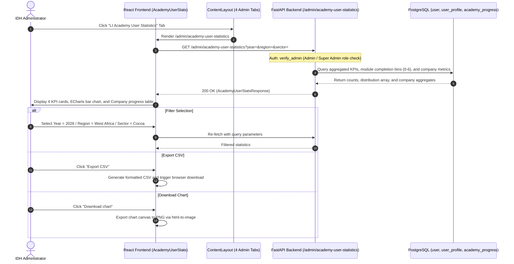

# [TLSA-013] Joint Admin Page & Living Income Academy User Statistics - Implementation Plan

**GitHub Issue**: `#879` — `[TLSA-013] Create joint admin page with user statistics for academy`  
**Parent Specs**: `docs/features/002_toolkit_login_shared_access_spec.md`, `docs/features/007_admin_tool_access_spec.md`  
**Figma References**:
- [Joint Admin Page (Manage Users)](https://www.figma.com/design/ga4EMPcp00Bh0d883khSs6/Living-income-academy?node-id=13010-13007) (Node: `13010:13007`)
- [Edit User](https://www.figma.com/design/ga4EMPcp00Bh0d883khSs6/Living-income-academy?node-id=13033-15051) (Node: `13033:15051`)
- [LI Academy User Statistics](https://www.figma.com/design/ga4EMPcp00Bh0d883khSs6/Living-income-academy?node-id=13036-20503) (Node: `13036:20503`)

---

## Overview

The IDH "Toolkit Towards Better Incomes" combines the **Income Driver Calculator (IDC)** and the **Living Income Academy (LIA)** under a single administrative umbrella. To give IDH program directors and administrators comprehensive visibility into cross-tool platform adoption and learner engagement, **TLSA-013** introduces:
1. **Unified Admin Navigation**: A centralized 4-tab admin interface across User Management (`Manage Users`, `Manage Companies`, `Manage Tags`, `LI Academy User Statistics`).
2. **Refined User Management & Edit User Workflow**: Synchronized table styling, tool access badges, and a dual-card edit layout featuring streamlined "Remove IDC Access" and "Account Status" controls.
3. **Dedicated Living Income Academy User Statistics Dashboard**:
   - Multi-dimensional filtering (`Year`, `Region`, `Sector`) with one-click CSV export.
   - 4 high-level KPI figure cards (`Registered Academy users`, `Active users (last 30 days)`, `Companies taking part`, `Average modules completed`).
   - Interactive module completion distribution bar chart (`0` to `6` modules completed) with unit toggles (`%` vs. `Number`), label toggle, and PNG chart download.
   - Sortable enterprise participation table ("Companies taking part") detailing company learner counts, average course progress %, and full-completion counts.

---

## 5W1H Requirements Discovery

- **Who**: IDH Platform Administrators, Super Admins, and Program Directors (Procurement & Living Income).
- **What**:
  - Global admin tab navigation incorporating the 4th tab: `LI Academy User Statistics`.
  - Refined user edit layout with explicit IDC access revocation and account deactivation actions.
  - Backend analytics endpoint `GET /admin/academy-user-statistics` calculating aggregated learner metrics from existing PostgreSQL tables without schema changes.
  - Interactive Academy statistics dashboard with KPI cards, ECharts bar distribution, and company progress table.
- **Where**:
  - **Frontend**:
    - Layout & Tabs: `frontend/src/components/layout/ContentLayout.js`
    - Routes: `frontend/src/App.js`, `frontend/src/components/route/paths.js`
    - Admin Users: `frontend/src/pages/admin/users/Users.js`, `frontend/src/pages/admin/users/UserForm.js`, `user.scss`
    - Academy Stats: `frontend/src/pages/admin/academy-stats/` (`AcademyUserStats.js`, `AcademyUserStats.scss`, components for KPIs, Chart, Table)
  - **Backend**:
    - Route: `backend/routes/admin_academy_stats.py` (registered in `backend/main.py`)
    - Models / Schemas: `backend/models/admin_academy_stats.py`
    - Data Layer: `backend/db/crud_admin_academy_stats.py`
  - **Tests**:
    - `backend/tests/test_1037_admin_academy_user_stats.py`
    - `frontend/src/pages/admin/academy-stats/__tests__/AcademyUserStats.test.js`
    - `frontend/src/pages/admin/users/__tests__/Users.test.js`
    - `frontend/src/pages/admin/users/__tests__/UserForm.test.js`
- **When**: Whenever administrators access `/admin/users`, `/admin/user/:id`, or `/admin/academy-user-statistics`.
- **Why**: Program leadership requires data-driven insights into how companies and practitioners progress through Living Income Academy modules, while administrators need unified tool governance.
- **How**: Ant Design v5 + ECharts frontend integrated into the existing `ContentLayout`, consuming optimized SQL aggregation queries secured by `verify_admin`.

---

## Architecture Overview



---

## 1. Backend Implementation

### 1.1 Database Models & Migrations
> [!NOTE]
> **Zero Schema Migrations Required**: All necessary tables and relationships already exist:
> - `user`: `id`, `email`, `fullname`, `role`, `user_type`, `is_active`, `tools`, `company`, `created_at`
> - `user_profile`: `user_id`, `company_name`, `sector`, `region_id`, `region_name`, `created_at`
> - `academy_module`: `id`, `order_index`, `title` (Total: 6 modules)
> - `academy_chapter`: `id`, `module_id`, `chapter_number`
> - `academy_user_chapter_progress`: `user_id`, `chapter_id`, `status`, `last_opened_at`, `completed_at`
> - `company`: `id`, `name`

### 1.2 Pydantic Schemas
**File**: `backend/models/admin_academy_stats.py`

```python
from typing import List, Optional
from pydantic import BaseModel, Field


class AcademyKpiStats(BaseModel):
    registered_users: int = Field(..., description="Total verified users with academy in tools")
    active_users_30d: int = Field(..., description="Academy users active in the last 30 days")
    companies_count: int = Field(..., description="Distinct companies taking part")
    avg_modules_completed: float = Field(..., description="Average number of completed modules (out of 6)")
    total_modules: int = Field(6, description="Total number of modules in the Academy curriculum")


class AcademyModuleDistributionBin(BaseModel):
    modules_completed: int = Field(..., ge=0, le=6, description="Number of modules completed (0 to 6)")
    count: int = Field(..., ge=0, description="Number of users in this bin")
    percentage: float = Field(..., ge=0.0, le=100.0, description="Percentage of total filtered users")


class AcademyCompanyStatItem(BaseModel):
    company: str = Field(..., description="Company name")
    users_count: int = Field(..., ge=1, description="Number of registered academy users from this company")
    average_progress_pct: float = Field(..., ge=0.0, le=100.0, description="Average course progress %")
    completed_all_modules_count: int = Field(..., ge=0, description="Number of users who completed all 6 modules")


class AcademyStatsFilterOptions(BaseModel):
    years: List[int] = Field(..., description="Available registration years for filtering")
    regions: List[str] = Field(..., description="Available region names for filtering")
    sectors: List[str] = Field(..., description="Available sector names for filtering")


class AcademyUserStatsResponse(BaseModel):
    kpis: AcademyKpiStats
    module_distribution: List[AcademyModuleDistributionBin]
    companies: List[AcademyCompanyStatItem]
    filter_options: AcademyStatsFilterOptions
```

### 1.3 Database Query Aggregations
**File**: `backend/db/crud_admin_academy_stats.py`

- **Cohort Definition**:
  - Filter `User.tools.contains(["academy"])` and `User.is_active == 1`.
  - Left outer join `UserProfile` on `UserProfile.user_id == User.id`.
  - Left outer join `Company` on `Company.id == User.company`.
  - Determine company name: `func.coalesce(Company.name, UserProfile.company_name, 'Unknown')`.
  - Apply optional filters:
    - `year`: `func.extract('year', User.created_at) == year`
    - `region`: `func.lower(UserProfile.region_name) == func.lower(region)`
    - `sector`: `func.lower(UserProfile.sector) == func.lower(sector)`
- **Module Completion Logic**:
  - Total modules = 6 (derived from count of `AcademyModule`).
  - Total chapters per module = count of `AcademyChapter` grouped by `module_id`.
  - For each user in cohort, count modules where all chapters have `AcademyUserChapterProgress.status == 'completed'`.
  - Bin users into buckets `0, 1, 2, 3, 4, 5, 6`.
  - Compute `avg_modules_completed = sum(user_completed_modules) / total_cohort_users`.
- **Active Users (30 Days)**:
  - Users with at least one record in `AcademyUserChapterProgress` where `last_opened_at >= now() - interval '30 days'`.
- **Company Progress Table**:
  - Group by company name.
  - Count users per company.
  - Average user progress % across company users: `(sum of user completed chapters / total course chapters) * 100`.
  - Count users where completed modules == 6.
  - Order by `users_count DESC`.

### 1.4 API Route
**File**: `backend/routes/admin_academy_stats.py`

```python
@admin_stats_route.get(
    "/admin/academy-user-statistics",
    response_model=AcademyUserStatsResponse,
    summary="Get Living Income Academy user statistics and analytics",
)
def get_academy_user_statistics(
    year: Optional[int] = Query(None, description="Filter by registration year"),
    region: Optional[str] = Query(None, description="Filter by region name"),
    sector: Optional[str] = Query(None, description="Filter by sector"),
    db: Session = Depends(get_db),
    current_user: User = Depends(get_current_user_required),
):
    verify_admin(current_user)
    return crud_admin_academy_stats.get_academy_user_statistics(
        db, year=year, region=region, sector=sector
    )
```

---

## 2. Frontend Implementation

### 2.1 Admin Navigation Tab Expansion
**File**: `frontend/src/components/layout/ContentLayout.js`
- Update `tabItems`:
  ```javascript
  const tabItems = [
    { key: "/admin/users", label: "Manage Users", value: "user" },
    { key: "/admin/companies", label: "Manage Companies", value: "companies" },
    { key: "/admin/tags", label: "Manage Tags", value: "tag" },
    { key: "/admin/academy-user-statistics", label: "LI Academy User Statistics", value: "academy-user-statistics" },
  ];
  ```
- Ensure `showTabItemsForPath` includes the new route so the 4 tabs render seamlessly on table/overview views.

### 2.2 Manage Users Table Polish
**File**: `frontend/src/pages/admin/users/Users.js`
- Synchronize **Tools** column tags with Figma:
  - `LI Academy`: `<Tag className="tag-academy">LI Academy</Tag>` (`#f6ffed` background, `#b7eb8f` border, `#52c41a` text).
  - `IDC`: `<Tag className="tag-idc">IDC</Tag>` (`#f0f5ff` background, `#adc6ff` border, `#2f54eb` text).
- Retain existing filter dropdowns (`User Role`, `Company`, `Tool Access`) and pagination.

### 2.3 Edit User Layout Polish
**File**: `frontend/src/pages/admin/users/UserForm.js`, `user.scss`
- Verify 2-column layout matching Figma node `13033:15051`:
  - **Left Card**: `User Information` (Fullname, Email, Role, User Type, Company).
  - **Right Card**: `Tool Access`:
    - "Current Access:" tags (`LI Academy`, `IDC`).
    - Tool access descriptive text.
    - Divider.
    - "Remove IDC Access" row: Red danger primary button (`Remove IDC Access`) with confirmation Popconfirm invoking `POST /user/{id}/revoke-idc`.
    - Divider.
    - "Account Status" row: Red danger button (`Deactivate Account` / `Reactivate Account`) with confirmation Popconfirm.
  - **Bottom Action**: Rounded green outline button: `Save User` (`border-2 border-[#00625f] rounded-[20px]`).

### 2.4 LI Academy User Statistics Dashboard Page
**File**: `frontend/src/pages/admin/academy-stats/AcademyUserStats.js`

#### UI Layout & Structure
```text
+---------------------------------------------------------------------------------------------------+
| Home > Users > User Management                                                                    |
| User Management                                                                                   |
| [Manage Users]  [Manage Companies]  [Manage Tags]  [LI Academy User Statistics (Active)]          |
+---------------------------------------------------------------------------------------------------+
| Filters: [All years v]  [All regions v]  [All sectors v]                      [ Export CSV Button ] |
+---------------------------------------------------------------------------------------------------+
| Key Figures (4 Cards):                                                                            |
| [ Registered Academy users ] [ Active users (30d) ] [ Companies taking part ] [ Avg completed ]   |
|   1,248                        412                    37                        3.4 / 6           |
+-------------------------------------------------------+-------------------------------------------+
| How many modules have users completed? [Download PNG] | Companies taking part                     |
| Show as: (•) % ( ) Number   Show label: [ ON ]        | (Green Toolbar Header)                    |
| +---------------------------------------------------+ | Company      | Users | Avg Prog | All 6   |
| | 18%   14%   15%   20%   16%   10%    7%           | | Ndugu        | 142   | 71%      | 58      |
| | [■]   [■]   [■]   [■]   [■]   [■]   [■]           | | ETG Beyond B | 118   | 64%      | 41      |
| |  0     1     2     3     4     5     6            | | Vitara       | 96    | 58%      | 33      |
| +---------------------------------------------------+ | Olam Cocoa   | 88    | 52%      | 27      |
+-------------------------------------------------------+-------------------------------------------+
```

#### Detailed Components:
1. **Filter Header**:
   - `Year Select`: `All years` + available years from API.
   - `Region Select`: `All regions` + available regions from API.
   - `Sector Select`: `All sectors` + available sectors from API.
   - `Export CSV`: Generates and triggers download of `li_academy_user_statistics_{date}.csv` including KPIs, module completion breakdown, and company participation table.
2. **Key Figures Grid**:
   - 4 equal-width cards in a responsive grid.
   - Labels in secondary grey (`#777`), values in bold primary black (`24px`).
3. **Module Completion Distribution (Bar Chart)**:
   - Header with title, information tooltip, and `Download chart` pill button (using `SaveAsImageButton` or canvas export).
   - Interactive controls:
     - `Show as`: Ant Design `Radio.Group` (`%` vs `Number`).
     - `Show label`: Ant Design `Switch` toggling bar end labels.
   - ECharts Bar Chart:
     - Categories: `0`, `1`, `2`, `3`, `4`, `5`, `6`.
     - Bar color: IDC brand green `#01625f`, rounded top corners (`border-radius: [4, 4, 0, 0]`).
     - Tooltip rendering both user count and percentage.
4. **Companies Taking Part (Table)**:
   - Header toolbar in IDH green (`#01625f`) with white title.
   - Ant Design `Table` with sortable columns:
     - `Company`: String sort.
     - `Users`: Numeric sort.
     - `Average progress`: Percentage numeric sort.
     - `Completed all 6`: Numeric sort.
   - Zebra striping and pagination (10 items per page).

---

## 3. Verification & Testing

### 3.1 Automated Tests
- **Backend Tests**:
  - `backend/tests/test_1037_admin_academy_user_stats.py`:
    - Test unauthenticated / non-admin access returns 401/403.
    - Test empty data state returns zeroed KPIs and 0-6 module bins with 0 counts.
    - Test populated progress calculates correct KPIs (`active_users_30d`, `avg_modules_completed`).
    - Test module distribution accurately bins users with 0, 1, ..., 6 completed modules.
    - Test company progress metrics and sorting.
    - Test filtering by `year`, `region`, and `sector`.
- **Frontend Tests**:
  - `frontend/src/pages/admin/academy-stats/__tests__/AcademyUserStats.test.js`:
    - Renders 4 KPI cards with fetched data.
    - Renders ECharts bar chart and handles `%` / `Number` toggle.
    - Renders company table and sorting.
    - Triggers CSV export on button click.
    - Handles filter dropdown changes and re-fetches data.
  - Regression tests for `Users.test.js` and `UserForm.test.js`.

### 3.2 Deterministic Test Commands
```bash
# Backend verification
./dc.sh exec backend pytest tests/test_1037_admin_academy_user_stats.py -v
./dc.sh exec backend flake8

# Frontend verification
./dc.sh exec frontend yarn test:ci --testPathPattern="admin" --runInBand
./dc.sh exec frontend yarn lint
```

---

## 4. Epic & Vibe Coding Estimation ⏱️

- **Confidence Level**: High (models and relationships already established in DB; clear Figma contracts)
- **Target Budget**: **6.0 Hours (0.75 Engineering Days)**
- **Dependencies**: None (builds on completed TLSA-007, Spec 001, and Spec 002)

| Task ID | Component & Scope | Vibe Coding (Dev) | Automated Testing | QA & Review | Total Est. Time | Priority |
| :--- | :--- | :---: | :---: | :---: | :---: | :---: |
| **TASK-01** | **Backend Models & Aggregation Engine**<br>- Create DTO schemas (`models/admin_academy_stats.py`)<br>- Implement queries for KPIs, 0-6 bins, and company stats (`db/crud_admin_academy_stats.py`)<br>- Cohort boundary handling (active academy users, profile company fallbacks) | 35m | 25m | 15m | **75m (1.25h)** | P0 |
| **TASK-02** | **Backend API Route & Security Gate**<br>- Implement `GET /admin/academy-user-statistics`<br>- Add query param filters (`year`, `region`, `sector`)<br>- Hermetic unit tests in `test_1037_admin_academy_user_stats.py` | 25m | 25m | 10m | **60m (1.0h)** | P0 |
| **TASK-03** | **Admin Navigation & Shared Layout Integration**<br>- Add 4th tab in `ContentLayout.js`<br>- Mount route `/admin/academy-user-statistics` in `App.js` and `paths.js`<br>- Update tag badges (`LI Academy` / `IDC`) in `Users.js` to match Figma colors<br>- Polish `UserForm.js` Tool Access card ("Remove IDC Access", "Account Status", pill "Save User") | 30m | 15m | 10m | **55m (~0.9h)** | P0 |
| **TASK-04** | **LI Academy Stats: Filters & KPI Figure Cards**<br>- Filter header (`Year`, `Region`, `Sector` dropdowns + `Export CSV`)<br>- Client-side CSV generation & download<br>- 4 KPI figure cards with responsive grid & typography | 30m | 20m | 10m | **60m (1.0h)** | P0 |
| **TASK-05** | **LI Academy Stats: Visualizations & Table**<br>- ECharts bar configuration (`0` to `6` modules)<br>- Unit toggle (`%` vs `Number`) and label switch (`Show label`)<br>- `Download chart` PNG export via `SaveAsImageButton`<br>- Sortable "Companies taking part" table with green toolbar (`#01625f`) | 35m | 25m | 10m | **70m (1.17h)** | P0 |
| **TASK-06** | **End-to-End Verification, Coverage Gate & Regression**<br>- Frontend unit tests (`AcademyUserStats.test.js`)<br>- Full backend pytest suite & flake8 check<br>- Full frontend `yarn test:ci` & `yarn lint` | 10m | 20m | 10m | **40m (~0.67h)** | P0 |
| **TOTAL** | **Full TLSA-013 Implementation** | **2h 45m** | **2h 10m** | **1h 05m** | **6h 00m (6.0h)** | — |

---

## 5. Parallel Execution Streams (`/bmad-parallel-dev`)

| Stream | Persona | Touchpoints | Deliverable |
| :--- | :--- | :--- | :--- |
| **Stream A (Backend)** | `bmad-dev` (Amelia API) | `backend/models/admin_academy_stats.py`<br>`backend/db/crud_admin_academy_stats.py`<br>`backend/routes/admin_academy_stats.py`<br>`backend/main.py` | Analytics aggregation engine, Pydantic DTOs, endpoint with year/region/sector filters |
| **Stream B (Frontend Admin UI)** | `bmad-dev` (Amelia UI-1) | `frontend/src/components/layout/ContentLayout.js`<br>`frontend/src/pages/admin/users/Users.js`<br>`frontend/src/pages/admin/users/UserForm.js`<br>`frontend/src/pages/admin/users/user.scss` | 4th admin tab integration, tool badge color synchronization, UserForm action card polish |
| **Stream C (Frontend Stats Dashboard)** | `bmad-dev` (Amelia UI-2) | `frontend/src/pages/admin/academy-stats/*`<br>`frontend/src/pages/admin/index.js`<br>`frontend/src/App.js`<br>`frontend/src/components/route/paths.js` | Filters, KPI cards, ECharts distribution chart with toggles/export, and Company participation table |
| **Stream D (QA & Verification)** | `bmad-tester` (Murat QA) | `backend/tests/test_1037_admin_academy_user_stats.py`<br>`frontend/src/pages/admin/academy-stats/__tests__/AcademyUserStats.test.js`<br>`frontend/src/pages/admin/users/__tests__/*` | Hermetic unit tests, edge case verification, ≥80% test coverage gate enforcement |
