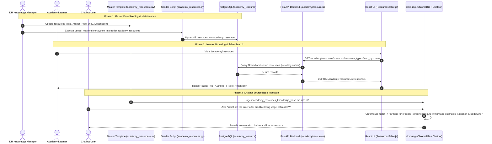

# [LIACD-014] Academy Resources Page Input & Chatbot Knowledge Base - Implementation Plan

**GitHub Issue**: `#907` — `[LIACD-014] Academy resources page input`  
**Parent Specs**: `docs/features/001_living_income_academy_spec.md`, `docs/features/013_academy_ai_chatbot_integration_spec.md`  
**Figma Reference**: [Academy Resources - Resources](https://www.figma.com/design/ga4EMPcp00Bh0d883khSs6/Living-income-academy?node-id=12327-22288) (Node: `12327:22288`)  
**Source Data**: [Google Sheet / Excel Master](https://docs.google.com/spreadsheets/d/1upWeWGAWTDU31pG_OvXqowxY42y470wd/edit?usp=sharing&ouid=113855328292107281106&rtpof=true&sd=true)

---

## Overview

The Living Income Academy provides learners with curated technical guidance, benchmark studies, methodologies, tools, and external resources. **LIACD-014** populates and standardizes the Academy Technical Resources catalog using vetted IDH and Living Income Community of Practice (LICOP) source data.

### Key Objectives:
1. **Master Data Template**: Establish a repeatable, version-controlled master data template (`backend/source/master/academy_resources.csv`) and an automated seeder (`backend/seeder/academy_resources.py`) containing all 48 vetted resources.
2. **Schema & Model Enhancement**: Add the `author` field to the `academy_resource` PostgreSQL table and expose it through FastAPI endpoints and DTOs.
3. **Table Column Realignment**: Update `ResourcesTable.js` to strictly reflect the requested 4 columns:
   - **Title** (with document/web icon)
   - **Author(s)**
   - **Type** (Guidance, Organisation, Template, Tool)
   - **Download / Link** (Action icon button opening external links in a new tab or triggering file downloads)
4. **Chatbot Knowledge Base Ingestion**: Format and export the resources catalog into a structured knowledge base document (`agent_docs/tmp/academy/academy_resources_knowledge_base.md`) so the AI Chatbot (`akvo-rag`) strictly and exclusively queries **(1) Course Content** and **(2) Technical Resources**, "and not more."

---

## 5W1H Requirements Discovery

- **Who**: 
  - *Learners & Practitioners*: Navigating `/academy/resources` to access reputable living income publications, calculators, and guidelines.
  - *IDH Knowledge Managers*: Maintaining and updating external resources via a standardized template without touching code.
  - *Academy AI Chatbot*: Leveraging the curated resources as an authoritative source base to cite relevant external publications in chat responses.
- **What**:
  - Ingest 48 verified resources from the provided spreadsheet into the database.
  - Realignment of the resources table columns to `Title`, `Author(s)`, `Type`, and `Download/link`.
  - Master template and database seeder for long-term data maintainability.
  - Chatbot knowledge base synthesis constraining RAG retrieval to course content + technical resources.
- **Where**:
  - **Master Data & Seeder**: `backend/source/master/academy_resources.csv`, `backend/seeder/academy_resources.py`
  - **Database & Backend**:
    - `backend/models/academy/academy_models.py` (`AcademyResource`)
    - `backend/models/academy/academy_schemas.py` (`AcademyResourceItemResponse`)
    - `backend/alembic/versions/2026_11_24_0800-d4e5f6a1b2c3_add_author_to_academy_resource.py`
    - `backend/db/academy/crud_resource.py`
    - `backend/routes/academy/resource.py`
  - **Frontend UI**:
    - `frontend/src/pages/academy/components/ResourcesTable.js`
    - `frontend/src/pages/academy/AcademyResourcesPage.js`
    - `frontend/src/pages/academy/AcademyResourcesPage.scss`
  - **Chatbot Knowledge Base**:
    - `agent_docs/tmp/academy/academy_resources_knowledge_base.md`
- **When**: Accessed whenever learners visit `/academy/resources` or prompt the Academy Chatbot.
- **Why**: Replaces preliminary placeholder items with official IDH/LICOP resources, ensures column parity with the curated excel spreadsheet, and enriches chatbot answer grounding.
- **How**: Alembic migration, SQLAlchemy ORM updates, React Ant Design v5 Table adjustments, and structured Markdown export for ChromaDB/LangGraph ingestion.

---

## Architecture & Data Flow



---

## 1. Master Data Specification

### 1.1 Master Template Schema
**File**: `backend/source/master/academy_resources.csv`

The master file is the single source of truth for all academy technical resources.

| Column | Type | Description | Example |
| :--- | :--- | :--- | :--- |
| `id` | Integer | Unique identifier (1..48) | `1` |
| `title` | String | Official resource publication title | `IDH Living Income Roadmap` |
| `author` | String | Author(s), institute, or publisher | `IDH` |
| `resource_type` | Enum | `Guidance`, `Organisation`, `Template`, `Tool` | `Tool` |
| `url` | String | Direct external URL or downloadable link | `https://roadmap.idh.org/living-income` |
| `description` | String | Contextual summary for search and chatbot RAG | `Comprehensive roadmap outlining steps for companies to address living income gaps.` |

### 1.2 Categorization Mapping
The 48 spreadsheet resources are mapped into the existing 4 `AcademyResourceType` enums:
- **`Guidance`** (24 items): Technical guides, FAQs, briefing papers, research reports, and methodologies (e.g. *Technical Guidance on Due Diligence for Living Income*, *Actual Income Measurement FAQ*, *KIT Demystifying Cocoa Sector*).
- **`Organisation`** (7 items): Institutional websites, communities of practice, and alliances (e.g. *Living Income Community of Practice*, *Global Living Wage Coalition*, *ISEAL*).
- **`Template`** (4 items): Downloadable calculation workbooks, alignment templates, and data tools (e.g. *LICOP Study Template for Alignment*, *Living Income Gap Calculation Excel Tools*).
- **`Tool`** (13 items): Interactive software, calculators, platforms, and dashboards (e.g. *Income Driver Calculator*, *World Bank Poverty and Equity Data Portal*, *Due Diligence Dashboard*, *Numbeo Cost of Living Map*).

---

## 2. Backend Implementation

### 2.1 Database Model Update
**File**: `backend/models/academy/academy_models.py`

Update `AcademyResource` model to include `author`:

```python
class AcademyResource(Base):
    __tablename__ = "academy_resource"

    id = Column(Integer, primary_key=True, autoincrement=True)
    name = Column(String(255), nullable=False)
    author = Column(String(255), nullable=True)  # <-- NEW: Author(s) / Publishing Organization
    resource_type = Column(
        Enum(AcademyResourceType, name="academy_resource_type"),
        nullable=False,
        index=True,
    )
    file_url = Column(String(500), nullable=False)
    created_at = Column(DateTime, server_default=func.now(), nullable=False)
    updated_at = Column(DateTime, server_default=func.now(), onupdate=func.now(), nullable=False)

    def to_dict(self) -> AcademyResourceDict:
        return {
            "id": self.id,
            "name": self.name,
            "author": self.author,
            "resource_type": (
                self.resource_type.value
                if isinstance(self.resource_type, AcademyResourceType)
                else str(self.resource_type)
            ),
            "file_url": self.file_url,
            "created_at": self.created_at,
            "updated_at": self.updated_at,
        }
```

### 2.2 Alembic Migration
**File**: `backend/alembic/versions/2026_11_24_0800-d4e5f6a1b2c3_add_author_to_academy_resource.py`
- **Revision**: `d4e5f6a1b2c3`
- **Down Revision**: `c8d9e0f1a2b3` (current HEAD)
- **Upgrade**:
  ```python
  op.add_column('academy_resource', sa.Column('author', sa.String(length=255), nullable=True))
  ```
- **Downgrade**:
  ```python
  op.drop_column('academy_resource', 'author')
  ```

### 2.3 Pydantic DTOs
**File**: `backend/models/academy/academy_schemas.py`

Update `AcademyResourceItemResponse`:

```python
class AcademyResourceItemResponse(BaseSchema):
    id: int
    name: str
    author: Optional[str] = None  # <-- NEW: Exposed for frontend rendering
    type: AcademyResourceType
    url: str
    description: Optional[str] = None
    created_at: datetime
```

### 2.4 Data Layer & Query Updates
**File**: `backend/db/academy/crud_resource.py`

1. **Search Extension**: Include `AcademyResource.author.ilike(f"%{s}%")` in the search filter:
   ```python
   if isinstance(search, str) and search.strip():
       s = search.strip()
       query = query.filter(
           or_(
               AcademyResource.name.ilike(f"%{s}%"),
               AcademyResource.author.ilike(f"%{s}%"),
               AcademyResource.file_url.ilike(f"%{s}%"),
           )
       )
   ```
2. **Sort Extension**: Add support for `sort_by="author"`:
   ```python
   elif sb in ("author", "authors"):
       sort_col = AcademyResource.author
   ```
3. **Response Mapping**: Map `author=r.author`.

### 2.5 Database Seeder & Truncation Protocol

#### 📍 Existing Seeder Structure:
- **File**: [`backend/seeder/academy.py`](file:///Users/galihpratama/Sites/IDH-IDC/backend/seeder/academy.py#L1259-L1282)
- **Current Mechanism**: In [`seed_resources(session)`](file:///Users/galihpratama/Sites/IDH-IDC/backend/seeder/academy.py#L1259-L1282), the code was already designed to load `backend/source/master/academy_resources.csv`:
  ```python
  df = load_csv("academy_resources.csv")
  resources_to_insert = (
      df.to_dict(orient="records") if df is not None else DEFAULT_RESOURCES
  )
  ```
- **Fallback**: It fell back to `DEFAULT_RESOURCES` (lines 103–160, 9 placeholder items) solely because `backend/source/master/academy_resources.csv` had not been created yet.

#### 🔄 Leveraging the Existing Seeder (No Redundant Script):
Instead of creating a separate seeder script, we **update the existing `backend/seeder/academy.py` directly**:
1. **Master CSV Placement**: Save the 48 validated records to `backend/source/master/academy_resources.csv`.
2. **Support `author` Column**: Update `seed_resources(session)` to read `item["author"]`:
   ```python
   resource = AcademyResource(
       id=int(item["id"]) if "id" in item and pd.notna(item["id"]) else None,
       name=str(item["name"]),
       author=str(item["author"]) if "author" in item and pd.notna(item["author"]) else None,
       resource_type=res_type,
       file_url=str(item["file_url"]),
   )
   ```
3. **Execution**:
   Running the existing academy seeder:
   ```bash
   ./dc.sh exec backend python seeder/academy.py
   ```
   automatically calls `truncate_academy_tables(session)` (which includes `TRUNCATE TABLE "academy_resource" CASCADE;` and sequence reset), wipes the old faker items, and seeds all 48 master records from `academy_resources.csv`.
4. **Standalone Resource Reseeding**:
   We will add a `--resources-only` CLI flag to `backend/seeder/academy.py` so developers can reseed just the resources table on demand without reseeding other tables:
   ```bash
   ./dc.sh exec backend python seeder/academy.py --resources-only
   ```

---

## 3. Frontend Implementation

### 3.1 Resources Table Realignment
**File**: `frontend/src/pages/academy/components/ResourcesTable.js`

Update table columns strictly to the 4 requested columns:

```javascript
const columns = useMemo(
  () => [
    {
      title: "Title",
      dataIndex: "name",
      key: "name",
      render: (name, resource) => (
        <span className="academy-resource-name">
          <span className="academy-resource-icon" aria-hidden="true">
            {getResourceLink(resource.url)?.external ? (
              <GlobalOutlined />
            ) : (
              <FileTextOutlined />
            )}
          </span>
          <HighlightedText text={name} highlight={highlight} />
        </span>
      ),
    },
    {
      title: "Author(s)",
      dataIndex: "author",
      key: "author",
      width: 220,
      render: (author) => (
        <span className="academy-resource-author">
          {author ? <HighlightedText text={author} highlight={highlight} /> : "—"}
        </span>
      ),
    },
    {
      title: "Type",
      dataIndex: "type",
      key: "type",
      width: 150,
      render: (type) => <span className="academy-type-tag">{type}</span>,
    },
    {
      title: "Link",
      key: "actions",
      width: 100,
      align: "center",
      render: (_, resource) => <ResourceAction resource={resource} />,
    },
  ],
  [highlight]
);
```

### 3.2 Action Icons & Download Logic
- Direct file URLs (e.g. `.pdf`, `.docx`, internal paths): Render `<DownloadOutlined />` button with `download` attribute.
- Web links / external websites: Render `<ExportOutlined />` button with `target="_blank" rel="noopener noreferrer"`.
- Tooltip/Aria-label: "Open resource in new tab" or "Download resource".

### 3.3 Search & Type Filtering
**File**: `frontend/src/pages/academy/AcademyResourcesPage.js`
- `search`: Filter text matches either `Title` or `Author(s)`.
- `type`: Dropdown with `Guidance`, `Organisation`, `Template`, `Tool`.

---

## 4. Chatbot Source Base Integration

> [!IMPORTANT]
> **Source Base Boundary**: The user specified:
> *"this file should also be a source base for the chatbot in addition to the course content. So thats all the chatbot picks from for now, and not more."*

### 4.1 Knowledge Base Document Generation
**File**: `agent_docs/tmp/academy/academy_resources_knowledge_base.md`

A structured markdown document compiled directly from the master resources template. Each entry includes:
- **Title**: Resource title
- **Author**: Author / Organization
- **Type**: Resource category
- **URL**: Verified link
- **Summary**: Concise explanation of what the resource covers and when a practitioner should consult it.

Example Markdown chunk for ChromaDB ingestion:
```markdown
# Academy Resource: Technical Guidance on Due Diligence for Living Income (2026)
- **Author**: Living Income Community of Practice (LICOP); produced by Shift
- **Category**: Guidance
- **Link**: https://www.living-income.com/fileadmin/living_income/Publications/Other_Relevant_Publications/Technical_guidance_on_Due_Diligence_for_Living_Inc.pdf
- **Description**: Comprehensive guidance on integrating living income into corporate human rights due diligence (HRDD) frameworks, specifically focusing on agribusiness and procurement practices.
```

### 4.2 Ingestion & RAG Citation Behavior
In `akvo-rag`:
- The Knowledge Base (`idc-academy-kb`) is configured with two document collections:
  1. `academy-curriculum`: All chapters from Modules 1 to 6.
  2. `academy-resources`: `academy_resources_knowledge_base.md`.
- When an inquiry matches an external guideline, methodology, or tool, the LLM cites it:
  > *"For detailed steps on adjusting benchmarks for household size, refer to the [Adjusting Living Income Benchmarks for Household Size in the Cocoa Sector (LICOP)](https://www.living-income.com/fileadmin/user_upload/Adjusting_Living_Income_Benchmarks_for_Household_Size_in_the_Cocoa_Sector.pdf)."*

---

## 5. Verification & Testing

### 5.1 Automated Tests
- **Backend**:
  - `backend/tests/test_academy_resource_api.py`:
    - Test `author` serialization in `/academy/resources`.
    - Test search across both `name` and `author`.
    - Test sorting by `author` (`sort_by=author`).
    - Test seeder idempotency (running seeder twice produces exactly 48 records without duplicates).
- **Frontend**:
  - `frontend/src/pages/academy/__tests__/AcademyResourcesPage.test.js`:
    - Verify 4 table column headers: `Title`, `Author(s)`, `Type`, `Link`.
    - Verify author name renders properly.
    - Verify external link vs. download icon behavior.
    - Verify search highlights author text.

### 5.2 Deterministic Test Commands
```bash
# Run migration & seeder
./dc.sh exec backend alembic upgrade head
./dc.sh exec backend python seeder/academy.py --resources-only

# Backend tests & lint
./dc.sh exec backend pytest tests/test_academy_resource_api.py -v
./dc.sh exec backend flake8

# Frontend tests & lint
./dc.sh exec frontend yarn test:ci --testPathPattern="AcademyResources" --runInBand
./dc.sh exec frontend yarn lint
```

---

## 6. Epic & Vibe Coding Estimation ⏱️

- **Confidence Level**: High (models, seeder patterns, and frontend components already exist)
- **Target Budget**: **3.0 Hours**

| Task ID | Component & Scope | Vibe Coding (Dev) | Automated Testing | QA & Review | Total Est. Time | Priority |
| :--- | :--- | :---: | :---: | :---: | :---: | :---: |
| **TASK-01** | **Master Template & Existing Seeder Update**<br>• Create `backend/source/master/academy_resources.csv` with all 48 vetted items<br>• Update `backend/seeder/academy.py` (`seed_resources`) to load `author`<br>• Add `--resources-only` CLI flag to `backend/seeder/academy.py` to allow isolated reseeding<br>• Truncate `academy_resource` table and reset sequence to 1 | 25m | 15m | 10m | **50m (~0.8h)** | P0 |
| **TASK-02** | **Database Migration & Backend API Update**<br>• Alembic migration adding `author` to `academy_resource`<br>• Update `AcademyResource` model and `AcademyResourceItemResponse` schema<br>• Update `crud_resource.py` for author search and sorting | 25m | 20m | 10m | **55m (~0.9h)** | P0 |
| **TASK-03** | **Frontend Resources Table Realignment**<br>• Update `ResourcesTable.js` to 4 columns (`Title`, `Author(s)`, `Type`, `Link`)<br>• Action icon buttons (download for files, external link for websites)<br>• Search highlight support for author names | 20m | 15m | 10m | **45m (0.75h)** | P0 |
| **TASK-04** | **Chatbot Knowledge Base Document & Documentation**<br>• Generate `agent_docs/tmp/academy/academy_resources_knowledge_base.md`<br>• Document chatbot RAG boundary (Course Content + Technical Resources only) | 15m | — | 10m | **25m (~0.4h)** | P1 |
| **TASK-05** | **Regression Testing & Verification**<br>• Unit tests in `test_academy_resource_api.py` and `AcademyResourcesPage.test.js`<br>• Full regression pass (`pytest`, `yarn test:ci`, `flake8`, `yarn lint`) | — | 20m | 10m | **30m (0.5h)** | P0 |
| **TOTAL** | **Full Feature (LIACD-014)** | **1h 25m** | **1h 10m** | **0h 50m** | **3h 25m (~3.5h)** | — |
