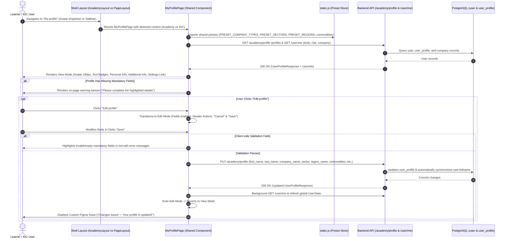

# [TLSA-014] Shared My Profile Page — Feature Specification

> **Status**: Ready for Frontend Development  
> **Backend Implementation Status**: **Complete (Zero Backend Tasks Required)** — Endpoints `GET /academy/profile`, `PUT /academy/profile`, and `GET /user/me` are already implemented, tested (599/599 passing), and production-ready.  
> **Figma Source**:
> - [My profile — View Mode (`node-id=12029-57236`)](https://www.figma.com/design/ga4EMPcp00Bh0d883khSs6/Living-income-academy?node-id=12029-57236&t=x4nFyxk3JdgINJgZ-0)
> - [My profile — Edit Mode (`node-id=13017-14597`)](https://www.figma.com/design/ga4EMPcp00Bh0d883khSs6/Living-income-academy?node-id=13017-14597&t=x4nFyxk3JdgINJgZ-0)
> - [Confirmation Toast — "Changes saved" (`node-id=13018-19695`)](https://www.figma.com/design/ga4EMPcp00Bh0d883khSs6/Living-income-academy?node-id=13018-19695&t=x4nFyxk3JdgINJgZ-0)
> - [Settings Page (`node-id=12029-57853`)](https://www.figma.com/design/ga4EMPcp00Bh0d883khSs6/Living-income-academy?node-id=12029-57853&t=x4nFyxk3JdgINJgZ-0)

---

## 1. Executive Summary & Requirements Discovery (5W1H)

This specification unifies the user profile experience across the entire IDH Toolkit into a single, cohesive **"My profile" page** shared between **Living Income Academy** learners and **Income Driver Calculator (IDC)** users.

### 1.1 5W1H Framework
- **Who**: All registered IDH Toolkit users (Living Income Academy learners, IDC users, and joint-access users).
- **What**: A single, shared "My profile" page holding user demographics, organizational context, non-editable system role/tool badges, and direct navigation link to account Settings (password change, account deletion).
- **Where**:
  - Frontend Canonical Route: `/profile` (with `/academy/profile` alias and redirect from `/academy/account`).
  - Shell Integration: Reached from the top avatar dropdown ("My Profile") across both tools, and from the left navigation rail ("My profile") in Academy.
  - Backend Endpoints: `GET /academy/profile`, `PUT /academy/profile`, and `GET /user/me` (already implemented and tested).
- **When**: Triggered when a user clicks "My profile" in either application shell, or when redirected from post-login incomplete profile reminders.
- **Why**: Eliminates fragmented, duplicate profile experiences between IDC and Academy. Ensures user data entered in either tool is synchronized globally, clarifies system-governed vs. user-editable fields, and routes users cleanly to password/deletion settings.
- **How**: Refactor the Academy profile component into the shared `MyProfilePage`, adapt layout presentation based on active tool context (with sidebar in Academy, without sidebar in IDC), centralize preset lists in `static.js`, and align all visual components with the Figma Living Income Academy 2026 design system.

### 1.2 Core Business & Technical Objectives
1. **Single Source of Truth**: Eliminate fragmented profiles between IDC and Academy; demographic and organizational data entered in one tool is instantly reflected in both.
2. **Context-Aware Presentation**: Seamlessly adapts its outer shell depending on navigation entry point:
   - When visited inside Academy (`/academy/profile`), renders inside `AcademyLayout` with the left rail (`AcademySidebar`).
   - When visited inside IDC (`/profile`), renders inside standard `PageLayout` / `ContentLayout` without the Academy sidebar.
3. **Figma Visual Parity**: Aligns 100% with the Living Income Academy 2026 design system, including:
   - Circular initials avatar (160px diameter) with no photo upload dropzone.
   - Non-editable tool access badges (`LI Academy` in Polar Green, `IDC` in Geek Blue).
   - Dedicated View vs. Edit state toggle (removing legacy "Continue learning" button).
   - Clean card-based layout: **Personal information**, **Additional information**, and **Settings link card**.
   - Custom Figma-styled toast notification on successful save ("Changes saved — Your profile is updated!").
   - Single source of truth for preset dropdowns (`PRESET_COMPANY_TYPES`, `PRESET_SECTORS`, `PRESET_REGIONS`) from `frontend/src/store/static.js`.

---

## 2. Architecture & Data Flow



---

## 3. Existing Component Inventory & Zero-Duplication Audit 🧩

To prevent duplicate code, redundant abstractions, or reinventing existing patterns, the implementation MUST strictly adhere to the following **Zero-Duplication Component Matrix**:

| Feature / UI Element | Existing Codebase Asset | Action Required | What NOT to Do (Anti-Duplication Guardrails) |
| :--- | :--- | :--- | :--- |
| **Profile Page Root** | `frontend/src/pages/academy/AcademyAccountPage.js`<br>*(and legacy `frontend/src/pages/profile/Profile.js`)* | **Adapt & Share**:<br>Retarget `AcademyAccountPage` as the unified profile page. Mount it at both `/profile` (IDC context) and `/academy/profile` (Academy context). Deprecate/replace legacy `Profile.js`. | **DO NOT** create a separate profile page component for IDC. One shared controller handles both contexts. |
| **Hero Banner & Avatar** | `frontend/src/pages/academy/components/AccountHeroBanner.js` | **Adapt (Minor)**:<br>Adjust avatar circle to 160px diameter, render `ToolTags` beneath identity, remove the legacy "Continue learning" button. | **DO NOT** build a new banner or custom avatar generator. Reuse `getUserInitials` from `frontend/src/pages/academy/utils`. |
| **Tool Access Tags** | `node-id=13048:10177`<br>*(Polar Green `LI Academy`, Geek Blue `IDC`)* | **Add small sub-component**:<br>`ToolTags` rendered in `AccountHeroBanner.js` driven by `userState.tools`. | **DO NOT** hardcode badge logic or create separate tag libraries; use Ant Design `<Tag>` with Figma CSS colors. |
| **Personal Info Form** | `frontend/src/pages/academy/components/PersonalInfoCard.js` | **Adapt (Minor)**:<br>Update card title to `"Personal information"`, subtitle to `"Update personal details."`, add Figma placeholders. | **DO NOT** rewrite the card. The existing Form.Item bindings for `first_name`, `last_name`, and read-only `email` already work. |
| **Additional Info Form** | `frontend/src/pages/academy/components/AdditionalInfoCard.js` | **Adapt (Refactor)**:<br>Remove local array declarations (`PRESET_*`). Import shared presets from `frontend/src/store/static.js`. Add non-editable Role and conditional IDH Company. | **DO NOT** duplicate preset lists. Single source of truth is `static.js`. |
| **Dropdown Presets** | `frontend/src/store/static.js`<br>`PRESET_COMPANY_TYPES`, `PRESET_SECTORS`, `PRESET_REGIONS` | **Reuse Directly**:<br>Import presets and `getOptionsWithFallback` from `static.js`. | **DO NOT** re-declare sector, region, or company type arrays in profile files. |
| **Commodity Tag Selector** | `frontend/src/pages/academy/components/CommodityTagSelector.js` | **Adapt (Minor)**:<br>Ensure dropdown displays fixed checklist and renders selected items as `<Tag closable>`. | **DO NOT** rewrite commodity selection from scratch; refine the existing selector. |
| **Settings Navigation Card** | Figma `node-id=13018:15302`<br>*(Bottom card linking to Settings)* | **Add small card**:<br>`SettingsLinkCard.js` (Title: "Settings", Subtitle: "Change password or delete account", Button: "To settings"). | **DO NOT** embed password forms or account deletion into the profile page. It only links to the existing settings page. |
| **Settings / Password Change** | `frontend/src/pages/academy/components/SignInSecurityCard.js` | **Reuse Directly (100%)**:<br>Already fully implements current password, new password (min 12 chars), confirm password, and API call. | **DO NOT** touch or re-implement password change. |
| **Delete Account & Modal** | `frontend/src/pages/academy/components/DeleteAccountCard.js`<br>`frontend/src/pages/academy/components/ConfirmModal.js` | **Reuse Directly (100%)**:<br>Already implements 2-step deletion with 409 active cases check and `ConfirmModal`. | **DO NOT** touch or re-implement account deletion. |
| **Settings Page Root** | `frontend/src/pages/academy/AcademySettingsPage.js` | **Reuse Directly (100%)**:<br>Already mounts `SignInSecurityCard` and `DeleteAccountCard`. | **DO NOT** duplicate settings pages. |
| **Incomplete Profile Alert** | `frontend/src/components/profile/IncompleteProfileAlert.js` | **Reuse Directly (Minor copy)**:<br>Banner alert on overview/dashboard already exists with localStorage dismissal. | **DO NOT** build a new incomplete alert component. |
| **Confirmation Toast** | Figma `node-id=13018:19695` | **Add small toast**:<br>`ProfileSavedToast.js` styled notification component invoked via Ant Design `notification.open()`. | **DO NOT** install third-party toast libraries. Use Ant Design's native notification system with custom JSX. |
| **Backend APIs & DB** | `GET /academy/profile`, `PUT /academy/profile`, `GET /user/me` | **Reuse Directly (100%)**:<br>Already persisted, tested, and fully functional. | **DO NOT** modify backend routes, models, or database migrations. Zero backend work required. |

---

## 4. Scope Governance & Boundary Declarations

### 🎯 In-Scope Touchpoint Files (Frontend Only)
- `[MODIFY]` `frontend/src/pages/academy/components/AcademySidebar.js` (Rename "Account" to "My profile", update route)
- `[CREATE/REFACTOR]` `frontend/src/pages/academy/AcademyAccountPage.js` ➔ `MyProfilePage.js` (or maintain wrapper for backwards compatibility)
- `[MODIFY]` `frontend/src/pages/academy/components/AccountHeroBanner.js` (Initials avatar 160px, Tool badges, Edit/Cancel/Save button states, remove "Continue learning")
- `[MODIFY]` `frontend/src/pages/academy/components/PersonalInfoCard.js` (Card title/subtitle, First name, Last name, read-only Email, remove photo upload)
- `[MODIFY]` `frontend/src/pages/academy/components/AdditionalInfoCard.js` (Import presets from `static.js`, Role non-editable, IDH Company for IDC users, Sector, Region, Commodities, Company type)
- `[MODIFY]` `frontend/src/pages/academy/components/CommodityTagSelector.js` (Fixed multi-select dropdown with checkboxes and closable tag list)
- `[CREATE]` `frontend/src/pages/academy/components/SettingsLinkCard.js` (Settings link card matching Figma `node-id=13018:15302`)
- `[CREATE]` `frontend/src/components/common/ProfileSavedToast.js` (Custom toast banner matching Figma `node-id=13018:19695`)
- `[MODIFY]` `frontend/src/components/profile/IncompleteProfileAlert.js` (Post-login reminder banner copy & actions)
- `[MODIFY]` `frontend/src/components/route/routePath.js` & `frontend/src/App.js` (Mount `/profile` and sync routes)
- `[TEST]` `frontend/src/pages/academy/__tests__/MyProfilePage.test.js` (Unit & integration test suite)

### 🚫 Explicitly Out-of-Scope (Zero Backend Tasks Required)
- **NO Backend Changes**: Endpoints `GET /academy/profile`, `PUT /academy/profile`, and `GET /user/me` already support all required fields, sanitize payloads, update `user_profile`, and automatically sync `user.fullname`.
- **NO Database Migrations**: `user_profile` table already contains all required columns (`first_name`, `last_name`, `company_name`, `company_type`, `sector`, `region_name`, `region_id`, `commodities`).
- **NO Password Change / Delete Account Reimplementation**: Existing Settings page (`/academy/settings` / `/settings`) handles password reset and account deletion; this page merely links to it.

---

## 5. Detailed Component Specifications (Figma Alignment)

### 4.1 Navigation & Breadcrumbs (`AcademySidebar.js` & `PageLayout.js`)
- **Figma Reference**: `node-id=12029:57237` (Side menu)
- **Sidebar Tab**: Renamed from `"Account"` to `"My profile"`.
- **Icon**: `<UserOutlined />`.
- **Routes**:
  - Primary Canonical Route: `/profile`.
  - Academy Context Route: `/academy/profile` (or `/profile?context=academy`).
  - Legacy Alias / Redirect: `/academy/account` redirects automatically to `/academy/profile`.
- **IDC Header Menu**: Avatar dropdown link labeled `"My Profile"` navigates to `/profile`.

---

### 4.2 Hero Banner & Tool Access Badges (`AccountHeroBanner.js`)
- **Figma Reference**:
  - View Mode: `node-id=12029:57741`
  - Edit Mode: `node-id=13017:14659`
  - Tool Tags: `node-id=13048:10177`
- **Visual Specifications**:
  - **Banner Height**: 200px background illustration area with subtle curved bottom overlay.
  - **Initials Avatar (`node-id=13017:15064`)**:
    - Circular container: `size: 160px × 160px`.
    - Background: `#e6eff6` (`--color/primary/brand-10%`).
    - Border: 4px solid `#ffffff`.
    - Shadow: `0px 12px 16px -4px rgba(16,24,40,0.08), 0px 4px 6px -2px rgba(16,24,40,0.03)`.
    - Typography: Inter Medium, 60px, color `#005ea3` (`--color/primary/brand-100%`), line-height 72px.
    - Value: Derived from `first_name` + `last_name` initials (fallback to `fullname` or `email[0..1]`).
  - **Identity Header (`node-id=13017:15068`)**:
    - User Full Name: Heading H4 Bold, 32px, line-height 42px, text `#111111`.
    - Email: Body M Regular, 18px, text `#777777`.
  - **Tool Access Badges (`node-id=13048:10177`)**:
    - Rendered directly beneath or adjacent to the user identity info (non-editable tags):
      - **`LI Academy`**: Background `#f6ffed`, border 1px solid `#b7eb8f`, text `#52c41a` (Polar Green 6), font size 12px, border-radius 2px, padding `1px 8px`.
      - **`IDC`**: Background `#f0f5ff`, border 1px solid `#adc6ff`, text `#2f54eb` (Geek Blue 6), font size 12px, border-radius 2px, padding `1px 8px`.
    - Logic:
      - Displayed conditionally based on `userState.tools` (e.g. `['academy']` shows only `LI Academy`, `['idc']` shows only `IDC`, `['academy', 'idc']` shows both).
  - **Header Action Buttons**:
    - **View Mode**:
      - `"Edit profile"`: Secondary outline button, border 1px solid `#005ea3`, text `#005ea3`, border-radius 8px, font size 14px.
    - **Edit Mode**:
      - `"Cancel"`: Secondary outline button, border 1px solid `#005ea3`, text `#005ea3`, border-radius 8px.
      - `"Save"`: Primary solid button, background `#005ea3`, border 1px solid `#005ea3`, text `#ffffff`, border-radius 8px. Shows spinner during `saving`.
    - **REMOVED**: The `"Continue learning"` button is permanently removed from the header.

---

### 4.3 Personal Information Card (`PersonalInfoCard.js`)
- **Figma Reference**:
  - View Mode: `node-id=12029:57281`
  - Edit Mode: `node-id=13017:14603`
- **Container**: White card, border 1px solid `#e0e0e0`, border-radius 24px, padding 24px.
- **Card Header**:
  - Title: `"Personal information"` (Heading 20px bold `#000000`).
  - Subtitle: `"Update personal details."` (Body 16px regular `#777777`).
- **Fields**:
  1. **First name** (`first_name`):
     - Grid position: Left column (50% width).
     - Label: `"First name"` (mandatory, red asterisk in edit mode).
     - Placeholder: `"Fill in your First name"`.
     - Rules: Mandatory (`required: true`), max length 125 characters.
  2. **Last name** (`last_name`):
     - Grid position: Right column (50% width).
     - Label: `"Last name"` (optional).
     - Placeholder: `"Fill in your Last name"`.
     - Rules: Optional, max length 125 characters.
  3. **Email** (`email`):
     - Grid position: Full width row.
     - Label: `"Email"`.
     - Read-only: Disabled input (`background: #f2f2f2`, `color: #666666`).
     - Helper text below: `"Email address cannot be changed."`.
- **REMOVED**: The `"Update your photo"` file upload dropzone is completely removed.

---

### 4.4 Additional Information Card (`AdditionalInfoCard.js`)
- **Figma Reference**:
  - View Mode: `node-id=12050:71886`
  - Edit Mode: `node-id=13017:14627`
- **Container**: White card, border 1px solid `#e0e0e0`, border-radius 24px, padding 24px.
- **Card Header**:
  - Title: `"Additional information"` (Heading 20px bold `#000000`).
  - Subtitle: `"Update your personal details."` (Body 16px regular `#777777`).
- **Shared Presets Architecture**:
  - All dropdown arrays MUST be imported directly from `frontend/src/store/static.js`:
    - `PRESET_COMPANY_TYPES`
    - `PRESET_SECTORS`
    - `PRESET_REGIONS`
    - `getOptionsWithFallback(presets, currentValue)`
- **Fields Grid Layout (3 Columns × 2 Rows)**:
  - **Row 1**:
    1. **Company/Organisation name** (`company_name`):
       - Type: Text input.
       - Placeholder: `"Fill in your company or organisation"` or current company name.
       - Mandatory for Academy self-registered users; optional/read-only if assigned via IDC enterprise.
    2. **Role** (Figma `node-id=13016:14564` / `13060:27094`):
       - Label: `"Role"`.
       - Non-editable display of user system role (e.g. `"User"`, `"Admin"`).
       - Disabled input with helper tooltip: *"Set by IDH. Contact support to request permissions changes."*.
    3. **Sector** (`sector`):
       - Type: Single-select dropdown with search.
       - Options: Imported from `PRESET_SECTORS` in `static.js` via `getOptionsWithFallback`.
       - Placeholder: `"Select sector"`.
       - Mandatory.
  - **Row 2**:
    4. **Region** (`region_name`):
       - Type: Single-select dropdown with search.
       - Options: Imported from `PRESET_REGIONS` in `static.js` via `getOptionsWithFallback`.
       - Placeholder: `"Select region"`.
       - Mandatory.
    5. **Commodities** (`commodities`):
       - Type: Fixed multi-select dropdown with checkboxes (`<Select mode="multiple">` or `CommodityTagSelector`).
       - Options: Sourced from `commodities` list in `static.js`.
       - Display: Selected items render as removable tags (`<Tag closable>`).
       - Mandatory.
    6. **Company type** (`company_type`):
       - Type: Single-select dropdown.
       - Options: Imported from `PRESET_COMPANY_TYPES` in `static.js` via `getOptionsWithFallback`.
       - Placeholder: `"Select company type"`.
       - Optional.
  - **Conditional IDH Company Entity (IDC Users Only)**:
    - Displayed only if `userState.tools.includes('idc')` and `userState.company?.name` exists.
    - Non-editable text input showing the official IDH company entity.
    - Tooltip: *"Set by IDH. Contact idc-support@idhtrade.org to change it."*.
    - Completely hidden for Academy-only users.

---

### 4.5 Settings Link Card (`SettingsLinkCard.js`)
- **Figma Reference**: `node-id=13018:15302`
- **Location**: Bottom card of the My profile page.
- **Visual Design**:
  - Card container: White background, border 1px solid `#e0e0e0`, border-radius 24px, padding 24px.
  - Flex layout: Content on left, Action button on right (`items-center justify-between`).
  - Title: `"Settings"` (Heading 20px bold `#000000`).
  - Subtitle: `"Change password or delete account"` (Body 16px regular `#777777`).
  - Action Button: `"To settings"`:
    - Style: Outline button, border 1px solid `#005ea3`, text `#005ea3`, border-radius 8px, font size 14px.
    - Click Behavior: Navigates to:
      - Inside Academy: `/academy/settings`.
      - Inside IDC: `/settings`.

---

### 4.6 Confirmation Toast Notification (`ProfileSavedToast.js`)
- **Figma Reference**: `node-id=13018:19695`
- **Visual Design**:
  - Placement: Top-center of viewport (or Ant Design `notification.open` with custom template).
  - Background: Grass Green 10% tint `#f0fcf5`.
  - Border: 1px solid `#6de19e` (Grass Green 80%) with a prominent 4px solid left border `#48d985` (`border-l-4`).
  - Border Radius: 16px (`rounded-[16px]`).
  - Padding: 16px (`px-4 py-4`).
  - Icon: Green checked-box icon (24px × 24px, `#48d985`).
  - Text:
    - Title: **"Changes saved"** (Font: Tablet Gothic / Inter Bold, 16px, line-height 24px, color `#000000`).
    - Body: **"Your profile is updated!"** (Font: Actor / Inter Regular, 16px, line-height 24px, color `#111111`, margin-left 8px).
  - Behavior: Automatically fades out and dismisses after 4.0 seconds.

---

### 4.7 Incomplete Profile Alerts
1. **On-Page Warning Banner**:
   - Shown at the top of the cards in My profile when mandatory fields are missing:
     > ⚠️ **Please complete the highlighted details**
   - Mandatory empty fields (`first_name`, `company_name`, `sector`, `region_name`, `commodities`) receive a red border and validation helper text.
2. **Global Post-Login Reminder Banner (`IncompleteProfileAlert.js`)**:
   - Rendered on the Academy overview / IDC welcome dashboard if `isUserProfileIncomplete(userState)` is true:
     > **Please complete your profile. A few details are missing.**
   - Action Buttons:
     - `"Complete now"`: Navigates to `/profile` (with edit mode active) and focuses the first empty field.
     - `"Skip"`: Dismisses the banner for the current session, storing `idc_profile_alert_dismissed_{userId}` in `localStorage`.

---

## 6. User Acceptance Criteria (UAC) & Technical Acceptance Criteria (TAC)

### Epic-1: Navigation, Routing & Dual Layout Context

#### User Acceptance Criteria (UAC)
- **UAC-1.1**: When an Academy user views the left sidebar, the former "Account" tab is displayed as **"My profile"** with a user icon.
- **UAC-1.2**: When an IDC user clicks their avatar dropdown in the IDC header, they see **"My Profile"** which navigates directly to `/profile`.
- **UAC-1.3**: When accessing `/profile` within the Academy, the page renders seamlessly inside `AcademyLayout` (with sidebar and header).
- **UAC-1.4**: When accessing `/profile` within IDC, the page renders inside `PageLayout` without the Academy sidebar.
- **UAC-1.5**: If a user navigates to the legacy `/academy/account` URL, they are immediately redirected to `/profile` (preserving query params).

#### Technical Acceptance Criteria (TAC)
- [ ] **TAC-1.1 (Sidebar Nomenclature)**: In `AcademySidebar.js`, rename navigation item label to `"My profile"` and path to `/academy/profile` (or `/profile`).
- [ ] **TAC-1.2 (Route Configuration)**: Route `/profile` is mounted in `App.js` with layout context detection (`isAcademyContext ? <AcademyLayout /> : <PageLayout />`).
- [ ] **TAC-1.3 (Backwards Compatibility)**: Redirect `/academy/account` to `/profile` using `<Navigate to="/profile" replace />`.
- [ ] **TAC-1.4 (Header Sync)**: Update `PageLayout.js` avatar menu to ensure the link points to `/profile`.

---

### Epic-2: Hero Banner, Initials Avatar & Tool Access Badges

#### User Acceptance Criteria (UAC)
- **UAC-2.1**: User sees a large 160px circular avatar with their uppercase two-letter initials (e.g. `"KJ"` for Kole Jain) on a brand-tinted blue background (`#e6eff6`) with a 4px white border.
- **UAC-2.2**: User sees their Full Name (32px Bold) and email address (18px Regular) clearly rendered.
- **UAC-2.3**: Under/beside their name, the user sees non-editable tool badges reflecting their active permissions:
  - If they have Academy access: **`LI Academy`** badge in Polar Green (`#52c41a` on `#f6ffed`).
  - If they have IDC access: **`IDC`** badge in Geek Blue (`#2f54eb` on `#f0f5ff`).
  - If they have both: Both badges appear side-by-side with 8px spacing.
- **UAC-2.4**: In View mode, the header has a single action button: **"Edit profile"**. The legacy "Continue learning" button is completely absent.
- **UAC-2.5**: Clicking "Edit profile" transforms the header buttons into **"Cancel"** and **"Save"**.
- **UAC-2.6**: Clicking "Cancel" reverts all uncommitted edits and returns to View mode.
- **UAC-2.7**: Clicking "Save" initiates submission with a visual loading spinner on the Save button.

#### Technical Acceptance Criteria (TAC)
- [ ] **TAC-2.1 (Initials Avatar)**: Implement 160px avatar in `AccountHeroBanner.js` using CSS tokens (`width: 160px; height: 160px; border-radius: 200px; border: 4px solid #fff; background: #e6eff6`).
- [ ] **TAC-2.2 (Tool Badges Component)**: Create or render tool tags matching Figma `node-id=13048:10177` based on `userState.tools` array.
- [ ] **TAC-2.3 (Header Actions Transition)**: Toggle header actions based on `isEditing` state:
  - `!isEditing`: `<Button onClick={onEdit}>Edit profile</Button>`
  - `isEditing`: `<Button onClick={onCancel}>Cancel</Button>` + `<Button type="primary" htmlType="submit" loading={saving}>Save</Button>`.
- [ ] **TAC-2.4 (Button Removal)**: Remove all references to `<Button>Continue learning</Button>` from `AccountHeroBanner.js`.

---

### Epic-3: Personal Information Card Realignment

#### User Acceptance Criteria (UAC)
- **UAC-3.1**: The card title is **"Personal information"** and the subtitle is **"Update personal details."**.
- **UAC-3.2**: In View mode, fields are disabled/read-only with values clearly readable.
- **UAC-3.3**: In Edit mode, First name and Last name inputs become editable. First name shows a required asterisk.
- **UAC-3.4**: If First name is cleared and Save is clicked, First name is highlighted in red with message `"First name is required"`.
- **UAC-3.5**: Email input is strictly read-only in both View and Edit modes, displaying helper text: *"Email address cannot be changed."*.
- **UAC-3.6**: There is NO photo upload dropzone or file picker present anywhere on the card.

#### Technical Acceptance Criteria (TAC)
- [ ] **TAC-3.1 (Card Typography)**: Update title to `"Personal information"` and subtitle to `"Update personal details."` in `PersonalInfoCard.js`.
- [ ] **TAC-3.2 (Field Validation)**: `first_name` rules: `[{ required: true, message: 'First name is required' }, { whitespace: true }, { max: 125 }]`. Placeholders: `"Fill in your First name"`, `"Fill in your Last name"`.
- [ ] **TAC-3.3 (Email Immutability)**: `email` field has `disabled={true}` permanently with `extra="Email address cannot be changed."`.
- [ ] **TAC-3.4 (Zero Photo Code)**: Verify no photo upload or avatar file dropzone exists in `PersonalInfoCard.js`.

---

### Epic-4: Additional Information Card & Presets Centralization

#### User Acceptance Criteria (UAC)
- **UAC-4.1**: Card title is **"Additional information"** and subtitle is **"Update your personal details."**.
- **UAC-4.2**: The user's system **Role** is displayed as a disabled input with tooltip: *"Set by IDH. Contact support to request permissions changes."*.
- **UAC-4.3**: For IDC users, the official **IDH Company** entity is displayed as a disabled input with tooltip: *"Set by IDH. Contact idc-support@idhtrade.org to change it."*. For Academy-only users, this field is completely hidden.
- **UAC-4.4**: **Company/Organisation name** input allows self-reporting and editing.
- **UAC-4.5**: **Sector** dropdown displays standardized sectors from shared presets with search support.
- **UAC-4.6**: **Region** dropdown displays standardized global regions from shared presets with search support.
- **UAC-4.7**: **Company type** dropdown displays standard company types (NGO, Private Sector, etc.) from shared presets.
- **UAC-4.8**: If a user's existing profile contains a legacy value not in the preset list, that value is preserved and displayed at the top of the dropdown.

#### Technical Acceptance Criteria (TAC)
- [ ] **TAC-4.1 (DRY Preset Import)**: Remove local preset arrays from `AdditionalInfoCard.js`. Import `PRESET_COMPANY_TYPES`, `PRESET_SECTORS`, `PRESET_REGIONS`, and `getOptionsWithFallback` from `frontend/src/store/static.js`.
- [ ] **TAC-4.2 (Role Field)**: Render `Role` input with `disabled={true}` and an Ant Design `<Tooltip title="Role and user type are set by IDH. Contact support to request permissions changes.">`.
- [ ] **TAC-4.3 (Conditional IDH Company)**: Render IDH Company only when `userState?.tools?.includes('idc') && userState?.company?.name`.
- [ ] **TAC-4.4 (Dropdown Configuration)**: Ensure `Select` components have `showSearch`, `allowClear`, and use `getOptionsWithFallback` for legacy value preservation.

---

### Epic-5: Commodities Multi-Select with Checkboxes & Tag Removal

#### User Acceptance Criteria (UAC)
- **UAC-5.1**: Commodities are displayed in a clean multi-select component.
- **UAC-5.2**: Clicking the selector opens a dropdown list of preset commodities (Cocoa, Coffee, Tea, Palm Oil, Rice, Corn, Cotton, Sugar, Wheat, Rubber, Vanilla, Cashew, etc.).
- **UAC-5.3**: Each option has a checkbox. Users can select and deselect items with a single click.
- **UAC-5.4**: Selected commodities appear as removable tags (`<Tag closable>`). Clicking the `×` on a tag immediately removes that commodity from the selection.
- **UAC-5.5**: In View mode, selected commodities are displayed as non-closable tags.
- **UAC-5.6**: At least one commodity must be selected; clearing all commodities displays a validation error upon save.

#### Technical Acceptance Criteria (TAC)
- [ ] **TAC-5.1 (Commodity Tag Selector)**: Refactor `CommodityTagSelector.js` to render `<Select mode="multiple">` or checkboxes backed by the canonical `commodities` list from `static.js`.
- [ ] **TAC-5.2 (Closable Tags)**: In edit mode, render selected items as `<Tag closable onClose={() => handleRemove(item)}>{item}</Tag>`.
- [ ] **TAC-5.3 (View Mode Presentation)**: In view mode, render `<Tag closable={false}>{item}</Tag>`.
- [ ] **TAC-5.4 (Form Binding)**: Ensure `value` and `onChange` conform to Ant Design `Form.Item` contract (`Array<string>`).

---

### Epic-6: Settings Link Card & Navigation

#### User Acceptance Criteria (UAC)
- **UAC-6.1**: At the bottom of the My profile page, user sees a distinct **Settings** card.
- **UAC-6.2**: The card displays heading **"Settings"** and supporting text **"Change password or delete account"**.
- **UAC-6.3**: On the right side of the card, a secondary outline button labeled **"To settings"** is displayed.
- **UAC-6.4**: Clicking "To settings" navigates the user to:
  - `/academy/settings` when in Academy context.
  - `/settings` when in IDC context.

#### Technical Acceptance Criteria (TAC)
- [ ] **TAC-6.1 (SettingsLinkCard Component)**: Create `SettingsLinkCard.js` implementing Figma `node-id=13018:15302`.
- [ ] **TAC-6.2 (Context-Aware Navigation)**: Use `useNavigate()` to route to `isAcademyContext ? routePath.academy.settings : routePath.idc.settings`.
- [ ] **TAC-6.3 (Card Styling)**: Apply `.academy-account-card` styling with `display: flex; justify-content: space-between; align-items: center;`.

---

### Epic-7: Save Flow, Custom Toast & Global State Reactivity

#### User Acceptance Criteria (UAC)
- **UAC-7.1**: When the user clicks "Save" and all mandatory fields are valid:
  - Form switches back to View mode immediately upon success.
  - User sees a custom toast notification at the top-center:
    - Left green accent border and green checked-box icon.
    - Title: **"Changes saved"** (Bold).
    - Message: **"Your profile is updated!"**.
    - Auto-dismisses after 4 seconds.
- **UAC-7.2**: Changes made to First Name and Last Name immediately update the header avatar initials, header full name, and the top-right avatar in the application shell without requiring a page refresh.
- **UAC-7.3**: If the user clicks "Cancel" after editing fields, the form values reset to their previous persisted state and the page exits Edit mode without saving.
- **UAC-7.4**: If the backend returns an error (e.g. 500 or network timeout), the form remains in Edit mode and an error alert is displayed at the top of the form.

#### Technical Acceptance Criteria (TAC)
- [ ] **TAC-7.1 (PUT Payload)**: Dispatch `academyService.updateProfile(payload)` with trimmed values:
  ```json
  {
    "first_name": "Kole",
    "last_name": "Jain",
    "company_name": "Unicef",
    "company_type": "NGO",
    "sector": "Agriculture",
    "region_name": "West Africa",
    "region_id": null,
    "commodities": ["Rice", "Corn", "Cocoa"]
  }
  ```
- [ ] **TAC-7.2 (Custom Figma Toast)**: Render `ProfileSavedToast` component matching Figma `node-id=13018:19695` via Ant Design `notification.open({ message: <ToastComponent />, duration: 4, ... })`.
- [ ] **TAC-7.3 (UserState Reactivity)**: After successful `PUT /academy/profile`, immediately call `academyService.getMe()` and pass result to `syncUserState(me)`.
- [ ] **TAC-7.4 (Dismiss Incomplete Alert)**: If `!isUserProfileIncomplete(me)`, remove `idc_profile_alert_dismissed_{userId}` from `localStorage`.
- [ ] **TAC-7.5 (Cancel Reset)**: `handleCancel()` calls `form.setFieldsValue(persistedProfile)` and sets `isEditing(false)`.

---

## 7. Frontend Test Strategy & Deterministic Verification

### 6.1 Test Matrix (`MyProfilePage.test.js`)
| Test Case ID | Description | Expected Outcome |
| :--- | :--- | :--- |
| **TEST-01** | View Mode Initial Render | Renders avatar 160px with initials, full name, email, tool badges, and "Edit profile" button. "Continue learning" and photo dropzone are NOT rendered. |
| **TEST-02** | Tool Badges Logic | Renders `LI Academy` tag for Academy-only, `IDC` for IDC-only, and both tags side-by-side for joint-access users. |
| **TEST-03** | Edit Mode Transition | Clicking "Edit profile" renders inputs in enabled state, and switches header buttons to "Cancel" and "Save". |
| **TEST-04** | Read-Only Fields Enforcement | Email, Role, and IDH Company inputs remain disabled with appropriate tooltips/helper text in Edit mode. |
| **TEST-05** | Commodities Multi-Select | Selects commodities with checkboxes and verifies closable tags are rendered and removable. |
| **TEST-06** | Form Validation on Save | Clearing mandatory fields (`first_name`) and clicking Save triggers inline validation error and halts API call. |
| **TEST-07** | Successful Save Flow | Submits valid payload to `PUT /academy/profile`, displays Figma "Changes saved" toast, calls `getMe()`, updates UserState, and returns to View mode. |
| **TEST-08** | Cancel Edit Flow | Modifies fields, clicks "Cancel", verifies form values revert to original profile state and returns to View mode. |
| **TEST-09** | Settings Card Navigation | Clicking "To settings" invokes router navigation to the context-specific settings path. |

### 6.2 Deterministic Verification Commands
```bash
# Run unit and integration tests for My Profile and alerts
./dc.sh exec frontend yarn test:ci --testPathPattern="MyProfile|AccountHero|PersonalInfo|AdditionalInfo|IncompleteProfile" --runInBand

# Run ESLint to enforce zero lint violations
./dc.sh exec frontend yarn lint
```

---

## 8. Epic Breakdown & Vibe Coding Estimation ⏱️

- **Total Backend Effort**: **0.0 Hours** (Backend already complete, 599/599 tests passing).
- **Target Frontend Budget**: **4.5 Hours**
- **Confidence Level**: High (Component skeletons exist; tasks focus on styling alignment, preset centralization, and toast component).

| Task ID | Component & Description | Vibe Coding (Dev) | Automated Testing | QA & Review | Total Est. Time | Priority |
| :--- | :--- | :---: | :---: | :---: | :---: | :---: |
| **TASK-01** | **Shared Profile Routing & Dual Layout Context**<br>• Rename "Account" to "My profile" in `AcademySidebar.js`<br>• Configure `/profile` route with layout context detection (Academy vs IDC)<br>• Add redirect from legacy `/academy/account` to `/profile`<br>• Sync avatar dropdown link in `PageLayout.js` | 25m | 15m | 10m | **50m (~0.8h)** | P0 |
| **TASK-02** | **Hero Banner, Initials Avatar & Tool Badges**<br>• Implement 160px initials avatar in `AccountHeroBanner.js`<br>• Add non-editable tool badges (`LI Academy` / `IDC`) based on `userState.tools`<br>• Remove "Continue learning" button completely<br>• Implement View/Edit action button transitions ("Edit profile" ➔ "Cancel" & "Save") | 25m | 15m | 10m | **50m (~0.8h)** | P0 |
| **TASK-03** | **Personal Information Card Realignment**<br>• Update card title to "Personal information" and subtitle to "Update personal details."<br>• Configure First name (mandatory) and Last name (optional) with Figma placeholders<br>• Enforce read-only Email with helper text: "Email address cannot be changed."<br>• Remove legacy photo upload dropzone | 20m | 15m | 10m | **45m (0.75h)** | P0 |
| **TASK-04** | **Additional Information Card & Shared Presets**<br>• Centralize presets: import `PRESET_COMPANY_TYPES`, `PRESET_SECTORS`, `PRESET_REGIONS`, and `getOptionsWithFallback` from `frontend/src/store/static.js`<br>• Configure non-editable Role with "Set by IDH" tooltip<br>• Add conditional read-only IDH Company for IDC users; hide for Academy-only<br>• Configure Sector, Region, and Company type dropdowns | 30m | 15m | 10m | **55m (~0.9h)** | P0 |
| **TASK-05** | **Commodities Multi-Select & Closable Tags**<br>• Refactor `CommodityTagSelector.js` to fixed multi-select with checkboxes<br>• Render selected items as closable tags in edit mode<br>• Wire to `commodities` list in `static.js` | 20m | 15m | 10m | **45m (0.75h)** | P0 |
| **TASK-06** | **Settings Link Card & Custom Figma Toast**<br>• Create `SettingsLinkCard.js` ("Settings" / "Change password or delete account" / "To settings")<br>• Implement custom `ProfileSavedToast.js` matching Figma `node-id=13018:19695`<br>• Wire toast trigger upon successful `PUT /academy/profile`<br>• Ensure reactive UserState sync via `getMe()` | 25m | 15m | 10m | **50m (~0.8h)** | P0 |
| **TOTAL** | **Full Frontend Implementation (TLSA-014)** | **2h 25m** | **1h 30m** | **1h 00m** | **4h 55m (~4.9h)** | — |
