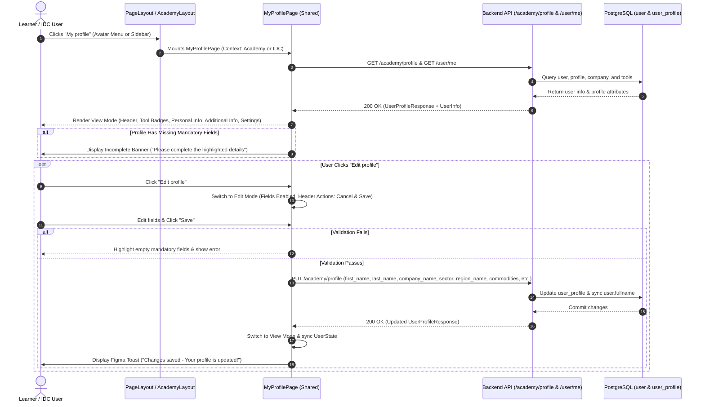

# [TLSA-014] Shared My Profile Page — Feature Specification

## Overview
This specification details the unification and enhancement of the profile experience across the entire IDH Toolkit. The existing Academy "Account" page is refactored into the **shared "My profile" page** for both Living Income Academy users and Income Driver Calculator (IDC) users.

It provides a single source of truth for user details, personal preferences, and organizational context, while adapting its layout depending on whether the user is navigating within the Academy (with the Academy side menu) or the IDC (without the side menu). Settings (password change and account deletion) are directly accessible via a dedicated link on this page.

---

## Architecture Overview



---

## 1. Requirements & Design Alignment (5W1H)

### 1.1 5W1H Framework
- **Who**: All registered Toolkit users (Living Income Academy learners, IDC users, and joint access users).
- **What**: A unified, responsive "My profile" page with view/edit toggle, non-editable tool badges, fixed-list commodity multi-selection, contextual IDH company field, incomplete profile banners, and a link to account settings.
- **Where**:
  - Route: `/profile` (shared canonical route; `/academy/account` redirects or aliases).
  - Navigation: Avatar dropdown menu ("My profile"), Academy left navigation rail ("My profile"), and global incomplete profile alerts.
- **When**: Delivered as feature `[TLSA-014]`.
- **Why**: Eliminates fragmented user profile experiences between IDC and Academy, avoids duplicate data entry, ensures mandatory user demographic fields are completed, and clarifies which fields are system-governed vs. user-editable.
- **How**: Refactor `AcademyAccountPage` into the shared `MyProfilePage` component, mount it under both `/profile` and `/academy/account`, update all card components to match Figma designs, and enhance `IncompleteProfileAlert`.

---

## 2. UI Component Specifications (Figma Alignment)

### 2.1 Navigation & Nomenclature Update
- **Sidebar & Page Title**:
  - Rename `"Account"` to `"My profile"` in `AcademySidebar.js` ([line 35](file:///frontend/src/pages/academy/components/AcademySidebar.js#L35)) and page title/breadcrumb.
  - Avatar menu in `PageLayout.js`: already labels the link as `"My Profile"`.
  - Icon: `<UserOutlined />`.

### 2.2 Header Section (`AccountHeroBanner.js`)
- **Initials Avatar**:
  - Large circle (160px diameter, background `#e6eff6`, border 4px solid `#ffffff`, drop shadow).
  - Shows 2-letter uppercase initials calculated from First + Last name (or fallback to fullname/email initials).
- **User Identity**:
  - Name: `displayFullName` (H4 Bold 32px, `#111111`).
  - Email: `email` (Body 18px, `#777777`).
- **Tool Access Badges** (Figma `node-id=13048:10177`):
  - Information tags rendered immediately below or next to the user identity (non-editable):
    - **`LI Academy`**: Polar Green tag (background `#f6ffed`, border `#b7eb8f`, text `#52c41a`, font size 12px).
    - **`IDC`**: Geek Blue tag (background `#f0f5ff`, border `#adc6ff`, text `#2f54eb`, font size 12px).
  - Condition:
    - User has only Academy: renders `LI Academy`.
    - User has only IDC: renders `IDC`.
    - User has joint access: renders both `LI Academy` and `IDC`.
- **Action Buttons**:
  - **View Mode**:
    - `"Edit profile"` button (secondary outline `#005ea3`, font 14px).
  - **Edit Mode**:
    - `"Cancel"` button (secondary outline `#005ea3`).
    - `"Save"` button (primary blue solid `#005ea3`, text white `#ffffff`, loading indicator during submission).
  - **REMOVED**: The `"Continue learning"` button is completely removed from the header.

### 2.3 Personal Information Card (`PersonalInfoCard.js`)
- **Container**: Card with rounded corners (24px, border `#e0e0e0`).
- **Title**: `"Personal information"`, subtitle: `"Update personal details."`.
- **Fields**:
  1. **First name** (`first_name`): Open text input. Mandatory. Max length 125 chars.
  2. **Last name** (`last_name`): Open text input. Optional. Max length 125 chars.
  3. **Email** (`email`): Read-only text input (background `#f2f2f2`, text `#666666`). Extra note: *"Email address cannot be changed."*
- **REMOVED**: The `"Update your photo"` / avatar upload dropzone is completely removed (avatars derive from initials).

### 2.4 Additional Information Card (`AdditionalInfoCard.js`)
- **Container**: Card with rounded corners (24px, border `#e0e0e0`).
- **Title**: `"Additional information"`, subtitle: `"Update your personal details."`.
- **Fields**:
  1. **Company / Organisation** (`company_name`): Open text field. Mandatory for self-registered users.
  2. **Role & User Type** (Figma `node-id=13016:14564`):
     - Displays the user's system role and type (e.g. `User`, `Admin`, `Standard`).
     - **Non-Editable**: Renders as disabled/read-only input (background `#f2f2f2`) with info icon tooltip:
       > *"Role and user type are set by IDH. Contact support to request permissions changes."*
  3. **IDH Company** (IDC Users Only):
     - Displays `user_company.name` (the official IDH-assigned company entity).
     - **Non-Editable**: Read-only field with info tooltip:
       > *"Set by IDH. Contact idc-support@idhtrade.org to change it."*
     - **Hidden**: Not displayed for Academy-only users.
  4. **Sector** (`sector`): Dropdown with search (Agriculture, Food & Beverage, Apparel & Textiles, Retail & Consumer Goods, Financial Services, Development & Philanthropy, Technology & Data, Other). Mandatory.
  5. **Region** (`region_name`): Dropdown with search (Global, West Africa, East Africa, Southern Africa, Latin America & Caribbean, Southeast Asia, South Asia, East Asia, Europe, North America, Middle East & North Africa). Mandatory.
  6. **Commodities** (`commodities`):
     - Replaces the free-form "Add more" autocomplete with a **fixed multi-select dropdown with checkboxes**.
     - Selected items display as removable tags (`<Tag closable>`).
     - Options populated from `commodityOptions` in `frontend/src/store/static.js` (Cocoa, Coffee, Tea, Palm Oil, Rice, Corn, Cotton, Sugar, Rubber, Vanilla, Cashew, Wheat, etc.). Mandatory.
  7. **Company type** (`company_type`): Dropdown (Private Sector, NGO, Government / Public Sector, Cooperative / Farmer Organization, Research / Academia, Financial Institution, Multilateral / Donor, Consultancy, Other). Optional.

### 2.5 Link to Settings Card (`DeleteAccountCard.js` / `SettingsLinkCard.js`)
- Bottom card on My profile page:
  - Title: `"Settings"`.
  - Subtitle: `"Change password or delete account"`.
  - Action Button: `"To settings"` (`Button` outline `#005ea3`), navigating to `/academy/settings` (or `/settings`).

### 2.6 Dual Layout Behavior (Context-Aware)
- **Within Living Income Academy**:
  - Mounted inside `AcademyLayout`.
  - Renders the Academy left navigation sidebar (`AcademySidebar`), Academy header, and chatbot launcher.
- **Within Income Driver Calculator (IDC)**:
  - Mounted inside `PageLayout` / `ContentLayout`.
  - Renders full-width content area **without the Academy sidebar**.
  - Accessible directly from IDC avatar dropdown: *"My Profile"*.

---

## 3. Alerts, Validations & Feedback States

### 3.1 Confirmation Toast (Figma `node-id=13018:19695`)
Upon successful profile save:
- Custom toast banner rendered at top-center:
  - Background: Grass Green tint `#f0fcf5`.
  - Border: 1px solid `#6de19e` with 4px left border `#48d985`.
  - Corner radius: 16px.
  - Icon: `<CheckSquareOutlined />` or checked box SVG in `#48d985`.
  - Title: **Changes saved** (Tablet Gothic / Bold 16px, `#000000`).
  - Message: **Your profile is updated!** (Regular 16px, `#111111`).
  - Auto-dismisses after 4 seconds.

### 3.2 On-Page Incomplete Profile Banner
- When navigating to My Profile and mandatory fields are empty:
  - Warning banner at the top of the cards:
    > ⚠️ **Please complete the highlighted details**
  - All empty mandatory fields (`first_name`, `company_name`, `sector`, `region_name`, `commodities`) receive a highlighted red border and validation helper text.

### 3.3 Post-Login Reminder Banner (`IncompleteProfileAlert.js`)
- In both tools (IDC Welcome page and Academy Overview page):
  - Banner alert rendered when `isUserProfileIncomplete(userState)` evaluates to `true`:
    > **Please complete your profile. A few details are missing.**
  - Actions:
    - **`Complete now`**: Navigates to `/profile` with `?edit=true` and highlights missing fields.
    - **`Skip`**: Dismisses the banner for the active session (stored in `localStorage` under `idc_profile_alert_dismissed_{userId}`).

---

## 4. Backend Contracts & Data Flow

### 4.1 Profile Read API
- **Endpoint**: `GET /academy/profile` (or `GET /user/me`)
- **Response**: `UserProfileResponse`
  ```json
  {
    "id": 142,
    "user_id": 85,
    "first_name": "Kole",
    "last_name": "Jain",
    "company_name": "Unicef",
    "company_type": "NGO",
    "sector": "Agriculture",
    "region_id": null,
    "region_name": "West Africa",
    "commodities": ["Rice", "Corn", "Cocoa"],
    "created_at": "2026-11-20T10:00:00Z",
    "updated_at": "2026-11-23T11:00:00Z"
  }
  ```

### 4.2 Profile Update API
- **Endpoint**: `PUT /academy/profile`
- **Payload**: `UserProfileUpdatePayload`
  ```json
  {
    "first_name": "Kole",
    "last_name": "Jain",
    "company_name": "Unicef",
    "company_type": "NGO",
    "sector": "Agriculture",
    "region_name": "West Africa",
    "commodities": ["Rice", "Corn", "Cocoa"]
  }
  ```
- **Backend Behavior**:
  1. Validates string lengths and commodity string array.
  2. Updates `user_profile` table attributes.
  3. Concatenates `first_name` and `last_name` to synchronize `user.fullname`.
  4. Preserves `user.company` (IDH company foreign key remains untouched).
  5. Returns updated `UserProfileResponse`.

---

## 5. Verification & Testing

### 5.1 Automated Tests
- **Frontend**:
  - `frontend/src/pages/academy/__tests__/MyProfilePage.test.js`:
    - Verify view mode vs. edit mode rendering.
    - Verify tool access badges (`LI Academy`, `IDC`, or both).
    - Verify removal of "Continue learning" button and photo upload component.
    - Verify read-only state for Email, System Role, and IDH Company.
    - Verify IDH Company is visible for IDC users and hidden for Academy-only users.
    - Verify fixed commodities dropdown with checkboxes and tag removal.
    - Verify "Changes saved" toast appears on save.
    - Verify mandatory field validation error highlights.
  - `frontend/src/components/profile/__tests__/IncompleteProfileAlert.test.js`:
    - Verify banner text: *"Please complete your profile. A few details are missing."*
    - Verify "Complete now" redirects to profile.
    - Verify "Skip" closes alert and records dismissal.
- **Backend**:
  - `backend/tests/test_academy_profile_api.py`:
    - Verify `PUT /academy/profile` persists all fields and syncs `user.fullname`.
    - Verify non-interference with `user.company`.

### 5.2 Deterministic Verification Commands
```bash
# Frontend test suite
./dc.sh exec frontend yarn test:ci --testPathPattern="MyProfile|IncompleteProfileAlert|AcademySidebar" --runInBand

# Frontend ESLint
./dc.sh exec frontend yarn lint

# Backend test suite
./dc.sh exec backend pytest tests/test_academy_profile_api.py -v
./dc.sh exec backend flake8
```

---

## 6. Epic & Vibe Coding Estimation ⏱️

- **Confidence Level**: High (models, endpoints, and card components already exist; work is focused on UI refinement, shared routing, and validation).
- **Target Budget**: **5.0 Hours**

| Task ID | Component & Description | Vibe Coding (Dev) | Automated Testing | QA & Review | Total Est. Time | Priority |
| :--- | :--- | :---: | :---: | :---: | :---: | :---: |
| **TASK-01** | **Shared Profile Routing & Dual Layout Context**<br>• Unify `AcademyAccountPage` into shared `MyProfilePage`<br>• Update `AcademySidebar.js` to rename "Account" to "My profile"<br>• Mount `/profile` with context detection (with sidebar in Academy, without sidebar in IDC)<br>• Sync avatar menu route in `PageLayout.js` | 30m | 15m | 10m | **55m (~0.9h)** | P0 |
| **TASK-02** | **Header, Initials Avatar & Tool Access Badges**<br>• Update `AccountHeroBanner.js`: initials avatar, name, email<br>• Add non-editable tool badges (`LI Academy` / `IDC`) based on `userState.tools`<br>• Remove "Continue learning" button<br>• View/Edit button states (Edit profile vs. Cancel & Save) | 25m | 15m | 10m | **50m (~0.8h)** | P0 |
| **TASK-03** | **Personal & Additional Info Cards Realignment**<br>• Clean up `PersonalInfoCard.js`: First name, Last name, read-only Email; remove photo upload<br>• Update `AdditionalInfoCard.js`: Company name, read-only Role / User Type<br>• Add read-only IDH Company field for IDC users with tooltip; hide for Academy-only<br>• Sector & Region dropdowns; Company type dropdown | 30m | 15m | 10m | **55m (~0.9h)** | P0 |
| **TASK-04** | **Fixed Commodities Multi-Select Dropdown**<br>• Refactor `CommodityTagSelector.js` from free-text autocomplete to fixed multi-select dropdown with checkboxes<br>• Render selected commodities as removable tags<br>• Populate options from `commodityOptions` in `static.js` | 20m | 15m | 10m | **45m (0.75h)** | P0 |
| **TASK-05** | **Save Workflow, Validations & Figma Toast**<br>• Implement mandatory field validation on Save with red border highlights<br>• Create custom Figma confirmation toast (`Changes saved - Your profile is updated!`)<br>• Wire Cancel button to revert form values and exit edit mode<br>• Sync `UserState` reactively on successful save | 25m | 15m | 10m | **50m (~0.8h)** | P0 |
| **TASK-06** | **Incomplete Profile Banners & Settings Link**<br>• Add on-page top banner: *"Please complete the highlighted details"*<br>• Update `IncompleteProfileAlert.js`: *"Please complete your profile. A few details are missing."* with *"Complete now"* and *"Skip"*<br>• Ensure Settings card links to `/academy/settings` / `/settings` | 20m | 15m | 10m | **45m (0.75h)** | P1 |
| **TOTAL** | **Full Feature (TLSA-014)** | **2h 30m** | **1h 30m** | **1h 00m** | **5h 00m (5.0h)** | — |
