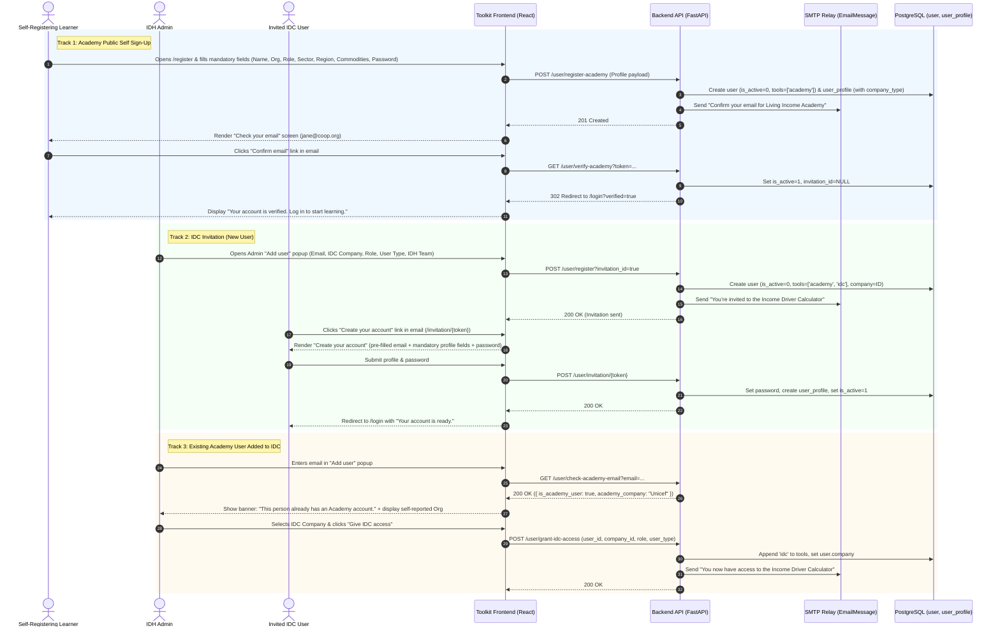

# [TLSA-015] Getting an Account — Feature Specification

## Overview
This specification defines the unified onboarding, registration, invitation, and account provisioning workflows for the **Better Income Toolkit** (Living Income Academy and Income Driver Calculator).

Every account in the system possesses a `tools` attribute specifying its accessible modules (`academy`, `idc`, or both `["academy", "idc"]`). Account creation and provisioning follow two primary tracks that converge on the same mandatory profile attributes:
1. **Academy Self Sign-Up**: Public self-registration $\rightarrow$ Email verification link $\rightarrow$ Account activated with `tools=["academy"]`.
2. **IDC Invitation (New User)**: IDH admin invites user via email $\rightarrow$ User sets password and fills mandatory profile attributes $\rightarrow$ Account created with `tools=["academy", "idc"]`.
3. **IDC Access Added Later (Existing Academy User)**: IDH admin assigns IDC company to an existing Academy user $\rightarrow$ System upgrades account to `tools=["academy", "idc"]` while retaining login credentials $\rightarrow$ Dispatches confirmation notification.
4. **Existing IDC Users**: Automatically receive `academy` access via database migration/backfill with zero user friction.

---

## Architecture Overview



---

## 1. Requirements Breakdown & User Journeys

### 1.1 Track 1: Academy Self Sign-Up (`/register`)
- **Route**: `/register`
- **Visual Design**: 2-column Better Income Toolkit layout (Figma `11861:52124`):
  - **Left Column (Form)**:
    - Header: IDH logo + *"Toolkit Towards Better Incomes"*.
    - Heading: *"Create your Academy account"* (or *"No account yet?"*).
    - Subtitle: *"The Living Income Academy is free for everyone. Create your account here."*
    - **Fields**:
      1. **First name** (`first_name`): Mandatory text input.
      2. **Last name** (`last_name`): Mandatory text input.
      3. **Email** (`email`): Mandatory email input.
      4. **Organisation** (`company_name`): Open text with autocomplete suggestions of existing companies. User can pick a suggestion or keep custom text.
      5. **Company type** (`company_type`): Dropdown (NGO, Private Sector, etc.).
      6. **Sector** (`sector`): Dropdown (Agriculture, Food & Beverage, Apparel & Textiles, etc.).
      7. **Region** (`region_name`): Dropdown (Global, West Africa, East Africa, etc.).
      8. **Commodities** (`commodities`): Fixed multi-select dropdown with checkboxes, displaying selected items as tags.
      9. **Password** (`password`): Password input with show/hide toggle and live 5-point password criteria checklist underneath.
      10. **Terms & Privacy**: Checkbox agreeing to terms and data security provision.
    - **Context Callout**:
      > *"This account gives you access to the Living Income Academy. The Income Driver Calculator is available by invitation: send an email to livingincome@idhtrade.org."*
    - **Primary Button**: `"Create account"` (submits form).
    - **Footer Link**: *"Already have an account? Log in"* (links to `/login`).
  - **Right Column (`AdditionalTextBlock`)**:
    - Branded summary card for **Living Income Academy** (free courses, self-paced).
    - Branded callout card for **Income Driver Calculator** (explains invitation-only policy and contact email).

### 1.2 "Check Your Email" Screen (Figma `12942:20452`)
- **Route**: Rendered in place on `/register` after successful submission or routed to `/check-email?email=...`.
- **Title**: *"Check your email"*
- **Content**:
  - *"We sent a link to **jane@coop.org**. Click the link in the email to activate your Academy account. The link is valid for 24 hours."*
  - Help text: *"Can’t find the email? Check your spam folder or [send the link again]."*
  - When clicking "send the link again": triggers `POST /user/resend-verification` and shows feedback: *"We sent a new link."*
  - Navigation: *"Wrong email address? [Go back]"* (returns to editable registration form).
  - Secondary link: *"Back to log in"* (navigates to `/login`).

### 1.3 Email 1: Academy Verification Email
- **Template ID**: `ACADEMY_REGISTRATION_VERIFY`
- **Subject**: *"Confirm your email for the Living Income Academy"*
- **Header**: IDH Better Income Toolkit branding.
- **Body**:
  - *"Hi Jane, welcome to the Living Income Academy. Please confirm your email address to activate your account."*
- **Primary CTA Button**: `"Confirm email"` $\rightarrow$ `https://idc.akvotest.org/verify-academy?token={token}`.
- **Footer**: *"This link is valid for 24 hours. Didn’t sign up? You can safely ignore this email."*
- **Landing State**: Upon clicking, verifies token, sets `is_active=1`, and redirects to `/login` displaying banner:
  > **Your account is verified. Log in to start learning.** (Figma `12943:7471`).

---

### 1.4 Track 2: IDC Admin Invitation & Account Setup
- **Screen 4a: Admin "Add User" Popup** (`UserForm.js` / Modal):
  - IDH Admin enters:
    - **Email**
    - **IDC Company**: Dropdown of registered IDC companies.
    - **Role**: Default `"User"`.
    - **User Type**: Dropdown (Standard, Evaluator, etc.).
    - **IDH Team**: Optional tag/team selector.
  - **Case A: New User (Email not in DB)**:
    - Button: `"Send invitation"`.
    - Dispatches IDC invitation email.
  - **Case B: Existing Academy User (Email already in DB)**:
    - Detected dynamically via `GET /user/check-academy-email?email=...` (or 409 conflict inspection).
    - Informational Banner:
      > *"This person already has an Academy account. Giving IDC access adds the calculator to their account; they keep their current login."*
    - **Organisation Matching**: Shows their self-reported free-text organisation (e.g. *"Self-reported: Olam Farmer Group"*) next to the official IDC Company dropdown so admin can match accurately.
    - Button changes to: `"Give IDC access"`.

### 1.5 Email 2: IDC Invitation Email (New Person)
- **Template ID**: `INVITATION`
- **Subject**: *"You’re invited to the Income Driver Calculator"*
- **Body**:
  - *"Hi, IDH invited you to the Income Driver Calculator, part of the Better Income Toolkit. Your account also gives you access to the Living Income Academy, with free online courses on living income."*
- **Primary CTA Button**: `"Create your account"` $\rightarrow$ `https://idc.akvotest.org/invitation/{invitation_id}`.
- **Footer**: *"This invitation is valid for 7 days. Questions? Contact idc-support@idhtrade.org."*

### 1.6 Screen 4c: Invited User "Create Your Account" (`/invitation/:token`)
- **Route**: `/invitation/:token` (Figma `13044:24854`, redesigned from legacy `ResetPassword.js`).
- **Title**: *"Create your account"*
- **Intro**: *"IDH invited you to the Income Driver Calculator. Your account also gives you access to the Living Income Academy."*
- **Fields**:
  1. **Email**: Pre-filled from invitation token, read-only.
  2. **First name** (`first_name`): Mandatory.
  3. **Last name** (`last_name`): Mandatory.
  4. **Organisation** (`company_name`): Pre-filled with company name (or editable).
  5. **Company type** (`company_type`): Mandatory dropdown.
  6. **Sector** (`sector`): Mandatory dropdown.
  7. **Region** (`region_name`): Mandatory dropdown.
  8. **Commodities** (`commodities`): Mandatory fixed multi-select dropdown.
  9. **Password** (`password`): Password rules checklist + show/hide toggle.
  10. **Terms and Privacy**: Checkbox.
- **Button**: `"Create account"`.
- **Post-Submission**: Activates account, saves profile, and redirects to `/login` with banner:
  > **Your account is ready. Log in to start using the Income Driver Calculator and the Living Income Academy.** (Figma `12943:7252`).

### 1.7 Email 3: IDC Access Granted Email (Existing Academy User)
- **Template ID**: `IDC_ACCESS_GRANTED`
- **Subject**: *"You now have access to the Income Driver Calculator"* (Figma `12958:22668`).
- **Body**:
  - *"Hi Jane, IDH gave you access to the Income Driver Calculator for **[IDC Company Name]**. You don’t need a new account: log in with your current email address and password."*
- **Primary CTA Button**: `"Explore the Income Driver Calculator"` $\rightarrow$ `https://idc.akvotest.org/login`.

---

## 2. Backend Implementation & Database Schema

### 2.1 Database Models & Option B Alignment
In alignment with the final Figma design (`node-id=10612-21056` / `11861:52124`), **Option B** was selected:
- There is **no `job_role` or job title field** in the design.
- The user profile uses `company_type`, `sector`, `region_name`, `commodities`, `company_name`, and split name (`first_name`, `last_name`).
- All these fields already exist in `user_profile` table, so **no new schema migration was needed**, avoiding unnecessary database schema changes.

### 2.2 API Route Updates
**File**: `backend/routes/user.py`

1. **`POST /user/register-academy`**:
   - Update `UserRegisterAcademy` schema:
     ```python
     class UserRegisterAcademy(BaseModel):
         first_name: str
         last_name: str
         email: EmailStr
         password: str
         company_name: str
         company_type: Optional[str] = None
         sector: Optional[str] = None
         region_name: Optional[str] = None
         commodities: List[str] = Field(default_factory=list)
     ```
   - Sets `user.fullname = f"{first_name} {last_name}".strip()`.
   - Populates all fields into `UserProfile`.
   - Sends `ACADEMY_REGISTRATION_VERIFY` email with 24h token.

2. **`POST /user/resend-verification`** (New):
   - Accepts `{ "email": "jane@coop.org" }`.
   - If user exists, is inactive (`is_active=0`), and has `invitation_id`: generates fresh token, updates user, and resends verification email.

3. **`GET /user/check-academy-email`** (New):
   - Query param: `?email=...` (Admin authenticated).
   - Returns:
     ```json
     {
       "exists": true,
       "is_academy_user": true,
       "has_idc_access": false,
       "user_id": 142,
       "fullname": "Jane Doe",
       "academy_company": "Coop Western Union"
     }
     ```

4. **`POST /user/grant-idc-access`** (New):
   - Admin authenticated endpoint.
   - Payload:
     ```json
     {
       "user_id": 142,
       "company_id": 12,
       "role": "user",
       "user_type": "standard",
       "business_unit_ids": []
     }
     ```
   - Appends `"idc"` to `user.tools`.
   - Sets `user.company = company_id`, `role`, and `user_type`.
   - Dispatches `IDC_ACCESS_GRANTED` email.

5. **`GET /user/invitation/{invitation_id}` & `POST /user/complete-invitation`**:
   - `GET`: Returns invitation details (`email`, pre-filled company).
   - `POST`: Validates token, hashes password, saves full `UserProfile` (`first_name`, `last_name`, `company_name`, `company_type`, `sector`, `region_name`, `commodities`), activates user (`is_active=1`, `invitation_id=None`).

### 2.4 Mailer Template Refinements
**File**: `backend/utils/mailer.py`

Update `EmailBody` entries with exact approved wording:
- `ACADEMY_REGISTRATION_VERIFY`:
  - Subject: *"Confirm your email for the Living Income Academy"*
  - Button label: *"Confirm email"*
  - Footer: *"This link is valid for 24 hours. Didn’t sign up? You can ignore this email."*
- `INVITATION`:
  - Subject: *"You’re invited to the Income Driver Calculator"*
  - Body: *"Hi, IDH invited you to the Income Driver Calculator, part of the Better Income Toolkit. Your account also gives you access to the Living Income Academy, with free online courses on living income."*
  - Button label: *"Create your account"*
- `IDC_ACCESS_GRANTED`:
  - Subject: *"You now have access to the Income Driver Calculator"*
  - Body: *"Hi {name}, IDH gave you access to the Income Driver Calculator for {company_name}. You don’t need a new account: log in with your current email address and password."*
  - Button label: *"Explore the Income Driver Calculator"*

---

## 3. Frontend Implementation & UI Components

### 3.0 Shared Profile Presets Architecture (DRY)
To eliminate duplicate array declarations between Academy My Profile (`AdditionalInfoCard.js`) and registration forms (`Register.js`, `InvitationRegister.js`), preset options (`PRESET_COMPANY_TYPES`, `PRESET_SECTORS`, `PRESET_REGIONS`, and `getOptionsWithFallback`) are centralized in `frontend/src/store/static.js` (alongside existing `commodities`) as the single source of truth.

### 3.1 Academy Sign-Up Page (`frontend/src/pages/login/Register.js`)
- Refactored into full Toolkit 2-column layout matching Figma `11861:52124`.
- **Form Controls**:
  - `first_name` & `last_name` split inputs.
  - `email` input.
  - `company_name`: `AutoComplete` querying existing companies, allowing free text.
  - `company_type`: `Select` with preset company types.
  - `sector`: `Select` with preset sectors.
  - `region_name`: `Select` with preset regions.
  - `commodities`: `Select mode="multiple"` with checkboxes and removable tags.
  - `password`: `Input.Password` with live `PasswordCriteria` validator.
  - Terms & Data security provision checkbox.
- **On Submit Success**: Renders the "Check your email" view.

### 3.2 "Check Your Email" View (`Register.js` / `CheckEmail.js`)
- Displays envelope illustration, targeted email address, and resend action.
- Hooks to `api.post("/user/resend-verification", { email })`.
- Handles spam warning and "Wrong email address? Go back" flow.

### 3.3 IDC Invitation Registration Page (`frontend/src/pages/login/InvitationRegister.js`)
- Replaces legacy password-only invitation view in `ResetPassword.js`.
- Mounted on route `/invitation/:tokenId`.
- Pre-fills and disables `email`.
- Renders the identical full profile fields matching Academy sign-up.
- On success: redirects to `/login` with success alert:
  > *"Your account is ready. Log in to start using the Income Driver Calculator and the Living Income Academy."*

### 3.4 Admin "Add User" Popup Enhancement (`frontend/src/pages/admin/users/UserForm.js`)
- Real-time debounced check on email input:
  - Calls `api.get("/user/check-academy-email?email=" + encodeURIComponent(email))`.
  - When matching an existing Academy user:
    - Renders warning alert: *"This person already has an Academy account. Giving IDC access adds the calculator to their account; they keep their current login."*
    - Displays self-reported organisation name alongside the IDC Company selector:
      > **Self-reported organisation**: *{user.academy_company}*
    - Changes submit button label to: `"Give IDC access"`.

---

## 4. Formal Acceptance Criteria (UAC & TAC)

For the dedicated frontend developer handoff brief, see [022_getting_an_account_fe_brief.md](022_getting_an_account_fe_brief.md).

### 4.1 Task 1: Shared Profile Constants Centralization (DRY)
* **User Acceptance Criteria (UAC)**:
  - [ ] **UAC-1.1 (Option Parity)**: The dropdown options for Company Type, Sector, Region, and Commodities remain identical across Academy Profile, Academy Registration, and IDC Invitation screens.
  - [ ] **UAC-1.2 (Custom Fallback)**: If a user has a custom value not in the preset list, it displays seamlessly as the selected option without data loss.
* **Technical Acceptance Criteria (TAC)**:
  - [ ] **TAC-1.1 (Single Source of Truth)**: `PRESET_COMPANY_TYPES`, `PRESET_SECTORS`, `PRESET_REGIONS`, and `getOptionsWithFallback` are exported from `frontend/src/store/static.js`.
  - [ ] **TAC-1.2 (No Code Duplication)**: `AdditionalInfoCard.js` removes duplicate local definitions and imports from `static.js`.
  - [ ] **TAC-1.3 (Zero Regression)**: Existing Academy Profile tests in `AcademyAccountPage.test.js` continue passing without modification.

### 4.2 Task 2: Academy Self Sign-Up Screen (`/register`) — Figma 11861:52124
* **User Acceptance Criteria (UAC)**:
  - [ ] **UAC-2.1 (2-Column Toolkit Layout)**: The sign-up page renders a 2-column layout. The left column contains the header (`IDH Logo` + `"Toolkit Towards Better Incomes"`), the registration form, and footer. The right column (`AdditionalTextBlock`) displays promotional cards for **Living Income Academy** and **Income Driver Calculator (invitation only)**.
  - [ ] **UAC-2.2 (Header & Subtitle)**: Displays heading `"No account yet?"` (or `"Create your Academy account"`) and subtitle: *"Learn how to understand, measure and close living income gaps. Creating an account is free and takes a few minutes: fill in your details, confirm your email address, and you can start right away."*
  - [ ] **UAC-2.3 (Form Controls & Grid)**:
    - **Row 1**: `first_name` (mandatory text) and `last_name` (mandatory text) side-by-side.
    - **Row 2**: `email` (mandatory valid email) and `password` (mandatory password input with show/hide toggle).
    - **Row 3**: `company_name` (mandatory text with autocomplete suggestions from existing companies) and `company_type` (`Select` from shared presets).
    - **Row 4**: `sector` (`Select` from shared presets) and `region_name` (`Select` from shared presets).
    - **Row 5**: `commodities` (`Select mode="multiple"` with tag display).
  - [ ] **UAC-2.4 (Live Password Criteria)**: Renders live `PasswordCriteria` checklist below the password field (at least 8 characters, 1 uppercase, 1 lowercase, 1 number, 1 special character). All items update dynamically as the user types.
  - [ ] **UAC-2.5 (Context Callout & Consent)**: Displays callout *"This account gives you access to the Living Income Academy. The Income Driver Calculator is available by invitation: send an email to livingincome@idhtrade.org."* and a checkbox agreeing to terms and data security provision.
  - [ ] **UAC-2.6 (Navigation Links)**: Displays primary button `"Get started"` (or `"Create account"`) and link `"Already have an account? Log in"` pointing to `/login`.
* **Technical Acceptance Criteria (TAC)**:
  - [ ] **TAC-2.1 (API Payload)**: Submitting the form dispatches `POST /user/register-academy` with:
    ```json
    {
      "first_name": "Jane",
      "last_name": "Doe",
      "email": "jane@coop.org",
      "password": "Password123!",
      "company_name": "Coop Western",
      "company_type": "Cooperative / Farmer Organization",
      "sector": "Agriculture",
      "region_name": "West Africa",
      "commodities": ["Cocoa", "Coffee"]
    }
    ```
  - [ ] **TAC-2.2 (Client-Side Validation)**: Form blocks submission and highlights errors if any mandatory field is empty, email format is invalid, password does not satisfy all 5 criteria, or terms checkbox is unchecked.
  - [ ] **TAC-2.3 (Error Handling)**: Backend HTTP 409 (User already exists) or 422 errors are displayed via Ant Design `message.error` or inline alert.

### 4.3 Task 3: "Check Your Email" Confirmation & Resend Flow — Figma 12942:20452
* **User Acceptance Criteria (UAC)**:
  - [ ] **UAC-3.1 (Email Confirmation Toast / View)**: Upon successful sign-up submission, the page renders the confirmation alert:
    > *"Please confirm your email address first. We sent a link to **{registeredEmail}** when you signed up. Can’t find it? Check your spam folder or **send the link again**."*
  - [ ] **UAC-3.2 (Resend Link Trigger)**: Clicking **"send the link again"** dispatches a verification link resend and displays immediate user feedback: *"We sent a new link."*
  - [ ] **UAC-3.3 (Back Navigation)**: Includes links to edit the email address or return to `/login`.
* **Technical Acceptance Criteria (TAC)**:
  - [ ] **TAC-3.1 (API Integration)**: Resend action calls `POST /user/resend-verification` (or `/user/resend-academy-verification`) with payload `{ "email": registeredEmail }`.
  - [ ] **TAC-3.2 (Cooldown / Throttle UX)**: Disables the resend trigger during pending requests (`loading=true`) with a 30-second cooldown to prevent spam.

### 4.4 Task 4: Admin "Add User" Popup — Existing Academy User Detection (`UserForm.js`)
* **User Acceptance Criteria (UAC)**:
  - [ ] **UAC-4.1 (Dynamic Academy Account Check)**: Typing an email in the "Add user" modal dynamically verifies if an account already exists.
  - [ ] **UAC-4.2 (Existing User Warning Banner)**: If the email belongs to an existing Academy user without IDC access:
    * Displays informational banner:
      > *"This person already has an Academy account. Giving IDC access adds the calculator to their account; they keep their current login."*
    * Shows the user's self-reported organisation next to the IDC Company selector:
      > **Self-reported organisation**: *{user.academy_company}*
    * Primary submit button switches from `"Send invitation"` to: **`"Give IDC access"`**.
  - [ ] **UAC-4.3 (New User Invitation Flow)**: If the email does not exist in the database, the modal retains the standard `"Send invitation"` button.
* **Technical Acceptance Criteria (TAC)**:
  - [ ] **TAC-4.1 (Debounced Verification)**: Triggers `GET /user/check-academy-email?email={email}` debounced by 300ms on email change/blur.
  - [ ] **TAC-4.2 (Grant IDC Access API)**: Submitting with `"Give IDC access"` dispatches `POST /user/grant-idc-access` with `{ user_id, company_id, role: "user", user_type: "external_regular", business_unit_ids: [] }`.
  - [ ] **TAC-4.3 (Feedback & Close)**: On success, displays `message.success("IDC access granted successfully")` and closes the modal.

### 4.5 Task 5: IDC Invited User "Create Your Account" (`/invitation/:token`) — Figma 13044:24854
* **User Acceptance Criteria (UAC)**:
  - [ ] **UAC-5.1 (2-Column Layout & Header)**: Opens from the invitation email link (`/invitation/:token`). Displays title `"Create your account"` and intro: *"IDH invited you to the Income Driver Calculator. Your account also gives you access to the Living Income Academy."*
  - [ ] **UAC-5.2 (Pre-filled Read-Only Email)**: The `email` field is pre-filled from the invitation token and locked (disabled / read-only).
  - [ ] **UAC-5.3 (Pre-filled Company)**: The `company_name` field is pre-populated with the company assigned by the IDH Admin.
  - [ ] **UAC-5.4 (Complete Profile Fields)**: Prompts for the same mandatory fields as Academy sign-up (`first_name`, `last_name`, `password` with criteria checklist, `company_type`, `sector`, `region_name`, `commodities`).
  - [ ] **UAC-5.5 (Login Redirect with Banner)**: On successful account creation, redirects user to `/login` displaying banner (Figma Node `12943:7252`):
    > **"Your account is ready. Log in to start using the Income Driver Calculator and the Living Income Academy."**
* **Technical Acceptance Criteria (TAC)**:
  - [ ] **TAC-5.1 (Token Resolution)**: On component mount, calls `GET /user/invitation/{invitation_id}` to retrieve `{ email, company_id, company_name }`. Invalid or expired tokens render an error alert with contact support link.
  - [ ] **TAC-5.2 (Account Completion API)**: Submitting dispatches `POST /user/complete-invitation/{invitation_id}` with `{ first_name, last_name, password, company_name, company_type, sector, region_name, commodities }`.
  - [ ] **TAC-5.3 (Session Bootstrap)**: On successful response, redirects to `/login` with success banner state.

---

## 5. Verification & Testing Strategy

### 5.1 Automated Tests
- **Backend (`pytest`)**:
  - `test_academy_registration.py`:
    - Test full registration payload validation (`first_name`, `last_name`, `company_name`, `company_type`, etc.).
    - Test resend verification token regeneration and rate-limiting.
    - Test token expiration after 24 hours.
  - `test_idc_invitation.py`:
    - Test invitation creation and completion with full profile.
    - Test `GET /user/check-academy-email` detection of existing Academy accounts.
    - Test `POST /user/grant-idc-access` upgrading `tools` to `["academy", "idc"]`.
    - Test data migration backfilling `tools` for existing IDC users.
- **Frontend (`Jest` / `Testing Library`)**:
  - `Register.test.js`:
    - Test full field validation, password criteria checks, and transition to "Check your email" screen.
    - Test resend verification link button.
  - `InvitationRegister.test.js`:
    - Test token verification, pre-filled email, and profile submission.
  - `UserForm.test.js`:
    - Test dynamic Academy account detection and button switch to "Give IDC access".

### 5.2 Deterministic Verification Commands
```bash
# Run Alembic migrations
./dc.sh exec backend alembic upgrade head

# Run backend test suite & linter
./dc.sh exec backend pytest tests/test_1031_academy_registration.py tests/test_admin_user_api.py -v
./dc.sh exec backend flake8

# Run frontend test suite & linter
./dc.sh exec frontend yarn test:ci --testPathPattern="Register|VerifyAcademy|UserForm" --runInBand
./dc.sh exec frontend yarn lint
```

---

## 6. Epic & Vibe Coding Estimation ⏱️

- **Confidence Level**: High (core email dispatcher, token verification, and user models exist; work focuses on field expansion, email template updates, and invitation UI redesign).
- **Target Budget**: **6.0 Hours**

| Task ID | Component & Description | Vibe Coding (Dev) | Automated Testing | QA & Review | Total Est. Time | Priority |
| :--- | :--- | :---: | :---: | :---: | :---: | :---: |
| **TASK-01** | **Backend Models & Option B Alignment [COMPLETED]**<br>• Align models and schemas with Option B (no `job_role`, zero schema migrations)<br>• Verified clean database head at `c8d9e0f1a2b3` | 30m | 15m | 10m | **55m (~0.9h)** | P0 |
| **TASK-02** | **Backend APIs & Mailer Updates**<br>• Extend `POST /user/register-academy` with all mandatory profile fields<br>• Add `POST /user/resend-verification` and `GET /user/check-academy-email`<br>• Implement `POST /user/grant-idc-access`<br>• Update the 3 HTML email templates in `mailer.py` | 40m | 25m | 15m | **80m (~1.3h)** | P0 |
| **TASK-03** | **Academy Registration Screen & "Check Email" View**<br>• Realign `Register.js` to full 2-column layout (Figma `11861:52124`)<br>• Wire all mandatory fields, organisation autocomplete, live password checklist<br>• Build "Check your email" screen with resend link button (Figma `12942:20452`) | 35m | 20m | 15m | **70m (~1.2h)** | P0 |
| **TASK-04** | **IDC Invited User "Create Your Account" Page**<br>• Build standalone `InvitationRegister.js` (`/invitation/:token`) in Toolkit design style<br>• Pre-fill and lock email, render all mandatory profile fields and password rules<br>• Wire account activation and redirect to login with ready message (Figma `12943:7252`) | 30m | 20m | 10m | **60m (1.0h)** | P0 |
| **TASK-05** | **Admin "Add User" Popup Existing User Integration**<br>• Update `UserForm.js` / modal to detect existing Academy users in real time<br>• Render warning banner and display self-reported organisation for matching<br>• Dynamic button toggle: `"Send invitation"` vs. `"Give IDC access"` | 25m | 15m | 10m | **50m (~0.8h)** | P0 |
| **TASK-06** | **Full Regression Verification & Quality Gate**<br>• Comprehensive unit test coverage across backend registration, invitation, and mailers<br>• Frontend Jest tests and clean linting pass (`flake8`, `yarn lint`) | 15m | 20m | 10m | **45m (0.75h)** | P0 |
| **TOTAL** | **Full Feature (TLSA-015)** | **2h 50m** | **1h 55m** | **1h 10m** | **5h 55m (~6.0h)** | — |
