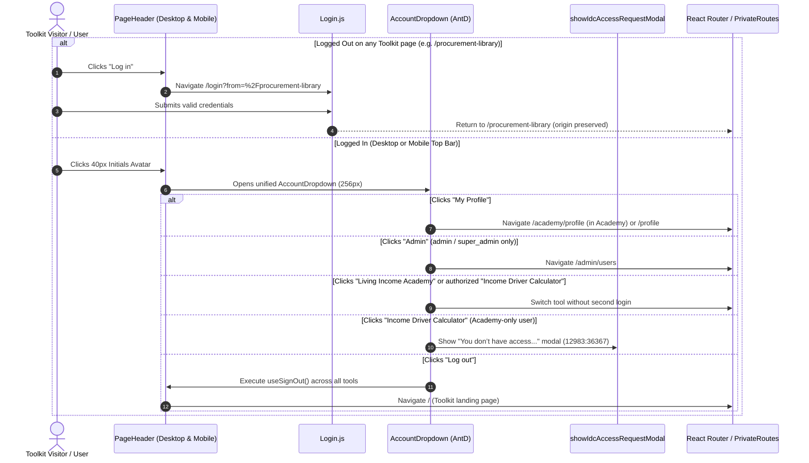

# [TLSA-016] "After You've Logged In" — Unified Avatar Menu & Responsive Header — Feature Specification

> **GitHub Issue**: [#917](https://github.com/akvo/IDH-IDC/issues/917) — `[TLSA-016] "After you've logged in" - Avatar menu`  
> **Target Branch**: `feature/917-after-login-avatar-menu`  
> **Status**: Implemented & Verified — `/3-integrate` & `/4-verify` Passed (`feature/917-after-login-avatar-menu`; Zero Backend Tasks Required)  
> **Backend Implementation Status**: **Complete (Zero Backend Tasks Required)** — Shared JWT/refresh authentication (`POST /user/login`, `POST /user/refresh`, `POST /user/logout`, `GET /user/me`), `User.tools` array, shared `/academy/profile` endpoints, and `verify_idc_access` middleware (`backend/middleware.py`) are already implemented and tested.  
> **Related Prior Specs**:
> - `docs/features/004_shell_header_avatar_tool_switcher_spec.md` (`#865`)
> - `docs/features/005_tool_level_route_guarding_spec.md` (`#868`)
> - `docs/features/019_joint_admin_page_user_stats_spec.md` (`#916`)
> - `docs/features/021_shared_my_profile_page_spec.md` (`#913`)
>
> **Figma Sources**:
> - Menu & Responsive Header Variations (`node-id=1915-14015` / `6983:22331`)
> - Avatar & Account Dropdown Component Set (`node-id=820-5368` → `13172:15085` & `13172:17766`: `idc`, `academy`, `Admin` variants; `7561:23560` `Header -after login`)
> - IDC "No Access" Modal — Desktop & Mobile (`node-id=12983-36367`)

---

## 1. Overview & 5W1H Requirements Discovery

Roughly **80% of `[TLSA-016]`** is already live on `staging`, delivered across `[TLSA-004]` (`PageLayout.js` avatar dropdown, tool switcher, mobile drawer), `[TLSA-005]` (`verify_idc_access`, `PrivateRoutes.js`, `Landing.js`, `idcAccessModal.js`), and `[TLSA-014]` (shared `MyProfilePage` and `AcademySettingsPage` across `/profile` and `/academy/profile`).

This specification documents the existing baseline and scopes **only the remaining functional bugs, responsive layout delta, and Figma 2026 visual parity updates** needed to close `[TLSA-016]` cleanly without duplicating existing components.

### 5W1H Analysis
- **Who**:
  - **Unauthenticated Visitor**: Sees the Toolkit navigation bar and a `"Log in"` button in the top-right slot.
  - **Dual-Access User (`tools: ["idc", "academy"]`)**: Sees their initials avatar on desktop and mobile, switches seamlessly between Living Income Academy and Income Driver Calculator without a second login, and accesses `My Profile`.
  - **Academy-Only User (`tools: ["academy"]`)**: Sees their initials avatar, sees Income Driver Calculator muted/locked in both the navbar and avatar menu, and receives the `"You don’t have access to the Income Driver Calculator yet."` modal if they click IDC (never seeing IDC pages).
  - **Admin / Super Admin (`role: "admin" | "super_admin"`)**: Sees the `"Admin"` entry in the avatar menu opening the joint admin panel (`/admin/users`) across both tools.
- **What (Delta Scope)**:
  1. **Logged-out `"Log in"` pill & origin return**: Rename `"Sign In"` → `"Log in"` with Figma outlined pill styling, pass full `pathname + search` in `?from=...`, and fix `Login.js` so logging in from any public Toolkit page returns the user to that exact origin page (while preserving `FE-LOG-06C` for `/academy` and `/academy/*` routes).
  2. **Global log out destination & single auth anchor**: Update `handleLogout` in `PageLayout.js` to navigate to the Toolkit landing page (`/` instead of `/login`), and remove the duplicate legacy `"Logout"` button from `IDCSubMenu.js`.
  3. **Avatar & `AccountDropdown` Figma parity**: Update avatar to `40px` `#F2F4F7` circle with `#475467` initials and subtle inner border, restyle the `256px` dropdown card (`16px` radius), place `"Admin"` directly under `"My Profile"` per Figma `13172:20577`, style the current tool exclusively with Figma's `#EAF2F2` background pill + `#01625F` text (no checkmark icon), and replace `<Tag>No access</Tag>` on gated IDC with muted `#A4A4A4` text + right-aligned lock icon (`LockOutlined`).
  4. **Responsive mobile header & clean nav stack**: Keep the `40px` Avatar + `AccountDropdown` visible in the mobile top header bar beside the hamburger/close toggle (`[Logo] ... [Avatar] [≡ / ✕]`), removing duplicate user/tool/footer blocks from the mobile nav drawer.
  5. **Navbar muted IDC state & mobile modal polish**: Mute the navbar `"Income Driver Calculator"` link (`#A4A4A4`) for logged-in Academy-only users, align `"Other Tools & Resources"` label, and align `idcAccessModal` mobile (`<=600px`) layout with Figma `12983:36367`.
- **Where**:
  - `frontend/src/components/layout/PageLayout.js`
  - `frontend/src/components/layout/ContentLayout.js`
  - `frontend/src/App.scss`
  - `frontend/src/components/route/paths.js` & `frontend/src/components/route/PrivateRoutes.js`
  - `frontend/src/pages/login/Login.js`
  - `frontend/src/pages/cases/components/IDCSubMenu.js`
  - `frontend/src/components/utils/idcAccessModal.js` & `frontend/src/components/utils/idcAccessModal.scss`
- **When**: Rendered persistently on every Toolkit page (except standalone auth views `/login`, `/register`, `/verify-academy`, `/forgot-password`, `/invitation/*`, `/reset-password/*` on desktop).
- **Why**: Fixes two user-visible navigation bugs (lost `?from=` origin on non-landing pages and logout redirecting to `/login` instead of `/`) and brings desktop/mobile header, avatar dropdown, and no-access modal into 1:1 alignment with the 2026 Figma specification.
- **How**: Reuse `PageHeader`, `UserState`, `useSignOut`, `PrivateRoutes`, and `showIdcAccessRequestModal`, applying targeted CSS/component updates rather than introducing any parallel header or dropdown implementation.

---

## 2. Current Implementation Audit & Zero-Duplication Matrix

| Requirement / UI Element | Existing Codebase Asset | Current Status | Delta Action Required | Anti-Duplication Guardrail |
| :--- | :--- | :--- | :--- | :--- |
| **Global Header Mount** | `frontend/src/App.js`, `frontend/src/components/layout/PageLayout.js`, `frontend/src/pages/cases/components/IDCSubMenu.js` | `PageHeader` mounts across all Toolkit pages; `IDCSubMenu` still renders a duplicate `"Logout"` button on lines 132–154. | Remove legacy `"Logout"` `<Link>` from `IDCSubMenu.js` per Figma `7561:23560`; rename 5th navbar item `"Tools & Resources"` → `"Other Tools & Resources"` per `1915:14015`. | **DO NOT** create a second header component for Academy or IDC; keep `PageHeader` as the sole top bar. |
| **Logged-Out `"Log in"` Button** | `frontend/src/components/layout/PageLayout.js`, `frontend/src/App.scss` | Renders `<Link data-testid="button-signin">` labeled `"Sign In"` with solid `#01625F` fill. | Rename text to **`"Log in"`** (desktop & mobile), style `.nav-sign-in` as Figma outlined pill (`#ffffff` bg, `1px solid #01625f`, `#01625f` text, `999px` radius), and pass `location.pathname + location.search` in `?from=...`. | **DO NOT** change `data-testid="button-signin"` unnecessarily if existing suites depend on it, or update tests atomically in `PageLayout.test.js`. |
| **Return-to-Origin After Login** | `frontend/src/pages/login/Login.js` | Handles `/`, `/academy`, `/income-driver-calculator`, and `?redirect=`; ignores `?from=` for other Toolkit pages (`/procurement-library`, `/cocoa-income-inventory`, `/tools-and-resources`, etc.). | Update `useEffect` and `onFinish` redirect resolution so safe `?from=` (including query params) returns users to the exact public Toolkit page they came from, while preserving `FE-LOG-06C` (`/academy` and `/academy/*` → `/academy/overview`), landing upgrades, and IDC gating for Academy-only users. | **DO NOT** duplicate redirect logic or break `FE-LOG-06C` (`Login.test.js:315`); consolidate origin parsing into a single helper inside `Login.js`. |
| **Avatar Trigger Tokens** | `frontend/src/components/layout/PageLayout.js`, `frontend/src/App.scss`, `frontend/src/pages/academy/utils/index.js` | `36px` solid `#01625f` circle with white initials (`getUserInitials` + `getInitials` fallback). | Update `.header-avatar` to **`40px`**, `background: #F2F4F7`, border `0.75px solid rgba(17, 17, 17, 0.08)`, text `#475467` (`16px`, weight `600`, line-height `24px`) per Figma `13172:15085`. | **DO NOT** replace `getUserInitials` / `getInitials`; keep existing initials computation. |
| **Avatar Dropdown Menu & Admin Entry** | `frontend/src/components/layout/PageLayout.js`, `frontend/src/App.scss` | Renders Name, Email, `My Profile` (context-aware `/academy/profile` vs `/profile`), `SWITCH TOOL`, `Admin Panel`, and `Log out`. | Update card to `256px` width, `16px` radius, `#E5E5E5` border/dividers, `16px 24px` user header (`#000000` / `#777777`); rename `"Admin Panel"` → **`"Admin"`** (under `My Profile` per Figma `13172:20577`); style active tool with `#EAF2F2` pill + `#01625F` text (no checkmark icon, per Figma `13175:14742`); replace `<Tag>No access</Tag>` with `#A4A4A4` text + `<LockOutlined />`; style `"Log out"` in `#FF010E`. | **DO NOT** build a custom popover from scratch; style Ant Design `<Dropdown menu={{ items }} overlayClassName="header-avatar-dropdown">`. |
| **Global Log Out Redirect** | `frontend/src/components/layout/PageLayout.js` (`handleLogout`), `frontend/src/hooks/useSignOut.js` | `useSignOut()` clears cookie, `sessionStorage`, `api.token`, and `UserState`; `handleLogout` redirects to `/login`. | Change `navigate(paths.login)` in `PageLayout.js` line 97 to **`navigate("/")`** so log out goes to the Toolkit landing page. | **DO NOT** alter `useSignOut.js` token/cookie cleanup semantics. |
| **Academy-Only IDC Gating & Modal** | `frontend/src/components/route/PrivateRoutes.js`, `frontend/src/pages/income-driver-calculator/Landing.js`, `frontend/src/components/utils/idcAccessModal.js`, `idcAccessModal.scss`, `backend/middleware.py` | Backend `verify_idc_access` + frontend route guards + `showIdcAccessRequestModal()` already prevent IDC access and show the modal from navbar & avatar menu. | Mute navbar `"Income Driver Calculator"` link (`#A4A4A4`) when `isLoggedIn && !hasIdcAccess` (still clickable to open modal); update mobile (`<=600px`) modal in `idcAccessModal.js/.scss` to center header/body, hide `"Don’t show again"` checkbox on mobile, and stack `"Explore the Academy"` above `"Discard"`. | **DO NOT** create a second no-access modal or weaken `PrivateRoutes` / `verify_idc_access`. |
| **Responsive Mobile Header & Menu** | `frontend/src/components/layout/PageLayout.js`, `frontend/src/App.scss` | Mobile drawer duplicates user card, tool switcher, `My Profile`, `Admin Panel`, and `Log out` inside the slide-out drawer. | Render the **`40px` Avatar `<Dropdown>` button in the mobile top bar** next to `[≡ / ✕]` when logged in (`[Logo] ... [Avatar] [≡ / ✕]`); remove duplicate user/switcher/footer blocks from the mobile menu so it shows only the site navigation stack (plus `"Log in"` button when logged out). | **DO NOT** build a separate mobile account menu; reuse `avatarDropdownItems` and `<Dropdown>` on both desktop and mobile. |
| **Joint Admin Shell Compatibility (`#916`)** | `frontend/src/components/route/paths.js`, `frontend/src/components/route/PrivateRoutes.js`, `frontend/src/pages/login/Login.js`, `frontend/src/pages/cases/components/IDCSubMenu.js`, `frontend/src/components/layout/ContentLayout.js` | `#916` added `routePath.admin.academyUserStatistics` and `/admin/academy-user-statistics`; `PrivateRoutes` treats `/admin` as IDC-restricted even for `admin` users without `"idc"` in `tools`, and `ContentLayout` offsets `140px` assuming `IDCSubMenu` renders on `/admin/*`. | Add `routePath.admin.users: "/admin/users"` in `paths.js`; allow `adminRole.includes(userRole)` onto `/admin/*` in `PrivateRoutes.js` and `Login.js` even if `!userTools.includes("idc")` (still blocking non-admin Academy-only users); suppress `IDCSubMenu` and use `Affix` `offsetTop={80}` in `ContentLayout.js` when `!hasIdcAccess`. | **DO NOT** create a separate Academy admin layout or weaken non-admin `/admin/*` route guards. |

---

## 3. Architecture Overview

1. **Logged-Out Navigation**: Visitor sees `"Log in"` in the top-right header (or mobile menu). Clicking it navigates to `/login?from=<encoded_pathname_and_search>`. After authenticating, `Login.js` returns them to their originating Toolkit page (with landing-page shortcuts and Academy-only IDC route protection preserved).
2. **Unified Authenticated Shell**: Desktop and mobile headers share the same `40px` initials `<Avatar>` + `<Dropdown>` backed by `UserState` (`fullname`, `email`, `role`, `tools`, `user_profile`).
3. **Cross-Tool SSO & Gating**: Clicking the other tool switches routes directly using the shared `AUTH_TOKEN` / refresh cookie. If `tools` excludes `"idc"`, clicking `"Income Driver Calculator"` in either the navbar or avatar dropdown opens `showIdcAccessRequestModal()`, while `PrivateRoutes.js` and FastAPI `verify_idc_access` block direct URL/API access.
4. **Global Log Out**: Clicking `"Log out"` invokes `useSignOut()` (revoking backend session, clearing `AUTH_TOKEN` cookie, `sessionStorage`, `api.token`, and `UserState`) and navigates to `/` (Toolkit landing page).



---

## 4. Backend Implementation

**Zero Backend Changes / Zero Database Migrations Required.**

Existing backend endpoints and guards already satisfy all `[TLSA-016]` requirements:
- `POST /user/login`, `POST /user/refresh`, `POST /user/logout`, `GET /user/me` (`backend/routes/user.py`)
- `GET /academy/profile`, `PUT /academy/profile` (`backend/routes/academy_profile.py`)
- `verify_idc_access` (`backend/middleware.py`) enforcing `HTTP 403` (`"Tool access required: idc"`) across all confidential IDC routes
- `verify_admin` protecting `/user` and `/admin/academy-user-statistics` endpoints

---

## 5. Frontend Implementation & Wireframes

### 5.1 Touchpoint Files
- `[MODIFY]` `frontend/src/components/layout/PageLayout.js`
- `[MODIFY]` `frontend/src/components/layout/ContentLayout.js`
- `[MODIFY]` `frontend/src/App.scss`
- `[MODIFY]` `frontend/src/components/route/paths.js`
- `[MODIFY]` `frontend/src/components/route/PrivateRoutes.js`
- `[MODIFY]` `frontend/src/pages/login/Login.js`
- `[MODIFY]` `frontend/src/pages/cases/components/IDCSubMenu.js`
- `[MODIFY]` `frontend/src/components/utils/idcAccessModal.js`
- `[MODIFY]` `frontend/src/components/utils/idcAccessModal.scss`
- `[TEST]` `frontend/src/components/layout/__tests__/PageLayout.test.js`
- `[TEST]` `frontend/src/components/layout/__tests__/ContentLayout.test.js`
- `[TEST]` `frontend/src/components/route/__tests__/PrivateRoutes.test.js`
- `[TEST]` `frontend/src/pages/login/__tests__/Login.test.js`
- `[TEST]` `frontend/src/components/utils/__tests__/idcAccessModal.test.js`

### 5.2 Component & Logic Changes

1. **`frontend/src/components/layout/PageLayout.js` & `frontend/src/App.scss`**:
   - **Desktop & Mobile Logged-Out Button**: Change `"Sign In"` → `"Log in"`, pass `${location.pathname}${location.search}` to `?from=...`, and apply outlined pill styling (`.nav-sign-in`: `#ffffff` bg, `1px solid #01625f`, `#01625f` text, `999px` border-radius, `10px 16px` padding).
   - **Navbar Items**: Rename `"Tools & Resources"` label to `"Other Tools & Resources"` (keep route `/tools-and-resources`). Add a muted class (e.g., `nav-item-disabled` with `color: #A4A4A4`) to `"Income Driver Calculator"` in both desktop horizontal `<Menu>` and mobile nav stack when `isLoggedIn && !hasIdcAccess`, preserving `onClick` to trigger `showIdcAccessRequestModal({ force: true, navigate })`.
   - **Avatar (`40px`) & Unified `AccountDropdown`**:
     - Update `<Avatar className="header-avatar">` (sized responsively via CSS at `40px` desktop → `36px` `<=1366px` → `32px` `<=576px` without inline `size` overrides) with `#F2F4F7` background, `0.75px solid rgba(17, 17, 17, 0.08)` border, and `#475467` `16px` SemiBold initials.
     - Style `.header-avatar-dropdown .ant-dropdown-menu` to `width: 256px`, `border-radius: 16px`, `border: 1px solid #E5E5E5`, `box-shadow: 2px 4px 8.9px 1px rgba(0, 0, 0, 0.05)`.
     - User header: `padding: 16px 24px`, non-clickable name (`#000000`, `16px`) and email (`#777777`, `14px`).
     - Menu items: `My Profile` (`UserOutlined`) and conditional `Admin` (`SettingOutlined`, visible when `adminRole.includes(userRole)` → `routePath.admin.users`) placed directly below `My Profile` in the top section above the divider (`13172:20577`); divider; `SWITCH TOOL` group (`Income Driver Calculator` with `<LockOutlined />` + `#A4A4A4` text when `!hasIdcAccess`; `Living Income Academy`; current tool row highlighted with `#EAF2F2` background pill + `#01625F` text and **no** checkmark icon, using Figma `13175:14742` as source of truth; on `/admin/*` neither tool is highlighted so admins can switch directly to either tool); divider; and `Log out` (`LogoutOutlined`, `#FF010E`).
     - Update `handleLogout` to call `signOut()` and `navigate("/")`.
   - **Mobile Top Bar & Nav Stack**:
     - When `isMobile && isLoggedIn`, render the `Avatar` `<Dropdown>` inside `.mobile-header-actions` immediately left of the hamburger/close button (`<MenuOutlined />` / `<CloseOutlined />`).
     - Remove `.drawer-user-card`, `.drawer-tool-switcher`, and duplicate footer profile/admin/logout buttons from the mobile menu; keep only the site navigation stack and the logged-out `"Log in"` button.
   - **Monotonic Screen-Size Typography Scale (`App.scss`)**:
     - Scale header logo text, navbar links, `"Log in"` pill, `.header-avatar` (`40px` → `36px` → `32px`), `.header-avatar-dropdown` (`256px` → `240px` → `232px` → `224px`), and mobile drawer items proportionally across breakpoints (`> 1366px` desktop → `<= 1366px` laptop → `<= 1179px` → `<= 768px` tablet → `<= 576px` mobile) without inline `<Avatar size={40}>` overrides.

2. **`frontend/src/pages/login/Login.js`**:
   - Extend `candidateDeepLink` to read `originParam` (`?from=...`, including `search` query params) for public Toolkit pages such as `/procurement-library`, `/cocoa-income-inventory`, `/tools-and-resources`, and `/income-driver-calculator/faq` in both `useEffect` and `onFinish`.
   - Preserve existing `FE-LOG-06C` contract (`isFromAcademy`: `/academy` and `/academy/*` origins → `/academy/overview`, since `/academy/*` routes sit inside `<PrivateRoutes />` and cannot be browsed logged-out), while keeping explicit `?redirect=` deep-link support.
   - Keep explicit landing-page rules:
     - `/academy` (bare landing) → `/academy/overview`
     - `/` → `/`
     - `/income-driver-calculator` (bare landing) → `/income-driver-calculator/welcome` if `hasIdc`, else `/` with `unauthorizedIDC: true`
     - Restricted IDC deep links when `!hasIdc` → `/academy/overview` with `unauthorizedIDC: true`.

3. **`frontend/src/pages/cases/components/IDCSubMenu.js` & `frontend/src/components/layout/ContentLayout.js`**:
   - Remove the legacy `"Logout"` `<Link className="nav-sign-in">` block (lines 132–154) and unused `useSignOut` / `LogoutOutlined` / `LoadingOutlined` imports so logout is exclusively handled by the top-right Avatar menu.
   - Hide `IDCSubMenu` when `!userTools.includes("idc")` and adjust `ContentLayout.js` `Affix` `offsetTop` to `80` (instead of `140`) when `IDCSubMenu` is suppressed for Academy-only admins on `/admin/*`.

4. **`frontend/src/components/route/paths.js` & `frontend/src/components/route/PrivateRoutes.js`**:
   - Add `users: "/admin/users"` under `routePath.admin` alongside `#916`'s `academyUserStatistics`.
   - Allow `adminRole.includes(userRole)` onto `/admin/*` in `PrivateRoutes.js` and `Login.js` even if `!userTools.includes("idc")`, while continuing to block non-admin Academy-only users from `/admin/*`.

5. **`frontend/src/components/utils/idcAccessModal.js` & `idcAccessModal.scss`**:
   - On `@media (max-width: 600px)` (per Figma `12983:36367`): center icon badge, title, and description; hide `.modal-checkbox-wrapper` (`Don’t show again`); stack `.modal-buttons-group` vertically with full-width pill buttons (`Explore the Academy` primary on top, `Discard` outlined below).

### 5.3 ASCII Wireframes

#### Desktop Header & Open Avatar Menu (Admin vs Academy-Only)
```text
+---------------------------------------------------------------------------------------------------+
| [IDH Logo | Toolkit Towards Better Incomes]   IDC   Procurement   Cocoa   Academy   Other... [OR] |
+---------------------------------------------------------------------------------------------------+
                                                                      +---------------------------+
                                                                      | Egor                      |
                                                                      | egor@akvo.org             |
                                                                      +---------------------------+
                                                                      | (o) My Profile            |
                                                                      | (*) Admin   [admins only] |
                                                                      +---------------------------+
                                                                      | SWITCH TOOL               |
                                                                      | Income Driver Calculator  | <- muted + [Lock] if Academy-only
                                                                      | [ Living Income Academy ] | <- #EAF2F2 pill + #01625F text (current)
                                                                      +---------------------------+
                                                                      | [<-] Log out  (#FF010E)   |
                                                                      +---------------------------+
```

#### Mobile Header (Logged In, Open Nav Menu)
```text
+-------------------------------------+
| [IDH | Toolkit...]       [OR]  [X]  |  <- [OR] opens the same 256px AccountDropdown
+-------------------------------------+
| Income Driver Calculator        [v] |  <- muted #A4A4A4 if Academy-only; opens modal on tap
+-------------------------------------+
| Procurement Library                 |
+-------------------------------------+
| Cocoa Income Inventory              |
+-------------------------------------+
| Academy                             |
+-------------------------------------+
| Other Tools & Resources             |
+-------------------------------------+
```

> [!NOTE]
> **Resolved Design & Product Decisions (Locked)**
> 1. **`Admin` placement & label**: Placed directly below `"My Profile"` (above the divider and `SWITCH TOOL`) and labeled `"Admin"` per Figma `13172:20577`.
> 2. **Current tool indicator**: Follows Figma (`13175:14742`) as single source of truth — `#EAF2F2` background pill + `#01625F` text without a checkmark/tick icon.
> 3. **Legacy `IDCSubMenu` Logout**: Confirmed removal of the duplicate `"Logout"` button in `frontend/src/pages/cases/components/IDCSubMenu.js` per Figma `7561:23560`.

---

## 6. Technical Audit (Phase 1 Research Findings)

1. **Verified Frontend Stack & Icons (`frontend/package.json`)**:
   - `react` `^18.2.0`, `react-router-dom` `^6.15.0`, `antd` `^5.9.3`, `pullstate` `^1.23.0`, `react-cookie` `^6.1.1`.
   - Icons `UserOutlined`, `SettingOutlined`, `LogoutOutlined`, `MenuOutlined`, `CloseOutlined`, and `LockOutlined` are already bundled in `@ant-design/icons` (verified across `Welcome.js`, `Cases.js`, `AdvancedModellingTool.js`). Zero new npm dependencies required.
2. **`Login.js` Smart Redirection Contract (`FE-LOG-06C`)**:
   - `frontend/src/pages/login/__tests__/Login.test.js` explicitly tests `FE-LOG-06C` (line 315): `?from=/academy/courses` redirects to `routePath.academy.overview` (`/academy/overview`). Because `/academy/*` routes are wrapped in `<PrivateRoutes />`, unauthenticated users cannot browse them directly; keeping `isFromAcademy` intact preserves all 22 existing `Login.test.js` cases while extending `candidateDeepLink` with `originParam` (`?from=...`) resolves return-to-origin for all public Toolkit pages in both `useEffect` and `onFinish`.
3. **AntD v5 `<Dropdown>` Soft-Gating & Existing Test Contracts (`PageLayout.test.js`)**:
   - Ant Design v5 suppresses `onClick` on menu items with `disabled: true`. Gated IDC items in both navbar and `AccountDropdown` must omit `disabled: true` and use muted CSS (`#A4A4A4`) + click interception calling `showIdcAccessRequestModal({ force: true, navigate })`.
   - Existing assertions in `frontend/src/components/layout/__tests__/PageLayout.test.js` to update atomically during `/2-implement`:
     - Line 66: `"Tools & Resources"` → `"Other Tools & Resources"`
     - Line 161: logout target `/login` → `/`
     - Line 195: `"No access"` tag → `switcher-idc-lock` icon
     - Line 255: `"Admin Panel"` → `"Admin"`
     - Lines 266–342 & 594–654: legacy mobile drawer identity/switcher/footer tests → persistent mobile top-bar `header-avatar-btn` opening `AccountDropdown` + clean mobile nav stack.
4. **Initials Priority Chain (`getUserInitials` + `getInitials`)**:
   - Retain `getUserInitials({ user_profile: userProfile }) || getInitials(fullname, email)` (`PageLayout.js:78`) so learner profile `first_name`/`last_name` take priority with safe fallback to `fullname`, `email`, or `"U"`.
5. **Joint Admin (`#916`) Guard & `Affix` Offset (`PrivateRoutes.js`, `IDCSubMenu.js`, `ContentLayout.js`)**:
   - `PrivateRoutes.js:14` currently lists `"/admin"` in `IDC_RESTRICTED_PREFIXES`, blocking Academy-only admins (`role: "admin"`, `tools: ["academy"]`). Permitting `/admin/*` when `adminRole.includes(userRole)` (both in `PrivateRoutes.js` and `Login.js`) while preserving non-admin blocking keeps `PrivateRoutes.test.js:104` green.
   - `IDCSubMenu.js:113` and `ContentLayout.js:84` must also check `userTools.includes("idc")` so Academy-only admins on `/admin/*` do not see IDC sub-navigation or a blank `60px` `Affix` gap (`offsetTop={80}`).
6. **Mobile Modal Button Stacking (`idcAccessModal.js` & `.scss`)**:
   - `IdcAccessModalContent` renders `button-modal-discard` before `button-modal-explore` in DOM order (desktop: Discard left, Explore right). Using `flex-direction: column-reverse` on `.modal-buttons-group` inside `@media (max-width: 600px)` stacks `"Explore the Academy"` (rendered via `useWindowDimensions().isMobile`) above `"Discard"` cleanly without altering desktop DOM order or breaking existing `idcAccessModal.test.js` assertions.

---

## 7. User Acceptance Criteria (UAC) & Technical Acceptance Criteria (TAC)

### 7.1 T-016A — Logged-Out "Log in" Pill, Return-to-Origin & Global Log Out

* **User Acceptance Criteria (UAC)**:
  - [x] **UAC-1.1 (Logged-Out `"Log in"` Button)**: When logged out on any Toolkit page (desktop or mobile menu), the top-right slot displays an outlined pill button labeled **`"Log in"`** (`#FFFFFF` fill, `1px solid #01625F` border, `#01625F` text) instead of `"Sign In"`.
  - [x] **UAC-1.2 (Origin Memory & Return)**: Clicking `"Log in"` from any public Toolkit page (e.g., `/procurement-library`, `/cocoa-income-inventory`, `/tools-and-resources`, or `/income-driver-calculator/faq`) opens `/login` and returns the user to that exact page (preserving query parameters) after successful login.
  - [x] **UAC-1.3 (Landing Shortcuts & Academy-Only Safety)**: Logging in from `/academy` or `/academy/*` routes to `/academy/overview` (`FE-LOG-06C`); logging in from `/` stays on `/`; logging in from `/income-driver-calculator` routes authorized IDC users to `/income-driver-calculator/welcome` and redirects Academy-only users safely with the IDC no-access modal.
  - [x] **UAC-1.4 (Global Log Out to Toolkit Landing)**: Clicking `"Log out"` in the avatar menu logs the user out of all tools and navigates to the **Toolkit landing page (`/`)**.
  - [x] **UAC-1.5 (Single Auth Anchor)**: The IDC secondary sub-navigation bar (`IDCSubMenu`) no longer displays a duplicate `"Logout"` button on the right (matching Figma `7561:23560`).
* **Technical Acceptance Criteria (TAC)**:
  - [x] **TAC-1.1 (Origin Encoding)**: `PageLayout.js` encodes `${location.pathname}${location.search}` into `?from=...` on both desktop and mobile login triggers.
  - [x] **TAC-1.2 (Safe Redirect Validation in `Login.js`)**: Both the authenticated `useEffect` and `onFinish` handlers in `frontend/src/pages/login/Login.js` validate `?from=` via `isSafeRedirect` (blocking `//` and `\` open-redirect vectors), resolve exact public Toolkit deep links before generic fallbacks while preserving `FE-LOG-06C` (`isFromAcademy`), and enforce `isIdcRestrictedPath` checks against `user.tools` and `adminRole`.
  - [x] **TAC-1.3 (Clean Session Teardown)**: `handleLogout` in `frontend/src/components/layout/PageLayout.js` invokes `useSignOut()` (clearing `AUTH_TOKEN`, `sessionStorage`, `api.token`, and `UserState`) and calls `navigate("/")`.
  - [x] **TAC-1.4 (`IDCSubMenu` Cleanup)**: Remove the legacy `<Link className="nav-sign-in">` logout block and unused auth imports from `frontend/src/pages/cases/components/IDCSubMenu.js`.

### 7.2 T-016B — Desktop 40px Avatar, AccountDropdown & Navbar Figma Parity

* **User Acceptance Criteria (UAC)**:
  - [x] **UAC-2.1 (`40px` Initials Avatar)**: Once logged in, the top-right header displays a `40px` circular avatar (`#F2F4F7` background, subtle `0.75px` inner contrast border, `#475467` `16px` SemiBold uppercase initials) in place of `"Log in"`.
  - [x] **UAC-2.2 (Menu Structure & Order — Figma `13172:17766`)**: Clicking the avatar opens a `256px` rounded (`16px`) dropdown card containing top-to-bottom:
    1. Non-clickable user identity block (Name in `#000000` `16px`, Email in `#777777` `14px`).
    2. `My Profile` (with user outline icon) opening `/academy/profile` inside Academy or `/profile` outside Academy (from which Settings is reached).
    3. `Admin` (with settings icon, visible **only** to `admin` / `super_admin` roles) placed directly under `My Profile` and opening `/admin/users` from both tools.
    4. `SWITCH TOOL` section listing `Income Driver Calculator` and `Living Income Academy`, with the active tool highlighted in `#EAF2F2` background pill + `#01625F` text (no checkmark icon) and zero second login required when switching.
    5. `Log out` styled in `#FF010E` with logout icon.
  - [x] **UAC-2.3 (Academy-Only IDC Gating & Visuals)**: For an Academy-only user (`tools: ["academy"]`), `"Income Driver Calculator"` appears in muted `#A4A4A4` text in the top navigation bar (`13172:17673`) and in muted `#A4A4A4` text with a right-aligned lock icon (`18px`) inside `SWITCH TOOL` (`13172:17767`). Clicking either opens the `"You don’t have access to the Income Driver Calculator yet."` modal without ever displaying IDC pages.
  - [x] **UAC-2.4 (Navbar Copy Parity)**: The 5th top navigation item displays `"Other Tools & Resources"` (matching Figma `1915:14015`) while preserving routing to `/tools-and-resources`.
  - [x] **UAC-2.5 (Joint Admin Access Across Both Tools — `#916` Alignment)**: An Admin (`admin` / `super_admin`) — whether dual-tool or Academy-only (`tools: ["academy"]`) — clicking `"Admin"` opens `/admin/users` (and can switch to `/admin/academy-user-statistics`) without triggering the IDC no-access modal; Academy-only admins do not see the `IDCSubMenu` bar on `/admin/*`, and neither tool is highlighted as active in `SWITCH TOOL` while on `/admin/*`.
* **Technical Acceptance Criteria (TAC)**:
  - [x] **TAC-2.1 (Zero Component Duplication)**: Reuse Ant Design `<Avatar className="header-avatar">` (sized responsively via CSS at `40px` desktop → `36px` `<=1366px` → `32px` `<=576px`) and `<Dropdown menu={{ items: avatarDropdownItems }} overlayClassName="header-avatar-dropdown">` in `PageLayout.js` with `getUserInitials` / `getInitials` — do not introduce a second header or custom popover library.
  - [x] **TAC-2.2 (Soft-Gating Clickability)**: Do not set `disabled: true` on Ant Design menu items for gated IDC (which suppresses `onClick`); apply muted CSS classes (`#A4A4A4`) and intercept clicks in `handleMenuClick` and `switch-idc.onClick` to invoke `showIdcAccessRequestModal({ force: true, navigate })`.
  - [x] **TAC-2.3 (Layered Route Guarding Intact)**: Keep `Landing.js`, non-admin IDC route guards in `PrivateRoutes.js`, and backend `verify_idc_access` (`backend/middleware.py`) intact and passing all existing route-guarding tests.
  - [x] **TAC-2.4 (`#916` Admin Guard & SubMenu Alignment)**: Add `routePath.admin.users` in `frontend/src/components/route/paths.js`; update `PrivateRoutes.js` and `Login.js` so `/admin/*` permits `adminRole.includes(userRole)` without requiring `"idc"` in `tools` (still blocking non-admin Academy-only users); guard `IDCSubMenu.js` and `ContentLayout.js` `offsetTop` with `userTools.includes("idc")`.

### 7.3 T-016C — Responsive Mobile Header & Clean Navigation Stack

* **User Acceptance Criteria (UAC)**:
  - [x] **UAC-3.1 (Persistent Mobile Top-Bar Avatar)**: On mobile viewports when logged in, the `40px` initials avatar remains visible in the top-right header bar immediately left of the menu toggle (`[Logo] ... [Avatar] [≡ / ✕]`), and tapping the avatar opens the exact same `256px` `AccountDropdown` menu as desktop (`1915:14015`).
  - [x] **UAC-3.2 (Clean Mobile Nav Menu)**: Opening the mobile menu (`[≡]` → `[✕]`) displays the Toolkit navigation stack (`Income Driver Calculator` — muted `#A4A4A4` for Academy-only users, `Procurement Library`, `Cocoa Income Inventory`, `Academy`, `Other Tools & Resources`), plus the `"Log in"` button when logged out, without duplicating the user card, tool switcher, or profile/admin/logout buttons inside the drawer.
* **Technical Acceptance Criteria (TAC)**:
  - [x] **TAC-3.1 (Shared Dropdown Instance)**: Both desktop and mobile avatar triggers bind to the same `avatarDropdownItems` memo in `PageLayout.js` so behavior and state cannot drift across breakpoints.
  - [x] **TAC-3.2 (DOM & SCSS Cleanup)**: Remove obsolete `.drawer-user-card`, `.drawer-tool-switcher`, and logged-in `.drawer-footer-actions` markup/styles from `PageLayout.js` and `App.scss`.

### 7.4 T-016D — Mobile Responsiveness for IDC "No Access" Modal

* **User Acceptance Criteria (UAC)**:
  - [x] **UAC-4.1 (Mobile Modal Layout — Figma `12983:36367`)**: On mobile viewports (`<= 600px`), the IDC no-access modal centers the warning badge, title, and body copy, hides the `"Don’t show again"` checkbox, and stacks full-width pill buttons vertically with primary `"Explore the Academy"` on top and outlined `"Discard"` below.
  - [x] **UAC-4.2 (Desktop Modal Preserved)**: On desktop viewports (`> 600px`), the horizontal layout (`654px` max-width, left warning badge, `"Don’t show again"` checkbox, right-aligned `"Discard"` + `"Explore academy"` buttons) remains unchanged.
* **Technical Acceptance Criteria (TAC)**:
  - [x] **TAC-4.1 (Responsive CSS & Copy Alignment)**: Scope mobile layout overrides cleanly under `@media (max-width: 600px)` in `frontend/src/components/utils/idcAccessModal.scss` (and responsive CTA label handling in `idcAccessModal.js` if needed) without breaking existing `idcAccessModal.test.js` assertions.
  - [x] **TAC-4.2 (Quality & Coverage Gate)**: `./dc.sh exec frontend yarn test:ci` passes 100% with `>= 80%` coverage across modified files, and `./dc.sh exec frontend yarn lint` exits with `0` errors.

---

## 8. Verification & Testing

### 8.1 Automated Tests
All commands must be run inside Docker via `./dc.sh exec`:
- **Frontend Unit Tests**: `./dc.sh exec frontend yarn test:ci`
  - `PageLayout.test.js`: Verify `"Log in"` button & `?from=` encoding; `40px` initials avatar on desktop and mobile; non-clickable user header; `"Admin"` visibility by role; `SWITCH TOOL` active state (`#EAF2F2` pill); muted + locked IDC behavior opening `showIdcAccessRequestModal`; `"Log out"` calling `signOut()` and navigating to `/`; mobile header keeping `[Avatar]` beside toggle and removing duplicate drawer cards.
  - `Login.test.js`: Verify returning to exact `?from=` paths (e.g. `/procurement-library`, `/tools-and-resources?tab=1`) while preserving `FE-LOG-06C` (`/academy/*` → `/academy/overview`), gating restricted IDC deep links for Academy-only users, and allowing Academy-only admins onto `/admin/*`.
  - `PrivateRoutes.test.js` & `ContentLayout.test.js`: Verify Academy-only admins (`role: "admin"`, `tools: ["academy"]`) can access `/admin/*` with `offsetTop={80}`, while non-admin Academy-only users remain blocked from `/admin/*`.
  - `idcAccessModal.test.js`: Verify mobile button label (`"Explore the Academy"`), modal rendering, and `showIdcAccessRequestModal` discard/explore/cancel persistence callbacks (`95.12%` coverage).
- **Frontend Lint**: `./dc.sh exec frontend yarn lint`
- **Backend Regression Guard Check**: `./dc.sh exec backend pytest tests/test_1032_route_guarding.py -v`

### 8.2 Manual Verification Steps
1. Open the app at `1440px` (desktop) and `375px` (mobile) while logged out on `/procurement-library`; verify `"Log in"` pill styling, click `"Log in"`, authenticate, and confirm return to `/procurement-library`.
2. Log in as a dual-access Admin user; verify `40px` avatar appears on every Toolkit page (both desktop and mobile), `"Admin"` opens `/admin/users` from both tools, switching between Academy and IDC requires no second login, and `"Log out"` lands on `/`.
3. Log in as an Academy-only user; verify `"Income Driver Calculator"` appears muted in the navbar and locked in the avatar menu, and clicking either opens the `"You don’t have access..."` modal without ever displaying IDC pages.

---

## 9. Epic & Vibe Coding Estimation ⏱️ (Remaining Delta Only)

- **Confidence Level**: High
- **Dependencies**: None (`#865`, `#868`, `#913`, `#916` already merged on `staging`)

| Task ID | Component & Description | Vibe Coding (Dev) | Automated Testing | QA & Review | Total Est. Time | Priority |
| :--- | :--- | :---: | :---: | :---: | :---: | :--- |
| **T-016A** | Logged-out `"Log in"` pill button, return-to-origin `?from=` deep-link fix in `Login.js`, logout redirect to `/`, & `IDCSubMenu` duplicate logout cleanup | 45m | 30m | 15m | **90m (1.50h)** | Must Have |
| **T-016B** | Desktop `40px` Avatar, `AccountDropdown` Figma visual alignment (`#F2F4F7` avatar, `256px` card, `"Admin"` item, `#EAF2F2` active row, `#A4A4A4` lock icon, muted navbar IDC), & `#916` Joint Admin guard/SubMenu alignment | 70m | 40m | 20m | **130m (2.17h)** | Must Have |
| **T-016C** | Responsive mobile header refactor (persistent `40px` Avatar + `AccountDropdown` next to `[≡ / ✕]` toggle & clean mobile nav stack per Figma `1915:14015`) | 60m | 35m | 20m | **115m (1.92h)** | Must Have |
| **T-016D** | Mobile responsiveness alignment for `IdcAccessModalContent` (`12983:36367` centered layout, stacked full-width CTA buttons, mobile checkbox visibility) | 30m | 20m | 10m | **60m (1.00h)** | Should Have |
| **TOTAL** | **Remaining `[TLSA-016]` Delta** | **205m (3.42h)** | **125m (2.08h)** | **65m (1.08h)** | **395m (6.58h)** | |
