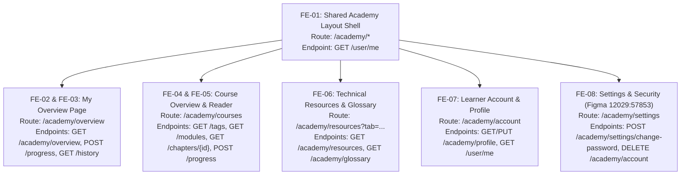

# Living Income Academy — Frontend Implementation & Estimation Breakdown 🎨

## 1. Executive Summary

This document establishes the comprehensive frontend implementation plan, route architecture, and task-by-task **Vibe Coding estimation** for the **Living Income Academy** web application in the **IDH Income Driver Calculator (IDC)** platform. 

The frontend architecture faithfully translates all 6 core Figma designs (including the **Settings & Security** screen) into modular, accessible, and responsive React components built on top of Ant Design, the existing IDC application shell, and a dedicated Academy layout.

### Velocity & Estimation Basis
- **Standard Velocity**: 1 Frontend Developer with **7.0 effective development hours per day**.
- **BMAD Vibe Coding Standard**: Each task explicitly separates effort into **Vibe Coding (Dev)** + **Automated Testing** + **QA & Design Review** + **1.0h Buffer**.
- **Task Cap**: All atomic tasks are scoped to **≤ 6.0 hours** to ensure focused, incremental PR delivery.
- **Backend Readiness**: All corresponding backend REST APIs (`/academy/overview`, `/academy/modules`, `/academy/tags`, `/academy/chapters/{id}`, `/academy/history`, `/academy/resources`, `/academy/glossary`, `/academy/profile`, and `/user/me`) are **100% implemented, tested (210/210 passed), and ready for frontend consumption**.

---

## 2. Master Route & Endpoint Quick Reference

The table below provides a complete cross-reference between the browser routes, design screens, and the underlying FastAPI backend endpoints:

| # | Screen / Figma Design | Frontend Route (Browser URL) | Backend API Endpoints Used | HTTP Method | Data / Operation |
|---|---|---|---|:---:|---|
| **1** | **Shared Layout Shell** | `/academy/*` | `/user/me` | `GET` | User identity & hydrated `user_profile` |
| **2** | **My Overview** | `/academy/overview` | `/academy/overview`<br>`/academy/chapters/{id}/progress`<br>`/academy/history` | `GET`<br>`POST`<br>`GET` | KPI metrics, greeting, 6 roadmap modules<br>Inline completion checkbox toggle<br>Paginated reading history modal |
| **3** | **Course Overview** | `/academy/courses` | `/academy/tags`<br>`/academy/modules`<br>`/academy/chapters/{id}`<br>`/academy/chapters/{id}/progress` | `GET`<br>`GET`<br>`GET`<br>`POST` | 10 topic tag badges & counts<br>6 modules with nested chapters & filters<br>Full chapter content & prev/next pointers<br>Inline chapter completion toggle |
| **4** | **Technical Resources & Glossary** | `/academy/resources`<br>`?tab=resources`<br>`?tab=glossary` | `/academy/resources`<br>`/academy/glossary` | `GET`<br>`GET` | Downloadable guidance files, templates & tools<br>Standardized terminology definitions |
| **5** | **User Account & Profile** | `/academy/account` | `/academy/profile`<br>`/academy/profile`<br>`/user/me` | `GET`<br>`PUT`<br>`GET` | Fetch learner profile & commodities<br>Update demographics, org, commodities & bio<br>Refresh global user state & header avatar |
| **6** | **Settings & Security**<br>*(Figma `12029:57853`)* | `/academy/settings` | `/academy/settings/change-password`<br>`/academy/account`<br>`/user/me` | `POST`<br>`DELETE`<br>`GET` | Update learner password (verifies current)<br>Delete learner account with FK case-ownership check<br>Refresh session state |

---

## 3. Master Estimation Matrix by Design Screen

| Screen / Figma Design | Task IDs | Frontend Route | Vibe Coding (Dev) | Automated Testing | QA & Design Review | Buffer | Total Est. | Dev Days (7h/d) | Priority |
| :--- | :---: | :--- | :---: | :---: | :---: | :---: | :---: | :---: | :--- |
| **1. Shared Academy Shell & Layout** | `FE-01` | `/academy/*` | 3.0h | 1.0h | 0.5h | 1.0h | **5.5h** | **0.79d** | Must Have |
| **2. My Overview Page** | `FE-02`, `FE-03` | `/academy/overview` | 5.5h | 2.0h | 1.0h | 2.0h | **10.5h** | **1.50d** | Must Have |
| **3. Course Overview Page** | `FE-04`, `FE-05` | `/academy/courses` | 5.5h | 2.5h | 1.0h | 2.0h | **11.0h** | **1.57d** | Must Have |
| **4. Technical Resources & Glossary** | `FE-06` | `/academy/resources` | 3.0h | 1.5h | 0.5h | 1.0h | **6.0h** | **0.86d** | Must Have |
| **5. Learner Account & Profile** | `FE-07` | `/academy/account` | 3.0h | 1.5h | 0.5h | 1.0h | **6.0h** | **0.86d** | Must Have |
| **6. Settings & Security** *(New)* | `FE-08` | `/academy/settings` | 2.5h | 1.0h | 0.5h | 1.0h | **5.0h** | **0.71d** | Must Have |
| **TOTAL FRONTEND WORKSTREAM** | **8 Tasks** | — | **22.5h** | **9.5h** | **4.0h** | **8.0h** | **44.0h** | **~6.29 days** | — |

---

## 4. Detailed Screen Breakdown & Endpoint Specifications



---

### Screen 1: Shared Academy Shell, Navigation & Layout (`FE-01`)
*The universal frame housing the Academy experience across all sub-pages.*

#### Routing & URLs
- **Frontend Route (Browser URL)**: `/academy/*` (Layout wrapper for all authenticated academy pages)
- **Navigation Links**:
  - `My overview` $\rightarrow$ `/academy/overview`
  - `Course Overview` $\rightarrow$ `/academy/courses`
  - `Academy resources` $\rightarrow$ `/academy/resources`
  - `Account` $\rightarrow$ `/academy/account`
  - `Settings` $\rightarrow$ `/academy/settings`

#### Backend API Endpoints Used
1. `GET /user/me`:
   - **Headers**: `Authorization: Bearer <token>`
   - **Data Returned**: Current authenticated user details (`id`, `email`, `fullname`, `role`) and hydrated `user_profile` (`first_name`, `last_name`, `company_name`, `commodities`, etc.).
   - **Usage**: Renders user initials in top header avatar and populates global `UserState`.

#### Touchpoint Files & Component Structure
- `[CREATE]` `frontend/src/pages/academy/components/AcademyLayout.js`
- `[CREATE]` `frontend/src/pages/academy/components/AcademySidebar.js`
- `[CREATE]` `frontend/src/pages/academy/components/AcademyFooter.js`
- `[CREATE]` `frontend/src/pages/academy/components/ChatbotFloatButton.js`
- `[CREATE]` `frontend/src/services/academy.js`
- `[MODIFY]` `frontend/src/components/route/paths.js`
- `[MODIFY]` `frontend/src/App.js`
- `[TEST]` `frontend/src/pages/academy/components/__tests__/AcademyLayout.test.js`

#### Estimation Breakdown
- **Vibe Coding (Dev)**: 3.0h | **Testing**: 1.0h | **QA/Review**: 0.5h | **Buffer**: 1.0h $\rightarrow$ **Total: 5.5h (0.79 days)**

---

### Screen 2: "My Overview" Learner Dashboard (`FE-02` + `FE-03`)
*The personalized learner landing view showing real-time KPIs, roadmap modules, and recent reading history.*

#### Routing & URLs
- **Frontend Route (Browser URL)**: `/academy/overview`

#### Backend API Endpoints Used
1. `GET /academy/overview`:
   - **Headers**: `Authorization: Bearer <token>`
   - **Data Returned**:
     - `greeting_name`: String (e.g. `"Wayan Galih"`)
     - `continue_chapter_id`: Integer (ID of next recommended chapter, e.g. `1`)
     - `metrics`: `{ academy_progress_pct, modules_completed, total_modules (6), chapters_completed, total_chapters (27) }`
     - `modules`: Array of 6 roadmap module cards with `progress_pct`, `status`, `estimated_minutes`, and topic `tags`
     - `recently_opened`: Array of top 3 recently accessed chapters with `last_opened_at`
2. `POST /academy/chapters/{chapter_id}/progress`:
   - **Payload**: `{"status": "completed"}` (or `"not_started"`, `"in_progress"`)
   - **Usage**: Inline completion checkbox toggle on recently opened cards; triggers optimistic UI update and recomputes overview KPIs.
3. `GET /academy/history?page=1&page_size=10`:
   - **Query Params**: `page` (int, default 1), `page_size` (int, default 10)
   - **Data Returned**: Paginated list of all chapters opened by the learner with completion dates.
   - **Usage**: Opens when learner clicks `"View history"` action button.

#### Touchpoint Files & Component Structure
- `[CREATE]` `frontend/src/pages/academy/AcademyOverviewPage.js`
- `[CREATE]` `frontend/src/pages/academy/components/ProgressMetricCard.js`
- `[CREATE]` `frontend/src/pages/academy/components/RoadmapModuleCard.js`
- `[CREATE]` `frontend/src/pages/academy/components/RecentlyOpenedChapterCard.js`
- `[CREATE]` `frontend/src/pages/academy/components/ChapterHistoryModal.js`
- `[CREATE]` `frontend/src/pages/academy/components/RoadmapCtaBanner.js`
- `[TEST]` `frontend/src/pages/academy/__tests__/AcademyOverviewPage.test.js`

#### Estimation Breakdown
- **Task `FE-02` (Greeting, KPI Rings & Roadmap Grid)**: Dev: 3.0h | Testing: 1.0h | QA: 0.5h | Buffer: 1.0h $\rightarrow$ **5.5h (0.79d)**
- **Task `FE-03` (Recently Opened, History Modal & CTA Banner)**: Dev: 2.5h | Testing: 1.0h | QA: 0.5h | Buffer: 1.0h $\rightarrow$ **5.0h (0.71d)**
- **Total Screen Effort**: **10.5h (1.50 days)**

---

### Screen 3: "Course Overview" Curriculum & Reader (`FE-04` + `FE-05`)
*The comprehensive curriculum directory with search, topic filtering, module accordions, and rich chapter reader.*

#### Routing & URLs
- **Frontend Route (Browser URL)**: `/academy/courses`
- **Filtered State**: `/academy/courses?tag=due-diligence&search=measurement`
- **Active Reader State**: `/academy/courses?chapter=5` (or nested `/academy/courses/chapter/5`)

#### Backend API Endpoints Used
1. `GET /academy/tags`:
   - **Headers**: `Authorization: Bearer <token>`
   - **Data Returned**: Array of all 10 topic tags with `name`, `slug`, `module_count`, and `chapter_count`.
   - **Usage**: Renders the horizontal tag filter chips (`All`, `#Income measurement`, `#Income gap`, `#Benchmark`, etc.).
2. `GET /academy/modules?search={keyword}&tag={slug}&tag_id={id}`:
   - **Query Params**:
     - `search`: String (optional, e.g. `?search=cacao`)
     - `tag`: String (optional tag slug, e.g. `?tag=procurement`)
     - `tag_id`: Integer (optional tag ID)
   - **Data Returned**: All 6 curriculum modules with nested `chapters` array (`id`, `chapter_number`, `title`, `estimated_minutes`, `status`, `tags`).
   - **Usage**: Renders the collapsible 6-module accordion with dynamic search and tag filtering.
3. `GET /academy/chapters/{chapter_id}`:
   - **Headers**: `Authorization: Bearer <token>`
   - **Data Returned**: Full chapter details, sanitized HTML content (`content_html`), parent module metadata, `prev_chapter_id`, and `next_chapter_id`.
   - **Usage**: Opens the reader drawer/modal when a chapter is clicked; automatically updates `last_opened_at`.
4. `POST /academy/chapters/{chapter_id}/progress`:
   - **Payload**: `{"status": "completed"}`
   - **Usage**: Inline completion checkbox toggle directly on accordion chapter rows.

#### Touchpoint Files & Component Structure
- `[CREATE]` `frontend/src/pages/academy/CourseOverviewPage.js`
- `[CREATE]` `frontend/src/pages/academy/components/TagFilterChips.js`
- `[CREATE]` `frontend/src/pages/academy/components/CourseSummaryCard.js`
- `[CREATE]` `frontend/src/pages/academy/components/ModuleAccordion.js`
- `[CREATE]` `frontend/src/pages/academy/components/ChapterRow.js`
- `[CREATE]` `frontend/src/pages/academy/components/ChapterReaderModal.js`
- `[TEST]` `frontend/src/pages/academy/__tests__/CourseOverviewPage.test.js`

#### Estimation Breakdown
- **Task `FE-04` (Header, Search, Tag Chips & HTML Summary)**: Dev: 2.5h | Testing: 1.0h | QA: 0.5h | Buffer: 1.0h $\rightarrow$ **5.0h (0.71d)**
- **Task `FE-05` (Module Accordions, Chapter Rows & Reader View)**: Dev: 3.0h | Testing: 1.5h | QA: 0.5h | Buffer: 1.0h $\rightarrow$ **6.0h (0.86d)**
- **Total Screen Effort**: **11.0h (1.57 days)**

---

### Screen 4: "Technical Resources & Glossary" (`FE-06`)
*The reference library offering downloadable guidance tools and living income terminology.*

#### Routing & URLs
- **Frontend Route (Browser URL)**:
  - Base: `/academy/resources` (defaults to Resources tab)
  - Resources Tab: `/academy/resources?tab=resources`
  - Glossary Tab: `/academy/resources?tab=glossary`

#### Backend API Endpoints Used
1. `GET /academy/resources?search={kw}&type={type}&sort_by={col}&sort_order={asc|desc}`:
   - **Query Params**:
     - `search`: Substring search on resource name and URL
     - `type`: Enum filter (`Guidance`, `Organisation`, `Template`, `Tool`)
     - `sort_by`: Column name (`name`, `type`, `created_at`)
     - `sort_order`: Direction (`asc`, `desc`)
   - **Data Returned**: Array of downloadable resources with `name`, `type`, `file_url`, and `created_at`.
   - **Usage**: Powers `ResourcesTable.js` with direct download action buttons.
2. `GET /academy/glossary?search={kw}&type={type}&sort_by={col}&sort_order={asc|desc}`:
   - **Query Params**:
     - `search`: Substring search on term name and definition
     - `type`: Enum filter (`Core`, `Finance`, `Additional`)
     - `sort_by`: Column name (`name`, `type`, `created_at`)
     - `sort_order`: Direction (`asc`, `desc`)
   - **Data Returned**: Array of standardized glossary terms with `name`, `type`, and rich `definition`.
   - **Usage**: Powers `GlossaryTable.js` with alphabetical sorting.

#### Touchpoint Files & Component Structure
- `[CREATE]` `frontend/src/pages/academy/AcademyResourcesPage.js`
- `[CREATE]` `frontend/src/pages/academy/components/ResourcesTable.js`
- `[CREATE]` `frontend/src/pages/academy/components/GlossaryTable.js`
- `[CREATE]` `frontend/src/pages/academy/components/TableToolbar.js`
- `[TEST]` `frontend/src/pages/academy/__tests__/AcademyResourcesPage.test.js`

#### Estimation Breakdown
- **Vibe Coding (Dev)**: 3.0h | **Testing**: 1.5h | **QA/Review**: 0.5h | **Buffer**: 1.0h $\rightarrow$ **Total: 6.0h (0.86 days)**

---

### Screen 5: "User Account & Profile" (`FE-07`)
*The learner profile management page for updating personal and organizational demographics.*

#### Routing & URLs
- **Frontend Route (Browser URL)**: `/academy/account`

#### Backend API Endpoints Used
1. `GET /academy/profile`:
   - **Headers**: `Authorization: Bearer <token>`
   - **Data Returned**: `first_name`, `last_name`, `company_name`, `company_type`, `sector`, `region_id`, `region_name`, and `commodities` array.
   - **Usage**: Populates the Account hero banner, Personal Info card, and Additional Info card upon page mount.
2. `PUT /academy/profile`:
   - **Headers**: `Authorization: Bearer <token>`
   - **Payload**:
     ```json
     {
       "first_name": "Wayan Galih",
       "last_name": "Pratama",
       "company_name": "Akvo",
       "company_type": "NGO / Tech Provider",
       "sector": "Agritech & Living Income",
       "region_name": "Southeast Asia / Indonesia",
       "commodities": ["Coffee", "Cocoa", "Tea", "Palm Oil"]
     }
     ```
   - **Side Effect**: Automatically synchronizes display name back to `user.fullname = f"{first_name} {last_name}".strip()`.
   - **Usage**: Saves profile updates and triggers instant feedback.
3. `GET /user/me`:
   - **Usage**: Re-fetches user session after profile update to update the top navigation avatar initials and global application state.

#### Touchpoint Files & Component Structure
- `[CREATE]` `frontend/src/pages/academy/AcademyAccountPage.js`
- `[CREATE]` `frontend/src/pages/academy/components/AccountHeroBanner.js`
- `[CREATE]` `frontend/src/pages/academy/components/PersonalInfoCard.js`
- `[CREATE]` `frontend/src/pages/academy/components/AdditionalInfoCard.js`
- `[CREATE]` `frontend/src/pages/academy/components/CommodityTagSelector.js`
- `[MODIFY]` `frontend/src/store/user.js`
- `[TEST]` `frontend/src/pages/academy/__tests__/AcademyAccountPage.test.js`

#### Estimation Breakdown
- **Vibe Coding (Dev)**: 3.0h | **Testing**: 1.5h | **QA/Review**: 0.5h | **Buffer**: 1.0h $\rightarrow$ **Total: 6.0h (0.86 days)**

---

### Screen 6: "Settings & Security" (`FE-08`) *(Figma Node `12029:57853`)*
*Learner account security settings for password modification and self-service account deletion.*

#### Routing & URLs
- **Frontend Route (Browser URL)**: `/academy/settings`

#### Scope & Figma Design Mapping (Node `12029:57853`)
- **Sign In and Security Form Card**:
  - `Current password` input with hint text (*"This is a hint text to help user."*).
  - Two-column password input row:
    - `New password`: Validated for minimum 12 characters (*"At least 12 characters"*).
    - `Confirm new password`: Real-time equality validation matching new password.
  - `Update` button: Submits password change request.
- **Delete Account Danger Card**:
  - Title: *"Delete account"*.
  - Warning explanation: *"Your progress, workbook entries and certificates will be removed permanently."*
  - `Delete` button: Triggers an Ant Design modal confirmation dialog (`Modal.confirm`) requiring explicit user confirmation before executing account deletion.

#### Backend API Endpoints Used
1. `POST /academy/settings/change-password`:
   - **Headers**: `Authorization: Bearer <token>`
   - **Payload**:
     ```json
     {
       "current_password": "CurrentPassword123!",
       "new_password": "NewSecurePassword456!"
     }
     ```
   - **Validation & Business Logic**:
     - Verifies `current_password` via bcrypt against `user.password`. If incorrect, returns `400 Bad Request` (`"Incorrect current password"`).
     - Hashes `new_password` with bcrypt (`get_password_hash`) and updates `user.password`.
   - **Response**: `200 OK`
     ```json
     {
       "message": "Password changed successfully"
     }
     ```
   - **Error Handling**: `400 Bad Request`, `401 Unauthorized`, `422 Unprocessable Entity`.
2. `DELETE /academy/account`:
   - **Headers**: `Authorization: Bearer <token>`
   - **Foreign Key Safety Checks**:
     - **Blocking FK Check**: Queries `Case` table for cases where `created_by == user.id`. If found, rejects with `409 Conflict` returning the list of blocking cases.
     - **Secondary FK Cleanup**: Reassigns `case.updated_by = case.created_by`, unlinks `Tag.created_by`, `Question.created_by`, and `ReferenceData.created_by`.
     - **Related Tables Deletion**: Deletes `UserCaseAccess` and `UserBusinessUnit`.
     - **Cascaded Academy Data**: Automatically cascades deletion of `user_profile` and `academy_user_chapter_progress`.
     - **User Removal**: Permanently deletes the `User` record.
   - **Response**: `204 No Content`.
   - **Error Handling**: `401 Unauthorized`, `409 Conflict` (when user owns existing cases).
3. `GET /user/me`:
   - **Usage**: Verify authenticated session and refresh header state.

#### Touchpoint Files & Component Structure
- `[CREATE]` `frontend/src/pages/academy/AcademySettingsPage.js`
- `[CREATE]` `frontend/src/pages/academy/components/SignInSecurityCard.js`
- `[CREATE]` `frontend/src/pages/academy/components/DeleteAccountCard.js`
- `[MODIFY]` `frontend/src/components/route/paths.js`
- `[TEST]` `frontend/src/pages/academy/__tests__/AcademySettingsPage.test.js`

#### Estimation Breakdown
- **Vibe Coding (Dev)**: 2.5h
- **Automated Testing**: 1.0h
- **QA & Design Review**: 0.5h
- **Buffer**: 1.0h
- **Total Task Time**: **5.0h (0.71 days)**

---

## 5. Security & Quality Gate Standards

1. **XSS Protection (`[SEC]`)**: All rich HTML content (`content_html` from `/academy/chapters/{id}` and course summaries) MUST be sanitized using `DOMPurify.sanitize()` prior to rendering.
2. **Password Validation**: Frontend enforces the 12-character minimum length constraint and password confirmation matching before sending payloads over the wire.
3. **Destructive Action Safety**: Account deletion requires a two-step confirmation modal with clear permanent loss disclosure.
4. **Optimistic UI with Rollback**: Status checkboxes update local state immediately for instant feedback, but roll back gracefully with a notification if the API call fails.
5. **URL State Synchronization**: Active tabs (`?tab=...`), tag filters (`?tag=...`), and search queries (`?search=...`) remain in sync with the URL for shareable links and back-button navigation.
6. **Automated Testing Gate**: Minimum **≥80% unit test coverage** enforced via Jest and React Testing Library (`yarn test:ci`).
7. **Code Quality**: Zero ESLint errors (`yarn lint`) and consistent formatting (`yarn prettier-write`).
