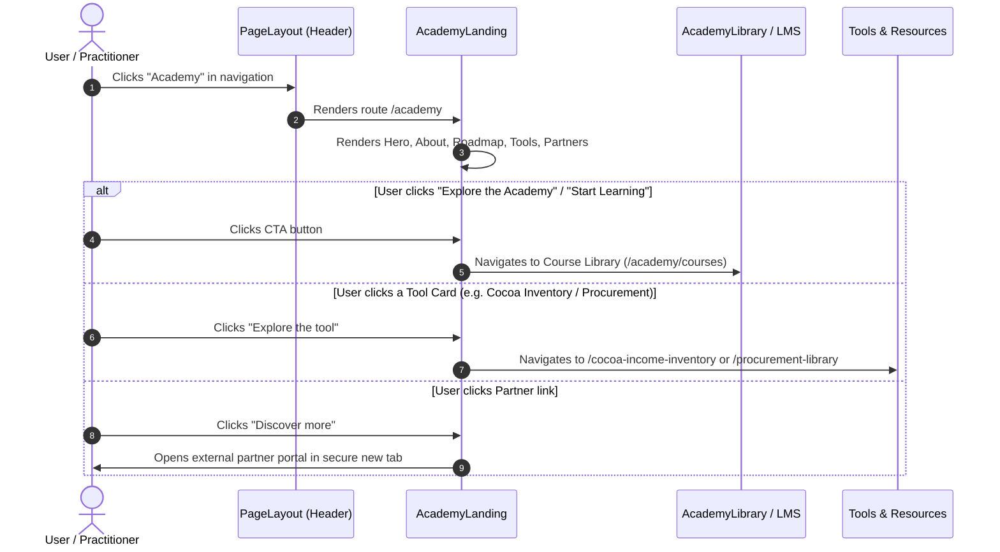

# Feature Specification: Living Income Academy Landing Page [LIACD-001]

**Issue**: `[LIACD-001]`  
**Feature Name**: Living Income Academy Landing Page  
**Branch**: `feature/liacd-001-academy-landing-page`  
**Figma Node**: `11856:29958` (Living Income Academy main page)  
**Status**: Planning / Spec Review  

---

## 1. Executive Summary & 5W1H Discovery

- **Who (Primary Persona)**: Supply chain sustainability managers, corporate procurement officers, agricultural program developers, and industry practitioners seeking structured methodologies to close farmer income gaps.
- **What**: A bespoke, domain-authentic landing page for the Living Income Academy within IDH-IDC. It introduces the Academy curriculum, guides learners through the 5-stage Roadmap on Living Income, provides direct entry points into interactive course modules, showcases sibling tools (Income Measurement Guidance Tool, Cocoa Income Inventory, Procurement Library), and presents accredited institutional partners.
- **Where**:
  - Frontend Route: `/academy` (`routePath.academy.landing`, matching `/procurement-library` and `/cocoa-income-inventory`)
  - Dedicated Directory Structure: `frontend/src/pages/academy/` as a dedicated top-level page directory alongside `frontend/src/pages/procurement-library/` and `frontend/src/pages/cocoa-income-inventory/`
  - Component Architecture:
    - Entry & Container: `frontend/src/pages/academy/AcademyLanding.js`
    - Stylesheet: `frontend/src/pages/academy/AcademyLanding.scss`
    - Modular Sections: `frontend/src/pages/academy/components/` (`AcademyHero.js`, `AcademyAbout.js`, `AcademyRoadmap.js`, `AcademyCta.js`, `AcademyToolsResources.js`, `AcademyPartners.js`)
    - Export Barrel: `frontend/src/pages/academy/index.js`
  - Navigation: Top header menu in `frontend/src/components/layout/PageLayout.js` (`key: "/academy"`, matching `/procurement-library` and `/cocoa-income-inventory`)
  - Legal & Attribution: `frontend/src/pages/income-driver-calculator/components/FooterDisclaimer.js` (extending with `disclaimerText="academy"`)
- **When**: Delivered under sprint initiative `LIACD-001` as the primary public entry point for the Living Income Academy.
- **Why**: Existing IDH tools (IDC, Cocoa Inventory, Procurement Library) previously lacked a cohesive educational narrative linking high-level living income strategies with practical operational tooling.
- **How**: Delivered as a responsive, accessible React interface styled with SCSS, reusing established Ant Design primitives (`antd`), honoring pre-existing Academy LMS components (`AcademyLibrary`, `CoursePlayer`, `AcademyService`), and strictly applying Anti-AI-Slop design craftsmanship.

---

## 2. Design System & Anti-AI-Slop Architecture (`/frontend-design`)

### Visual Archetype: Warm Editorial & Authentic Enterprise (IDH Domain Aesthetic)
- **Primary Brand Color**: IDH Forest Teal `#01625F` / Deep Emerald `#005953`
- **Surface Neutrals**:
  - Warm Canvas / Linen: `#FCF9F4` (About Section background)
  - Cool Mist / Sage Well: `#EAF2F2` (CTA banner & Partner card backgrounds)
  - Pure White: `#FFFFFF` (Tools & Resources, Cards)
- **High-Contrast Accents**:
  - Electric Amber / Warm Gold: `#FFC505` (Hero primary CTA pill, text `#00625F`)
  - Deep Charcoal: `#1A1A1A` / `#474747` (Body copy)
- **Typography Pairing**:
  - Headings: `Roc Grotesk Bold` / `Tablet Gothic Bold` (40px H1, 32px H2, 24px H3)
  - Body Text: `Actor Regular` / `Inter` (18px lead, 16px standard, 14px compact, 1.571 line-height)
- **Tactile Ergonomics**:
  - Physical button feedback: `active:scale-[0.98]` with 120ms cubic-bezier transition
  - Accessible focus rings: `focus-visible:ring-2`
  - High contrast ratio ≥ 4.5:1 for body copy across all background surfaces (WCAG 2.1 AA)

---

## 3. Component Architecture & Structural Layout

### Layout Hierarchy

```
PageLayout (Sticky Header with Academy Navigation)
  └── AcademyLanding Container
        ├── 1. AcademyHero
        │      ├── Hero Background with authentic agricultural imagery & subtle radial mask
        │      ├── Roc Grotesk Headline: "Expertise What Drives Living Income Impact"
        │      ├── Sub-headline narrative & value proposition
        │      └── Yellow CTA Button: "Explore the Academy" (scrolls or navigates to library)
        │
        ├── 2. AcademyAbout ("What is the Living Income Academy")
        │      ├── Section Title & Descriptive Lead (#FCF9F4 background)
        │      ├── 4-Step Structured Progression (Left Column):
        │      │     1. Foundations of Living Income
        │      │     2. Materiality and Prioritization
        │      │     3. Measuring Income Gaps
        │      │     4. Designing Living Income Programs
        │      └── Authentic Field Photography Card (Right Column)
        │
        ├── 3. AcademyRoadmap ("Roadmap on Living Income")
        │      ├── Deep Teal Structural Canvas (#005953 / #01625F)
        │      ├── Concentric Radar Graphic (SVG Vector)
        │      └── 5 Interactive Roadmap Nodes with Illustrations & Callouts:
        │            • Node 1: Laying the Groundwork (Step 1)
        │            • Node 2: Measuring + Analysis (Step 2)
        │            • Node 3: Building the Business Case (Step 3)
        │            • Node 4: Implementing Solutions (Step 4)
        │            • Node 5: Reporting + Sharing Insights (Step 5)
        │
        ├── 4. AcademyCta ("Ready to accelerate your Living Income journey?")
        │      ├── Mint / Sage Container (#EAF2F2) with subtle organic accent lines
        │      ├── High-contrast heading & motivating copy
        │      └── Outline Primary Pill Button: "Start Learning"
        │
        ├── 5. AcademyToolsResources ("Tools and resources")
        │      ├── Header with "Explore all Resources" Action
        │      └── 3 Tool Discovery Cards:
        │            1. Income Measurement Guidance Tool (Badge: Tool, Action: Download)
        │            2. Cocoa Income Inventory (Badge: Tool, Action: Explore the tool)
        │            3. Procurement Library (Badge: Tool, Action: Explore the tool)
        │
        ├── 6. AcademyPartners ("Collaboration partners")
        │      ├── Contextual intro on institutional coalition (IDH, Sustainable Food Lab, LICOP, Akvo, RVO)
        │      └── 4 Accredited Partner Cards:
        │            • IDH (with logo + mission overview + "Discover more")
        │            • Sustainable Food Lab (with logo + mission overview + "Discover more")
        │            • The Living Income Community of Practice - LICOP (with logo + "Discover more")
        │            • Netherlands Enterprise Agency - RVO (with logo + "Discover more")
        │
        └── 7. FooterDisclaimer
               └── Customized for Living Income Academy (disclaimerText="academy")
```

---

## 4. Logic Flow & Mermaid Diagrams



---

## 5. Respecting Pre-Existing Components & System Contracts

1. **Header & Navigation (`PageLayout.js`)**:
   - Reuses `PageHeader` in `frontend/src/components/layout/PageLayout.js`.
   - Adds `{ testid: "nav-menu-academy", label: "Academy", key: "/academy", isPublic: true, role: [] }` to `menuItems` (matching the exact pattern of `/procurement-library` and `/cocoa-income-inventory`).
   - Supports both mobile Drawer and sticky desktop navigation.

2. **Footer & Legal Disclaimer (`FooterDisclaimer.js`)**:
   - Reuses `frontend/src/pages/income-driver-calculator/components/FooterDisclaimer.js`.
   - Extends with `academyDisclaimerText` containing exact legal and disclaimer wording from Figma.
   - Retains `DataSecurityProvisionModal` callback and Akvo development attribution footer.

3. **Academy LMS Interoperability (`AcademyLibrary.js` & `CoursePlayer.js`)**:
   - Maintains routing compatibility with the LMS architecture developed in `origin/feature/759-poc-idc-lms`.
   - Landing page acts as public orientation layer, smoothly linking to course library cards.

4. **Sibling Tools Linking**:
   - Links directly to internal routes: `/cocoa-income-inventory`, `/procurement-library`, and `/tools-and-resources`.

---

## 6. Technical Audit & Reconnaissance (`/1-research`)

### Stack & Dependencies Parity
- **React**: `18.2.0` — standard functional components with hooks (`useState`, `useMemo`, `useCallback`).
- **React Router DOM**: `6.15.0` — route path `/academy` declared as top-level route in `frontend/src/App.js` alongside `/procurement-library` and `/cocoa-income-inventory`.
- **UI Component Library**: `antd` `^5.9.3` — `Row`, `Col`, `Button`, `Card`, `Typography`, `Tag`, `Drawer`, `Menu`, `Tooltip`.
- **CSS Preprocessor**: `node-sass` `^7.0.1` — SCSS styling following IDC BEM-like conventions.
- **Window Dimensions Hook**: `useWindowDimensions()` from `frontend/src/hooks` providing `isMobile` flag (breakpoint: `1024px`) and `windowInnerWidth`.

### Existing Asset Reuse
- **Tools & Resources Imagery**:
  - `Income Measurement Guidance`: Reuses `frontend/src/assets/images/home/income-measurement-img.png`.
  - `Procurement Library`: Reuses `frontend/src/assets/images/home/procurement-lib-img.png`.
  - `Cocoa Income Inventory`: Reuses `frontend/src/assets/images/home/cii-img.png`.
- **Roadmap Diagram Asset**:
  - `frontend/src/assets/images/living-income-roadmap.png` already exists and is validated in `LivingIncomeSteps.js`.

### Touchpoint Files & Blast Radius
- `[CREATE]` `frontend/src/pages/academy/index.js` — export barrel.
- `[CREATE]` `frontend/src/pages/academy/AcademyLanding.js` — main page container.
- `[CREATE]` `frontend/src/pages/academy/AcademyLanding.scss` — page styles.
- `[CREATE]` `frontend/src/pages/academy/components/AcademyHero.js` — hero section.
- `[CREATE]` `frontend/src/pages/academy/components/AcademyAbout.js` — 4-step progression & about section.
- `[CREATE]` `frontend/src/pages/academy/components/AcademyRoadmap.js` — roadmap on living income.
- `[CREATE]` `frontend/src/pages/academy/components/AcademyCta.js` — CTA banner section.
- `[CREATE]` `frontend/src/pages/academy/components/AcademyToolsResources.js` — tools & resources section.
- `[CREATE]` `frontend/src/pages/academy/components/AcademyPartners.js` — collaboration partners section.
- `[CREATE]` `frontend/src/pages/academy/__tests__/AcademyLanding.test.js` — unit test suite.
- `[CREATE]` `frontend/src/assets/images/academy/` — dedicated assets for academy landing.
- `[MODIFY]` `frontend/src/components/route/paths.js` — declare `routePath.academy.landing = "/academy"`.
- `[MODIFY]` `frontend/src/App.js` — mount `<Route exact path="/academy" element={<AcademyLanding />} />`.
- `[MODIFY]` `frontend/src/components/layout/PageLayout.js` — add Academy menu item `{ testid: "nav-menu-academy", label: "Academy", key: "/academy", isPublic: true, role: [] }`.
- `[MODIFY]` `frontend/src/pages/income-driver-calculator/components/FooterDisclaimer.js` — add `academyDisclaimerText` case.

---

## 7. Verification & Quality Gates

- **Unit Testing**:
  - `frontend/src/pages/academy/__tests__/AcademyLanding.test.js`:
    - Renders all 6 core sections (Hero, About, Roadmap, CTA banner, Tools, Partners).
    - Verifies navigation CTA buttons click to expected targets.
    - Tests responsive layout collapse and accessibility attributes.
- **Automated Verification Commands**:
  - `./dc.sh exec frontend yarn lint` (Must pass with 0 errors, 0 warnings)
  - `./dc.sh exec frontend yarn test:ci` (All test suites must pass, ≥80% coverage)
  - `./dc.sh exec frontend yarn prettier-write`

---

## 7. ⏱️ Vibe Coding Estimation Standard

| Task ID | Story / Task Description | 💻 Vibe Coding (Dev) | 🧪 Automated Testing | 🔍 QA & Review | Total Est. Time |
| :--- | :--- | :---: | :---: | :---: | :---: |
| **LIACD-001-A** | **Routing, Navigation & Disclaimer Wiring**: Register route in `paths.js`, `App.js`, update `PageLayout.js` nav menu, and add `academy` disclaimer to `FooterDisclaimer.js`. | 25m | 15m | 10m | **50m (0.8h)** |
| **LIACD-001-B** | **Hero & About Sections**: Implement `AcademyHero.js` (Roc Grotesk heading, amber pill CTA) and `AcademyAbout.js` (4-step progression + photo card). | 35m | 20m | 15m | **70m (1.2h)** |
| **LIACD-001-C** | **Roadmap & CTA Banner Sections**: Implement `AcademyRoadmap.js` (5 roadmap radar steps + vector diagrams) and `AcademyCta.js` (sage well + Start Learning button). | 40m | 25m | 15m | **80m (1.3h)** |
| **LIACD-001-D** | **Tools, Resources & Partner Cards**: Implement `AcademyToolsResources.js` (3 tool cards + badges) and `AcademyPartners.js` (4 accredited partner cards). | 30m | 20m | 15m | **65m (1.1h)** |
| **LIACD-001-E** | **Automated Testing, A11y & Quality Gate**: Full Jest unit test suite in `AcademyLanding.test.js`, responsive layout testing, ESLint audit, and code review check. | 20m | 30m | 15m | **65m (1.1h)** |
| **TOTAL** | **Complete Feature Implementation** | **150m (2.5h)** | **110m (1.8h)** | **70m (1.2h)** | **330m (5.5h)** |
